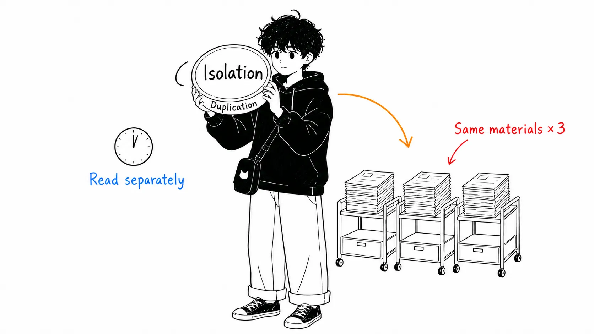
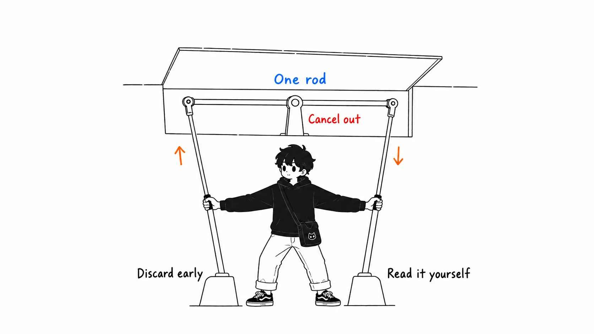
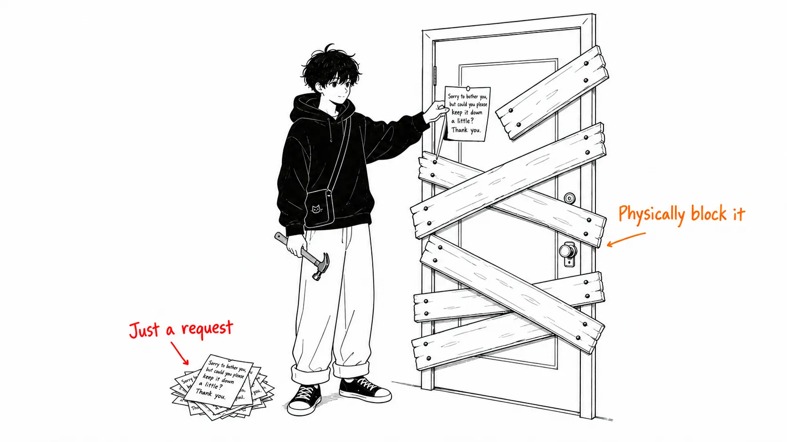

Here's the conclusion up front.

> A subagent's "context isolation" and "duplicate loading" aren't implementation flaws. They're two sides of the same coin. Buy isolation and you buy duplication. In the measurements, **54.7% of the data that 47 subagent runs read from large files was pure duplication**. On top of that, the median gap between duplicate reads was **35 minutes**. Had the parent agent done the reading itself, most of that would still have been sitting in its own context.

## About This Article

I read the second post in Maurice Heumann's (momo5502) experiment, in which he has a fleet of AI agents decompile Call of Duty: Modern Warfare 2 (2009) around the clock.

- Part 1: [200 Billion Tokens Later: A Month of Letting AI Agents Decompile MW2](https://momo5502.com/posts/2026-08-17-mw2-decompilation/) (August 17, 2026)
- Part 2: [235 Billion Tokens Later: Auditing What The AI Agents Really Did](https://momo5502.com/posts/2026-08-22-mw2-decompilation-audit/) (August 22, 2026)

Part 1 is a report on scale. Four weeks nonstop, 199.8B tokens, about 7,000 commits, and 5,588 of 16,324 functions (about 34%) decompiled. In what he himself calls "pretty much a cry for help," he lines up his gripes: the agents want to run tests locally, they dodge the big problems and pick off only the small ones, they decide on their own that "there isn't enough context," and so on.

Part 2 **audits how that setup actually behaved, using about 2GB of session logs**. I think this one is worth more. Part 1 is how it felt to use; Part 2 is measurement.

Let me be upfront. I don't have 2GB of logs and I haven't reproduced the audit. Every number is quoted from the original. One more thing: some of the original's numbers (the breakdown of 1107.6 agent-hours, the bugs/hour in the overseer model comparison) **exist only in the charts and never made it into the body text**, so in this article I'll just say "see the original's figure" where I have to touch on them. Filling in numbers by guesswork does more harm.

## First, the Scale

It runs on a subscription, so the actual payment is about €200. Converted to pay-as-you-go API pricing for the same usage, it's **$85,207**.

| | Worker | Overseer |
| --- | --- | --- |
| Pay-as-you-go equivalent | $70,275 | $14,933 |
| Tool calls | 198,143 | 38,173 |
| Assistant turns | 364,786 | 81,705 |

Cache reads are about 89%. Naturally, since it runs for 24 hours straight.

Here are the context numbers.

| | |
| --- | --- |
| Total compactions | 269 |
| Context size before compaction (median) | 933,088 tokens |
| Turns between compactions (median) | 1,346 |
| Time between compactions (median) | 3.3 hours |

It compacts only after using 93 to 100% of the 1M window. In other words, **nearly every turn was paying for a cache read of close to 1M tokens**. Seeing this, the author lowered the compaction threshold from 93% to 60%. His reasoning: functions already decompiled are mostly irrelevant to later turns, so discarding them early shouldn't change performance much.

## You Can't "Measure" Subagents, So He Measured Duplication

This is the main point. This section alone makes the original worth reading.

First, a premise. In this project **subagents can't do real work**. They can't safely rewrite the workspace in parallel, so each would need a dedicated workspace. So a subagent's only role is to investigate and compress the results, that is, to keep the parent's context from being polluted.

And here the author stalls.

> Measuring the effect is hard. The fact that they can't do real decompilation work already cuts their usefulness in half. The remaining question is how efficient they are at investigation.
>
> That's hard to measure too. But what we can measure instead is how much redundant data got pulled in because they don't share context.
>
> (効果を測るのは難しい。実作業のデコンパイルができないという事実だけで、すでに有用性は半分になっている。残る問いは、調査においてどれだけ効率的か、だ。
>
> これもまた測るのが難しい。だが代わりに測れるのは、コンテキストを共有しないせいでどれだけ冗長なデータを取り込んだか、である。)

**"Efficiency can't be measured, so measure duplication."** I think how he takes this step is the most honest part of the article. For 47 subagent runs, he cross-checked every file read of 5kB or more, and the results:

- **36%** of large files were read by multiple subagents
- Weighted by volume read, **54.7% was pure duplication**
- The worst case was `STATUS.md`: **read 28 times in total by 21 subagents** (before migrating to GitHub issues)
- The **median gap between duplicate reads was 35 minutes**

That last line is the real discovery. The author says so too.

> What matters is that the median time until a file is redundantly read by another subagent is 35 minutes. If the parent agent had done that investigation itself, the file would have stayed in its own context, and most of the redundant reads wouldn't have happened.
>
> (重要なのは、あるファイルが別のサブエージェントに重複して読まれるまでの中位時間が35分だということだ。もし親エージェントが自分でその調査をしていたら、そのファイルは自分のコンテキストに残っていて、冗長な読み込みの大半は起きなかった。)

And he cut them. Productivity after cutting:

| | Commits per day |
| --- | --- |
| With subagents | 243.9 |
| Without subagents | 311.1 |

About 28% more. But the author himself notes that "using commit count as a productivity metric isn't necessarily accurate," and he closes his conclusion like this.

> Whether subagents are useful, in this project or in general, is still hard for me to quantify. But I do have a feeling that (when lots of agents are launched in parallel) they can push token consumption up out of control, and that's reason enough to disable them.
>
> (サブエージェントが有用かどうか、この項目の外側でも一般に、定量化するのは私にはまだ難しい。ただ、（大量のエージェントが並列で起動された場合に）制御不能にトークン消費を押し上げうるという感覚はあって、無効化する理由としてはそれで十分だ。)

In other words, the original's claim isn't "subagents are inefficient." It's **"I couldn't measure efficiency. What I could measure was unpredictability, and that became the reason to cut them."** Summarize this as "54.7% duplication, so they're wasteful," and you've made a stronger claim than the original.

## My Take

From here on is my reading, which isn't in the original.

### 1. 35 Minutes Weighs More Than 54.7%

54.7% is merely the fact that "there was duplication." Whether duplication is bad depends on whether it was avoidable. What decides that is the 35 minutes.

The subagent's selling point was "doesn't pollute the parent's context." But not polluting means **the subagent doesn't know what the parent knows**. It's the same sentence. So the moment you buy isolation, you buy duplication. It's not sloppy implementation; it's the definition.

If so, the direction of "making subagents efficient" is, to a large extent, a poorly framed wish. Wanting to eliminate duplication while keeping isolation is close to wanting to share without sharing. I think the original's 35 minutes is the number that puts a price tag on that contradiction.

Conversely, **isolation is worth paying for only when the cost of pollution is greater than the cost of duplication**. That judgment changes from task to task, and in the author's project the constraint that subagents can't do real work was in play from the start. So it isn't a conclusion you can carry over to other projects as is.

### 2. The Author's Two Adjustments Probably Cancel Each Other Out

This is where I got snagged in the original. Within the same article, two adjustments sit side by side.

- Lower the compaction threshold from 93% to **60%** (discard context early)
- **Disable** subagents (do the investigation in the parent's context)

The rationale for dropping subagents was "if the parent read it itself, it would have stayed in context for 35 minutes." That rationale **assumes the parent's context lasts 35 minutes**.

But lowering compaction to 60% shortens the lifespan of the parent's context. By the original's numbers, it was using up to 93% and compacting every 3.3 hours at the median. If you cut at 60%, simple arithmetic says the interval should get considerably shorter. Whether it drops below 35 minutes can't be unrelated to how fast the context grows.

In other words, early compaction **could bring back, as the parent's own re-reads, the duplicate reads that dropping subagents was supposed to eliminate**. The original doesn't touch on this interaction. Each is reasonable alone, but combined their effects might eat into each other.

This is my inference, not a verified result. The author writes that he'll post results in the next post, so I expect the answer will come there. What I want to see is the **parent agent's re-read rate** after setting compaction to 60%. If it went up, then this article's "35 minutes" argument turns out to have been a function of the threshold.

### 3. "The Reviewer's Model Matters" Transfers More Easily

The original has one more result that's less flashy than the subagent story but more general.

A comparison where Opus 5 and Sonnet 5 each ran as workers, about half and half:

| Model | Build attempts | Failure rate | Commits/hour |
| --- | --- | --- | --- |
| Sonnet 5 | 5,826 | 9.1% | 6.1 |
| Opus 5 | 9,868 | 23.9% | 1.6 |

Opus breaks the build more. It breaks it, so it fixes it. It fixes it, so commits don't advance. But the author puts the brakes on himself: "That doesn't necessarily mean Sonnet is better. It may just be picking easier tasks."

So he also swapped the model of the overseer (a separate agent that reviews every commit) and counted "flagged bugs" for each worker x overseer combination. Per hour, the Opus worker has fewer bugs. But Opus makes fewer commits to begin with. So converted **per commit**, the error rates of the two come out about the same. The difference showed up on the overseer side, and the conclusion is this.

> What matters is the reviewer's model, not the worker's model.
>
> (効くのはレビュアーのモデルであって、ワーカーのモデルではない。)

(The numbers for this section are in the original's charts. They didn't make it into the body text, so see the original for the exact values.)

This is the opposite of our intuitive arrangement. Normally we have a good model write and a cheap model check. This result suggests the reverse.

Still, I think it's risky to take that one line home as is. The metric is "number of flagged bugs." The Sonnet overseer may have flagged more simply because it's a model that points out more. **Whether the flags were correct hasn't been measured.** There's another number for the overseer's overall accuracy: of 2,177 Discord replies mentioning commits, 1,172 couldn't be classified and 354 pointed out clear bugs. Among those that could be classified, that's about one third. Not bad, but not enough to establish that "more flags means a better reviewer."

Even so, I take this result seriously because **it gives a reason to doubt designs that skimp on the reviewer**. My own Claude Code setup leaned exactly toward "a light model is fine for review" (`~/.claude/rules/performance.md` says "If it only reads/searches, use haiku"). At the very least, treating review as cheap read-only work is worth reconsidering.

### 4. CLAUDE.md Is a Soft Instruction

The original's conclusion has this line.

> Soft instructions don't work very well. Mechanical blockers are more effective for enforcing rules.
>
> (ソフトな指示はあまり効かない。ルールを強制するには機械的なブロッカーのほうが効果的だ。)

This is the payoff of a setup from Part 1. In Part 1 the author **said repeatedly**, "don't run tests locally, we have CI," and the agents didn't listen. Part 2's fixes are these.

- **Disabled test execution on the code side** (only allowed when reproducing a CI failure or adding a new test)
- Moved warnings-as-errors in Release builds to a CMake option for Debug builds (30% less build time)
- To stop CI polling, switched to notifying failures via GitHub webhook
- To stop agents from checking whether an issue had closed, put `Fix #N` in commit messages so they auto-close

All of it is a shift from "telling them" to "making it the only thing they can do." Along the way, a figure appears that PowerShell's error rate is 17% (other tools are mostly under 2%), and the author writes that "banning PowerShell execution may be the logical consequence." Same idea.

Reading this, I went and looked at my own `CLAUDE.md`. It's all soft instruction. "Write tests first," "don't commit on your own," "token budget is 4000." All requests. Zero enforcement, and whether they're followed depends on the model's mood and how many compactions have intervened.

And Claude Code has proper enforcement mechanisms. Hooks (reject with PreToolUse), the deny list in settings.json, permission modes. **If there's a rule you want followed, the place to write it is settings.json, not CLAUDE.md.** That's where the author landed after four weeks of experimentation, and honestly I think it's the most practical line in these two articles.

## If You Take Away Just One Thing

It isn't about subagents.

**Write the rules you want followed in a place where a machine rejects violations.** A rule written in a place meant for requests vanishes by the tenth compaction.

If I add one thing about subagents: before deciding whether to cut them, try counting your own duplicate reads. It's all kept in `~/.claude/projects/**/*.jsonl`. The author read 2GB. With smaller logs, we can answer the same question.

## Sources

- Maurice Heumann, [235 Billion Tokens Later: Auditing What The AI Agents Really Did](https://momo5502.com/posts/2026-08-22-mw2-decompilation-audit/), momo5502.com, August 22, 2026
- Maurice Heumann, [200 Billion Tokens Later: A Month of Letting AI Agents Decompile MW2](https://momo5502.com/posts/2026-08-17-mw2-decompilation/), momo5502.com, August 17, 2026

All numbers in the article are quoted from the two posts above. I haven't reproduced the log audit myself. Some of the original's numbers (the breakdown of agent-hours, bugs/hour and bugs/commit in the overseer model comparison) exist only in the charts, so this article doesn't quote specific values. Item 2 of the "My Take" section is my inference, not a verified result.
