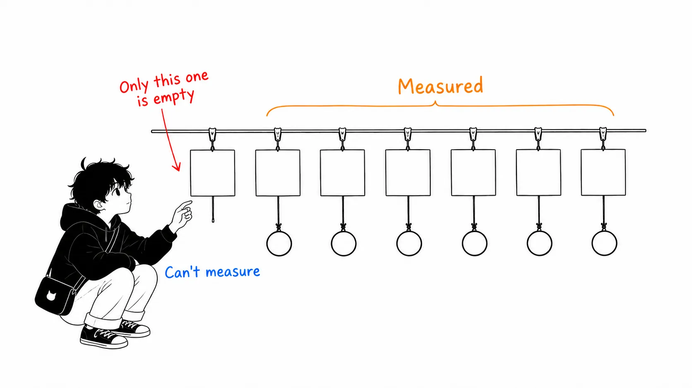
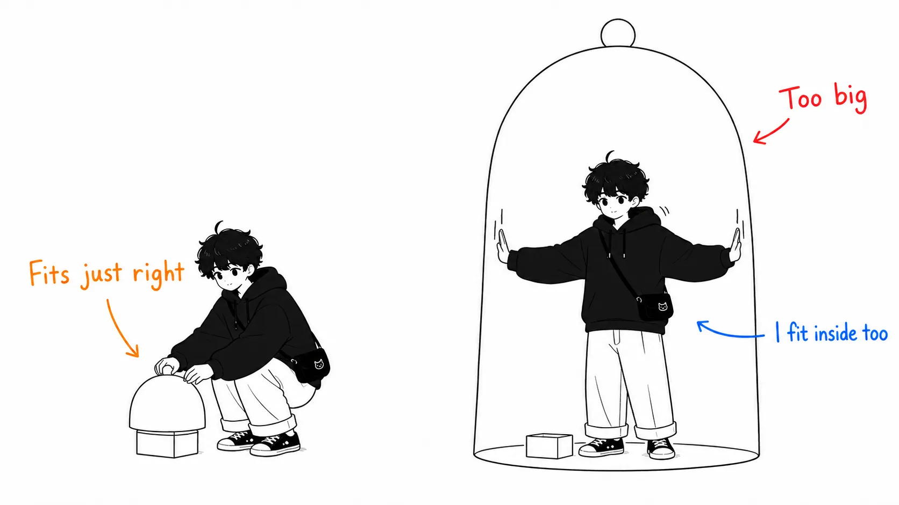
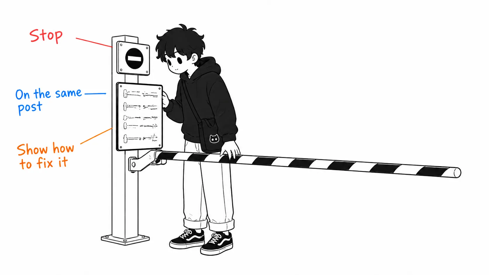
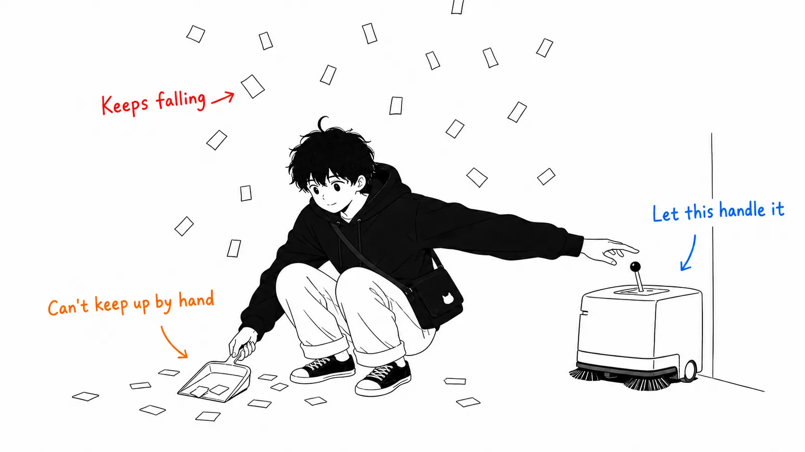

Here's the conclusion first.

> I read an explainer on "harness engineering," then went back to the primary sources it cited. **What the summary dropped wasn't an item. It was a constraint.** What OpenAI did was an experiment in which they **deliberately imposed** "zero lines of hand-written code," and the seven to-dos are conclusions that fell out of that constraint, worked backward. If you copy the items without the constraint, you probably can't tell the order or the priorities. And that constraint comes with conditions of its own: the original says, in its own words, "this would be irresponsible in a low-throughput environment."

## About this article

What got me started was an article that drifted across my X feed.

- The explainer: [Harness Engineering: How to Build AI Agents That Don't Fall Apart](https://x.com/i/article/2093441687989186560), by rari ([@0xwhrrari](https://x.com/0xwhrrari/status/2093685107534000560)), August 29, 2026
- Primary source 1: [Harness engineering: leveraging Codex in an agent-first world](https://openai.com/index/harness-engineering/), OpenAI, February 11, 2026
- Primary source 2 (cited by the explainer): Anthropic, Harness design for long-running application development

The explainer argues that agents break not because the model isn't smart enough but because of **the environment around it (that is, the harness)**, and it lists seven jobs a production harness has to do. I think it's a good breakdown. There's value in the fact that these things have names at all.

Two honest disclosures. **The body of the explainer contains a lot of image blocks, and I couldn't read them** (the checklist itself, the article's main selling point, is in the images). All I could read was the text blocks. Also, I haven't read the Anthropic primary source, so I'm treating it as a citation of a citation.

The OpenAI article, on the other hand, I read in the original. And once I did, the story changed.

## The seven things the explainer says

Just the skeleton first.

1. **Turn the request into a contract**: before acting, convert the request into a bounded object
2. **Hand over a map**: not all the docs, but a small root guide that tells the agent where to look
3. **Expose the right tools in the right environment**: purpose, predictable output, explicit failure states, permission boundaries
4. **Move memory out into persistent state**: the conversation is not the system of record
5. **Put sensors in before autonomy**: you can't fix what you can't observe
6. **Enforce permissions outside the model**: the model can propose, and the harness does the authorizing
7. **Record traces and recover locally**

And this is the claim of the whole piece.

> Prompt engineering tells the model what to do
> Context engineering decides what the model sees
> **Harness engineering builds the world the model acts in**

I have no objection. But it doesn't say which of the seven to do first. What decides that is the constraint in the primary source.

## What's in the primary source and missing from the summary

OpenAI's article opens with this declaration.

> For the past five months, our team has been running an experiment: build and ship an internal beta of a software product with **zero lines of hand-written code**.

And the next sentence determines the design of the whole article.

> **We chose this constraint deliberately.** It forces us to build what's needed to increase engineering velocity by orders of magnitude.

So "zero lines" isn't a brag about results. It's **a restriction they imposed on themselves.** Since they can't write by hand, there's no escape hatch where a human steps in and writes it when things get stuck. So every time, all they can do is ask this.

> When something failed, the fix was almost never "try harder." Because the only way forward was to get Codex to do the work, human engineers always stepped into the task and asked: "**what capability is missing, and how do we make it both legible and enforceable for the agent?**"

This order of events, where blocking the escape hatch left them no choice but to fix the environment, doesn't appear in the explainer's seven items. The seven are conclusions, not motivation.

Let me also write down the scale. Five months, about 1 million lines, about 1,500 PRs, 3.5 PRs per engineer per day, a team that grew from three to seven. They estimate it took about one-tenth of the time it would have taken by hand.

And **the conditions of applicability are stated explicitly.** This is the part that hit hardest.

> The repository runs with minimal merge-blocking gates. Pull requests are short-lived. Test flakes are often handled with follow-up runs rather than blocking indefinitely. In a system where agent throughput far exceeds human attention, **corrections are cheap and waiting is expensive.**
>
> **This would be irresponsible in a low-throughput environment.** Here, it is often the right tradeoff.

They state outright that their way of working only holds under certain conditions. A summary drops exactly this. Drop it and all that's left is "reduce your merge gates," which, depending on the conditions, is a perfectly ordinary way to cause an incident.

## Putting a price on the seven items

From here on it's my own work. For the past two weeks I happened to be reading articles on closely related topics back to back, so I lined up the explainer's seven items against "which primary source has measurements for each."

| Explainer's item | Matching primary source, and what's in it |
| --- | --- |
| 1. Make it a contract | **Not found** (more below) |
| 2. Hand over a map | OpenAI: `AGENTS.md` is a map of **about 100 lines**. Details live in a structured `docs/`, which is the source of truth / Uber: an AI context graph (24 million nodes, 80 million edges). A question the grounded agent answered in 38 seconds took 20 minutes without grounding, and was answered wrongly |
| 3. Right tools in the right environment | Uber: with 100 tools, a schema of **50,000 to 70,000 tokens** was resent every turn → removed from context via CLI resolution and tool search, and code-mode cut it by 50 to 90% |
| 4. Memory as persistent state | OpenAI: make repository knowledge the system of record / Warp: update skill files via PRs / momo5502: `STATUS.md` ballooned past 10MB and overflowed the context, so it moved to GitHub issues |
| 5. Sensors before autonomy | OpenAI: wired the Chrome DevTools Protocol into the runtime, with an independent observability stack per worktree. **Making it queryable with LogQL / PromQL turned "start up within 800ms" into an executable instruction** / Cainex: a golden set and back-testing |
| 6. Permissions outside the model | momo5502: after four weeks of telling it and being ignored, disabled test execution on the code side / TokenOps: "we don't want the thing being governed to decide whether it gets stopped," so the model isn't placed in the enforcement path |
| 7. Traces and local recovery | Uber: a session-analytics dashboard detects **16 anti-patterns**, with dollar amounts attached / momo5502: an audit of 2GB of session logs |

Six of the seven have multiple measurements of different scales lined up. **And only item 1 is blank.**

That may be a problem with how I searched. But I can guess why it came up empty. **There's no way to measure "the task was not quietly redefined."** The other six all reduce to countable quantities (tokens, time, counts, dollars). Adherence to a contract doesn't. To detect that an agent "completed a different job and declared success," you need someone to determine what the original request was. For now, that someone is a human.

What's interesting is that **the item that can't be measured is placed first in the explainer.** I think that's the right order (without a contract you can't tell what the other six are protecting). But a structure that puts at the head an item you can't back with measurements doesn't help a reader deciding "what do I do first." I'd start from item 3 (tidying tools and context), because its effect can be counted today.

## The one sentence that gives a ratio

The sentence in the explainer I found heaviest is this one.

> **The harness should be smaller than the failure surface it controls**

Every other statement is a "should do," and only this one says "how much." And you can use it inverted, too. **When the harness grows larger than the failure surface, the harness itself becomes a new failure surface.**

This isn't abstract. I had just seen a concrete case. When I read Warp's self-improving skill loop (a mechanism that collects feedback, then has an improvement agent open a diff PR against a base skill), the automation stopped at drafting the diff, and from there a human reviews and merges. In other words, that mechanism **adds one more review queue.** For an organization where hundreds of people run thousands of code reviews, it pays off. If you're working alone, the added queue may be bigger than the original failure surface.

The same test applies to OpenAI's side. Their harness is huge (a set of custom linters, structural tests, a per-worktree observability stack, CDP wiring, background cleanup agents). But the failure surface it controls is bigger still (1 million lines, 1,500 PRs, zero hand-written lines). As a ratio, it holds.

The explainer places this sentence in the middle, treated the same as its other claims. I thought this was the conclusion.

## The smallest thing, and the easiest to copy

If I had to pick just one thing from OpenAI's article that you can do tomorrow regardless of scale, it's this.

> Because lint is custom, **we write the error messages to inject remediation instructions into agent context**

When lint fails, what the agent reads is the error message. If it ends at "naming convention violation," the agent guesses and fixes. If it goes on to say "in this case follow X and change it to Y," it gets fixed in that one pass. **The error message becomes a channel for instructing the agent.**

This also meshes with something I read earlier: "write the rules you want followed where a machine rejects them, not where you leave a request." But if a machine merely rejects, the agent doesn't know why it was rejected. What this sentence says is to **write the reason and the fix right where it rejects.** Put the gate and the teaching material in the same place.

OpenAI's article has one more generalization of the same idea.

> When documentation falls short, we promote the rule into code

"Promote" is a good word. You don't add more writing. You raise where it lives.

## The entropy story is probably the closest to home

Last, a plain but vivid part that wasn't in the explainer and was in OpenAI's article.

> Codex replicates patterns that already exist in the repository, **including uneven or suboptimal ones.** Over time, this inevitably leads to drift.
>
> Initially, humans handled this manually. **Our team used to spend every Friday (20% of the week) cleaning up "AI slop."** Unsurprisingly, that didn't scale.

Twenty percent of the week. And the response wasn't to add people to clean up. It was to write "golden principles" into the repository, have background cleanup agents scan on a schedule, find deviations, and open small fix PRs. Most can be reviewed in under a minute and are auto-merged.

The original calls this **garbage collection.** It also likens technical debt to a high-interest loan and says that paying it down continuously in small amounts is almost always better than paying it back all at once, painfully.

I quoted this part because I hadn't seen the point that **an agent degrades by using its own output as teaching material** made much elsewhere. The same thing happens on human teams, but the speed of replication is different. I think that Friday 20% is the invoice for that speed.

## If you take away just one thing

**After you read a summary, go back to the primary source and look for the constraint.**

What was missing this time wasn't an item. The seven items are summarized accurately. What was missing was the constraint that decided "why these seven" (zero hand-written lines) and the conditions under which that constraint holds (a high-throughput environment).

If you take the items without the constraint, you get a checklist. A checklist isn't bad, but **you can't tell the order, or the cases where you don't have to do it.** I noticed that item 1 of the seven has no measurements only because I lined up the primary sources.

If I may add one more, try applying that one sentence from the explainer to your own harness. **Is it smaller than the failure surface it controls?**

## Sources

- rari (@0xwhrrari), [Harness Engineering: How to Build AI Agents That Don't Fall Apart](https://x.com/i/article/2093441687989186560), X Article, August 29, 2026
- OpenAI, [Harness engineering: leveraging Codex in an agent-first world](https://openai.com/index/harness-engineering/), February 11, 2026
- Anthropic, Harness design for long-running application development (cited by the explainer; I haven't read it)
- Articles referenced in the comparison table: Uber Engineering [Running a Software Factory Efficiently at Uber Scale](https://www.uber.com/us/en/blog/efficient-software-factory/) (August 27, 2026) / [How Warp builds self-improving agents on Claude](https://claude.com/blog/how-warp-builds-self-improving-agents-on-claude) (August 26, 2026) / Maurice Heumann [235 Billion Tokens Later](https://momo5502.com/posts/2026-08-22-mw2-decompilation-audit/) (August 22, 2026) / Chawla & Koul [Who spent all the tokens?](https://commandline.microsoft.com/tokenops-real-time-run-scoped-cost-control-ai-agents/) (August 13, 2026) / [The Claude Code guide for startups](https://claude.com/blog/claude-code-guide-for-startups) (August 20, 2026, the Cainex case)

I read only the text portions of the explainer, excluding the image blocks (the checklist itself is in the images, and I haven't checked it). I haven't read the Anthropic primary source. The comparison table in the section "Putting a price on the seven items," and my guess about why item 1 is blank, are my own work and not a claim from any original text.
