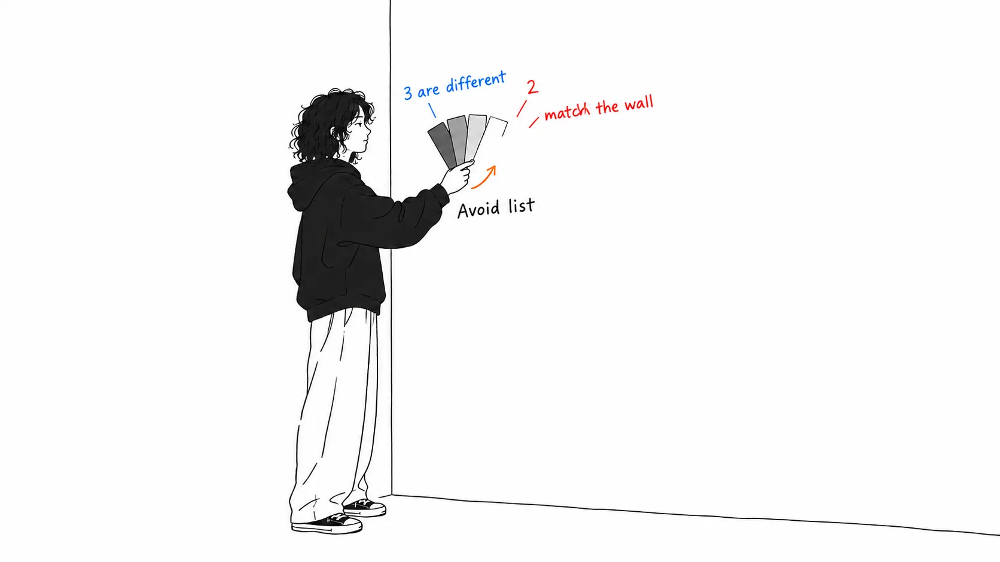
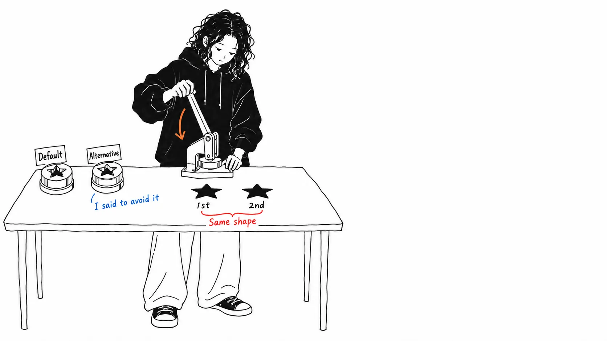
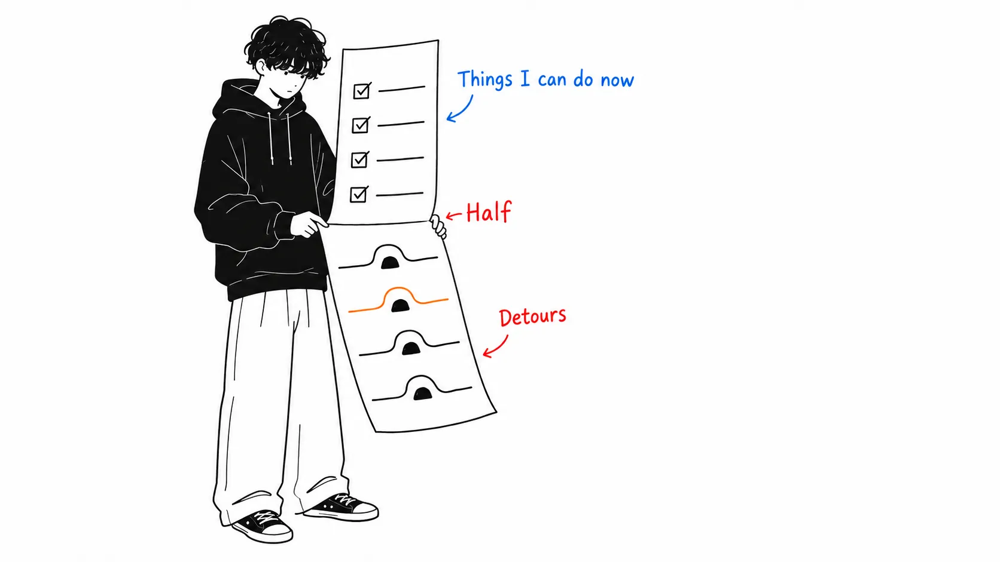
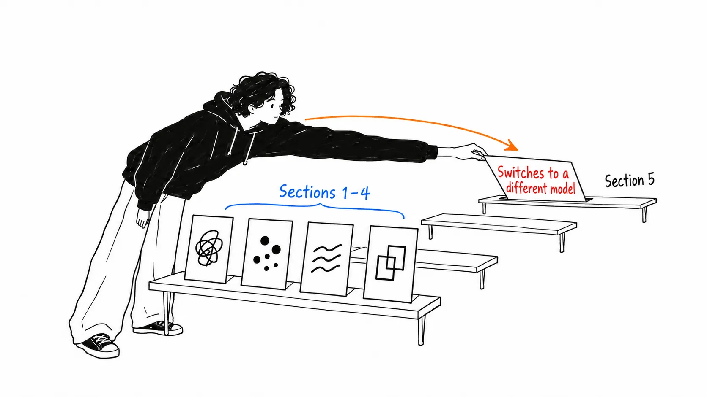

Here's the conclusion first.

> There's a section telling you to name, specifically, the looks you want to avoid when you make a design request. **Two of the five listed are the look of the very site that hosts the article.** The cream background `#faf9f5` (in light mode) and monospace labels. Both are **house style** that anthropic.com uses as well. So of course "avoid a generic look" doesn't work: **to the model, that isn't generic, it's the default.**

## About this article

What I read is the [claude.dev Playbook "Getting the most out of Opus 5.5 in Claude and Claude Code"](https://claude.dev/blog/getting-the-most-out-of-opus-5-5/) (September 22, 2026, 9 minutes). The author is listed as Addy Osmani, with Molly Vorwerck as reviewer.

First, a check on provenance. Judging by the domain alone, `claude.dev` looks unofficial, but **it is official**. The page's JSON-LD names the publisher explicitly.

```json
"publisher": {"@type":"Organization","name":"Anthropic","url":"https://www.anthropic.com"}
```

And Opus 5.5 itself exists too. [anthropic.com/claude-opus-5-5](https://www.anthropic.com/claude-opus-5-5), "Introducing Claude Opus 5.5," is dated **the same September 22**. In other words, this Playbook is a launch-day guide.

**An honest disclosure.** I haven't used Opus 5.5 yet. All I verified is what can be checked from the outside (the domain's provenance, the publication date, the site's CSS). **The author's affiliation isn't stated in the article.** I couldn't tell from the page whether they're an Anthropic person or an outside contributor.

## I looked for the "five things to avoid" in the publisher's CSS

The design section was good, so I'll quote it.

> With no design direction, Opus 5.5 falls back on a few default styles. **A general instruction like "avoid a generic look" mostly swaps one default for another.** A list of specific patterns works much better.

And here are the five it lists.

> Don't use a **cream or off-white background**, **italic accent words in headings**, numbered **"01 / 02 / 03" section labels**, **monospace labels**, or **pill-shaped buttons**.

Something snagged as I read. **I feel like I've seen these five somewhere.** On the very page that hosts the article. I downloaded the CSS and checked.

| Listed pattern | claude.dev's CSS |
| --- | --- |
| Cream / off-white background | **Match.** Under `@media (prefers-color-scheme:light)`, `--bg:#faf9f5`, `--bg-raised:#f1efe8`, `--bg-panel:#ece9e0` |
| Monospace labels | **Match.** **100** rules with `font-family:var(--mono)`. Selectors include `.label`, `.mono`, `.tabs`, `.meter`, `.nav-brand`, and more |
| Italic accent words in headings | Not found (`font-style:italic` appears in only 2 places) |
| Pill-shaped buttons | Not found (only 2 matching `border-radius` places) |
| "01 / 02 / 03" section numbers | **No match.** This site uses a "1. / 2. / 3." format |

**Two of five.** Not all of them. But what the two hits contain matters.

The definition of `--mono` was this.

```css
--mono: "Anthropic Mono", ui-monospace, "SF Mono", Menlo, monospace
```

**Anthropic Mono.** They have their own monospace typeface, and they use it for labels.

Just to be safe, I looked at the main sites too.

| Site | `#faf9f5` | `#141413` | "Anthropic Mono" |
| --- | --- | --- | --- |
| claude.dev | `--bg` in light mode | the default `--bg` | defined in `--mono` |
| anthropic.com/claude-opus-5-5 | 37 times | 50 times | 1 time |
| anthropic.com (top page) | 8 times | 13 times | 3 times |

`#faf9f5` and `#141413` appear across all three sites. **These are house colors.**



## That's why "avoid generic" doesn't work

Here's the main point. The guide says "a general instruction just swaps one default for another," and that's correct. But it doesn't say **why that happens**. Looking at the CSS explains it.

To the model, those five are not "generic." They are **defaults**. It can't recognize as bad something that has always been the way everything around it looks. When told "avoid the generic stuff," the model doesn't think its own defaults are generic, so it judges something else to be generic and avoids that instead. The result: one default gets swapped for another.

That's why naming specifics works. It amounts to **handing over, from outside, the information that "this is a default."**

Put differently, those five aren't a tasteless look. If anything, they're polished. What's polished has become the default, and being the default is the problem, not ugliness. **What "AI-looking design" really is, probably, is not clumsiness but uniformity.**

This was exactly the same shape as something I messed up myself this month. When all 45 of this blog's titles had ended up in the same mold, none of them was bad on its own. Following the rule produces the same shape, and the sameness itself doesn't violate the rule, so you can't detect it from the inside.



## What was measured 14 days ago became a checklist

The second of the guide's first three items is this.

> Delete "think carefully" lines. Opus 5.5 already thinks before every reply.

And it's in the checklist at the end too: "No 'think hard' lines in prompts or saved instructions."

It reminded me of reading Anthropic's cost-reduction article of September 8 ([my article](https://meikocho1.github.io/blog/claude-official-cost-down)). It was an experiment that planted six anti-patterns and measured them, and two of them were **verification rituals ("verify twice")** and **thoroughness boosters ("be maximally thorough")**. After the cleanup, cost fell 14.6% and accuracy rose 5.3%.

**Fourteen days later, it's a checklist in a product guide.** On September 8 it was "we measured, and here's what we got"; on September 22 it's "please delete them." Two weeks from measurement to instruction.

Here is the evidence the guide gives this time.

> In our testing in a chat product, removing a "think carefully" line made replies start sooner, with **no clear drop in quality**.

The September 8 article even came with a confidence interval, so that one is more rigorous. But what they're saying is the same; this one is written from the usage side.

## Half of it is workarounds, and the heaviest item is in section 5

One more point. The guide is built from about 18 "What to do" items, and reading them apart, there are **two kinds**.

**Things that have newly become possible** (hand it the whole thing and let it run, split work across subagents, paste a diagram as is, have it find contradictions in long materials, receive a finished file, have it do reviews).

**Workarounds for new behavior** (delete "think carefully," list the designs you want to avoid, write "keep going, don't stop" in `CLAUDE.md`, put the task list in a file, write "don't reopen settled answers" in the project instructions, delete sentences asking it to disclose its reasoning).

It came out roughly half and half. The classification is subjective, so I won't give a number, but **half of what's titled "get more out of it" is procedure for avoiding new friction.**

And the heaviest item is in section 5.

> Opus 5.5 is the first Opus model to launch with Fable-level bio and cyber safeguards. In Claude apps and Claude Code, **most flagged messages move to an older model, and your work goes on there.**

When a flag is raised, **you're moved to an older model and the work simply continues there**. In Claude Code, you go back with `/model`, change "Switch models when a message is flagged" in `/config`, and edit the previous message by pressing `Esc` twice.

It also says the check covers the whole conversation: "The check covers everything in the conversation, including files and search results." The switch can be triggered not by your latest message but by a file you had it read earlier.

You can't notice this if you don't know about it. You think you chose Opus 5.5 while an older model is answering, and you can't tell why output quality dropped. **The information in the guide that costs you most if you don't know it is placed after the prompt-writing advice.**



## My view

The guide itself is well made. Each item is laid out in three lines, "What to do / Why it matters on Opus 5.5 / How," the code examples are short, and it closes with a checklist. It's in a readable shape.

Having said that, what I should have done as a reader was **look at the CSS**. If you just read the body text, the five patterns end at "ah, so that's what an AI-looking design is." Only when I checked them against the publisher's CSS did I see that **this is not a "list of bad looks" but a "list of defaults."**

That changes the meaning. A list of bad looks you can memorize and avoid. A list of defaults **changes when the environment changes**. An Anthropic model's defaults should lean toward Anthropic's look, and another vendor's model will have different defaults. So what you should port is not the names of the five, but **the procedure of "write out, by specific name, the defaults of the model you are using."**

I also found one quotation to be careful about.

> **One early tester said** Opus 5.5 at its lowest effort caught more bugs than Opus 5 at high effort, with fewer false alarms.

"One early tester said." Hearsay, N=1. In the same article, the "think carefully" point comes with an internal test, and this one comes with hearsay. Both sit in the same "Why it matters" slot, so a reader can't tell them apart. **Measurement and hearsay lined up under the same heading** is a problem I've seen in the same shape many times since last month.



## If you take away just one thing

**Stop writing "avoid generic" and write out five things you want to avoid.** And when you write them out, the quick way is to open the website of the vendor of the model you use and look at its background color and its label typeface. Two of the five this time were right there.

## Sources

- Addy Osmani, ["Getting the most out of Opus 5.5 in Claude and Claude Code"](https://claude.dev/blog/getting-the-most-out-of-opus-5-5/), claude.dev, September 22, 2026 (Playbooks, 9 minutes, reviewed by Molly Vorwerck)
- [Introducing Claude Opus 5.5](https://www.anthropic.com/claude-opus-5-5), Anthropic, September 22, 2026
- I downloaded and counted the CSS of claude.dev / anthropic.com on September 23, 2026

My judgment that `claude.dev` is an Anthropic property rests on the `publisher` field in the page's JSON-LD. **The author's affiliation is not stated in the article.**

Here is how I counted the CSS. For "monospace labels," I counted rules containing `font-family:var(--mono)`, which came to 100. For "cream background," it's `--bg:#faf9f5` inside `@media (prefers-color-scheme:light)`. **This site's default is the dark `:root{--bg:#141413}`, and cream appears only in light mode**, so saying flatly that "the site is cream" would be inaccurate. I found only 2 places each for `italic` and pill-shaped `border-radius`, so I marked them no match. The section numbers are "1. / 2. / 3." rather than "01 / 02 / 03," and I didn't count that as a hit.

Since I haven't used Opus 5.5, I haven't confirmed any of the behavior the guide describes (running for a long time, clear reports, stopping partway to ask questions, switching on a flag) myself. It's all what the article says.
