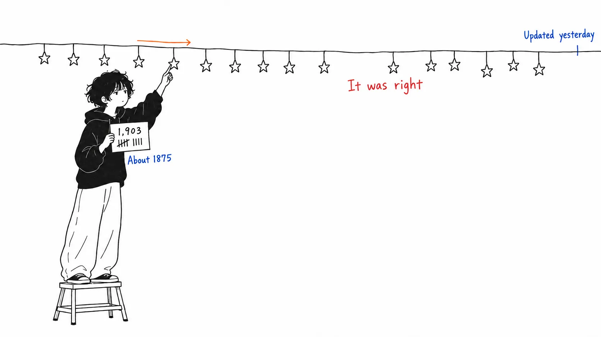
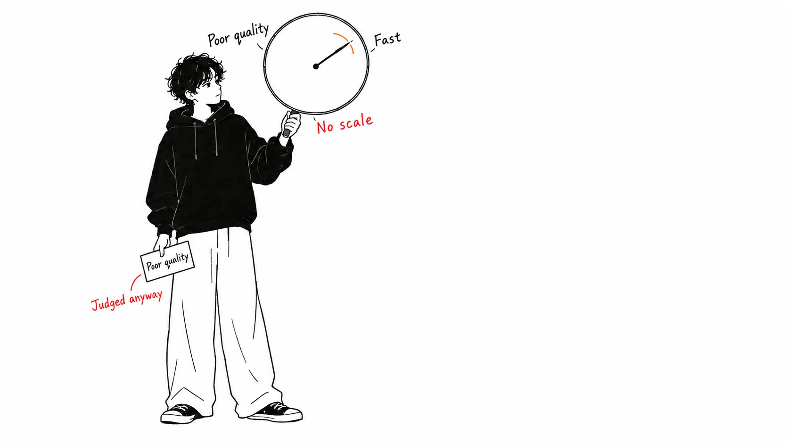

Here's the conclusion first.

> **Everything I could verify checked out.** The GitHub repositories exist, and even the star counts match the time of writing. Where the author hadn't tried something, the article says "I haven't tried it." On top of that, **one prescription that can't possibly be disproved** is mixed into the article. Readers can't see the boundary. **Accuracy carries over to the parts that aren't accurate.**

## About this article

The original is [an X Article by @Pluvio9yte (雪踏乌云)](https://x.com/Pluvio9yte/status/2097627175193366621), "万字长文如何百分百榨干ChatGPT Pro，发挥超出1000美金价值" ("A ten-thousand-character guide to squeezing 100% out of ChatGPT Pro and getting more than $1,000 of value," September 9, 2026, in Chinese). It explains how to use the ChatGPT Pro model across five sections.

I looked into it because I was asked to "analyze this, and if it's right, write it up." The result: **mostly correct**. What follows is the breakdown, and the one point that snagged me.

**An honest disclosure.** I don't subscribe to ChatGPT Pro, so I haven't checked the Pro model's behavior myself. All I verified were facts that can be checked from outside (whether the repositories exist, their star counts, their update dates). I also haven't confirmed the UI of the Codex desktop app.

## Even the star counts matched

The original names two OSS projects. I checked both through the GitHub API.

| What the article says | Actual (as of September 11, 2026) |
| --- | --- |
| `miuuyy/codex-chatgpt-web` (plugs Pro into Codex as an MCP) | **Exists. 6,130★**, MIT, last updated 2026-09-08 |
| `rebel0789/codexpro` (**about 1875 stars**) | **Exists. 1,903★**, MIT, last updated 2026-08-08 |

The description of `codex-chatgpt-web` is "Use ChatGPT Web (including Pro) as a native model in Codex — with context, tools, streaming and images, without using Codex quota," which matches the article's description. It was last updated the **day before** the article was published. It's a living project.

The article gives `codexpro`'s star count as "about 1875," and it's 1,903 now. That works out to 28 added in two days, so it should have been accurate at the time of writing. **Writing it as a round number on purpose is also good.** It's phrased so you can tell it was rounded.

On top of that, the article contains two self-disclosures.

> 这个项目我并没有试过，不过最近比较火，所以我就列出来了。
>
> （I haven't tried this project, but it's been pretty popular lately, so I listed it.）

> 个人观点觉得没有必要，似乎是一个反向生产力，为了用而用了。
>
> （My personal view is that it's unnecessary. It seems to be reverse productivity, using it for the sake of using it.）

The author says they haven't tried it, and **furthermore doesn't recommend it**. They write honestly that they listed it because it's popular, and dismiss it in their own opinion as "using it just to use it." Just having these two lines raises the credibility of the whole article.

## One prescription that can't be checked

This is where I snagged.

> 4.如果你觉得 Pro 模型回答速度也非常快，质量也很差，不要怀疑，**这是被路由到了降级模型**。比如说，你现在用的 GPT-6，可能会给你路由到 GPT 5.5 Mini。
>
> 5.应对降智的办法也很简单，**使用手机端对话即可**。网页版静待智力恢复。
>
> （4. If the Pro model answers very quickly and the quality is poor, don't doubt it: **you've been routed to a downgraded model**. For example, the GPT-6 you're using now may be routed to GPT 5.5 Mini. 5. The way to deal with the dumbing-down is also simple: **just chat on the mobile app**. On the web version, wait for the intelligence to come back.）

If Pro is fast and the quality is bad, you're being routed to a downgraded model. The fix is simple: **chat on your phone**. On the web version, wait for the intelligence to come back.

Let me look at it in three parts.

**The criterion has no scale.** "Fast" and "poor quality" are both subjective. The article itself says Pro's thinking time ranges from a few minutes to two hours, so "this one was fast today" happens as a matter of course. Nowhere does it say how to decide where a downgrade begins.

**The prescription has no mechanism.** If the routing happens on the server side, changing the client shouldn't change the assignment. If there were an explanation, such as the mobile app pinning a different model or hitting a different endpoint, that would be a different story, but the article has none. It just says "simple."

**And it can't be wrong.** This is the biggest problem. If switching to the phone makes things better, the prescription worked. If it doesn't get better, "wait on the web version" is still there. If waiting makes it better, that too counts as the prescription succeeding. **There is no state in which you could tell the prescription was wrong.**

While I'm at it, the number in the title also has no basis in the body. "人们对 ChatGPT Pro 的开发程度不足 10%" (people use less than 10% of ChatGPT Pro's potential). What counts as 100%? It isn't written anywhere. This doesn't affect the substance of the article, so I think it's the kind of number you can let pass as a headline figure.

## Accuracy carries over to the parts that aren't accurate

This is what I want to write about.

Someone who can write a star count correctly as a round number is someone with a habit of checking. Someone who can write "I haven't tried it" about something untried is someone with a habit of distinguishing. **Because the article does both of those, the "just switch to your phone" in the same article is read as being of the same quality.**

The reader has no clue for telling them apart. All five sections are in the same style, laid out in the same bullet lists. The repositories' star counts and the workaround for downgraded models both sit inside the same "in my experience."

I don't think this is a matter of blaming the author. The experience of feeling "this is fast and sloppy today" while using it, then asking again on the phone and getting a better answer, is probably real. **A real experience and a verifiable fact look the same once they're written down.**

I do the same thing on this blog myself. The section where I counted primary sources and the "my take" section sit side by side under the same `##`. From the reader's side, both must look like they carry the same weight. That's why I put an "honest disclosure" at the start each time and say first what I checked and what I didn't. Even so, I can't separate them completely.

## My take

I think the most usable part of this article is actually neither the OSS nor the downgrade workaround, but **section 3**.

> 在 Codex 里面，其实也能够进行 ChatGPT 类似于网页端的对话。但与直接在网页端对话不同的是，**Codex 里的对话具有当前项目的上下文**。
>
> （Inside Codex, you can actually have a conversation with ChatGPT similar to the web version. But unlike chatting directly on the web, **the conversation in Codex has the context of the current project**.）

When you ask Pro from inside Codex, it analyzes **while holding that project's context**. When the analysis is done, you hand that conversation record straight to Codex to execute. The author himself writes that "of the four, the one I use most is the third."

What's good about this is that it uses Pro not as "a smart model" but as **"a seat with a different role."** It separates the seat for thinking from the seat for doing the work. The Spotify shunt I read about in my previous article offloaded the reading work to a cheaper model. This goes the other direction: **it offloads the thinking work to the expensive model**. The directions are opposite, but what they're doing is the same: they've stopped making one seat do everything.

And there's no unverifiable part in this section 3. Whether the UI exists you can see for yourself, and by using it you can tell whether it worked. **The best part of the article was also the easiest part to verify.**

## If you take away just one thing

**Write down one state in which you'd know the prescription was wrong.** A procedure for which you can't write "if it doesn't work, this is what happens" is one where nobody can judge whether it's working. This is true of your own notes, a team's runbook, or a blog. After reading this article, I noticed the same problem in "if you're in trouble, recreate the session" written in my own CLAUDE.md.

## Sources

- [@Pluvio9yte (雪踏乌云), "万字长文如何百分百榨干ChatGPT Pro，发挥超出1000美金价值" (A ten-thousand-character guide to squeezing 100% out of ChatGPT Pro and getting more than $1,000 of value)](https://x.com/Pluvio9yte/status/2097627175193366621), X Article, September 9, 2026
- [miuuyy/codex-chatgpt-web](https://github.com/miuuyy/codex-chatgpt-web): 6,130★, MIT, as of September 11, 2026
- [rebel0789/codexpro](https://github.com/rebel0789/codexpro): 1,903★, MIT, same date

The star counts and last-updated dates were fetched from the GitHub API on September 11, 2026. There is a gap from the article's publication (September 9).

I don't subscribe to ChatGPT Pro. I have not personally verified anything about the Pro model's response speed, thinking time, or whether downgrades occur. When I wrote that "no mechanism is explained," **I don't mean that no such phenomenon occurs**, I mean that the article doesn't write out an explanation. If routing is actually happening, and there is a mechanism by which the assignment changes depending on the client, my objection is wrong. If you know, please tell me.
