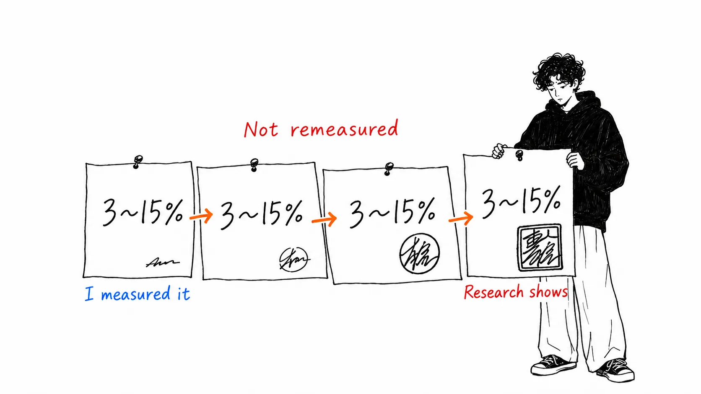
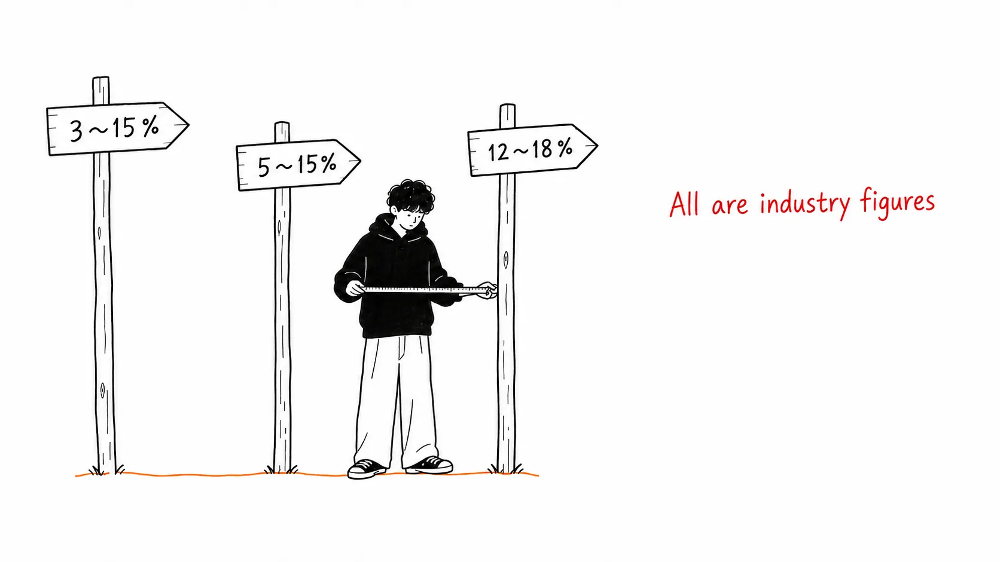
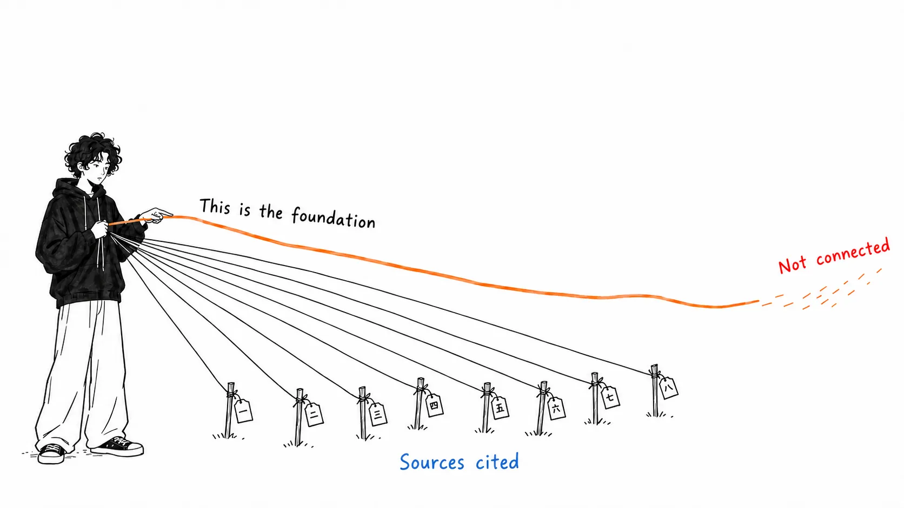
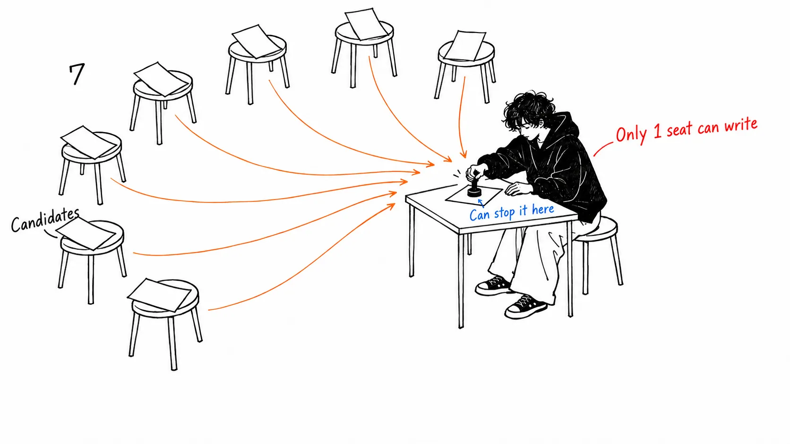

Here's the conclusion first.

> Trace the figure "production tool calls fail 3-15% of the time" back to its source and you arrive at **one blog post by an individual who wrote "I know this because I've been tracking it."** It gives no method and no sample size. Over ten months, it turned into "studies across production show." I'm not saying the number is wrong. I'm saying **no measurement exists.**

## About this article

The original is [an X Article by @gippp69](https://x.com/gippp69/status/2097696163424014406), "How to Build a Business Back Office That Runs on Agents with GPT-6 Astra (Complete Guide)" (September 9, 2026).

Let me say up front that **this is a good article.** It has a sources section, and it points to where the SDK specs, the pricing, and Temporal all come from. The second-to-last section (three things the author wouldn't build again) is a quality you rarely get to read in guides of this kind.

Even so, there's one number that the article itself says is "the whole article," and its origin is blurry. This is a record of tracing it.

**An honest disclosure.** I haven't built this setup with the OpenAI Agents SDK. What follows rests only on the original and on the search results from tracing where the number came from. GPT-6 Astra's pricing, context length, and benchmark figures are quoted as is from the original's statements, and I haven't confirmed them on OpenAI's primary pages.

## I traced the number that was called "the whole article"

The original opens like this.

> Tool calling, the mechanism by which every agent in every one of those guides actually touches a real system, **fails between 3% and 15% of the time in production. Not in bad systems. In well engineered ones.**
>
> That is the whole article.

The structure follows suit. Eight agents, an eight-step build procedure, six silent failures, and a close saying "3-15% is not an edge case to deal with later, it's a design constraint." If the number moves, the backbone of the article moves.

So I traced it.

| Source | Date | How it's written |
| --- | --- | --- |
| Michael Hannecke (Medium) | 2025-10-29 | 3-15%. **"I know this because I've been tracking it."** |
| Scalekit (blog) | 2026-05-26 | 3-15%. Stated flatly, no source |
| Openlayer (blog) | 2026-07-21 | 3-15%. **"Research across production deployments shows"** |
| The original | 2026-09-09 | 3-15%. "Even in well engineered systems" |

The oldest one I found is Hannecke's article. It's **one engineer writing "I know this because I've been tracking it."** It doesn't say the sample size, the period, or what was counted as a failure. I think that's an honest way to write it. Read as one person's observation, there's nothing wrong with it.

Over ten months, it became "Research across production deployments shows." The subject changed from an individual to research. There's no sign that any new measurement was made in between. **The same number gets promoted in rank each time it's cited.**

## In the same period, three other "industry numbers" were circulating

If 3-15% were truly an industry consensus, no other numbers should be showing up. They are.

| Source | Number | Framing |
| --- | --- | --- |
| AgentMarketCap (2026-04-10) | **12-18%**, "The industry has a number for this gap" | Production pipelines |
| cheesecat / JK Labs (2026-05-17) | **5-15%** | As a protocol problem |
| Presenc AI (2026-05-07) | 85-91% with 5 tools, 65-78% with more than 20 (that is, 9-35% failure) | **Cites BFCL v3** |

All three call theirs "the industry number." 3-15%, 5-15%, 12-18%. **They can't all be the industry number.**

The interesting one is Presenc AI, the only one with a different framing. It doesn't give a single range but gives the figure as **a function of the number of tools.** 85-91% with 5, 65-78% with more than 20. And it cites a named measurement, the UC Berkeley BFCL v3 leaderboard. It even gives a breakdown of the failures: about 38% parameter mismatch, about 24% type conversion errors, about 18% wrong tool selection.

Round the number into one and you get "3-15%." Stop rounding and you get "it depends on how many tools you have." **The latter is the one usable by the person designing the system.**

## An article with a sources section blurs exactly one spot

The original has a sources section. That deserves praise.

- SDK primitives, sandbox permissions, sessions, when to use it versus the Responses API → OpenAI's official docs and `openai/openai-agents-python`
- Astra's pricing, the 272K threshold, context length, first-attempt success rate → OpenAI's model docs and OpenRouter
- End dates for Agent Builder and Evals → OpenAI's AgentKit page
- Durable execution → temporal.io

It's concrete. And the line in question is this one.

> The 3-15% tool call failure figure and the ChatDev correctness number come from **published production write-ups**.

There's no link. It doesn't say whose, or what, the "published production write-ups" are. **An article that cites ten sources properly leaves exactly one, the one it built its foundation on, without a name.**

I don't think it's deliberate. The author probably also thinks this is a "number everyone knows." I thought so too until I read this article.

## The section with no numbers in it was the best

Section 10 of the article, "What I would cut if I started this over," has almost no numbers. This is the best part.

**First. Making the classifier its own agent.** It only reads a ticket and returns a type. That's not a seat, it's a function call. To borrow the author's phrasing,

> If a seat has no tools and no branch, it is **a function call wearing a costume**.

**Second. Treating retries as a cure-all.** They retried failed tool calls up to three times. On paper, 5% becomes 0.0125%. On a write path, **one duplicate invoice becomes three.** The ordering "you need an idempotency key before you need a retry count" is an ordering only someone who has implemented it can write.

**Third. Uncalibrated confidence.** The extractor returns 0 to 1 and anything under 0.7 is rejected. When they checked 100 cases against the originals, **accuracy at 0.65 and at 0.9 was about the same.** In other words, the threshold had just been throwing work away at random.

> A number you have not measured against reality is a decoration that looks like a control.

That one sentence applies, as is, to the 3-15% at the start of the article.

## My take

I don't want to bash this article. **I want to talk about structure.**

All three regrets have the shape "did it, measured it, and was wrong." There's a line saying they checked 100 cases. The 3-15% at the opening, on the other hand, has nobody who measured it. **Within the same article, the density of verification is the exact opposite at the two ends.**

This isn't the author's negligence. It's probably a problem with how articles get written. An intro needs "a shocking number the reader doesn't know." Your own measurements are plain, and don't make a range. So the borrowed number comes to the front and your own measurement goes to the back. **The more borrowed, the more it's put up front; the more homemade, the more it's put at the back.**

I do this in my own articles too. Two articles ago, I couldn't read Anthropic's figure and decided the shape of the curve from two endpoints, and got it wrong. That, too, was caused by wanting to say it decisively with the numbers I had on hand.

One more thing. **Even if 3-15% were right, you couldn't use it for design.** 3% and 15% differ by a factor of five. A number that differs fivefold changes your retry strategy, where you put human review, and how you split seats. Told "85-91% with 5 tools," as Presenc AI does, you can decide how many tools to have. **For a wide-range number, the width itself is evidence that "it wasn't measured."**

And the original's design itself, **"seven seats produce candidates and only one seat commits,"** is right without any numbers. Gather the irreversible operations in one place, and do auditing, rate limiting, and stopping there. This is a design that holds at 3%, at 15%, or at 41%. **The article's claim doesn't depend on the number it called its foundation.**

## If you take away just one thing

**When you see an "industry number" written as a range, divide the upper bound by the lower bound.** 3-15% is five times. 12-18% is 1.5 times. The former is an impression, not a measurement, and the latter still has the shape of a measurement. Put a fivefold range at the foundation of your design and whatever you build will be "within expectations."

## Sources

- [@gippp69, "How to Build a Business Back Office That Runs on Agents with GPT-6 Astra (Complete Guide)"](https://x.com/gippp69/status/2097696163424014406), X Article, September 9, 2026
- Michael Hannecke, ["Why AI Agents Fail in Production: What I've Learned the Hard Way"](https://medium.com/@michael.hannecke/why-ai-agents-fail-in-production-what-ive-learned-the-hard-way-05f5df98cbe5), Medium, October 29, 2025. The oldest "3-15%" I found
- [Scalekit, "Tool Call Failures in Production"](https://www.scalekit.com/blog/tool-call-failures-production) (May 26, 2026)
- [Openlayer, "AI Agent Failure Modes"](https://www.openlayer.com/blog/ai-agent-failure-modes-tool-calling-loops-propagation) (July 21, 2026)
- [AgentMarketCap (April 10, 2026)](https://agentmarketcap.ai/blog/2026/04/10/agent-tool-call-retry-failure-mode-handling-production-2026): 12-18%
- [Presenc AI, "AI Agent Tool-Calling Accuracy Benchmarks 2026"](https://presenc.ai/research/ai-agent-tool-calling-accuracy-benchmarks-2026) (May 7, 2026): cites BFCL v3
- [JK Labs (May 17, 2026)](https://cheesecat.net/blog/ai-agent-tool-calling-reliability-production-checklist-2026/): 5-15%

When I wrote "the oldest I found," I didn't mean that no article before Hannecke's gave the same number. I meant that **within the range my search could trace back, that was the first.** If anyone knows of an earlier source, please tell me. It would undermine this article's claim, and that would be better.

GPT-6 Astra's figures (1,050,000 tokens; above 272,000, input and cache double and output goes up 1.5 times, applied to the whole request; first-attempt 88.0% vs. 55.9%; within four attempts 99.2% vs. 68.7%; prompt-injection success rate 11.2%) are all statements from the original. I haven't confirmed them on OpenAI's primary pages.
