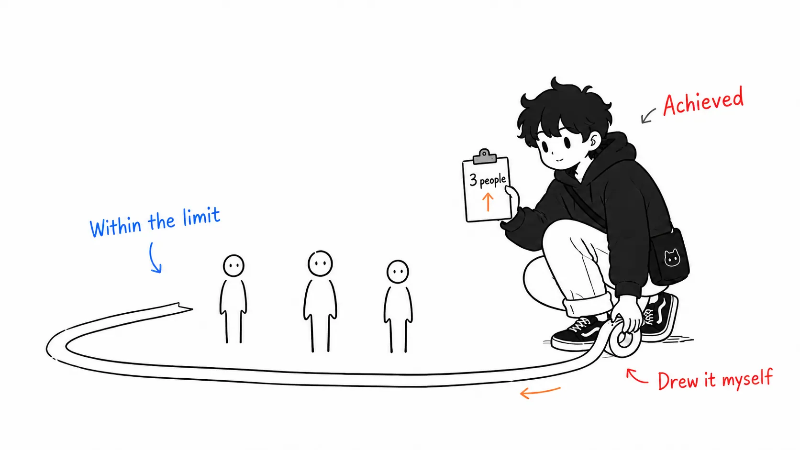
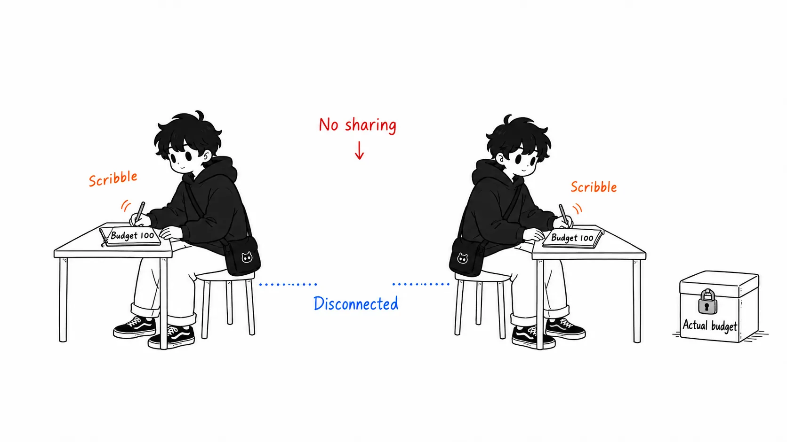
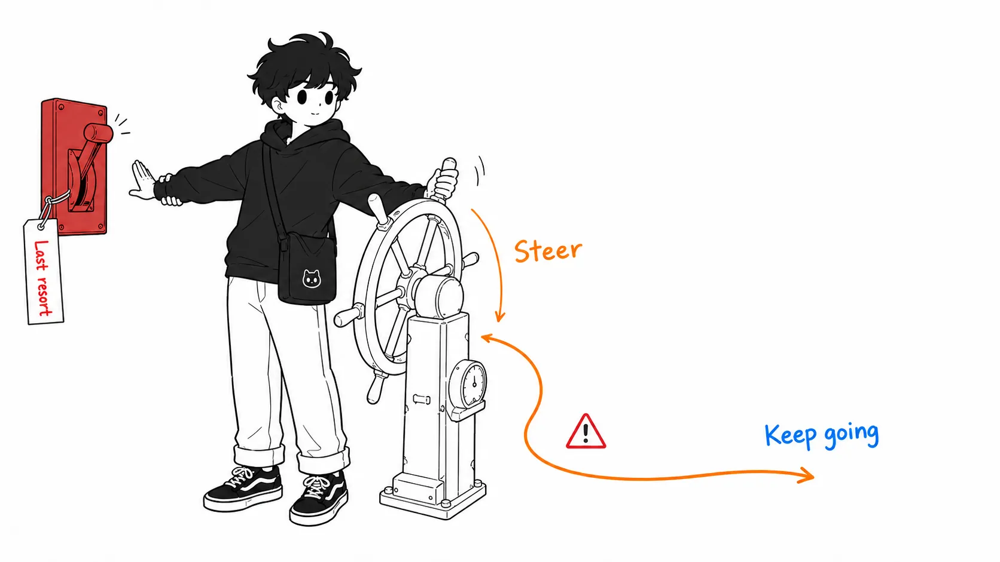

Here's the conclusion up front.

> Read the primary source behind the story going around as "they cut token costs by 78% and completion rate went up from 67% to 96%," and **the control group is not "hard limits (throttling)" but "no governance,"** and the metric is not "task completion rate" but **"the share of runs that finished within the budget cap"** (within-cap success). N=27, from $0.068 to $0.014 per run. The system they built is interesting and the numbers are measured, but the most-quoted sentence is probably describing an experiment nobody ran.

## About this article

This is about **TokenOps**, built by Microsoft's Tisha Chawla and Susheem Koul, a system that controls token spend at runtime, per agent run.

- Primary source: [Who spent all the tokens? Real-time, run-scoped cost control for AI agents](https://commandline.microsoft.com/tokenops-real-time-run-scoped-cost-control-ai-agents/) — Tisha Chawla, Susheem Koul (Microsoft Command Line, August 13, 2026)
- Talk: [Who Spent All the Tokens? — Tisha Chawla & Susheem Koul, Microsoft](https://www.youtube.com/watch?v=GJX19pNhmSw) (AI Engineer)
- Code: [github.com/theagentplane/tokenops](https://github.com/theagentplane/tokenops)

I came across it through a Chinese-language summary, which introduced it like this: "Token spend cut by 78%, yet task completion rate soared from 67% to 96%. Conventional wisdom says the quickest way to save tokens is to cut off with hard limits, but doing that saves money while killing the task. Microsoft, however..."

I found that framing interesting, so I went to read the primary source. When I did, the control group was different.

Full disclosure: I haven't run the benchmark, and I haven't read the repository's code. I haven't watched the talk video all the way through either (I only read part of the transcript). What follows is limited to what I read in the body of the Command Line article.

## Here's how the original states its numbers

I'll quote the relevant passage. The bold is mine.

> - Cost: mean cost per completed run. 78.9% lower than no governance: $0.068 → $0.014 average spend per run (weighted total $1.839 → $0.388, N=27 scored trials across browser-use and MetaGPT scenarios).
> - Completion: share of runs that **finish under the cap**, **vs. no governance**. +29pp: 67% → 96% **within-cap success** (18/27 → 26/27), N=27.

Three things were dropped from the summary.

**1. The control group is "no governance."** It isn't throttling. Just before this paragraph, the original goes out of its way to declare the basis of comparison: "the baseline that governs the demand for this post: no governance at all." In other words, it's a comparison of "do nothing vs. TokenOps," and a comparison experiment of "cut off hard vs. steer smartly" doesn't exist anywhere in this article.

**2. The metric is within-cap success.** "The share of runs that finished inside the budget cap." Not whether the task succeeded. The 33% without governance (9 of 27) **didn't die as tasks; they exceeded the budget.** The original is precise everywhere, restating it twice: "finish under the cap" and "within-cap success." Translate it as "completion rate" and the meaning changes.

**3. N=27.** Scenarios from two repositories, browser-use and MetaGPT, combined for 27 trials. The average per run went from $0.068 to $0.014. It's a story of seven cents becoming 1.4 cents.

## "The share that stayed within budget went up": how much of a claim is that?

This is where I got stuck.

You introduce a budget cap, and you put in a system that steers midway so the cap isn't exceeded. As a result, "the share of runs that finished within the cap" goes up. ... A good part of that comes out of the definition of the design. A mechanism built to keep within the cap raises the rate of keeping within the cap. If it hadn't gone up, that would be the news.

Of course, it isn't a complete tautology. **Keeping within the cap by HALT (cutting off) doesn't increase within-cap success.** A run killed by hitting the cap doesn't count as "finished within the cap." So the number 26/27 means that "steered, stayed within the cap, and still finished" happened 26 times, and there's substance in that. A reading in which the original's STEER design (dropping to a cheaper model, shrinking the prompt, repairing broken loops) worked is a valid one.

But from there you don't reach "the task completion rate went up." The original itself says why not. This is the most honest section of the article.

> To be clear about the boundary: everything above governs cost. (...) It does not decide whether the spend was worth it. A cost cap halts on dollars; it cannot see whether the dollars bought a correct answer.

It then cites MAST (Berkeley's research on multi-agent failures) and goes on to say that more than half of multi-agent failures are problems of specification and verification, and that a cost cap can't tell a correct answer from a wrong one. **A number from an article whose authors state outright that "quality wasn't measured" is circulating as evidence that "quality went up."** This was the most interesting part for me this time.

My read is that the distortion happens in a single step: the word "Completion" in the original's heading. The substance is within-cap success, but pull out just the heading and it looks like a completion rate. At the stage of putting it into a table, the column name becomes "completion rate," the control group gets swapped from "no governance" to "throttling," and a sentence that isn't in the original, "cutting off kills 33%," gets added. One round of summarizing, and an experiment nobody measured has been built.



## Three parts still worth reading

I've quibbled with how the numbers are interpreted, but the article itself is quite good. What I took away wasn't about the metric but these.

### 1. The bug that turned a $2 cap into effectively $4

This is the most practical one. The test bench ran two agents in separate processes. A research agent looping over a search tool passes its findings to a summarizer agent over HTTP. Both share the same run id, and the run has a budget. All the tests passed, yet there was a bug.

> Each process kept its spend counter in its own memory. Both started from zero, and both saw the run's full budget, so a $2 run cap was effectively "$2 for the research agent and another $2 for the summarizer." Add them up and you can spend twice the cap, while every local check passes.

The fix was moving the counter out of the process into a shared ledger. The original's generalization is this: **in a multi-agent run, a budget that each agent counts for itself is not the run's budget.**

This isn't an LLM story but a distributed-systems story. Which means, conversely, it won't rot even when LLM circumstances change. Reading this, I realized I had never once checked whether what I call a "budget" really has a single source of truth.



### 2. The list of policies is derived from the cost formula

The original doesn't line up the policies first. It first writes out what a run's cost is made of.

```
cost of a run = Σ over calls ( input tokens × input price + output tokens × output price )

calls per run = loop depth × fan-out breadth
                (逐次ステップ)   (並列サブエージェント)
```

What determines the bill is just two things: "tokens per call" and "the number of calls." The sources of the number of calls are also just two (loop depth and the breadth of subagent fan-out). So the things to protect form a closed list: tokens per call, loop depth, fan-out, and the ceiling on the total. The original's policies number ten: `cost_budget` is the ceiling, and each of the other nine guards one spot.

What I found to be a good argument is this sentence.

> We derived this list from cost, but it also matches the findings of failure research. OWASP's Unbounded Consumption, Microsoft's agentic failure taxonomy (v2.0), and Berkeley's MAST name the same modes: loops, repetition without progress, degenerate output, oversized context and payloads, malformed tool calls, unbounded fan-out. Arriving at the same list from two directions is good evidence that we haven't missed any of the obvious modes.

A list enumerated from the standpoint of cost optimization matches a list enumerated from the standpoint of security and failure analysis. This way of checking can be used for your own design checklists too.

### 3. STEER first, HALT last

This is about design order, and it fits in one line.

> Steering runs first. A halt is the last resort because halting a legitimate run causes the outage you were trying to avoid.

A cutoff causes by itself the outage you were trying to avoid. That's why it's last. And the decision to put no model at all in the enforcement path is clear too: because "we don't want the thing being governed to decide whether to stop itself." Here they bring in CaMeL (a technique that places a deterministic control layer outside the model as a defense against prompt injection) and say the threat is different but the design is the same. I thought that mapping was well done.



## Two minor points worth writing down

**The repository isn't under the Microsoft organization.** It's [github.com/theagentplane/tokenops](https://github.com/theagentplane/tokenops). "Open source made by a Microsoft engineer" and "Microsoft's open source" are different things, and the former is correct. Incidentally, under the Microsoft organization there's a separate project called [agent-governance-toolkit](https://github.com/microsoft/agent-governance-toolkit), which is governance on the security side, not cost. It's easy to mix them up.

**This article is not a product pitch but a claim about layers.** In the second half of the original there's a table of "which layers already exist and where the gaps were," filling it in as follows: accounting is FOCUS, observability is the OpenTelemetry GenAI conventions, per-request enforcement is LiteLLM / Portkey / Cloudflare, step limits are LangGraph's `recursion_limit` and CrewAI's `max_iter`, and only per-run enforcement is left open. I think this framing will outlive the 78%.

## If you take away only one thing

It isn't about the numbers.

**Read the definition of a metric, not its name.** This time the discrepancy happened between the heading "Completion" and the definition "share of runs that finish under the cap." The heading survives a summary and the definition drops. Only the side that dropped says what that number is evidence of.

And when you cite this kind of benchmark yourself, write N alongside it. N=27 is "a directional hint," not "you can expect a 78% reduction." The original does write N. It was the summarizer who dropped it (I nearly dropped it too).

## Sources

- Tisha Chawla, Susheem Koul, [Who spent all the tokens? Real-time, run-scoped cost control for AI agents](https://commandline.microsoft.com/tokenops-real-time-run-scoped-cost-control-ai-agents/), Microsoft Command Line, August 13, 2026
- Talk: [Who Spent All the Tokens? — Tisha Chawla & Susheem Koul, Microsoft](https://www.youtube.com/watch?v=GJX19pNhmSw), AI Engineer
- Code: [github.com/theagentplane/tokenops](https://github.com/theagentplane/tokenops)

All figures and quotations in the article come from the Command Line article above. I haven't reproduced the benchmark or read the repository's code. I haven't watched the talk all the way through. The second half of the section "'The share that stayed within budget went up': how much of a claim is that?" is my own argument about interpreting the metric, not a claim of the original.
