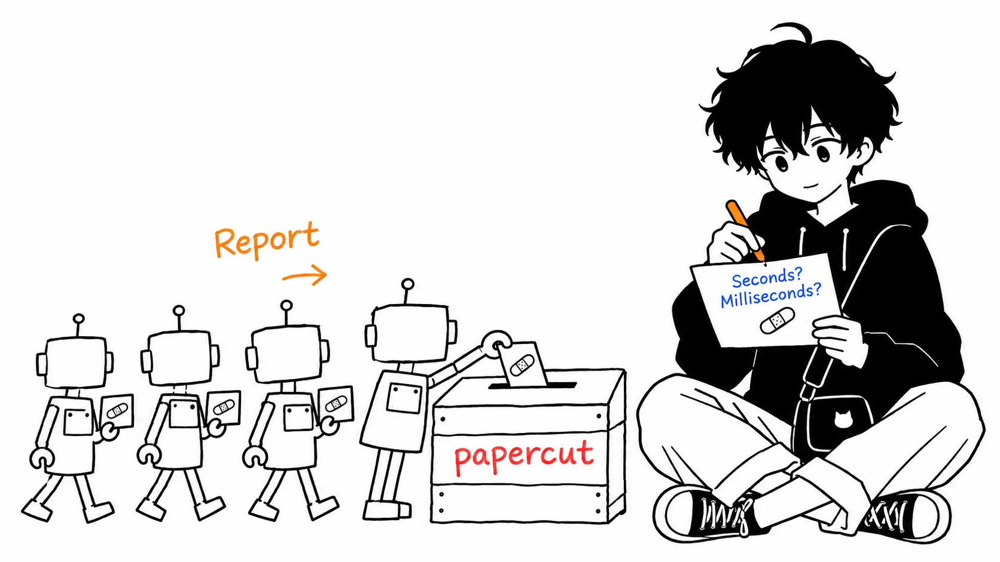

On November 23, 2026 (UTC), Uber Engineering published an article on X titled "How Uber Evals 1 Million Agent Skill Invocations a Month". The same content is also on Uber's blog. Here are the opening numbers.

> Uber's shared skills marketplace grew from 1 skill in October 2025 to more than 5,000 in just one year. Thousands of people have written a skill, and agents invoked skills more than 1 million times in just one month.

The article covers a lot: a distribution CLI, a three-tier hierarchy, usage measurement, a linter, evals, cost reduction, and a mechanism for agents to report bugs themselves.

Here's the conclusion up front.

> Uber has a system that generates SKILL.md from a spec and regenerates it when the model changes. I read this as Uber putting the text that survives a model change (the spec) and the text that gets rebuilt for the current model (SKILL.md) into separate files. In my own skills, these two kinds are mixed together in a single SKILL.md. When the model changes, I can't tell which parts are safe to cut, so I decided to separate them.

---

## In plain words

When you have an AI do a job, you give it a how-to sheet: "here's how this task is done." These sheets are called "skills." At Uber, employees have written more than 5,000 of them, and AI used them more than a million times in a single month.

A how-to sheet mixes two kinds of sentences. One kind is the promise that doesn't change when the AI gets replaced: "this is what counts as done." The other kind is wording tuned to today's AI: "say it this way and this AI gets it." The second kind stops fitting when a newer AI arrives.

Uber keeps the first kind on a separate sheet, a design document (the "spec"), and has a way to regenerate the second kind from it. My own how-to sheets mix both kinds on one page, so when the AI changes I can't tell which lines are safe to delete. So I decided to split them.

## About this article

What I read was the text of the X article's body. I haven't seen the images (diagrams and screenshots) embedded in it. I also haven't read the Cloudflare Code Mode article it references, Uber's other article (efficient software factory), or the Agent Skills specification.

I should also say where I stand. I write the articles on this blog using Claude Code skills. I've never used aifx or Skill Workshop, which are Uber's internal tools.

## SKILL.md is generated from a spec

The article begins by defining a skill as a "Markdown file". But once you reach the quality section, there is a path that generates that Markdown from a spec. One of the TL;DR items is also "Write the spec first".

> The spec keeps the intent of the skill: its goal, its outputs, the tool actions that are required or forbidden, and the agents and models it targets.

An internal tool called Skill Workshop generates SKILL.md and test prompts from this spec, and regenerates them when the model or agent changes. The future plans also include writing separate SKILL.md files for each model family, because the best phrasing and length differ from model to model.

The article doesn't say whether all 5,000 skills are built through this path. It says that SKILL.md is still fixed by its author based on real usage, and that in the Core tier a team maintains it and reviews changes. On top of that, they also run tests that remove words.

> As models get better, more words can reduce performance, so we also test removing words from skills.

The results of this test aren't in the article. But the direction is clear. The article also says that skills have a lifespan, and that a skill is retired once a better model makes it unnecessary.

What follows is my own way of organizing it. Things that tend not to change when the model changes, such as the goal, the outputs, and the operations that must be guarded, go in the spec, and phrasing aimed at the current model goes in SKILL.md. The latter can be regenerated or cut (though the spec also names the target models, so if you change the target, the spec changes too). What Uber appears to put on the side that stays is the spec, the eval, and the package of Code Mode scripts that skills across the company reference by name. The linter's rules (number the steps and give each step one purpose, include an error-recovery table, and don't accept "Try again" as a recovery strategy) check the shape of SKILL.md by machine.

The article also describes how evals are designed. About 5% are golden cases with fixed inputs and expected outputs, about 80% score real prompts by trajectory (whether the right skills and tools were used in the right order), and about 15% are judged by the author. It also says an eval that passes 70 to 90% can sometimes be more useful than one that passes everything, because if everything passes, you may be missing meaningful changes in the answers. Even so, the article closes by admitting that evaluating workflows that run rarely, matter a lot, and are hard to judge is still unsolved.

## The number that worked compared the skill as a whole, with and without

The most eye-catching number in the article is the result of an ablation (a test that removes the skill and compares).

> In our ablation test of a skill that runs warehouse queries, sessions without the skill made 13% more tool calls, had six times as many tool errors, and took 31% longer, and the answer with the skill won 87% of the comparisons.

This number is for one skill, comparing with and without it. It doesn't separate out which part of the skill made the difference. The number of comparisons isn't given either. As for what kind of skills worked, the article says this.

> The biggest wins came from skills that give the agent something it couldn't easily find or understand, such as access to internal documents or a way to run warehouse queries.

For skills overall, it only says they improved "In a majority of the cases", with no percentage.

Four cost-reduction measures are listed, and two of them come with a reduction rate. One hands heavy tool results to a worker on a cheaper model, which cut the per-invocation cost of the tracing skill by 46% (with the same measure, the deployment skill's cost did not go down in the first week). The other runs a script at load time and puts the result into the prompt, which cut the search skill's average cost by 32%. The other two, Code Mode and splitting out polling, have no reduction rate given.

You also need to be careful about how to read the numbers. The cost per skill invocation is the difference between the last value before the invocation and the first value after it, taken from the cumulative cost that is reported periodically, so it includes other tool calls in between. The 46% and 32% compare before and after the change, and the article doesn't say whether there was a control group.

## The agents were the ones who found the bugs

Through a mechanism called papercut, where agents report bugs themselves, thousands of reports came in over three months, and hundreds were fixed. Four examples are listed.

> A deployment skill told the agent to pass epoch seconds where the API expects milliseconds.

The other three: a pull request skill wrote commit messages to a shared temporary file, so two sessions running at the same time overwrote each other's pull requests. In a repository with no CI, an agent kept waiting for CI and repeated the same 404. And a skill that looks up settings returned a different property instead of raising an error when the key was missing.

The original doesn't say whether the mistakes were in the skill's step text or in the bundled scripts. To me, three of them read as problems with what the steps instructed, and one as a problem with a return value. None of them is the kind of problem where the wording was hard to understand. And all four were found through agent reports.

## My view

What caught my attention wasn't that the article says to cut text, but that it decides which text to keep.

The spec is text too: text that states the goal, the outputs, and the forbidden operations. The difference is that much of it doesn't need rewriting when the model changes. The phrasing in SKILL.md, on the other hand, is tuning for the current model, and gets rebuilt when the model changes. Uber separated these two kinds into different files.

In my own skills, these two kinds are mixed in one SKILL.md. In the skill for writing articles, requirements that don't change with the model, like "don't call it done until the illustrations and all three languages are in place", sit in the same tone next to tuning for the current model's habits, like "avoid this phrasing". I've polished both by hand.

What's the problem with mixing them? When the model changes, I can't tell which parts are safe to cut. If I tried a word-removal test like Uber's, it would end up cutting requirements that must not be cut along with the rest.

That said, this isn't a claim that the text is bad. What stops mistakes in my articles is a script that checks whether each quote appears in the original character for character, and a reviewer who reads the article in a separate context. In the [article](https://meikocho1.github.io/blog/efs-zero-data-retention-two-copies/) I published just before this one, the reviewer pointed out six factual errors, and I fixed all of them (that's just one example). What drives that reviewer is a request text I wrote. Most of its content is requirements that don't change with the model, such as "check facts against the original" and "flag experience stories with no basis". Since it's close to a spec, I expect it to last longer across model changes (I haven't compared the reviewer's performance before and after a model change, so I haven't confirmed this).

One more thing. "Illustrations and three languages are required" is a requirement that belongs in the spec, and it can also be checked by machine. Right now it's only added as prose in SKILL.md, and there is no check script yet. After reading Uber's article, I decided to write the check (I haven't written it yet).

## If you take away just one thing

Go through the sentences in your own skill one by one, and mark each as either "a requirement that survives a model change" or "phrasing for the current model". Put the former in a separate spec, and turn whatever you can into a check. The latter is the part you can put through a removal test.

Source: Uber Engineering, "[How Uber Evals 1 Million Agent Skill Invocations a Month](https://x.com/i/article/2120222611070500864)" and its announcement [post](https://x.com/ubereng/status/2125008806249930999) (X, November 23, 2026 UTC). The same content is on Uber's blog as "[optimizing-ubers-agent-skills](https://www.uber.com/us/en/blog/optimizing-ubers-agent-skills/)". I haven't read the images in the body, the referenced Cloudflare article, Uber's other article, or the Agent Skills specification.
