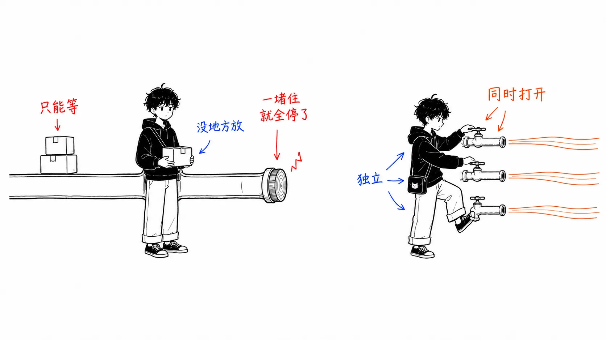
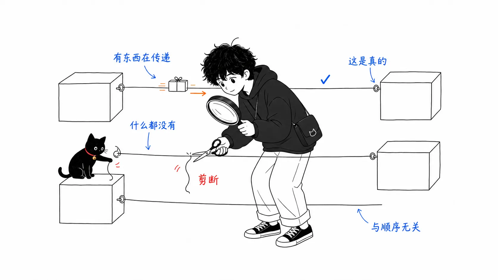
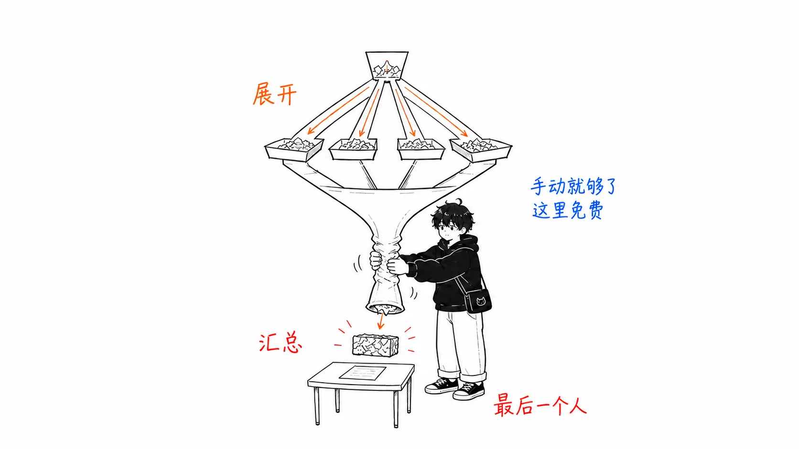
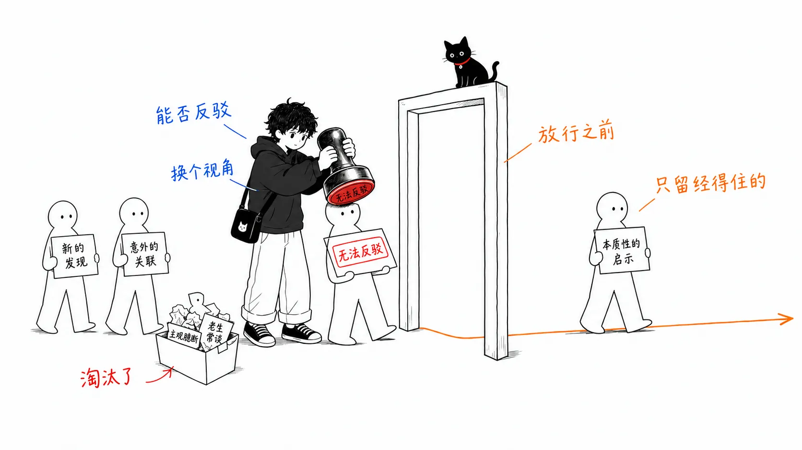
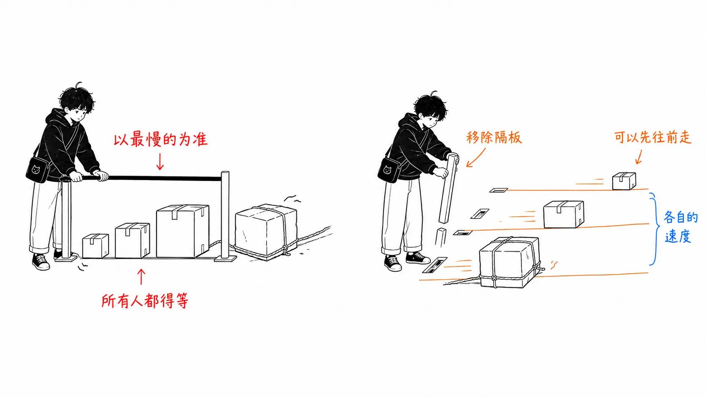
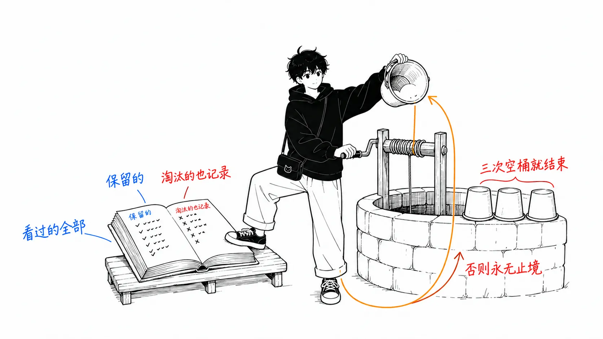

## 关于这篇文章

这篇文章解读的是 MIKE（[@mikenevermiss](https://x.com/mikenevermiss)）在 2026 年 7 月 27 日发布的长文 **"Graph Engineering: How to Stop Building AI Agents That Wait in Line"**。

原文主张：应该把 agent 系统设计成图，而不是链（一条直线）。它以 Claude Code 的 **dynamic workflows** 作为实现示例展开论述，浏览量约 22 万次。

文中的主要事实都依据 Anthropic 官方的表述，所以本文在整理时，**先用一手资料做了核实**。

- [A harness for every task: dynamic workflows in Claude Code](https://claude.com/blog/a-harness-for-every-task-dynamic-workflows-in-claude-code)（Anthropic，2026 年 6 月 2 日）
- [官方文档：Orchestrate subagents at scale with dynamic workflows](https://code.claude.com/docs/en/workflows)

先用一句话概括。

> 别再给 agent **加工序**，改它的**形状**。对速度、成本、可靠性影响最大的，不是模型，而是拓扑（图的形状）。

---

## 第 1 部分：为什么“一条线”会出问题

### 谁都是先写出一条链

想让 agent 做点稍微复杂的事，通常会写成这样。

```
ファイルを読む → 要約する → ルールと照合する → レポートを書く
```

每道工序一个 prompt，前一道没做完，后一道就等着。**这是很自然的形状**，因为它正好就是我们打字的顺序。

活儿短的时候，这样就够了。一旦活儿变长、变宽，尤其是**让 agent 给自己的工作打分**的时候，问题就开始冒出来。

### Anthropic 命名的三种失败模式

官方文章把 agent 在单个上下文窗口里长时间工作时会出现的问题，归纳成三类。

| 失败模式 | 会发生什么 | 具体例子 |
| --- | --- | --- |
| **Agentic laziness**<br/>agent 式的偷懒 | 复杂的多步任务做到一半就停下，然后宣布“完成了” | 安全审查 50 项只看了 35 项就汇报完成 |
| **Self-preferential bias**<br/>自我偏袒偏差 | 让它验证、评分自己的输出时，会偏向自己的结果 | 审查自己写的代码时手下留情 |
| **Goal drift**<br/>目标漂移 | 随着对话轮数增加，对原始请求的忠实度下降，**尤其是在做过摘要（compaction）之后** | “不要做 X”这类约束最先丢失 |

关键在于，**这三种问题，没有一种能靠加工序解决。**

如果还是排成一条线，只是把工序加长，同一个上下文只会越来越重。解决办法是改变形状：**给每个工作单元一个全新、干净的上下文，并且在信任结果之前先让它过一遍验证。**

官方文章的说法也是如此：workflow 通过编排“各自拥有独立上下文窗口、目标聚焦且彼此隔离的独立 subagent”，来对抗这些问题。



### “and then”测试

有一个简单的诊断方法，能揭穿你写的链里到底有多少是真正必要的。

> 对工序之间的每一个“然后接着”，都问一句：**下一道工序真的读了上一道工序的输出吗？**

原文的例子很直观。“总结这个文件，**然后**查一下明天的天气”，这两件事毫无关系。天气并不消耗总结的结果。这只是**一段直线脚本擅自把两个独立的任务用锁链串在了一起**，中间的等待什么也没换来。

### 链也是图（只不过是最小、也最脆弱的那一种）

这是认知上的转折点。

一条直链并不是“不是图”的东西。它是**你能画出的最小、最脆弱的图**：一条没有分支的单行道，每个节点都只有一个入口、一个出口，毫无冗余。

- 只要有一处堵住，下游全部停摆
- 而上游则被晾在原地，没有地方放自己的成果

该修的不是长度，而是**宽度**。

---

## 第 2 部分：词汇，节点和边

图的组成要素只有两个。agent 设计里的混乱，大半来自把这两个概念混为一谈。

### 节点 = 一个有边界的任务

**一个 agent、一个界限清晰的任务、一个输入、一个输出。**

“处理客户的往来沟通”不是节点，太宽泛了。“给这一张工单分类”“针对某一类 bug 检查这一个文件”，这才是合适的粒度。

### 边 = 依赖关系，仅此而已

边的意思是“这个节点的输出，会成为那个节点的输入”。**除此之外没有别的含义。**

因此就有了下面的结论。

| 这些都不是边 |
| --- |
| **顺序**：“因为先写了它”不是理由 |
| **在 prompt 里挨得近**：只是恰好写在旁边 |

让一条边成为真正的边的，**只有数据确实从那里经过**这一点。



对于已经做好的 agent，也可以做这个检查。

> 对你在两道工序之间画的每一个箭头，**你能指出从那里经过的具体数据吗？**

指不出来，就说明这两道工序是独立的，中间的等待纯属开销。

### 节点需要契约

只有当节点拥有**契约**时，把它嵌入大图才是安全的。

- 边界明确的输入
- 定义清楚、最好经过校验的输出形状

也就是说，它返回的应当是**可以直接拿来用的结构化数据**，而不是让下一道工序去解析、再祈祷“千万别出错”的自由文本。

有了这一点，边两端的 agent 就可以互相替换。多个节点并行运行时，也不会出现输出稍微偏离预期、整个系统就悄无声息地崩掉的情况。

---

## 第 3 部分：六种形态

节点和边的概念清楚之后，实际的 agent 系统用极少的几种形态就能基本覆盖。下面按你伸手去拿的顺序排列。

### 1. Fan-out（像扇子一样展开）

有 N 个独立任务，就让它们同时跑，而不是排队等。

这里要讲究的设计纪律是**容错**。一个节点失败，不能让整批任务一起沉没。要把失败的单元设计成**返回空**而不是崩溃，并在进入下一阶段之前把空结果剔除。

### 2. Fan-in（在 barrier 处汇集）

展开之后，如果没有东西去收拢，就没有意义。**barrier** 是一个地点：上游的结果没有全部到齐，就不能往下走。

重点在于：**它是例外，而不是默认值。** 只有在确实需要全部到齐的时候才用。

- 跨所有来源的去重
- 对整张列表排序
- “一条都没返回，所以提前结束”这样的判断

### 3. Diamond（菱形）

把 fan-out 和 fan-in 组合起来，几乎所有像样的 agent 系统背后都是这个形态。**展开、干活、汇总。**

值得把这三个部分拆开，各自起个名字。

```
① fan out    広さを稼ぐ（エージェント複数）
② reduce     普通のコード数行で圧縮する（平坦化、重複除去）
③ synthesize 完全な圧縮済みセットを必要とする最後の1エージェント
```

**关键在第 ②。** 把列表拍平、去重，用确定性的代码就能搞定，不需要 agent。**中间这条边是免费的**，只有下面的 barrier 才值得等。



### 4. Routing（分流）

并非所有路径都是固定的。**路由节点**会看结果，再决定下一步触发哪条边。比如把客服工单分类后交给合适的负责人，或者看改动的规模，选择轻量审查还是全面审计。

这里有一个重要的设计决策。

> **分类可以交给 agent 判断，但路由本身要用普通代码来写。**

这样，同样的输入每次都会走同一条路径。判断不会被埋在模型的脑子里，也就不会冒出不可预测的分支。

### 5. Verification（验证）

图真正的杠杆，不在于多加几个 agent 去干活，而在于**围绕工作搭一层结构，让你对它的发现产生信心。**

验证者坐在边上，在结果被放行到下游之前拦住它。它唯一的任务就是**设法推翻这个发现**。能挺过去就放行，挺不过去就不会出现在报告里。



回想一下第 1 部分的三种失败模式。自我偏袒偏差，源于“让它自己给自己的工作打分”。**让另一个上下文里的另一个 agent 来反驳**，就是针对它的结构性对策。

### 6. 会收敛的循环

有时工作量事先并不知道。比如找 bug，找到一个，又冒出三个。这种情况需要一个回到前面节点的、受控的循环。

危险显而易见：**没有退出条件的循环，就是靠反复重新发现同一个地方把预算烧光的死循环。**

真正管用的是 **loop-until-dry**。

```
数ラウンド連続で新しいものが出なくなるまで続ける。そして止める。
```

接下来是一个至关重要的细节。

> 拿新发现去比对的对象，应该是**“目前见过的全部”，而不是“已确认的”**。

如果不记录被驳回的结果，它们每一轮都会重新浮出水面。循环会一直花钱，去反复重新发现同样的死胡同。

### 与官方六种模式的对应

原文指出，这六种形态与 Anthropic 为 dynamic workflows 命名并写入文档的六种模式恰好对应。我在官方文章里确认过了。

| 本文里的叫法 | 官方的模式名 |
| --- | --- |
| Routing | **classify-and-act** |
| Diamond | **fan-out-and-synthesize** |
| Verification | **adversarial verification** |
| 会收敛的循环 | **loop until done** |
| （本文未涉及） | **generate-and-filter**：批量生成候选，只保留通过评分标准（rubric）的 |
| （本文未涉及） | **tournament**：让参赛者做同一个任务来竞争，由评审一对一比较，决出胜者 |

**tournament** 值得记住。官方文章举的例子是对 1000 多行数据排序，理由很清楚：**比较式判断比绝对评分更可靠。** 它适合命名、排名、排序这类“比较性多于绝对性”的判断。

---

## 第 4 部分：落地时真正管用的四点

### (1) 隔离失败，也隔离写入

并行执行有两种出错方式，对策各不相同。

| 出错方式 | 对策 |
| --- | --- |
| 节点单纯失败 | 把 fan-out 设计成遇到异常时**什么也不返回**，而不是让异常拖垮全局 |
| 写同一个文件的节点互相冲突 | 给每个 agent 一个**隔离的工作区**，之后再合并 |

第二点在 Claude Code 里是以 worktree 隔离的形式提供的。官方文章也明确写道，workflow 可以决定“agent 使用哪个模型，以及是否让 subagent 在自己的 worktree 里运行”。

不过有一点要注意。这是**只为需要它的那一种拓扑准备的安全带**，不是要对所有图征收的税。隔离要付出配置和磁盘的成本。

### (2) 在整张图上给模型分层

并不是每个节点都一样重。

```
1フィールドを抽出する、1チケットを分類する → 境界が明確で反復的 → 安いモデル
最終レポートを合成する、争点を裁定する      → 判断が宿る場所     → 最良のモデル
```

而且**不刻意去做，这件事就不会发生。**

> 默认情况下，所有生成的节点都会**继承启动它的那个会话所用的模型**。只有逐个节点显式指定，分层才会实现。

### (3) 拓扑就是成本杠杆

这是最容易栽跟头的地方，也是挂着最大数字的地方。

**barrier 会让下游所有工序，等到最慢的那一个完成，哪怕另外 9 个瞬间就做完了。**

相反，如果让每个条目在没有同步点的情况下，独立走完所有阶段，快的条目就能比慢的领先三个阶段。它们没有理由在后面空转。



**默认是“独立流动”。** 只有当某个阶段没有完整数据集就确实无法推进时，才去用 barrier。比如跨全局去重、依据总数提前结束、与其他所有发现做比较。

原文的这句话很扎心。

> **“这样代码更整洁”，不在理由之列。**

多出来的等待是可以实测的时间。想拿到这个位置，得有理由。

### (4) 怎么启动

这是在 Claude Code 里实际启动的方法。

| 想做的事 | 方法 |
| --- | --- |
| 让它以 workflow 方式运行 | 说明目的，并说“用 workflow”。或者使用**触发词 `ultracode`**，确保构建的是 workflow，而不是普通的一问一答 |
| 重复运行 | 把定期调度（`/loop`）和明确的完成条件（`/goal`）组合起来 |
| 防止失控 | **指定 token 上限。** 说一句“用 10k token”之类的话，就会设置上限 |
| 复用好结果 | 保存生成的脚本。它会成为受版本管理的可复用资产，下次不必从头重新解释 |

先确认一下前提条件。根据官方文档，dynamic workflows 需要 **Claude Code v2.1.154 或更高版本**，所有付费计划、Anthropic API、Amazon Bedrock、Google Cloud 的 Agent Platform、Microsoft Foundry 都可以使用。**Pro 计划需要自己在 `/config` 的 Dynamic workflows 一行里手动开启。**

### 那么 workflow 到底有什么不同

官方文档的梳理很到位，这里直接采用。subagent、skill、agent team 和 workflow 的区别，在于**谁握着计划。**

| | Subagent、skill、agent team | Workflow |
| --- | --- | --- |
| 决定下一步运行什么的是 | Claude（每一轮） | **脚本** |
| 中间结果存放在 | Claude 的上下文窗口 | **脚本的变量** |
| 能复用的东西 | worker 的定义和指令 | **编排本身** |
| 被中断时 | 重做这一轮 | **可在同一会话内恢复** |

也就是说，workflow 是**把计划挪进代码里**。循环、分支和中间结果都由脚本持有，所以 Claude 的上下文里只留下最终答案。

---

## 第 5 部分：图在哪里悄悄坏掉

这是原文列出的陷阱。每一个都属于“能跑，但一直在花冤枉钱”的类型。

| # | 陷阱 | 实际发生了什么 |
| --- | --- | --- |
| 1 | **假边** | 因为是按那个顺序打的字，就连上了。第二个并没有读第一个的输出。这段等待什么也没买到 |
| 2 | **默认就上 barrier** | 因为看起来更整齐，就加了同步等待。下一阶段其实不需要完整数据集。延迟是实打实的，而且是浪费 |
| 3 | **为自己的管道付房租** | 为了拍平列表、给数组去重而启用 agent。这是几行确定性代码、零成本就能搞定的活儿。**agent 要留给需要判断的地方** |
| 4 | **永远不会干涸的循环** | 新发现只和“已确认”的比对。被驳回的结果每一轮都重新出现，永远在重新发现同样的死胡同 |
| 5 | **时间紧就跳过验证** | 在没有任何反驳尝试之前就放行发现。把验证本该防止的偷懒和自我偏袒原封不动地请了回来 |
| 6 | **不需要却伸手去用** | — |

关于第 6 点，Anthropic 自己的指导意见相当直率。

> 大多数任务不需要五位审查者组成的评审团。

图和其他任何架构决策一样，**必须赚回它的编排成本。** 对于一个快速的一次性小活儿，快速的一次性 prompt 依然是正确的工具。官方文章也明确写道，workflow“可能会消耗明显更多的 token”，“最适合复杂、高价值的任务”。



---

## 第 6 部分：从“画”图到“养”图

手画的图比一条直链是很大的进步，但那还不是天花板。

原文指出的下一个前沿，是**不再手画图。** 你描述目标，让系统自己拆解任务、自己选择 fan-out 的宽度，并**让它写出适配这一次运行的编排脚本**，而不是一个指望适合所有情况的固定形状。

这也意味着**把图从个人习惯变成共享资产。** 运行成功的脚本被保存、提交到仓库里，队友可以按名字直接启动。它不再只属于最初做出它的那个人。

---

## 六种值得实际试一试的形态

这是原文给出的具体例子。括号里是对应的官方模式。

| 做什么 | 形态 |
| --- | --- |
| **覆盖所有路由的安全检查**：一个文件配一个 subagent，各自追查某一类问题，验证者在所有发现到达报告之前逐一确认 | fan-out-and-synthesize + adversarial verification |
| **带出处的研究报告**：并行搜索、获取来源，把每一条论断都拿去与“来源实际说了什么”做对抗式比对，然后综合 | fan-out-and-synthesize + adversarial verification |
| **模块迁移（按文件）**：每个修复一个 agent，各在自己的工作区里干，第二个人在合并前审查所有改动 | fan-out-and-synthesize + 隔离 + adversarial verification |
| **对 diff 的对抗式审查**：按规模分流，小改动走轻量的一遍，大改动从多个视角做全面审计 | classify-and-act + adversarial verification |
| **对变化快的领域做定期扫描**：并行检查大量来源，在 barrier 处排序，保存下来，下周不用从零重做就能跑 | fan-out-and-synthesize（定时运行） |
| **开放式发现**：并行放出探索者，把新结果与见过的全部比对，循环直到连续几轮什么都没出来 | loop until done + adversarial verification |

---

## 没能核实的一点

我想诚实地交代一下。

原文举了一个实例，说“把 Bun 的运行时从 Zig 重写成 Rust，正是这种形态”，但**这一点我没能在一手资料中确认。** 它不影响文章主张的骨架，不过请避免把它当作事实引用。

三种失败模式、六种模式名、worktree 隔离、模型继承的行为、token 上限、通过 `/config` 启用，这些都已在 Anthropic 官方文章和官方文档中确认过。

---

## 总结

| 角度 | 链 | 图 |
| --- | --- | --- |
| 形状 | 一条路。一个入口、一个出口 | 有宽度。独立的任务同时运行 |
| 一处堵住时 | 下游全停，上游无处可去 | 独立节点不受影响 |
| 边的含义 | 写下来的顺序 | **只有数据确实经过的依赖** |
| 验证 | 自己给自己打分（自我偏袒偏差） | 另一个上下文里的反驳者守在关卡前 |
| 工作量未知的任务 | 固定次数的遍历 | 循环到连续几轮为空 |
| 成本的主要杠杆 | 选哪个模型 | **拓扑** |

原文最后的一句话，把这个转变说得很到位。

> "A prompter asks a question. An architect draws a graph."
> — MIKE（@mikenevermiss）

重点不是增加工序，而是**对每一个到来的任务都问一句：“它要在哪里分开，又需要在哪里汇合？”**

---

### 参考资料

- MIKE [@mikenevermiss](https://x.com/mikenevermiss)，"Graph Engineering: How to Stop Building AI Agents That Wait in Line"（2026 年 7 月 27 日）
- Anthropic，[A harness for every task: dynamic workflows in Claude Code](https://claude.com/blog/a-harness-for-every-task-dynamic-workflows-in-claude-code)（2026 年 6 月 2 日，Thariq Shihipar、Sid Bidasaria）
- [官方文档：Orchestrate subagents at scale with dynamic workflows](https://code.claude.com/docs/en/workflows)
- Anthropic，[Building multi-agent systems: when and how to use them](https://claude.com/blog/building-multi-agent-systems-when-and-how-to-use-them)（与本文相对的问题：图什么时候会显得多余）
- Anthropic，[Building verification loops in Claude Code with skills](https://claude.com/blog/building-verification-loops-in-claude-code-with-skills)
