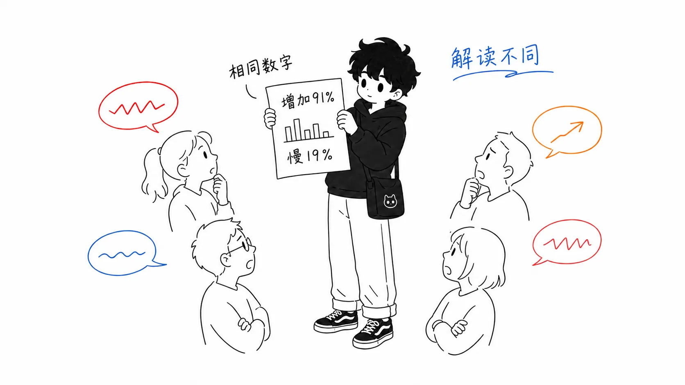
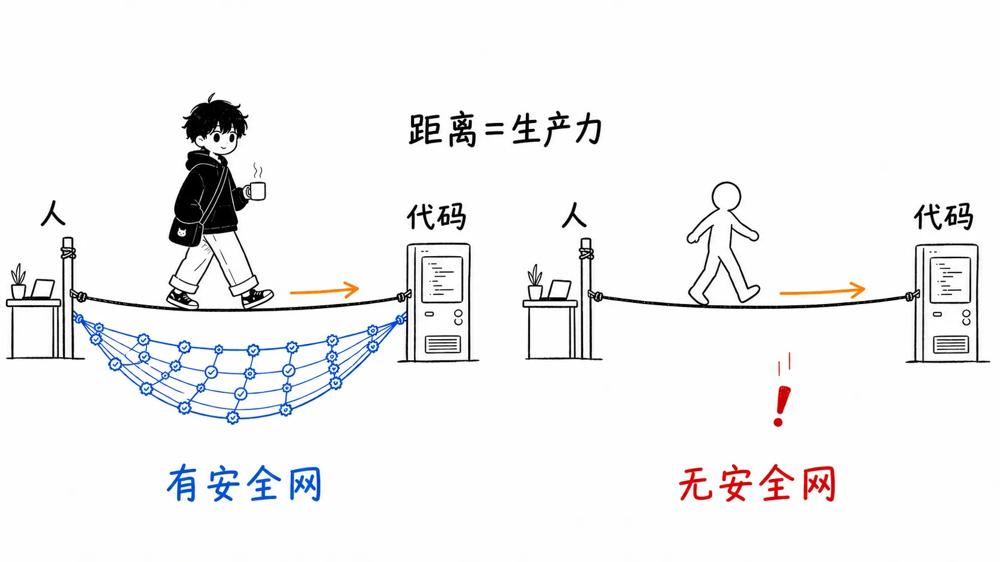
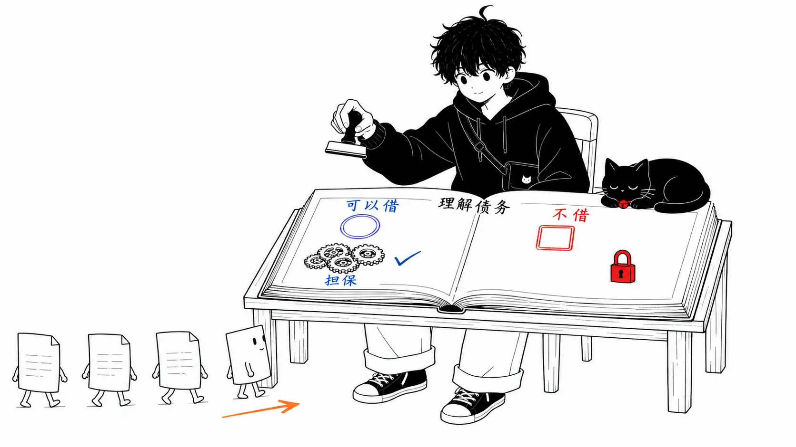
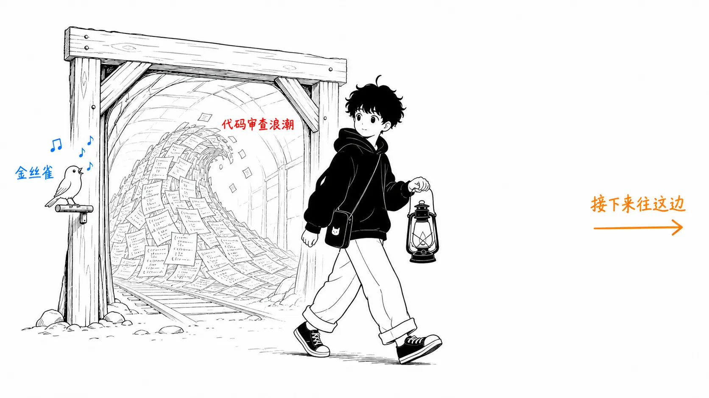

## 关于这篇文章

工程组织的经理 Csaba Okrona 在自己的博客 Leadership Garden 上发表了一篇题为《[The Work Moved: What the AI Coding Debate Actually Agrees On](https://leadership.garden/ai-the-work-moved/)》的文章。他对比阅读了六篇文章，作者从对 AI 编程深表怀疑的 Cory Doctorow、Armin Ronacher、Addy Osmani 等人，一直到全面投入的实践者，这篇是他的总括。

先声明一下：这六篇原文我并没有全部读过，本文依据的是 Okrona 的总括。另外，文章本身我没能找到发布日期的标注。同一博客前后的文章是 2026 年 5 到 6 月的，所以它发布在那之后（我是在 2026 年 8 月 16 日读的）。

先说结论。

> AI 编程之争，并不是在事实上起争执。怀疑派和推进派引用的是**同一批数据集**，甚至连“工作并没有消失，而是从代码生成转移到了评审、规格和验证”这一现象判断都是一致的。分歧只在解释上。而我认为，就连这种解释上的差异，也不是思想的差异，而是“在护栏上已经投入了多少”的差异。也就是说，这是披着哲学之争外衣的会计问题。

前半部分整理这几篇文章的内容，后半部分的“我的看法”会多花些篇幅。数字的罗列在别处也能读到，所以会写得短一些。

---

## 第 1 部分：所有人引用的都是同样的数字

Okrona 首先指出的是：立场截然相反的论者，伸手去拿的几乎是同样的数据。

据 Faros AI 和 Google 的 DORA 报告，AI 采用度高的团队，合并的 PR 增加了 98%，而评审时间膨胀了 91%，PR 的平均大小增加了 154%。瓶颈并没有消失，只是从生成转移到了评审。在 Atlassian 2025 年的调查中，使用 AI 的开发者有 99% 回答“每周节省了 10 小时以上”，但大多数人并没有报告整体工作量减少。省下来的时间被协调成本和上下文切换吃掉了。在 METR 的对照实验中，经验丰富的开发者使用 AI 时反而**慢**了 19%，可他们本人却相信自己变快了。在 Stack Overflow 2025 年的调查中，报告“生产力大幅提升”的开发者只有 16%。

这些数字，怀疑派读成“看吧，是幻觉”，推进派读成“看吧，只是工作移到上游去了”。数据是公共财产，只有解释成了私有财产。这就是 Okrona 的出发点。

> 私が衝撃を受けたのは、彼らの意見が割れている点ではない。**事実についてはこれほど一致しているのに、その解釈がこれほど違う**という点だ。
>
> （让我受到冲击的，不是他们意见有分歧这一点，而是**在事实上明明如此一致，解释却如此不同**这一点。）
>
> （摘自该文章，拙译）

---

## 第 2 部分：工作转移到了哪里

文章的核心，是并排列出各位论者对“转移目的地”的描述。

在 Steve Yegge 的 Gas Town 环境里同时跑 20 到 30 个智能体的 Dmytro Gaivoronsky，写得最坦率。

> AI支援コーディングは、私の生産性と、私とコードの間の距離の両方を増やした。この2つは別々の効果ではない。**生産性の向上とは、距離そのものなのだ。**
>
> （AI 辅助编程，既增加了我的生产力，也增加了我与代码之间的距离。这两者不是各自独立的效果。**生产力的提升，就是距离本身。**）
>
> （Gaivoronsky 氏，据 Okrona 的引用拙译）

他把工作的 70% 分配给“自动驾驶”（CI、linter、类型检查充当质量关卡），30% 分配给“深思模式”（推敲设计，认真评审代码）。距离拉大了也没关系，是因为他已经在出事时能接住的基础设施上投入过了。

Addy Osmani 承认同样的转移，然后把目光放在它的成本上。他（经由 Jeremy Twei）传播开来的“**理解负债**（comprehension debt）”，Okrona 说是这场争论里最好用的概念，我也同意。生成能力和理解能力是不同的认知能力，写的能力衰退之后，评审的能力还会保留一阵子。但存在一个临界点，过了它，“评审”就会变成盖橡皮图章。Osmani 本人的自白很生动。

> Claude が、私が何日も後回しにしていた機能を実装した。テストは通った。ざっと眺めて、頷いて、マージした。3日後、それがどう動いているのか自分で説明できなかった。
>
> （Claude 实现了一个我拖了好几天的功能。测试通过了。我大致扫了一眼，点点头，合并了。三天后，我自己说不清它是怎么运作的。）
>
> （Osmani 氏，据 Okrona 的引用拙译）

Bicameral AI 则把整个框架都推了回去。根据 IDC 2024 年的数据，开发者写代码的时间只占工作的 16%。瓶颈从一开始就不是代码生成，而是业务意图与技术实现之间的模糊。人类开发者会发现需求中的漏洞并向产品方上报，而他们担心的是，AI 智能体会**把漏洞埋进几百行代码里**交出来。

Jake Quist 的梳理最简单。他让 LLM 写一个 RingBuffer，因为这是边界清晰、自成一体的数据结构，它写得比他自己还好。接着让它做一个简单的个人 CRM，就崩溃了。分水岭不是前端还是后端，也不是简单还是困难，而是**是否需要同时把多个关注点记在脑子里**。人类对这种跨上下文的事异常擅长，而现在的 AI 不擅长，他这样说。

Armin Ronacher 作为 OSS 维护者，看到的是没有护栏的人引发的“slop loop（垃圾内容的无限循环）”的下游一侧。敲提示词只要一分钟，认真评审生成出来的代码则要花上它的好多倍。提交者被 AI 夸了一通，心满意足，而摆在维护者面前的是“表面上看着像样、评估起来却要花真功夫的代码”。据说有些项目开始要求大家不要发代码，改发提示词，理由是提示词更能清楚地表明意图。

然后是 Cory Doctorow 的“**反向半人马**”。如果说半人马是被机器辅助的人，那么反向半人马就是人的身体上装着机器的脑袋，也就是作为为机器干活的附属物的人。那种因为测试通过了就合并自己并不理解的代码的开发者，并不是在监督 AI，只是在为 AI 的输出提供**承担责任的一张脸**，这一指出堪称这个概念的看家本领。

---

## 第 3 部分：我的看法——这不是哲学之争，而是会计问题

从这里开始是正题。我要写的，是原文以及我看过的其他解读里都没有写的东西。

### 立场的差异，不是思想的差异，而是护栏投入金额的差异

把六位的“解释差异”重新排列，会注意到一种奇妙的相关性。按乐观程度排序，恰好就是在护栏上已投入金额的顺序。

Gaivoronsky 之所以从容，是因为他先建好了单元测试、linter、类型检查、CI 关卡、pre-commit 钩子这些承接网。Osmani 之所以谨慎，是因为他站在把规格驱动、三层边界、LLM-as-a-judge 当作“今后大家都该建的承接网”来宣讲的立场上。而 Ronacher 之所以愤怒，是因为他坐在别人护栏不足的成本会被记到自己账上的位置，也就是 OSS 维护者的座位。

也就是说，他们并不是对同一现象持有不同的意见，而是**在汇报同一现象的不同会计期间**。先投入完毕的人看到的是利润，正在宣讲投入的人看到的是报价单，收到不投入的别人的账单的人看到的是亏损。把它读成“对 AI 的乐观与悲观”，争论就永远对不上。把它读成“在你的环境里，评审成本是谁在付”这个会计问题，六个人的主张就排成了一条线。

所以我认为，这场争论分不出“胜负”。也不必分。你会有 Gaivoronsky 那一侧的体验，还是 Ronacher 那一侧的体验，是由你团队的承接网先决定的，而不是 AI 的性能。

### 理解负债不是用来偿还的，而是用来选择“在哪里借”的

“理解负债”这个词，听上去带着负债＝坏事、归零才理想的意味。我不同意这种读法。

和金融上的负债一样，问题不在于负债的存在，而在于不自觉的借入。Osmani 那句“三天后我说不清”的自白之所以可怕，不是因为有负债，而是因为他没有意识到自己借了。只有没记在账上的债务才会引发破产。

Gaivoronsky 的 70/30，其实就是把这笔记账明确地做出来的样子。“在这 70% 的领域，我放弃理解。取而代之的是，CI 和类型系统作为抵押。”“这 30% 抵押起不了作用，所以放在自己脑子里。”不是想把理解负债降到零，而是先划出可以借的领域和不能借的领域之间的边界线。按我的感觉，一定属于不能借那一侧的，是领域边界设计、数据模型、认证授权这一带；可以借那一侧的典型，是“测试能把规格完整说清楚”的自成一体的模块，也就是 Quist 的 RingBuffer 那一侧。他那个 RingBuffer/CRM 的分水岭，可以直接当作“可以借理解负债的地方的地图”来用。

你也许会想：“既然两边的说法最终都对，那读者该怎么办？”要做的只有一件事，重要的只是顺序。**在增加智能体数量之前，先建好承接网。** 按相反顺序做的人的账单，现在正堆在 Ronacher 的收件箱里。

### OSS 是煤矿里的金丝雀

还有一点。为什么最先惨叫的是 OSS 维护者，原文没有深究，但我认为这里有一个结构。

在企业内部，AI 产生的评审成本在同一个组织里被消化。就算有人批量制造粗糙的代码，负责评审的同事也在同一套薪酬体系里，成本留在公司内部。可是在 OSS 里，生成的成本由提交者支付（几乎为零），评审的成本由无薪的维护者支付。成本结构的不对称，在没有雇佣合同这层缓冲的情况下暴露了出来。所以，当企业的经理还在说“感觉生产力提高了”的时候，维护者已经在汇报极限了。

这不该被理解为 OSS 特有的悲剧，而应该读作有时间差的预告。在公司内部，使用 AI 的一方与承受后果的一方（评审者、SRE、QA，以及半年后要去碰那段代码的未来的自己）之间的不对称，同样以相同的形态存在。只是因为有缓冲，暴露得更晚而已。Faros AI 的“评审时间增加 91%”，我理解为金丝雀的叫声开始传到公司内部的矿道里的声音。

---

## 总结：只带走一件事的话

就是抛掉“赞成还是反对 AI 编程”这个问题。事实上两个阵营已经达成一致，决定你的体验的不是表明立场，只是在承接网上的投入是先还是后。把理解负债记入账本，有计划地去借。只有不自觉的债务才会引发破产，这一点 Osmani 三天后的自白已经证明过了。

## 出处

- Csaba Okrona《[The Work Moved: What the AI Coding Debate Actually Agrees On](https://leadership.garden/ai-the-work-moved/)》Leadership Garden（未标注发布日期。2026 年 8 月 16 日阅读）
- 文章中提到的主要一手资料：Faros AI / Google DORA 报告、Atlassian 2025 年调查、METR 的对照实验、Stack Overflow 2025 年调查、IDC 2024 年调查
- 提到的论者：Cory Doctorow（反向半人马）、Armin Ronacher（agent psychosis / slop loop）、Addy Osmani（80% 问题、理解负债）、Bicameral AI、Dmytro Gaivoronsky（Gas Town）、Jake Quist（RingBuffer/CRM）
