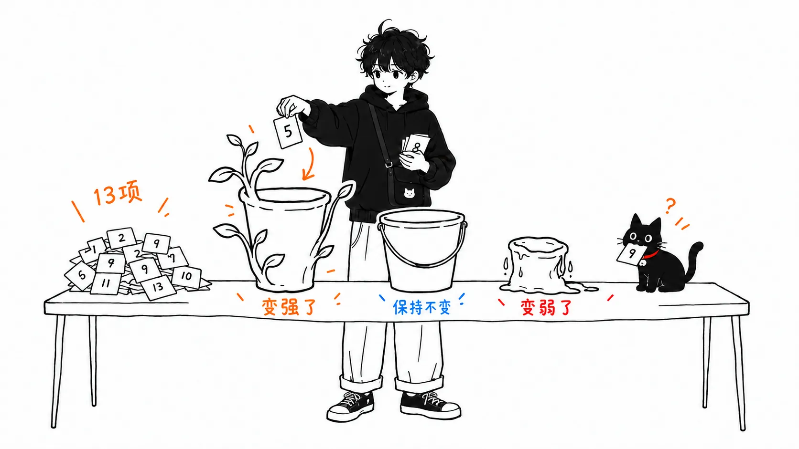
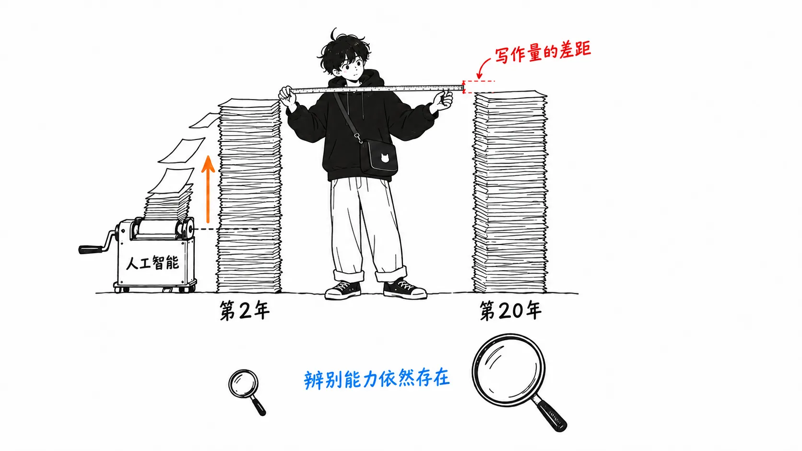
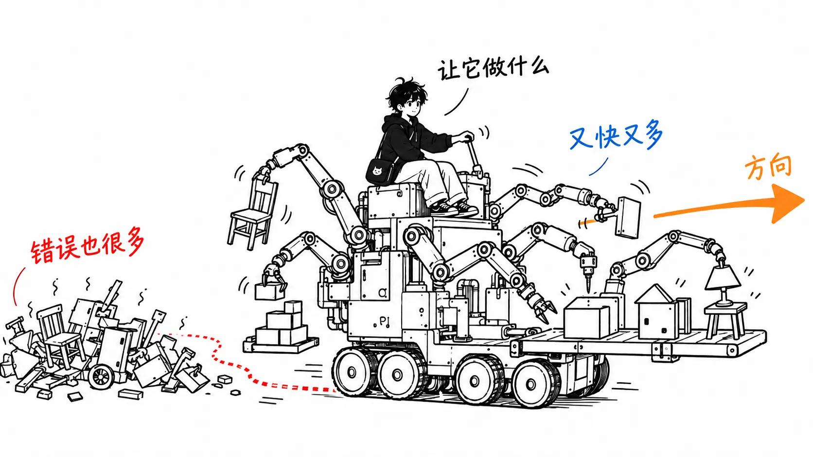
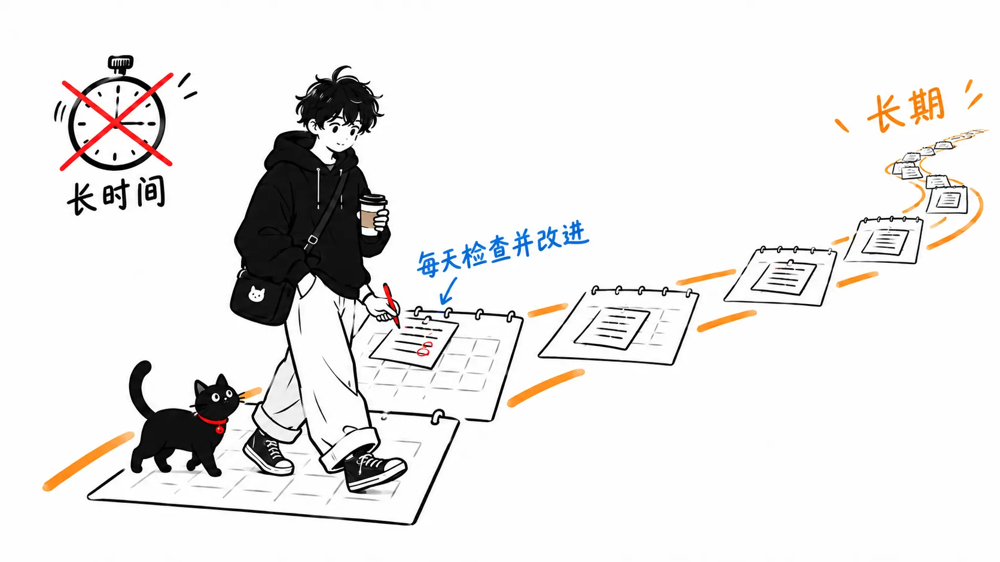

我重读了 Sam Altman 在 2019 年 1 月发在自己博客上的《How to Be Successful》。他当年执掌 Y Combinator，见过成千上万的创业者，这篇文章就是他把"想取得超乎寻常的成功需要什么"总结出的 13 条。

这是一篇七年前的文章，写在 ChatGPT 出现之前。当时 Altman 设想的"杠杆"里，还没有 AI。

所以我用 2026 年的眼光重读这 13 条，把它们分成"现在更强了的""原样不变的""变弱了的"三类。

先说结论。

> 13 条里动摇得最厉害的，我认为不是"7. Work hard"，而是"1. Compound yourself"里的一句话：别选那种干两年的人能和干二十年的人一样有效率的职业。AI 恰恰在缩小这个差距。反过来，因为 AI 而升值的是"6. Focus"，以及"4. Get good at 'sales'"里关于写作能力的那一段，它们都是决定"让 AI 去做什么"的那一侧的能力。

---

## 13 条的内容

这里只列出条目名，都是原文的标题，原样照搬。

1. Compound yourself
2. Have almost too much self-belief
3. Learn to think independently
4. Get good at "sales"
5. Make it easy to take risks
6. Focus
7. Work hard
8. Be bold
9. Be willful
10. Be hard to compete with
11. Build a network
12. You get rich by owning things
13. Be internally driven

Altman 在开头先声明，这篇文章是写给已经取得了一定成功（靠特权或靠努力）的人，讲的是怎样把它变成超乎寻常的成功。他还在脚注里写道，自己能有今天，出身的运气占了很大成分。这篇文章在设定前提时是很坦诚的。

内容摘要别处已经有很多可以读，所以接下来我只讲分类这件事。

## 动摇的那句话：两年和二十年

最让我在意的，是第 1 条里的这一段。

> You don't want to be in a career where people who have been doing it for two years can be as effective as people who have been doing it for twenty—your rate of learning should always be high.
>
> （你不会想待在这样的职业里：干了两年的人，能和干了二十年的人一样有成效。你的学习速度应该始终保持在高位。）

在 2019 年，软件工程师是满足这个条件的典型职业。干了二十年的人明显比干了两年的人强。设计的直觉，读懂故障的本事，哪里有雷的记忆。这是一份经验会直接变成复利的工作。

到了 2026 年，我认为这个前提已经塌了不少。第二年的人用上 Claude Code 或 Codex，产出的代码在数量和质量上，就是以前干了二十年的人才写得出来的水平。当然不是全部。但仅就"写"这一部分而言，两年和二十年的差距比 2019 年小得多。

直接拿 Altman 的尺子来量，软件工程师正在往"应该避开的职业"那一边靠。

我这么一写，大概有人会说"可是干了二十年的人能分辨 AI 输出的好坏"。确实如此，我也认为差距会留在那里。但那已经不是"写代码的经验"，而是"验证输出的经验"在产生复利。同样是二十年，复利压在什么上面，决定了 AI 之后的价值走向。Altman 的文章没有分得这么细，但今天来读，就得这样分开读。

## 更强了：Focus 和写作能力

反过来，我认为因为 AI 而升值的有两样。

第一个是"6. Focus"。

> It is much more important to work on the right thing than it is to work many hours.
>
> （做对的事，比工作很多个小时重要得多。）

让智能体去干活之后，动手的时间几乎变成了免费。剩下的是决定"让它干什么"的时间。这个博客的初稿也是让 Claude Code 写的，但选哪个题材，至今仍是人来定。选错了，智能体只会又快又多地做出错误的东西。Altman 的 Focus，如今比 AI 之前更是字面意义上的成立。

第二个是"4. Get good at 'sales'"里关于写作能力的那一段。

> Getting good at communication—particularly written communication—is an investment worth making. My best advice for communicating clearly is to first make sure your thinking is clear and then use plain, concise language.
>
> （擅长沟通，尤其是书面沟通，是值得投入的。想把话说清楚，我最好的建议是：先确保自己的思路清晰，再用平实、简洁的语言。）

Altman 写这段，是把它当作说服客户、投资人和候选人的能力。如今，这里又多了给智能体下指示这一项。思路不清就写出来的指示，换回来的成果物也是不清不楚的。读者从人扩大到了 AI，但所需要的能力没有变。

## 变弱了：Work hard 里"时间"的那一部分

第 7 条"Work hard"，现在读来只有一半过时了。

> You can get to about the 90th percentile in your field by working either smart or hard, which is still a great accomplishment. But getting to the 99th percentile requires both
>
> （无论是聪明地工作还是勤奋地工作，你都能在自己的领域达到大约前 10% 的水平，这仍然是了不起的成就。但要达到前 1%，两者缺一不可。）

如果"hard"指的是工作时长，那么在智能体能并行跑好几条任务的今天，人的时间的价值相对下降了。另一方面，Altman 在同一条里写的"work stamina"，也就是长期坚持下去的能力，并没有过时。每天看智能体的输出、修正、再跑一遍，这是长跑，不是短跑。

所以按我的读法，Work hard 的意思从"长时间"挪到了"长周期"。

## 原样不变：第 10 条和第 12 条

其余大部分，有没有 AI 都读起来一样。其中第 10 条贴合得简直像是为 AI 时代写的。

> If what you do can be done by someone else, it eventually will be, and for less money.
>
> （如果你做的事别人也能做，那它迟早会被别人做，而且花的钱更少。）

2019 年的"someone else"，指的是别的人，或者离岸外包公司。现在这里面加进了模型。而且模型比人便宜得多。这句话在 AI 之后会快得多地变成现实。

第 12 条"You get rich by owning things"也是同一个方向。Altman 写道"Time only scales linearly"。出卖时间的工作方式是线性的，这从来如此，但如今 AI 连这份时间的单价本身也在往下压，所以站到所有权一侧的理由更强了。

## 只带走一件事的话

把 13 条分类之后我明白了：Altman 的文章里过时的，不是"勤奋"的那部分，而是"工作年限直接就是价值"这个前提。

不妨针对自己的工作写一次：两年和二十年的差距，还留在哪里。如果差距只在"写了多少量"上，那这份工作就在向 Altman 的尺子所说的应避开的职业靠近。如果差距在于"选什么""判定什么是对的"，那这份经验仍在产生复利。
