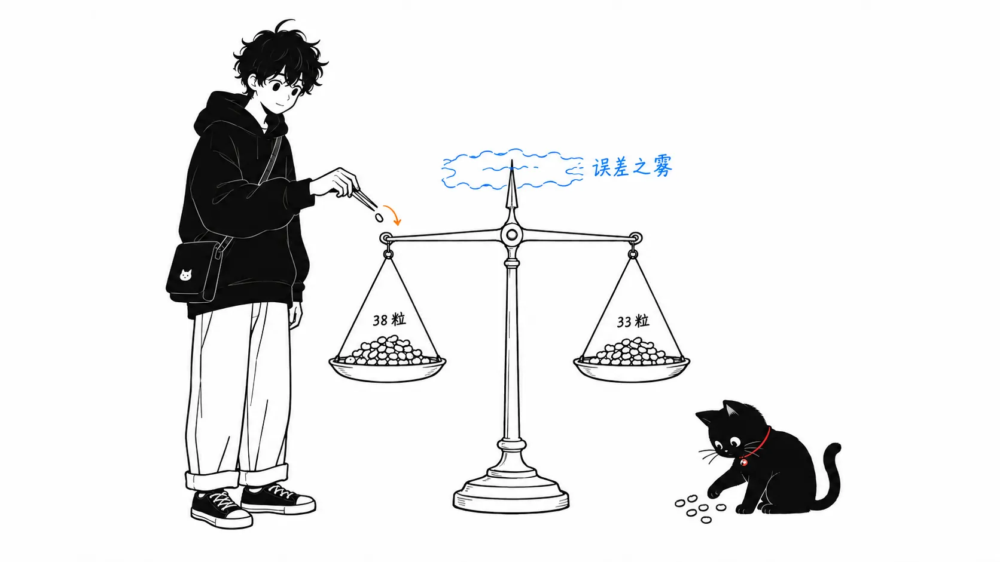
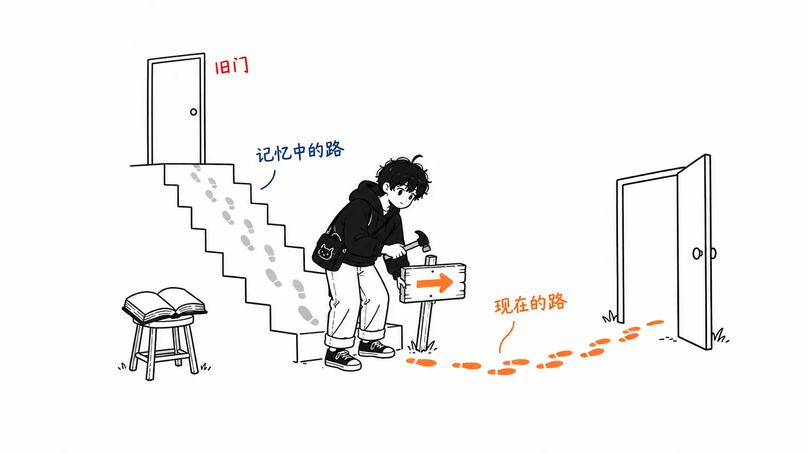

Anthropic 的 claude.dev 博客里有一个客服的例子，结尾给出的数字是"held-out 的 14 张工单上 90.5%，原来的配置是 78.6%"。按比例倒推，两个数字都和 42 次试验（14 张工单 × 每张 3 次）对得上：38 次和 33 次，差 5 次。

同一篇文章介绍的 `/claude-api hillclimb` 指南里，给了一个估算测试集误差的经验式 `1/sqrt(n·reps)`。代入 42，得到 ±15 个百分点。文中例子的差值 11.9 个百分点，用这个技能自己的尺子来量，落在误差范围之内。

先把我的判断放在前面。

> 我认为这篇文章里最重要的图是 OCR 的例子（Figure 5）。可紧跟在它后面列出的头号对策，也就是 train 和 test 的划分，根本检测不出 OCR 这种类型的过拟合。如果 eval 里的所有用例都需要 OCR，那么 train 和 test 会一起涨。划分防得住的是"对特定用例的过拟合"，防不住"对 eval 与线上之间偏差的过拟合"。后者在 hillclimb 内部拦不住，只能在 build-eval 阶段，靠从线上流量里取输入来防。

出处是 claude.dev 博客的 [Automating eval design and hillclimbing with Claude](https://claude.dev/blog/automating-eval-design-and-hillclimbing/)，作者 Lance Martin，2026 年 9 月 28 日发布。

先声明一下：我没有运行过 `/claude-api build-eval`，也没有运行过 `hillclimb`。我读的是博客正文和 9 张图，以及 GitHub 上 [anthropics/skills](https://github.com/anthropics/skills/tree/main/skills/claude-api) 里技能本体中与 eval 相关的 4 个文件（2026 年 9 月 29 日的提交 #1930 时的版本）。文中实验的数字全部是 Anthropic 自己报告的，我没有办法核实。

---

## 文章写了什么

前半部分是 eval 的设计原则，列出了好 eval 的 4 个条件。

> 1. Eval tasks mirror production.
> 2. Performance improves with stronger models and more thinking.
> 3. There is "passable" headroom at the frontier.
> 4. Low run-to-run variance.
>
> （eval 的任务要反映线上情况。模型越强、思考得越多，分数越高。即使是最顶级的模型，也还有达不到 100% 的余地。每次运行之间的波动要小。）

第 2 条和第 3 条组合起来很实用。模型更强分数却不涨，说明任务含糊，或者评分器（grader）偏了。每次都必然失败的任务不是难，而是坏了。文中给的标准是"两位专家会不会给出同样的判定"。

"adversarial sampling"那一节也很有分量。如果只收集当前模型答错的用例，eval 测的就成了这个模型弱点的指纹。难的用例，只放人能说清"为什么难"的。

`/claude-api build-eval` 把这些做成了对话式的流程，输入按线上对话记录 → bug 报告和咨询 → 手写的 5 到 10 条 → 从代码库合成 的顺序收集。评分从便宜的开始选：输出格式固定就用代码判定，自由文本就让 LLM 打分（评分细则不要写成 5 档打分，要写成可以核实的陈述）。跑完基线之后，它会把同一份输出评两遍，看判定会不会变，也检查有没有超时和中途被截断的回答；基线超过 95% 时，它会提醒你"目标该放在成本或延迟上，而不是质量"。

后半部分是 hillclimb。

1. 问要改进什么（性能，还是保持性能的前提下降成本）
2. 把 eval 用例随机分成 train 和 test
3. 每一轮只读 train 的对话记录，只提出一项修改，以补丁的形式给出
4. train 和 test 都涨就采纳；train 涨而 test 持平就怀疑过拟合，回退
5. 连续 2 到 3 轮分数不动之后，把剩下的失败按原因分类（评分器的 bug、测试框架的缺陷、波动）

文中有两个例子。第一个是客服的 44 张工单（探索用 30 张，held-out 14 张），从 Opus 4.8、effort high 的 74.4%、每张工单 4.6 美分起步；做了提示词审查并迁移到 Opus 5.5、effort low 之后是 87.8%、1.9 美分；换成 Sonnet 5、effort low 是 88.9%、约 1 美分；在提示词里加上路由规则后达到 98.9%。held-out 的 14 张工单上是 90.5% 对 78.6%，成本约为原来的五分之一。第二个例子是提升 claude-api 技能自身的性能，从 66% 升到约 88%。

---

## 技能本体里写了什么

博客只是摘要，所以我打开了技能本体里的 eval 指南。4 个文件加起来，英文约 18 万字符。

| 文件 | 行数 | 内容 |
| --- | --- | --- |
| `build-eval.md` | 234 | 搭建 eval |
| `eval-hillclimb.md` | 339 | 性能的 hillclimb |
| `cost-hillclimb.md` | 442 | 成本的 hillclimb |
| `eval-audit.md` | 205 | eval 的审计 |

有 3 处比博客写得更深。

第一处是误差的经验式。`eval-hillclimb.md` 是这样写的。

> For a binary pass-rate the 95% CI half-width is roughly `1/sqrt(n·reps)` - 25 test cases at 2 reps is about ±14 points, 50 at 2 reps about ±10
>
> （对于通过率这类二值指标，95% 置信区间的半宽大约是 `1/sqrt(n·reps)`。25 条测试各跑 2 次约为 ±14 个百分点，50 条各跑 2 次约为 ±10 个百分点。）

第二处是"test"这个词的用法。同一个文件里默认的划分方式中，test 每一轮都会被评分，"its score picks the winning round and is the headline"（用它的分数选出获胜的那一轮，并把它作为标题数字）。再单独切出第三份 validation，把 test 留到最后，只是对"~150+ cases"这样的大数据集才作为可选项推荐，并写着"For most evals the extra bookkeeping isn't worth it"（对大多数 eval 来说，这点额外的记账工作不值得）。

可是 `cost-hillclimb.md` 里却写着：

> **Selection set != holdout.** The split whose score picks winners each round is a selection set, even if the guide calls it "test". Pre-register confirm runs for the headline and expect train->holdout shrinkage.
>
> （选择集不是 holdout。每一轮靠分数挑选胜者的那份划分就是选择集，哪怕指南把它叫作"test"。标题数字要用事先登记好的确认运行来得出，并且要预期从 train 到 holdout 分数会缩水。）

"哪怕指南把它叫作 test"里的"指南"，换个读法，指的就是隔壁的 `eval-hillclimb.md`。同一个技能里的两个文件，用同一个词表达不同的意思，其中一个还给另一个加了注意事项。

第三处是 `cost-hillclimb.md` 里的一个实测例子。同一个配置在选择阶段的运行中 20 题答对 11 题，随后 3 次确认运行分别是 11、6、11。结论是"cost cut firm, mean quality comparable within noise, NOISIER than baseline"（成本削减是实在的，平均质量在噪声范围内相当，但比基线更不稳定）。在博客光鲜的例子背后，指南是从这种不起眼的失败案例里总结出规则的。我觉得指南比博客更可信。

---

## 用技能自己的尺子量一量例子里的数字

博客里的比例，全都能被每次的运行次数整除。这是我验证过的结果。

| 阶段 | 划分 | 比例 | 按每个 3 次计 |
| --- | --- | --- | --- |
| Opus 4.8 high（基线） | 探索 30 张 | 74.4% | 67/90 |
| Opus 5.5 low ＋ 提示词审查 | 探索 30 张 | 87.8% | 79/90 |
| Sonnet 5 low | 探索 30 张 | 88.9% | 80/90 |
| Sonnet 5 low ＋ 提示词改进 | 探索 30 张 | 98.9% | 89/90 |
| 原配置 | held-out 14 张 | 78.6% | 33/42 |
| 最终配置 | held-out 14 张 | 90.5% | 38/42 |

每个跑 1 次、2 次、4 次、5 次时，这 6 个比例不可能同时是整数。每个跑 3 次（或 6 次）则全部对得上。博客里没有写次数，所以这顶多是"当作每个 3 次来看就说得通"，不能再多说了。

如果是每个 3 次，held-out 就是 42 次运行。技能给的经验式 `1/sqrt(42)` 约为 ±15 个百分点。90.5% 和 78.6% 的差是 11.9 个百分点，比它小。`eval-audit.md` 的第 5 节把这个式子称为"noise floor（噪声底限）"，也就是用来衡量两个配置之间成对差值的 95% 置信区间半宽的估计。它正是用来判断"这个差值能不能信"的、技能自己的尺子。

这个例子的运行目标是"保持性能的同时降低成本"，所以该读出的结论是"成本约为五分之一，held-out 的正确率没有下降"。这是个站得住的主张，也相当有价值。但如果把文章最后一句读成"正确率提高了 12 个百分点"，那正是技能指南自己会叫停的读法。

用同样的眼光看 Figure 7（inbox-routing 的结果页，图注写的是"schematic（示意图）"），就更单薄了。24 条用例里 test 占 8 条，每条 3 次共 24 次运行。被采纳的 v1 的 test 是 0.875（21/24），因为"train 涨了而 test 持平"被回退的 v2 是 0.833（20/24）。决定回退与否的，只是 1 次运行的差别。它是示意图，把它当实测来责怪并不合适，但读者要照着做的界面样例就是这个粒度，这一点值得记住。

Figure 8 里还有一处让我停下来。第二个点的标签是"move to Opus 5.5 & audit prompt"，模型迁移和提示词审查被放进了同一个点里。`cost-hillclimb.md` 把审查放在最前面，当作"便宜、只做一次、能降低噪声"的第一道工序，所以这并不违反"每轮只改一项"的规则。只是图里没有只做审查的那个点，从 74.4% 跳到 87.8% 的涨幅里，有多少来自模型、多少来自提示词，无从知晓。正文用 Opus 5.5 的价格（输入输出便宜 20%，缓存读取便宜 60%）解释了一部分成本下降，但正确率的上升并没有被拆开。

至于 held-out 的那 14 张工单本身，博客写的是"the search never saw"（搜索过程从未见过）。如果这是最后只跑一次的确认，那就是比 `eval-hillclimb.md` 的默认做法更强的设计。这种情况下，弱的只是数量。

---

## 我的看法

### 1. held-out 拦不住 OCR

文章的过拟合一节，从 OCR 的例子开始。

> consider an evaluation task that benefits from OCR, but OCR is rarely beneficial in your production tasks. The evaluation harness might add an OCR tool to your application, which improves on the benchmark without any impact on production.
>
> （假设有个评估任务借助 OCR 更容易解决，但在线上任务里 OCR 很少有用。hillclimb 可能会给应用加上一个 OCR 工具。基准上的分数涨了，对线上却没有任何影响。）

Figure 5 把这种模式并排列了出来："任务构成要求 OCR → 加上 OCR 工具"、"任务在 /app 下 → 加上'务必先 cd /app 再跑 pytest'"、"措辞有特殊习惯 → 针对它写的提示词"。紧接着是"Three things can help address this"，第一条就是"Split the cases"。

这是我最在意的地方。Figure 5 里列的每一项，都是 **eval 整体的性质**。如果 eval 的大部分用例需要 OCR，那么随机分出来的 train 和 test 里，需要 OCR 的用例比例是一样的。加上 OCR 工具，两边会一起涨。hillclimb 的判定是"两边都涨了，所以采纳"。train 涨而 test 持平这种过拟合的信号，根本不会出现。

划分能抓住的，是针对 train 里特定用例的修改，比如把失败工单的措辞直接贴进提示词。指南另外立了"Never paste failures into the prompt"，针对的就是这一类。这是真问题，划分对它有效。但 Figure 5 最上面的 OCR 和 /app 的例子，在划分的网之外。

那么什么能防住呢？只有文章的第一条原则，"eval 任务要反映线上情况"。build-eval 想从线上对话记录里取输入，大概就是为了这个。也就是说，OCR 型的过拟合，只能在 build-eval 阶段拦住，而不是在 hillclimb 里面。文章的结构把这两件事放在了不同的小节，我觉得这让它们之间的联系很难看出来。

我想到一件实际能做的事。`eval-hillclimb.md` 里有一条规则，"Separate 'did the mechanism engage' from 'did it help.'"，让智能体把调用工具的次数等信息记在与分数分开的另一列里。把这一列和线上日志并排放一放就行。如果 hillclimb 加进去的工具或分支，在 eval 里 60% 的用例中会触发，在线上只有 2% 触发，那就是 OCR。技能只统计 eval 内部的次数，线上那边的次数只能自己拿来。

还有一点。hillclimb 允许改动的对象选项里包括"Your harness code"，文章自己也写了"放手让它改测试框架的请求容易陷入僵局"。OCR 型的添加恰恰发生在这个面上。在没有办法和线上调用次数对照之前，我觉得把测试框架的代码列进不让它碰的清单里更稳妥。

### 2. "test"在默认设计里是选择集

第二点是措辞问题。文章在讲划分时，把 test 写成"a test set that is never seen（从未被看到过的测试集）"。hillclimb 的分析角色确实不读 test 的对话记录。但 test 的分数每一轮都会被看，用在采纳还是回退的判定上，以及最后挑选哪一轮获胜上。

轮数越多，"碰巧在 test 上表现好的修改"就越容易被采纳。像 claude-api 技能那个跑了 24 轮的例子，就要做 24 次判定。最后报告的 test 分数，按定义就是所有轮次 test 分数的最大值。结构上就会偏乐观一点。`cost-hillclimb.md` 里的"Selection set != holdout"说的正是这件事，同一个技能里，答案早就先给出来了。

我的立场很明确：我认为应该改的是 `eval-hillclimb.md` 的默认做法。把第三份切片定为"150 条以上才可选"，是出于省事的考虑，但用例越少，选择带来的乐观偏差越大，所以实际上应该反过来。如果用例太少没法切成三份，至少在最后用另一个随机种子，只把获胜者和基线重新跑一遍，把那个数字作为标题数字。`cost-hillclimb.md` 就是这么要求的。

顺便说一句，文章的第二个例子（claude-api 技能自身）里，博客和 Figure 9 都没有出现 train 和 test 的区分。66.1% 到 87.9% 的那条曲线，是哪一份划分的数字，看不出来。

### 3. 最有价值的，是分数停滞时的归因分类

第三点，是我读起来觉得最有意思的地方。在 claude-api 技能的例子里，分数停滞两轮之后，把剩下的失败按原因分类，得到的是这样的结果。

> the hillclimber found that the skill content was present but Claude was simply writing older API shapes (e.g., from its trained priors).
>
> （技能里其实写了相关内容，但 Claude 仍然按训练时记住的旧 API 写法在写。）

修复方法是在技能开头附近放一张"记忆中的写法 → 现在的写法"的对照表，并把 C# 和 Java 的注意事项移到示例上方。这让分数从 77% 升到了 80%。

继续补充内容之所以修不好，是因为缺的不是信息，而是对抗模型记忆里那些习惯的力量。我之前读过一篇验证"技能有效"这类数字的论文，里面提到：去取技能和遵循技能是两道不同的工序。这个例子就是它的实战版。技能光是写在那里不够，必须放在习惯会出现的位置之前，否则不起作用。

分类中还出现了 eval 一侧的另一种坏法。有个任务要求写出捕获一种错误的代码，评分器却要求"至少三层的链式结构"。评分器的指示和文档互相矛盾，实际去调用 API 后发现文档是对的。Figure 9 第三段（80.1% → 87.9%）的标签是"fixing graders, plus more skill edits"。这一段的涨幅里，有多少来自技能变好，有多少来自评分器变正确，文章里看不出来（指南写了修好评分器之后要把所有版本重新评分，如果照做了，曲线应该是用同一把尺子连起来的）。

我不把这当成弱点，而觉得这才是 hillclimb 真正的用处。即使把它当作提分的工具来跑，最有用的产出也可能是"这个 eval 的这里坏了"的报告。分数停滞，就是告诉你这件事的信号。

留下一个我没能得出答案的问题。这个例子里的 eval 是从文档生成的，而 hillclimb 被允许去读那份文档和 SDK。提出修改的一方可以读到正确答案的出处。指南里"不要把答案放在模型够得着的地方"这条规则，说的是被测试的模型，所以并没有直接谈到提出修改的一方。技能的职责就是传递文档的内容，所以也可以说这不是作弊，而正是它的本职工作。可是那样一来，随机分出来的 test 任务同样是从文档的同一些页面生成的，"test 没被看过"的含义就大打折扣了。

---

## 只带走一件事的话

`/claude-api hillclimb` 加了工具或分支之后，请把它在 eval 里触发了几次，和在线上日志里会触发几次并排放在一起。前者技能会帮你数，后者只能自己拿来。两个次数差得很大的话，那就是文章 Figure 5 里的 OCR。train 和 test 的划分，不会告诉你这个差别。

---

## 出处，以及我是怎么核实的

- Lance Martin，["Automating eval design and hillclimbing with Claude"](https://claude.dev/blog/automating-eval-design-and-hillclimbing/)，claude.dev Blog，2026 年 9 月 28 日
- anthropics/skills 的 [claude-api 技能](https://github.com/anthropics/skills/tree/main/skills/claude-api)。`shared/evals/` 下的 `build-eval.md`、`eval-hillclimb.md`、`cost-hillclimb.md`、`eval-audit.md`。通过 GitHub API 获取，对应 2026 年 9 月 29 日的提交"Update claude-api skill: Claude Opus 5.5 default, Claude Sonnet 5.5, build-eval and hillclimb guides (#1930)"
- 我之前写过的相关文章：[Claude 官方的降本技巧](/articles/claude-official-cost-down)（读的是博客所链接的那篇成本削减文章）

比例的倒推，是对 30 条和 14 条两种情况分别穷举每个跑 1 到 6 次，检验博客里的比例（小数点后一位）能否由整数次数得出。只有每个跑 3 次和 6 次时全部对得上。误差的经验式原样使用了 `eval-hillclimb.md` 和 `eval-audit.md` 里的 `1/sqrt(n·reps)`。`eval-audit.md` 的第 5 节也把它用作差值置信区间的估计。每张工单的结果没有公开，所以我没有做精确的成对检验。

图的读数，是我用眼睛读博客里的图片得来的。原始数据没有公开。

### 没能验证的点

- 每张工单的运行次数。只做到了"当作每个 3 次就说得通"这一步
- held-out 的 14 张工单，究竟是最后只跑一次的确认，还是也在 `cost-hillclimb.md` 的采纳判定（held-out 的分数是否落在一定范围内）中途被用过
- Figure 8 第二个点里，只做提示词审查的效果与迁移到 Opus 5.5 的效果各占多少
- claude-api 技能的例子（66.1% → 87.9%）是 train、test 还是整体的数字。修好评分器之后，基线有没有重新评分
- Figure 7 是示意图，实际的 hillclimb 输出是否是这个粒度（test 8 条）
- Sonnet 5.5 在同一天（9 月 28 日）发布，文中例子用的是 Sonnet 5。不知道 5.5 能否得到同样的结果
