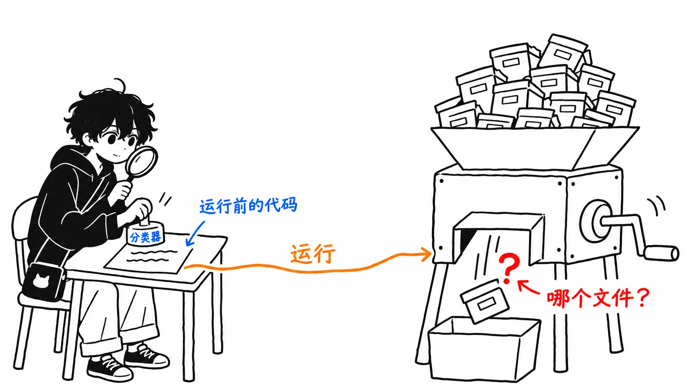
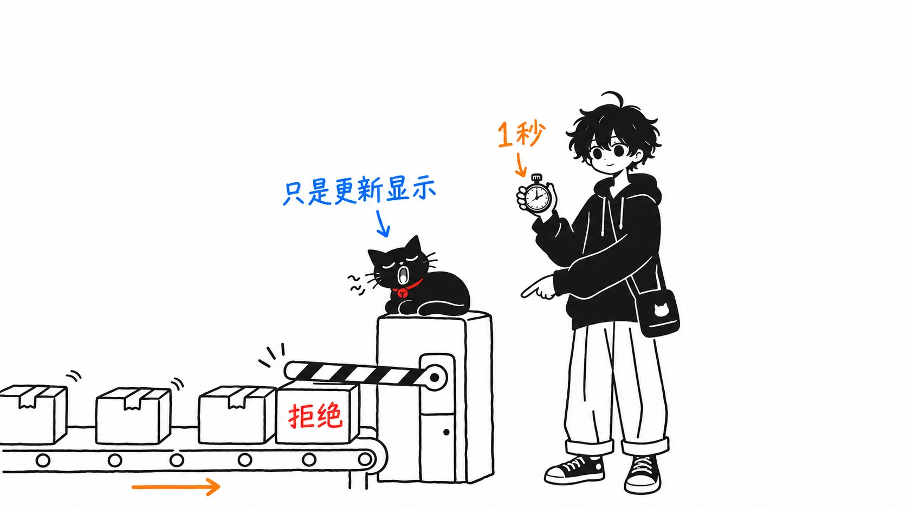
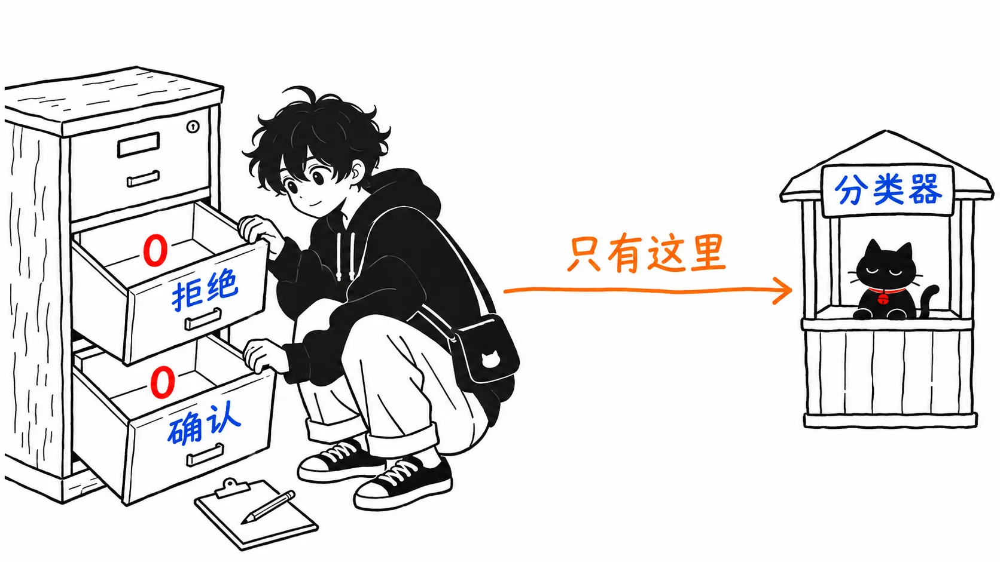

Anthropic 面向开发者的官方账号（@claudedevs）在 2026 年 11 月 17 日（UTC）介绍了 Code Mode。

> Check out Code Mode, a new, experimental way for Claude Code to work with tools. Claude writes scripts that chain your tools together in sophisticated ways, and it can answer you while long commands are still running.
>
> （来试试 Code Mode。这是 Claude Code 使用工具的一种全新的实验性方式。Claude 编写脚本，把各个工具高度灵活地串联起来，长命令还在运行的时候，它也能回复你。）

这条帖子只有一段简短的介绍、开启它的环境变量，以及文档链接，所以我读了链接指向的页面。然后把它和我自己的 Claude Code 设置逐项对照了一遍。

先说结论。

> 在 Code Mode 下，auto mode 的分类器看的东西，从"每一次工具调用"变成了"把调用打包在一起的代码"。分类器看不到运行时才确定的值（比如从搜索结果里取出的路径）。我的环境里一条 deny 和 ask 的规则都没有，决定拦什么，几乎全交给了 auto mode 的分类器，所以我是受影响最大的一方。我还发现了另一点：如果有超时为 1 秒的 hook，那么代码一旦运行过，hook 耗时超过 1 秒的工具调用就会被拒绝。

---

## 关于这篇文章

我读的是文档"Run tool calls from code with Code Mode"的正文。它链接的权限、permission modes、hooks 这几页，我没有读。

我的立场也交代一下。我手头的 Claude Code 是 v2.1.326，满足文档对版本的要求（v2.1.323 及以上）。但我没有为这篇文章开启 Code Mode。下面是把文档和我自己的设置文件并排读的结果，实际行为我没有确认过。

## Code Mode 做什么

平时的 Claude Code，是一次调用一个 Bash、Read、Edit，读了结果之后再决定下一步。在 Code Mode 里，Claude 编写 JavaScript，在其中调用工具。文档里的例子是这样的。

```javascript
const files = await $`rg -l "function retryPolicy" src`.text();
const target = files.trim().split("\n")[0];
await edit(target, "maxAttempts: 3", "maxAttempts: 5");
({ edited: target, tests: $`npm test -- retryPolicy`.nothrow() });
```

查找、修改、跑测试，用一段代码做完，最后一行只返回 Claude 要读的那部分。对话里会显示 diff 之类的工具调用，代码本身则折叠在用 `Ctrl+O` 打开的 transcript 里。

文档列出的适合的工作有：跨很多文件的同一处修改、想在读之前先筛选的搜索、可以同时运行的相互独立的命令。要开启它，设置环境变量 `CLAUDE_CODE_EXPERIMENTAL_CODE_MODE=1`。

这个"只返回要读的部分"，和我现在让插件做的事很接近。在我的环境里，如果想用 Read 或 Bash 直接读很大的输出，会被插件的 hook 拦下，并被要求在沙箱里处理、只输出答案。Code Mode 看起来是把这件事放到 Claude Code 本体这边来做的机制。

不过，文档里"无法启动的原因"那张表中，有"it doesn't yet work with the plugin"和"it doesn't yet work with an installed mod"。我的环境里装了检查、改写工具调用的插件，所以它到底能不能启动，我不知道。

## 分类器看不到运行时确定的值

正题是权限那一节。代码里的工具调用，会逐个以平常的工具名经过 deny 和 ask 的规则、PreToolUse 的 hook。变的是 auto mode 的分类器。

> the classifier reviews each piece of code before it runs, not each tool call. It doesn't see values computed at run time, such as a path taken from search output, so keep rules or hooks for calls you must control.
>
> （分类器是在代码运行前，把代码整体审查一次，而不是逐个审查工具调用。运行时算出的值，比如从搜索输出里取出的路径，它是看不到的。所以对必须控制的调用，要保留规则或 hook。）

就上面的例子来说，分类器看到的是"编辑 `rg` 结果的第一行"这样的代码。具体编辑哪个文件，要等 `rg` 运行了才确定。平时的 auto mode 是逐个调用地看，所以我认为 Edit 的文件名它应该是看得到的，但 permission modes 那一页我没读，所以这是推测。



接着我打开了自己的设置。`~/.claude/settings.json` 里 `defaultMode` 是 `auto`，`allow` 是空的，没有 `deny` 和 `ask`。另一个设置文件（`settings.local.json`）里有几条 `allow`，但 `deny` 和 `ask` 哪里都没有。也就是说，我没有写过任何拦截什么的规则，决定拦什么，几乎全交给了分类器。文档说"要保留规则或 hook"，我正是缺少那些规则的一方。

文档还写了另一个提醒。Bash 的规则是按命令字符串来匹配的，所以用不匹配规则的写法，也能做同样的事。这并非 Code Mode 独有，它说。在 Code Mode 里，`app` 文件夹里的 `git push`，到 hook 那里可能是 `cd 'app' && git push`。如果要增加规则或 hook，就得采用把复合命令拆开再逐一检查的写法。

## 超时为 1 秒的 hook

读的时候让我停下来的还有一处，是故障排查那一节。

> **`the hook did not finish`**: your hook timed out on a call from code, or on any other tool call once Claude has run code in the session.
>
> （「the hook did not finish」：hook 在来自代码的调用上超时了。或者，在会话里代码运行过一次之后，hook 在其他工具调用上超时了。）

这种情况下，会按 PreToolUse 的 hook 没有返回判定来处理，调用被拒绝。即使没有设置 `onFailure` 也一样。

`settings.json` 的 PreToolUse 里，有一个作用于所有工具的 hook，`timeout` 是 1 秒。从名字和显示的文案来看，我认为它是用来更新桌面宠物的显示的 hook，并不做权限判断（脚本的内容我没有读）。如果文档所说属实，那么在 Code Mode 下，代码一旦运行过，这个 hook 耗时超过 1 秒的调用就会被拒绝。本来没打算拦任何东西的 hook，站到了拦截的一边。实际上有多频繁地超过 1 秒，我没有测过。来自插件的 hook 的超时，我也没有确认。



文档给的处方是延长超时，或者加上 `"onFailure": "continue"`。对只是更新显示的 hook，我认为后者合适。

UserPromptSubmit 的 hook，据说在代码于后台运行时，也会对代码的输出起作用。我的环境里，有 `settings.json` 里的一个，以及插件装入的、用来补充上下文的 hook。其中是否有哪个会返回拦截的判定，我没有确认。

## 我的见解

要守住判定，常说的是把判定放在改动够不到的地方。读了 Code Mode 的文档，我觉得判定还有另一个条件：判定的对象是看得见的。

Code Mode 的分类器看的是参数确定之前的代码。它看的是计划，不是实际的行为。计划即使正确，只要 `rg` 返回了意料之外的文件，行为就变了。另一方面，规则和 hook 是对代码里的调用也逐个起作用的。我把文档写"保留规则或 hook"，读成是因为能看到实际的值的是它们。文档还提到了直接检查代码本身的办法：给 `REPL`（运行代码的工具）挂上 PreToolUse 的 hook，读 `tool_input.code` 就行。不过那和分类器一样，也是看计划的手段。

另一方面，设置放在哪里这一层的防护做得很扎实。`CLAUDE_CODE_EXPERIMENTAL_CODE_MODE` 写在项目的设置文件里会被忽略，所以克隆下来的仓库没法擅自开启 Code Mode。组织的管理员可以用 managed settings 把它关掉，但不能把它打开。能打开的只有本人。

所以我的结论是，在决定要不要试 Code Mode 之前，先数一数交给分类器的范围有多大。就我而言，是拦截判断的几乎全部。至少，凡是去向会随运行时的值而变的（`git push`、`rm`、向外部发送），我打算先挪到 deny 或 ask 的规则或者 hook 里，再来试。

## 只带走一件事的话

开启 Code Mode 之前，先数一数 `permissions` 里 `deny` 和 `ask` 的条数。如果是 0，那么想拦的东西能不能拦住，就只取决于一个看不到运行时确定的值的分类器。hook 的 `timeout` 放在那之后再看。



出处：ClaudeDevs（@claudedevs）的[帖子](https://x.com/claudedevs/status/2122801681939234950)（2026 年 11 月 17 日 UTC）。Claude Code Docs"[Run tool calls from code with Code Mode](https://code.claude.com/docs/en/code-mode)"。它链接的权限、permission modes、hooks、sandboxing 这几页我没有读。我实际上没有开启 Code Mode，hook 超时时的行为，我在手头也没有确认过。
