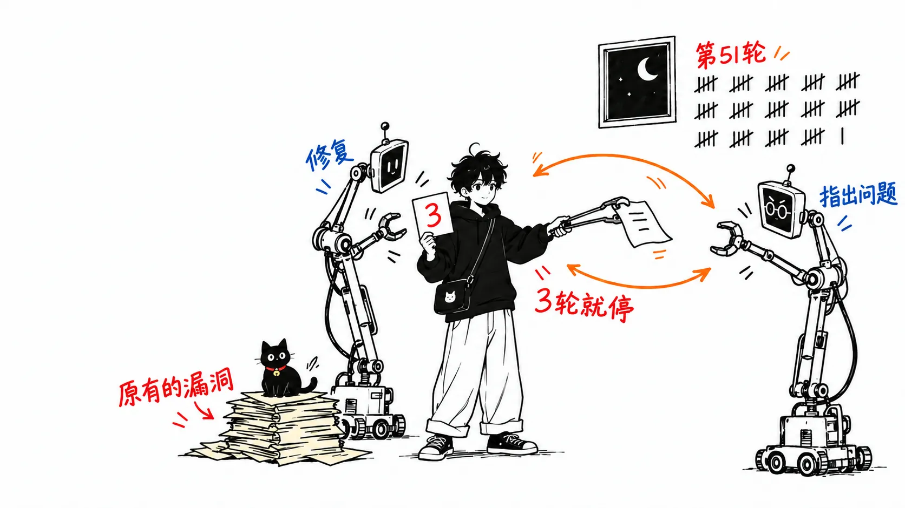
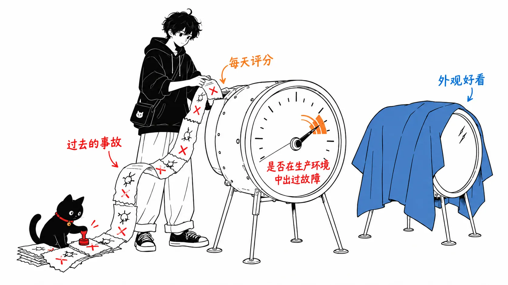
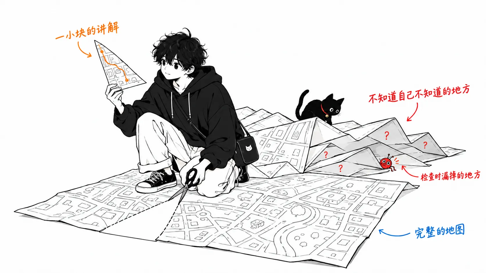
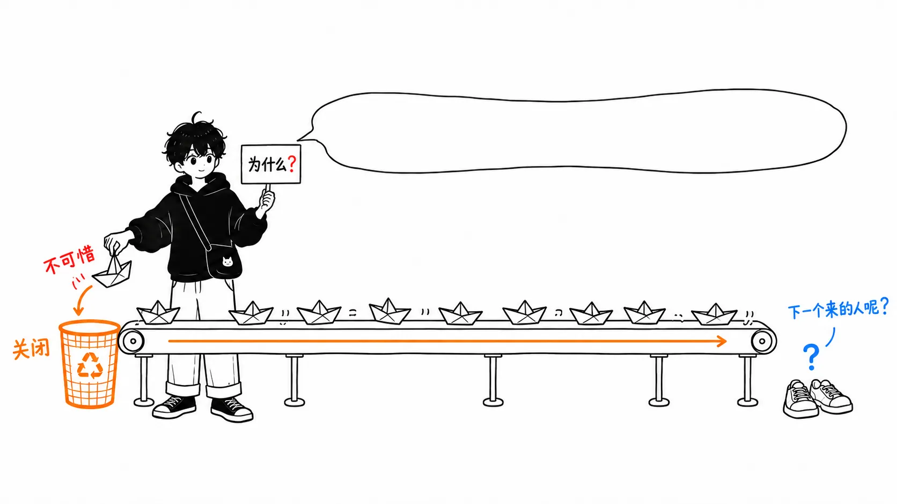

有一个 PR，一晚上被评审了 50 多次。

评审的不是人。是智能体写了 PR，智能体评审员提出问题，作者这边的智能体去修改，然后评审员再提。就这样来回折腾了一整晚，直到作者喊停。

这个故事出自 Claude Code 团队 2026 年 10 月 15 日发在 claude.dev 上的《How the Claude Code team does code review》。作者是 Addy Osmani、Morgan Westlee Lunt 和 Qing Wang 三人。文章的前提是 Claude Code 约 9 成的代码由 Claude 来写，然后用六层结构说明他们怎样评审这么大的量。门面数字是：6 月到 9 月之间合并的 PR 增加到了 2 倍以上，其中被 revert 的比例下降了 40% 以上。

先把结论写在前面。

> 8 月我写过一句话：“让 AI 做评审的预筛，不过是在坏掉的仪表旁边再摆一块同样的仪表。”这篇文章把这句话驳倒了一半。如果不是按人的喜好、而是按过去的事故给 AI 评审员打分，它就不再是同一块仪表。但是另一半，也就是评审的另一项工作“团队自己了解自己的代码”，这篇文章写的是“没有人需要掌握全貌”。而同一篇文章留给人的 5 项判断，每一项都需要掌握全貌才做得了。

原文我读了全文。文中链接的两篇文章，一篇讲单体仓库的源码管理重新设计，一篇讲 CI 的扩展，我没有读。还要说明一点：这是一家拥有名为 Code Review 的自家产品的公司的团队，写的是他们自己的运作方式。所有数字都是他们自己测出来的。

---

## 不再问“人看过没有”，那他们在量什么

先看前提数字。在 Anthropic 的单体仓库里，每天进来的变更从 5 月的约 2,500 个，到 9 月超过了 3 万个。Claude Code 本身在另一个仓库，但承受着同样的压力。

这么大的量没法让人逐行去读，这一步谁都会说。这篇文章往前多走了一步，是把评审的目的重新说了一遍。

> We think "did a human read the code?" is an imprecise proxy for "what could go wrong with this change, and which check—automated or human—is the right one to catch it?"
>
> （我们认为，“有没有人读过代码”是一个不精确的代理指标，它代替的真正问题是：“这次变更可能出什么问题，捕捉它的正确检查是自动的还是人工的？”）

而且他们明确写出了在优化什么：每个 PR 的人工批准数（中位数和第 95 百分位）、人工评论数、PR 在等人的时间。要把这些降下来。不过他们把 revert 率和事故率当作护栏，一旦这两个上升，就判定为“不是节省了人的时间，只是把它挪到了后面”。

> Cutting the first doesn't help if the time just shows up in the second.
>
> （如果削减下来的评审时间转头又以修复故障的时间冒出来，那就没有意义。）

这一句话，就定下了整篇文章的评分标准。后面的六层，都是在讲针对这个标准是怎么搭的。

## 六层之中，承接工作量的是第一层

六层分别是：提 PR 之前的验证、对所有 PR 的 AI 评审、会阻断合并的安全评审、必须通过的 CI、按风险分级的人工批准、合并队列加开关加分阶段发布。最底下还铺着一条“能马上回滚”。

在这些之中，我觉得最不起眼、却最管用的是第一层。

> Most review now happens before a PR exists. We give Claude something it can run—like tests, a build or a screenshot to compare against the design—and ask it to show the output instead of saying it's done.
>
> （现在大部分评审发生在 PR 出现之前。我们给 Claude 一些它能运行的东西，比如测试、构建，或者可以和设计稿对照的截图，让它拿出输出，而不是只说“做完了”。）

之后，再让另一个上下文里的子智能体去看差异。做出 Claude Code 的 Boris Cherny 估计，给 Claude 一个验证自己工作的手段，最终结果会好 2 到 3 倍。

同一层里还有一个习惯。如果 AI 评审员反复指出同一件事，就不要只接受指摘，而是去修源头。修技能，做成 lint 规则，或者写进 `CLAUDE.md` 或 `REVIEW.md`。关于什么是好的 `REVIEW.md`，描述得很具体：写出在这个仓库里“失败是什么”。文档就是“说谎”，配置就是“流向错误的地方”。指摘要求以文件和行号为证据，不允许凭名字猜。没有需要改的东西时，就让它直说没有。

这一层跟产品推销几乎没关系，明天起谁都可以照着做。

## 用自己的事故给 AI 评审员打分

第二层就是 Code Review 这个产品本身。多个智能体并行找 bug，另一批智能体对每条指摘投票，只有达成足够共识的才会发出来。只涉及风格或清理的指摘会被丢掉。据说在研究预览阶段，内部 PR 中收到实质性评审评论的比例从 16% 升到了 54%。

比起数字，让我读到停下来的是他们讲怎样改进这个评审员的那一节。

> The team collected past PRs that caused incidents, with their fix-forwards and reverts, and had engineers who know that code confirm each bug and where it lived. The reviewer runs against that set daily.
>
> （团队收集了过去引发事故的 PR，连同它们的 fix-forward 和 revert，并请了解那段代码的工程师确认 bug 是否真的在那里。评审员每天都对这套数据运行。）

每发生一起事故，评估集就多一条。无论改的是提示词、工具还是模型，只要换了评审员，就用全部案例重新打分，分数没上去就放弃这次改动。

测噪声也是同样的思路。把评审员的评论，按 PR 上的人怎么反应来分类：修了、说它错了、说是有意的行为、判断无关紧要。此外，还在已知没有问题的 PR 上运行，数它会给出多少可能诱发错误修改的指摘。

这两套机制，没有用“人觉得像不像那么回事”来衡量评审员的水平。衡量的是线上是否真的坏过，以及人实际上是怎么行动的。这一点在后面的看法里会起作用。

## 来回 50 轮的那一夜

这篇文章里最坦诚的一节，讲的是评审停不下来的事。

> An agent author and an agent reviewer can keep each other busy indefinitely. One CLI PR went through more than fifty rounds of review and fixes overnight before its author stopped it.
>
> （智能体作者和智能体评审员可以让彼此无限忙下去。有一个 CLI 的 PR，在作者叫停之前，一晚上经历了 50 多轮评审和修改。）

放在它前面的一句话，点出了这个问题的核心。人遇到琐碎的指摘，几秒钟就能放过去。智能体会去改。一改，提交就多了，评审又转一圈。作者是智能体的时候，噪声的代价会飙升。

为了查原因，他们用了 git blame。评审员反复指出的位置里，约 59% 在评审员第一次看到时就已经是现成的代码了。它并不是在发现新 bug，只是在发现本来就有的旧 bug，每转一圈多发现一点点。

而且他们写道，把情况搞糟的正是自己。因为每一圈都会发现点新东西，转好几圈就成了习惯。

对策有四条。转了三圈之后，评审员对作者说“把做法本身重新想一遍”。头几圈之后只重新评审差异。不是指出一行，而是指出 bug 的类型，让作者把所有位置都改掉。已经提过的指摘不再重复。结果，一轮评审加修改就通过的 PR 从 65% 升到 78%，需要 5 轮以上的 PR 从 8.9% 降到 1.5%，通过前的平均评审次数从 2.08 降到 1.32。

我读这一节，与其说是在讲评审质量，不如说是在讲指标。他们开始把 rounds-to-pass（几轮通过）和 recall（抓到多少 bug）放在一起追踪。只朝着多抓 bug 的方向看，评审员就会一直挖旧代码，PR 就永远结束不了。只量其中一个，另一个就会失控，这是显而易见的道理，而这篇文章的价值，我认为就在于用 50 轮这个实物把它展示了出来。

## 批准的级别，由变更决定，而不是由作者决定

第五层是按风险来改变人工批准的机制。

| 风险 | 例子 | 需要的人工批准 |
| --- | --- | --- |
| 低 | 文档、文案、仅限内部的功能、开关背后的增量变更 | 自动评审和安全检查都是绿的就不需要 |
| 中 | 普通的产品变更，缓存、自动更新器、系统提示词等敏感区域 | 1 人 |
| 高 | 风险最高的代码，以及一部分始终需要 2 人的路径 | 2 人 |

决定级别的是分类器。第二个分类器判断“即使按级别不需要，这个变更是否需要另一个人”。CI 的工作流文件，以及负责人登记为敏感的路径，始终需要人。

更细的规则我觉得更有意思。能用较轻级别的，只有列在该仓库可信名单上的作者。智能体的批准，绝不占用人工批准的名额。在智能体写的 PR 上，指挥智能体的那个人，和自己动手写时一样，算作必需的评审员之一。批准是针对某一个具体提交的，如果有系统无法担保的新提交（智能体的 push，或者手动解决的合并）加进来，批准就要重来。

最后这条规则，在智能体时代应该相当管用。它事先堵住了这样一种事故形态：批准之后，作者的智能体擅自 push 一个“改进”。

在此之上，还有“land 了就是你的”这条规范。小到中等规模的变更如果出了问题，通常由 land 它的人来修。理由不是追责，而是那个人最有上下文。这条规范之所以成立，是有前提的：变更很小，靠开关、revert 和分阶段发布，几分钟就能撤回。

---

## 我的看法

### 8 月那篇文章，有一半说错了

8 月我写过一篇文章，说“评审没有堵住，是仪表坏了”。当时的主张是这样的。AI 写的代码表面很干净，所以人的评审过去靠“粗糙”这个线索的仪表失灵了。而业界开出的药方，用 AI 做预筛，带着同样的偏见，会把流畅的代码判成“合理”，所以不过是在坏掉的仪表旁边再摆一块同样的仪表。

读了 Claude Code 团队的文章，我承认这后半句，至少对他们的运作并不成立。

原因在于他们的评审员以什么为校准对象。我写“同一块仪表”，是因为我认为 AI 评审员会被人类评审员上过当的同一种表面骗到。按表面打分的东西，会被表面骗。但他们的评审员，是每天对着一批过去在线上真正出过问题的 PR 来打分的。噪声是用人在收到这条指摘后实际怎么行动来衡量的。校准对象不是“看起来像不像那么回事”而是“有没有真的坏掉”，这样的仪表，已经不是我设想的那块仪表。

8 月的文章里，我列过三个无法伪造的信号：变更前会失败的测试、真正把路径跑一遍、revert 率。他们的第一层是“让它拿出输出”，护栏是 revert 率和事故率。药方的方向，比我想的要近。不同的是，我把 AI 评审员放在了药方的外面，而他们把它放进了药方里面，放在从事故中学习的那一边。

写到这里，你也许会想，进评估集的不就只有“已经发生的事故”吗。确实如此，还没发生过的那类事故是没法打分的。不过人类评审员也一样。人的直觉，也只会在见过的事故范围内长出来。

### “降低 40%”的分母

关于门面数字，我再写一点。合并的 PR 增加到 2 倍以上，被 revert 的比例下降 40% 以上。

比例下降是真正的改进。不过，如果 PR 恰好是 2 倍、比例恰好降 40%，那么被 revert 的 PR 的绝对数量是 2 × 0.6，约 1.2 倍，也就是增加了。文章只写了“以上”，所以实际的绝对数量是增是减，我无从判断。

我不是想挑刺。他们的目的是降低“每个 PR 的人工时间”，所以护栏用每个 PR 的比率是说得通的。但是，修 revert 的终究是人，这份工作的总量取决于件数，而不是比率。在 PR 翻了一倍的团队里，即使比率下降了，修复故障的人也许并没有变得更闲。文章自己的评分标准“削减评审时间，如果它以修复时间的形式冒出来就没有意义”，希望也能用件数来验证一下。

### 留给人的 5 项判断，要求掌握全貌

这是这篇文章里我最在意的地方，也是我想在这篇里立起来的主张。

文章开头写道，代码评审有两项工作：出货前发现并修复问题，以及在团队内共享对代码库的理解。然后正文的大部分篇幅用在第一项上，第二项只在结尾用 3 段话就交代了。

> Nobody on the team keeps a complete mental model of Claude Code in their head, and we don't think anyone needs to. When someone wants to understand a part of the codebase, they ask Claude to write an explainer for exactly that slice.
>
> （团队里没有人脑子里装着 Claude Code 完整的心智模型，我们也不认为有人需要。想理解代码库的某个部分时，就让 Claude 为恰好那一片写一份讲解。）

另一方面，同一篇文章里“人留在循环中的地方”那一节，列出了留给人的 5 项判断。到底该不该做。高风险代码。决定别人会照着学的模式的架构。读证据。对结果负责。在读证据那一项里，是这样写的。

> If you can't say what the checks would miss, ask for a real review rather than a quick approval.
>
> （如果你说不出这些检查会漏掉什么，就请求一次真正的评审，而不是快速批准。）

要说得出检查会漏掉什么，就得知道系统是怎么连在一起的，包括这次变更没碰到的地方。要判断“别人会照着学的模式”，就得知道现在有哪些模式。“到底该不该做”，需要大致知道它会和现有的什么东西冲突。

这 5 项，全都是一片讲解不够用的判断。

一片讲解，对知道自己哪里不懂的人有效。但留给人的 5 项判断所追问的，恰恰是不知道自己哪里不懂的地方。检查漏掉的东西，大多就在那里。

我的解读是，这篇文章把第二项工作换成了“需要时去调一份讲解就行”，结果是把第一项工作中留给人的那部分的前提给削掉了。而且这一点，在他们的护栏里是看不见的。revert 率和事故率，数的是已经发生的事故。“团队里没有人能说清这个模块的边界”不是事故，所以要等到由它引起的事故成片发生之后，数字上才会显现。

8 月我说的“坏掉的仪表”，就第一项工作而言，在这个团队已经不成立了。我现在在意的是，第二项工作上，仪表还一块都没有。

### 如果我错了

最有可能的反驳是：全貌不需要由一个人掌握，团队整体掌握就行。文章里也写到，团队里很多人在谁都能看到的公开频道里工作，不是负责人的人也会给出反馈。全貌不在某一个人的脑子里，而是分散在频道的对话中，这是完全可能的形态。如果是那样，我的担心就只看了每个人的脑子里。

还有一点，他们在“改变方向时”那一节写道，不该做的工作，会有人在频道里尽早问一句“为什么？”，让它收场。这个动作没有掌握全貌的人是做不到的，所以我认为，至少现在的团队里是有能做到这一点的人的。我的主张是这样一个问题：这些人是怎么获得这种能力的，以及接下来加入的人能不能走同一条路。现在的团队运转得很好，这一点，我从文章的数字上也并不怀疑。

我在这里写的，是基于文章内部一致性做的推论，我并没有看到 Claude Code 团队内部实际发生了什么。

---

## 总结

如果只带走一件事，就是用什么给 AI 评审员打分。按人觉得像不像那么回事来打分，它就会被和人一样的东西骗到。每天用自己过去的事故来打分，再用人在收到指摘后实际怎么行动来测噪声，它就成了另一块仪表。这件事不用 Code Review 也能做，需要的只是收集过去的 revert，请了解那段代码的人确认 bug 在哪里。

如果再说一件，就是事先定好评审最多走几轮。作者和评审员都是智能体的话，放着不管就不会结束。

而衡量评审第二项工作的方法，这篇文章里没有，我手上也还没有。

---

## 出处

- Addy Osmani, Morgan Westlee Lunt, Qing Wang《How the Claude Code team does code review》claude.dev Blog，2026 年 10 月 15 日 https://claude.dev/blog/solving-code-review-at-anthropic/
- 拙作《评审没有堵住，是仪表坏了：AI 代码烧掉了“粗糙”这盏警示灯》2026 年 8 月 25 日
