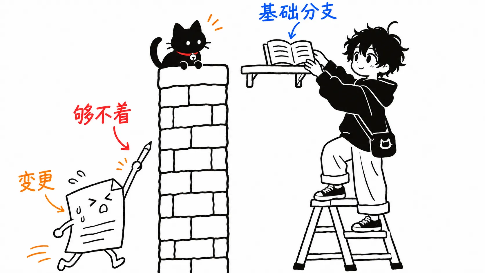
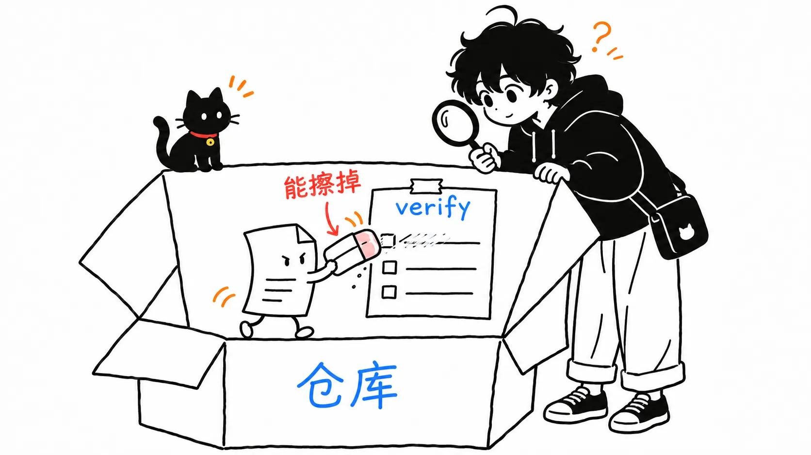
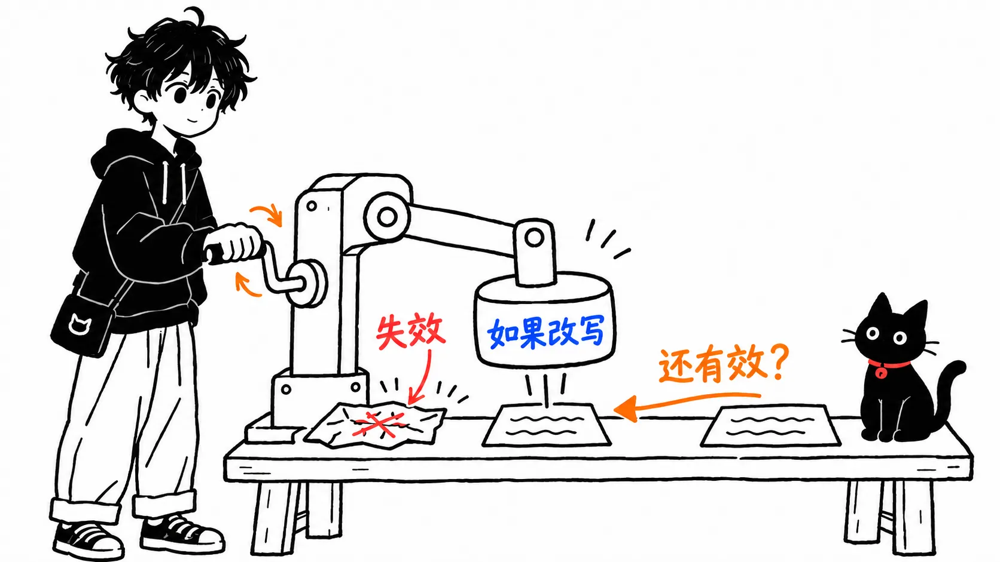

Addy Osmani 在 claude.dev 上写了"How the Claude Code team thinks about verification"（2026 年 11 月 16 日）。据说在 Claude Code 团队里，大约九成的代码由 Claude 来写，也由 Claude 来评审。这篇文章整理的是：在这样的规模下，如何让智能体带着证据去确认自己的工作。

读完之后，我在手边的笔记里只抄了一行。

> 我认为最管用的一句是"Changes can't modify their own checks"（变更不能改写判定自己的检查）。文章靠从变更碰不到的分支读取评审规则，守住了这一点。可是，同一篇文章推荐的 verify 技能，却要放在仓库里、变更可以改写的位置。要守住判定，就靠放置的位置来守。带着这个视角去读，文章里也有一处判定，还没有靠放置的位置守住。

---

## 关于这篇文章

我读的只有文章正文。文章里链接的"Solving code review at Anthropic"，以及 Code Review 和 hooks 的文档，我都没有读。

也交代一下我的位置。我是个人使用 Claude Code，没有文章里那种提交关卡或可靠性清单之类的机制。我手边有的，只是让 Claude 读的规则文件、`settings.json` 里的权限设置，以及写博客文章时对引文做的机械核对。

## 文章前半：值得投入的三种测试

前半讲的是该在哪些测试上投入。列出了三种。

第一种是 E2E 测试。它沿着真实用户的流程（加入购物车、购买、进入确认页面）走一遍，功能要么整个跑通、要么整个跑不通，所以很难蒙混过关。文章写道，单元测试可以通过，功能却仍然是坏的。

第二种是属性测试。把"编码再解码能还原"、"余额不会变成负数"这类不能被破坏的性质写出来，让库生成大量输入去找反例。文章的说明是，它的好处在于能用与写代码的智能体没有相同偏向的输入来试。

第三种是差分测试。在迁移这类行为不能改变的场合，把同样的输入分别送给旧系统和新系统，比较结果。

文章也写了要避免的失败。

> If your tests are flaky you'll train the agent to run them again rather than fixing the failing code.
>
> （如果测试不稳定，智能体就会学会把测试重新跑一遍，而不是去修失败的代码。）

## 文章后半：团队的做法

后半是 Claude Code 团队自己的做法，对我来说这才是正题。简短列在下面。

- 验证就是把变更跑起来。把启动、操作应用的步骤做成名为 `verify` 的技能，让它在提交前使用
- 如果有检查改了三次还是失败，Claude 会停下来叫人
- 检查由代码的负责人来写
- 有一份 39 项的可靠性清单，每一项都附有"能从差异里读出的触发条件"。Claude 只确认适用于这次差异的项（通常是 3 到 10 项）
- 不叠加评审者，用 REVIEW.md 来调校一个评审者
- 变更不能改写判定自己的检查
- 新的关卡先从"观察模式"开始
- 评审者本身也要盯着。追踪合并后被 revert 的变更数、合并前被维护者驳回的变更数等
- 漏掉的问题变成规则。规则也要定期清理

## 靠放置的位置来守

这些当中，我觉得分量最重的是"变更不能改写判定自己的检查"。

> If a change can modify the check that judges it, the check is broken.
>
> （如果变更能够修改判定它的检查，那这个检查就是坏的。）

具体来说，Code Review 读取 REVIEW.md 时，读的是基础分支，而不是 PR 的变更。决定变更能否通过的规则，放在变更碰不到的分支上。

这里重要的是，守住的方式并不是"请不要改写"这样的指示。而是放在了改写也不起作用的位置。无论智能体怎么判断，PR 的变更都够不到。

留存记录的机制也列了出来。给提交盖上"是怎么验证的"的标记，连"none"也记录下来，让没有验证过的提交事后可以搜索。新的关卡先用观察模式运行，记录本来会被拦下的东西，来确认误报。

不过，这些和靠放置的位置来守不同，明确写了绕过的办法。在提交信息里写明没有验证的理由就能通过。在同一个会话里被拦两次，第三次就放行。文章解释说，这是为了不让 Claude 卡住而留的出口。我的读法是，这套机制的重心在于事后可以搜索，而不在于拦住。

## 文章里，没有靠放置的位置来守的判定

不过，读的时候有个地方让我引起了注意。那就是 verify 技能的放置位置。

> Put it in a .claude/skills/ folder in your repo, as close to the relevant code as you can, and add as many as you need.
>
> （把它放在仓库的 .claude/skills/ 文件夹里，尽量靠近相关代码，需要多少就加多少。）

verify 技能就是文章所说的"冒烟测试的 harness"（测试装置），是确认变更是否真的能跑起来的步骤。它的角色和 REVIEW.md 那种决定能否合并的规则不同，但它在判定变更这一点上没有变。如果它放在仓库里，PR 就可以改写它。把启动步骤改一行，让它不去打开坏掉的页面，也是做得到的。REVIEW.md 是从基础分支读取的，可是文章并没有写对 verify 技能也同样处理。

文章里的其他机制，有可能补上了这一点。提交关卡会查看会话里是否使用了 /code-review 或 /verify。/code-review 那边是从基础分支读取 REVIEW.md，所以改写不了。文章还写了检查由代码的负责人来写并调校。即便如此，就 /verify 而言，"有没有被使用"和"有没有用未被改写的步骤使用"，是两个不同的问题。

类似的路径还有别处。对于不稳定的测试，文章允许 Claude 在"找不到根本原因时，删掉测试并写明理由"。规则文件也要定期整理。这两者都是变更一方可以减少验证的路径。文章最后把验证层总结为"放在它所判定的变更够不到的地方"。

> Keep it out of reach of the changes they judge,

如果把这句话用到验证层的整体，那么我认为，verify 技能，以及删除测试的决定，都应该放在变更之外。一旦决定了"判定靠放置的位置来守"，就会看出还有哪些判定没有被守住。

## 在我自己的环境里数一数

我把这条原则套到了自己的环境上。

在我的 Claude Code 里，允许哪些命令，是由 `~/.claude/settings.json` 里的 allow/deny 决定的。这是 Claude Code 本体强制执行的机制，不是靠叮嘱。另外，在我所在组织的管理员设置的指示里，有这样一句话："Claude 自身が権限設定（.claude/settings.json 等の allow/deny）を緩める変更をしない"（Claude 自身不得做放宽权限设置〔.claude/settings.json 等中的 allow/deny〕的改动）。

问题出在这两者的关系上。allow/deny 是强制执行的，但写着它的文件本身，就在 Claude 能通过编辑文件改写的位置。拦着不让改写的，是管理员指示里的那一句话。放置的位置在管理员那一侧，守的方式却是叮嘱。

实际上，就在这一周里，我让 Claude 改写了 `~/.claude/settings.json` 里的模型设置。我拜托的只是改默认模型和 effort，没有碰权限。即便如此，allow/deny 就在同一个文件里，Claude 处在够得着它的位置。

借文章的说法，我的权限规则接近"变更可以改写判定自己的检查"的状态。测试的规则也类似。我的规则文件里写着"要修的是实现，不是测试（测试本身有误的情况除外）"，可是测试文件在 Claude 能编辑的位置，括号里的例外也在。

把一切都靠放置的位置来守，在个人环境里有点小题大做。不过，像权限这种一旦放宽就不容易察觉的东西，值得按顺序先挪到 Claude 改写不了的地方。我想 Claude Code 应该有用户无法覆盖的、面向管理员的设置，但能用到什么程度，我没有确认过。

## 如果只带走一件事

把你让自己的智能体遵守的规则列出来，逐条问一句："如果智能体把这条改写了，它还会起作用吗？"不再起作用的，只是叮嘱而已。

出处：Addy Osmani，"[How the Claude Code team thinks about verification](https://claude.dev/blog/how-the-claude-code-team-thinks-about-verification/)"（claude.dev，2026 年 11 月 16 日）。文章里链接的"Solving code review at Anthropic"，以及 Code Review、hooks、/goal 的文档，我都没有读。面向管理员的设置怎么处理，我也没有在文档里确认过。
