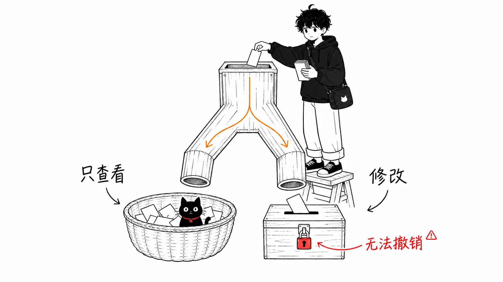
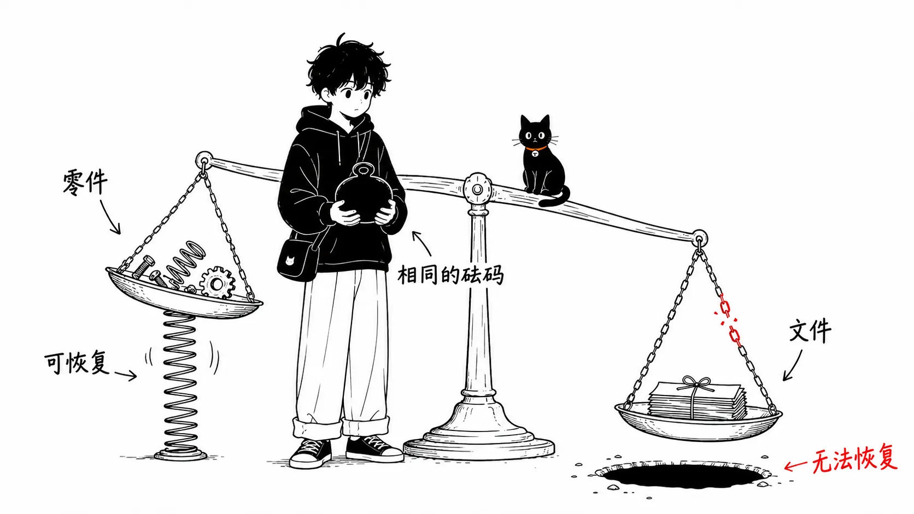
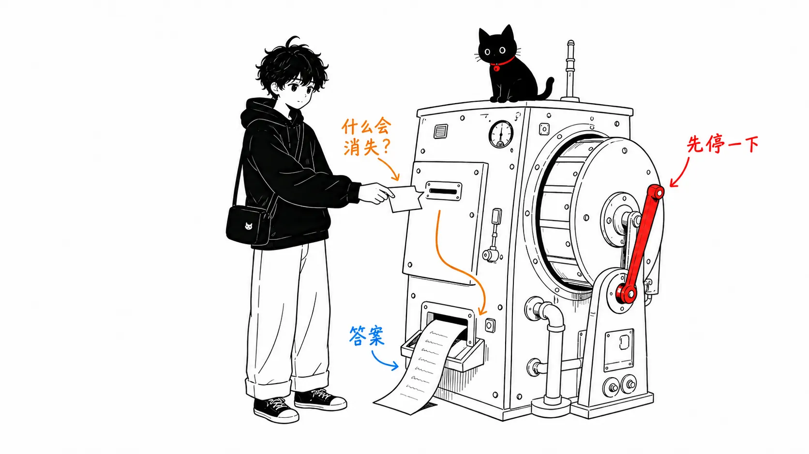

## 你有没有遇到过这种情况

开始使用 Claude Cowork 或 Claude Code 之后，会弹出这样的画面。

```
● Bash(rm -rf node_modules)

Do you want to proceed?
❯ 1. Yes
  2. No
```

工程师一眼就能判断。但对第一次见到的人来说，**完全看不出这是危险还是安全**。

而一旦看不懂，就会变成这样。

| 发生的事 | 结果 |
| --- | --- |
| 因为害怕，每次都拦下 | 用不了 AI，又回到手工操作 |
| 没看懂就点了 Yes | 总有一天重要的文件会消失 |

两种情况都想避免。这篇文章就是**让你能做出这个判断的最小集合**。

不需要任何编程知识。只要记住 10 个就行。

---

## 第 1 个：只看 / 会改

**最先要记住的，不是术语，而是这个区分。**



光是这一点，就解决了八成的判断。后面的术语，都是用来做这个区分的工具。

---

## 第 2 个：目录（directory）= 文件夹

**意思完全一样**。只是工程师换了个说法。在脑子里把它换成“文件夹”来读就行了。

---

## 第 3 个：路径（path）= 文件的地址

```
documents/2026/07/請求書.xlsx
```

`/` 是**文件夹之间的分隔符**。读作“documents 文件夹 → 2026 → 07 → 請求書.xlsx（发票文件）”。

`.` 是“现在所在的文件夹”，`..` 是“上一级”，`~` 是“自己的主文件夹（home）”。只要记住这三个，就能读懂路径。

---

## 第 4 个：`ls` = 查看列表

只是把文件夹里的内容列出来。**什么都不会改变。**🟢

同一类的（全都是“只看”，所以安全）：

| 命令 | 含义 |
| --- | --- |
| `ls` | 列表 |
| `pwd` | 现在在哪里 |
| `cat` | 查看文件内容 |
| `head` / `tail` | 只看开头 / 只看结尾 |
| `wc` | 计数 |

---

## 第 5 个：`grep` = Ctrl+F（搜索）

```
grep -rn "請求書" ./documents
```

意思是“在 documents 文件夹里，找出包含‘請求書’（发票）的行”。**和 Excel 的搜索是一回事**，什么都不会改变。🟢

你可能还会看到 `rg`，但它**同样是“搜索”**（更快的版本）。`find` 则不是按“内容”，而是按“文件名”来找。它们都是安全的。

---

## 第 6 个：`rm` = 彻底删除（不会进回收站）

接下来才是正题。

```
rm -rf node_modules
```

`-rf` 的意思是“**连文件夹一起、不经确认、强制删除**”。

:::message alert
看到 `rm -rf`，一定要停下来。不过，**问题不在 `-rf` 本身，一切取决于删除的对象是什么**。

- `rm -rf node_modules` → 是外面取来的零部件。删了还能重新装回来 🟢
- `rm -rf documents` → **是文档文件夹。绝对要拦住** 🔴
:::



---

## 第 7 个：`git commit` = 存档点

和游戏里的存档一样。**只要提交过，就能整个回到那个时间点。**

反过来说，**没有提交的修改是无法恢复的**。

:::message
**拜托它干活之前，先提交**。这是最有效的保险。只需要说一句话。

```
作業を始める前に、今の状態をコミットして
```
:::

---

## 第 8 个：`diff` = 修改前后的差异

和 Word 里的“显示修订”是同一类东西。

```diff
- 請求書の締め日は月末です
+ 請求書の締め日は毎月25日です
```

`-`（红色）是删除，`+`（绿色）是新增。这是**确认 AI 改了什么的最快方法**。

---

## 第 9 个：`git push` = 发送到外部

这是**把东西发送到互联网上（GitHub 等）**的操作。发出去之后，就很难当作“没发生过”了。

如果夹杂着内部资料或客户信息就发送出去，**信息就会流到外面**。🔴

同属“流到外面”的还有：deploy、上线到生产环境、`--prod`。它们全都是要先拦下确认的对象。

---

## 第 10 个：`.env` = 存着密码的文件

`.env` 和密钥文件（`~/.ssh` 里面）中，**以明文存放着密码和 API key**。

如果让 AI 打开它们，**就会留在对话记录里**。🔴

:::message
只要一开始设置一次，之后就会自动得到保护。

Cowork 的话，写在“设置 > Cowork”的 Global instructions 里；Claude Code 的话，写在项目的 `CLAUDE.md` 里：

```
- .env や鍵ファイルは開かない・中身を出力しない
- ファイルを削除・上書きする前に必ず確認する
- 元のファイルは書き換えず、新しいファイルとして作る
```
:::

---

## 总结：只看这张表就能做出判断

| 看到 | 判断 |
| --- | --- |
| `ls` `pwd` `cat` `grep` `rg` `find` `git status` `git diff` | 🟢 **Yes** |
| `mkdir` `cp` `git add` `git commit` `npm install` | 🟢 Yes（只会增加东西） |
| `mv` `>` `chmod` | 🟡 确认对象 |
| `rm -rf` `git reset --hard` `git push` `sudo` `deploy` `DROP` | 🔴 **拦下** |

而且，**看不懂的时候，正确答案永远是同一个**。

:::message
```
それは実行しないで。まず何をするコマンドか、
何が消えるかを日本語で説明して
```
:::



**反问不是拖慢工作，而是正确的用法。** Claude 在设计时就是以“会被反问”为前提的。

---

## 想了解更多：根据读者的不同，后面还有两本书

这篇文章是最小集合。接下来看什么，取决于**你用的是哪一种**。

### 不使用终端（黑色画面）的人

📘 **『AIが何をしているか分かる本 — 事務職のための Claude Cowork 入門』（《看懂 AI 在做什么：写给办公室职员的 Claude Cowork 入门》，日文书）**

- 从安装 Claude Desktop 到运行 Cowork 的 5 个步骤
- 文件夹的划分方式（**文件夹设计本身就是安全措施**的故事）
- 项目功能，以及指令的分别撰写（Global / 项目 / 文件夹）
- **批准画面上的词语**（Read/Write、删除保护、提示词注入）
- 该停下来的信号，以及出事故时的恢复

:::message
其实 Anthropic 官方写的是“**要监控任务，而不只是监控命令**（Monitor tasks, not just commands）”，以及“不应该试图去验证每一条命令”。

也就是说，如果只是在 Cowork 里做办公室工作，**连这篇文章里的命令都不用记**。详细内容我在那本书里讲过了。
:::

### 在终端里使用 Claude Code 的人

📘 **『黒い画面が読めるようになる本 — Claude Code コマンド・用語辞典』（《学会读懂黑色画面：Claude Code 命令与术语词典》，日文书）**

- 终端和 Git 的词汇
- 只看的命令 / 会改的命令（带选项的一览）
- 画面显示（`● Read(...)` `● Bash(...)`）的读法
- 符号（`-rf` `~` `*` `|` `>`）和报错信息（`command not found` 等）的反查
