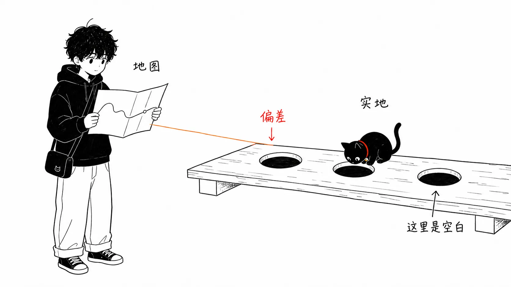
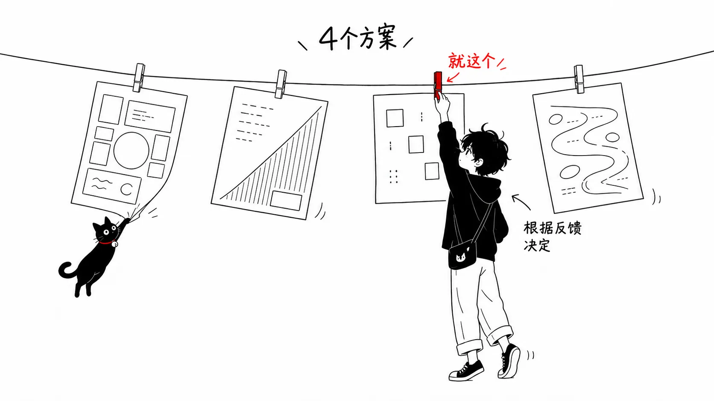
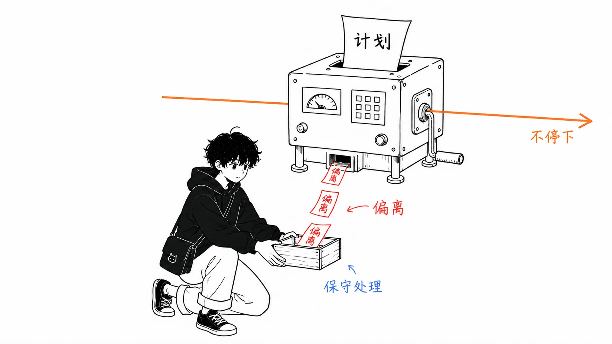
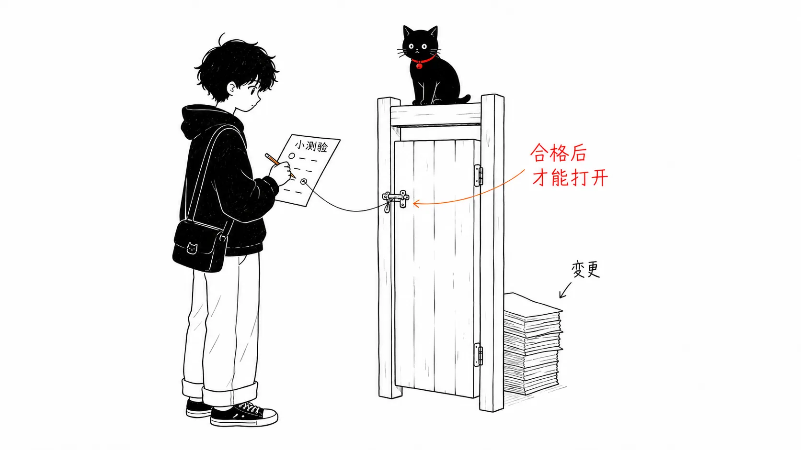

## 关于这篇文章

我来读一读 Anthropic 的 Thariq Shihipar 写的 [A field guide to Claude Fable 5: Finding your unknowns](https://claude.com/blog/a-field-guide-to-claude-fable-finding-your-unknowns)（2026 年 7 月 6 日），并整理其中的观点：**“把工作交给 AI 智能体时，质量不取决于模型的性能，而取决于你自己的 unknowns（尚未弄清的事）有多少”**，以及落地的具体做法。

原文是一篇五分钟左右就能读完的短文，但里面的内容，作为“明天就能用的提示词集”相当实用。这篇文章在把原文主张讲透的同时，整理成可以直接放进实际工作流的形式。

---

## 1. 地图与现地（Map and Territory）

原文一开始用了这样一个比喻。

> **地图（Map）** = 你交给 Claude 的东西。提示词、Skill、上下文。
> **现地（Territory）** = 工作实际发生的地方。代码库、现实世界、真实的约束。



然后它把**地图与现地之间的偏差，定义为“unknowns”**。

这是整篇文章的核心。Claude 碰到 unknowns 的时候，只能靠“大概是想要这个吧”这样的**猜测来做决定**。而且：

> 交出去的工作量越大，Claude 碰到的 unknowns 就越多。

也就是说，“把大活交给 AI”＝“增加 AI 去猜的次数”。

### 为什么现在这件事很重要

作者写道：

> 我觉得 Claude Fable 是**第一个工作质量的瓶颈在于“你自己把 unknowns 说清楚的能力”的模型**。

换句话说，主张是这样一种时代变化正在发生：

| 以前 | 现在（Fable 之后） |
| --- | --- |
| 模型的实现能力不够 | 模型已经足够会实现 |
| 瓶颈是“AI 写不出来” | **瓶颈是“我没能说清楚”** |
| 提示词工程＝驾驭 AI | 提示词工程＝**挖掘自己的需求** |

还有一个重要的提醒：

> **光是事先做计划是不够的。**unknowns 有时在实现的深处才会被发现，有时还会让你意识到“本来就该用另一种方式来解决”。

所以作者把发现 unknowns 当作**在实现的“前、中、后”反复进行的迭代过程**。

---

## 2. unknowns 的四种分类

作者带着问题来的时候，总是把它拆成四类。这是著名的拉姆斯菲尔德矩阵的应用。

| 分类 | 定义 | 具体例子 |
| --- | --- | --- |
| **Known Knowns**<br/>已知的已知 | 提示词里写了的内容。你正在告诉 AI 的要求本身 | “给这个 API 加上认证” |
| **Known Unknowns**<br/>已知的未知 | 还没决定，而且自己清楚还没决定的事 | “token 的有效期该设多少分钟，我还没定” |
| **Unknown Knowns**<br/>未知的已知 | 太理所当然，连记都不会记下来，但**一看到就知道“就是它”**的事 | “错误页面的语气”“按钮的留白”“这家公司的惯例” |
| **Unknown Unknowns**<br/>未知的未知 | 压根没想过的事。**不知道“这件事能做到多好”**的状态 | “其实现有的库就能解决”“还有更好的 UX 模式” |


上面三层费点劲还能打开，最下面一层**连可以拉的地方都没有**，所以打不开。这就是 Unknown Unknowns。

### 最棘手的是 Unknown Knowns

就我个人而言，这四类里最扎心的是 **Unknown Knowns**。

它们是“被人一说就觉得理所当然，但自己绝不会说出口”的东西。这块没填上，AI 的输出就会变成**技术上没错，却总觉得不对味**。设计评审时只能说出“感觉不太对”，背后就是这个。

### 高手的 unknowns 少，但他们默认“有” unknowns

作者说，看做出 Claude Code 的 Boris Cherny 和 Bun 的 Jarred Sumner 的提示词时，

> **很明显，他们对自己要什么了解得非常细。**他们和代码库、模型的行为都深度同步。

接着又写道：

> **但他们也默认 unknowns 是存在的。**在很多意义上，减少 unknowns、为 unknowns 做好准备，就是智能体式编程的“技能”。不过幸运的是，这是一种**可以通过与 Claude 协作来提高的技能**。

重点在于，“不会下指令”被当作靠练习能提高的技能，而不是才能问题。之后的章节，就是为此准备的具体方法。

---

## 3. 实现之前（Pre-implementation）

从这里开始是实践部分。原文列出了四种方法。

### 3-1. 头脑风暴与原型

**针对的 unknowns：Unknown Knowns（看了就知道、但说不出来的东西）**

在“看到了才能定义标准”的领域，作者会让 Claude 一起做头脑风暴和原型。

为什么要提前做？理由写得很清楚。

> **在原型阶段识别并说清楚 unknown knowns，价值极高。因为在实现过程中才发现，（相对而言）代价更高。**功能或规格上的一个小改动，可能让代码里的实现发生巨大的不同，而智能体要撤回之前的改动更困难。

比如，如果“只是想看一下在框架里加个按钮是什么样子”，就没必要去接后端路由，也没必要增加前端的状态管理。

作者还写道，**几乎所有的编程会话，都从探索和头脑风暴阶段开始**。效果是：

- 可以有意识地定义项目范围
- Claude 常常能找到自己忽略掉的高价值思路
- 反过来，也会出现“只见树木不见森林”的情况
- 结果是**能避免把范围定得过窄或过宽**

**提示词示例（出自原文）**

```text
我想要一个展示这些数据的仪表盘，但我没有视觉方面的审美，
也不知道有哪些可能。请做一个 HTML 页面，里面放 4 个方向完全不同的设计方案。
我想通过对这些方案的反应来做决定。
```

```text
在接任何线之前，先做一个单独的 HTML 文件，模拟出新的编辑界面。
```



:::message
关键在于采用“**让你来选**”的形式。不是让你从零开始用语言表达，而是让你对多个方案做出反应，把 Unknown Knowns 钓出来。“4 个完全不同的方案”这一点很管用。
:::

### 3-2. 参考（Reference）

**针对的 unknowns：说明成本太高的 Known Unknowns**

适用于没法详细说明、或者说明起来太费时间的情况。

> 图表、文档、图片也可以放进去，但**最好的参考是“源代码”**。

作者写道：

> 如果有某个库用特定方式实现了某种行为，或者有你喜欢的设计组件，**只要把那个文件夹指给 Fable，告诉它该看什么就行。哪怕是用另一种语言写的也没关系。**和截图之类相比，对于标记和结构，你能给 Claude 提供丰富得多的细节。

**提示词示例（出自原文）**

```text
vendor/rate-limiter 里的那个 Rust crate，正好实现了我想要的退避行为。
请读一下它，然后在我们的 TypeScript API 客户端里
用同样的语义重新实现。
```

:::message
“语言不同也可以”是个在实务中相当管用的提醒。想借鉴的行为恰好在另一种语言的库里，这是家常便饭。
:::

### 3-3. 访谈

**针对的 unknowns：把 Known Unknowns 揪出来**

头脑风暴做得再充分，unknowns 还是会剩下。于是作者**让 Claude 来采访自己**。

> 请 Claude 采访你的时候，要提供问题的上下文，来引导它的提问。

**提示词示例（出自原文）**

```text
就含糊不清的地方，一次只问我一个问题来采访我。
优先问那些我的回答会改变架构的问题。
```

:::message alert
这个简短的提示词里藏着两个重要的巧思。
1. **“一次一个问题”**：一下子问十个，人会答得很草率。
2. **“优先问会改变架构的问题”**：让它给问题排优先级，就不会把时间花在无关紧要的确认上。
:::

### 3-4. 实现计划（Implementation Plans）

觉得可以实现的时候，让它写一份供评审的实现计划。这里也有巧思。

> 让计划聚焦在**最可能被改动的部分**。数据模型、类型接口、UX 流程等等。这样，Claude 就会把“我实际上可能需要改的东西”浮现出来。

**提示词示例（出自原文）**

```text
用 HTML 写实现计划，但要把我最可能去动的决定放在开头：
数据模型的变更、新的类型接口、用户能看到的所有部分。
机械性的重构可以埋在最下面，这部分我信任你。
```

:::message
“机械性的重构可以埋在最下面，我信任你”这个指定非常漂亮。**负责评审的人的注意力是有限的资源**，这个设计把它集中在关键部分上。对于有过把冗长的实现计划从头到尾认真读完而累垮经历的人，应该会有共鸣。
:::

---

## 4. 实现过程中（During implementation）

### 4-1. 切换会话，把产物交过去

对计划满意之后，作者会**新开一个会话，通过提示词把产物（artifact）交过去**。

> 这样 Claude 得到的是**全新的上下文窗口**，而计划阶段收集的信息又全都在手边。

比如把 spec 文件和原型交给它去实现。思路是不把计划阶段反复试错的噪声带进来，只继承结论。

### 4-2. 让它写 implementation-notes.md

> **无论怎么计划，unknown unknowns 总是潜伏着的。**智能体在工作中，可能会因为在代码里发现的边界情况，意识到需要改用别的方案。

于是作者让 Claude Code 保留一个临时的 `implementation-notes.md`（或 `.html`），**记录下它做出的决定**。目的是“让下一次尝试能从中学到东西”。

**提示词示例（出自原文）**

```text
维护 implementation-notes.md。
如果遇到不得不偏离计划的边界情况，就选保守的方案，
记录在 'Deviations'（偏离）部分，然后继续推进。
```



:::message
这个提示词组合了三条指示。
- **先给出判断标准**（“选保守的方案”）→ 犹豫时的行为变得可预测
- **让它记录**（写在 Deviations 里）→ 事后人可以验证
- **不让它停**（keep going）→ 不会因为琐碎的确认而中断工作

这是介于“每次都来确认”和“擅自推进、事后才发现”之间的设计。而且记录下来的 Deviations，本身就是**下次做计划时可以消除的 unknowns 清单**。
:::

---

## 5. 实现之后（Post implementation）

### 5-1. 测验（轮到你被考）

长时间的会话之后，Claude 完成的事情，可能比你以为的多得多。

> 光读代码差异，只能获得浅层的理解。**因为很多行为取决于既有的代码路径。**

所以作者在给了 Claude 足够上下文的前提下，**让它就这次变更来考自己**。

> **我只有在测验全部答对之后才会合并。**

**提示词示例（出自原文）**

```text
我想确认自己理解了这次变更中发生的所有事情。
请做一份关于这次变更的 HTML 报告，包含上下文、直观理解、
做了什么等等，要做成我读了就能理解的形式。
然后在最下面，附上一份我必须通过的测验。
```



:::message
这是从“评审 AI 写的代码”到“**让 AI 来测试你的理解程度**”的反转。对于扫一眼差异、觉得“应该没问题吧”就合并了的问题，我觉得这是相当有实效的对策。
:::

### 5-2. 宣讲与说明材料

> 交付任何东西时，最重要的环节之一是**获得认同和批准**。

书中写道，把宣讲或说明类的产物放进最终文档，会有以下作用。

- **评审者和你从同样的 unknowns 起步时，能加快理解**
- **专家想确认“换作自己会预想到的 unknowns 和典型的失败点”你已经考虑过时，能加快批准**

**提示词示例（出自原文）**

```text
把原型、spec、implementation notes 整合成一份文档。
做成可以发到 Slack 上获得大家认同的形式。演示 GIF 放在最前面。
```

:::message
这同样是 unknowns 框架的延伸，前后一致。**评审者和你有着同样的 unknowns。**所以你消除 unknowns 的过程本身，就直接成了评审材料。
:::

---

## 6. 让地图与现地一致（结论）

原文的收尾是这样的。

> 模型越好，**在采取正确方法时能达成的事情就越多**。当一个长周期任务返回了错误的结果，你多半应该在定义 unknowns 上多花点时间，或者做出一份让你和 Claude 能够一边适应 unknowns 一边推进的实现计划。

而这是我最喜欢的一句话。

> **每一份说明材料、头脑风暴、访谈、原型、参考，都是“在修正变得昂贵之前，弄清自己原本不知道的事”的廉价手段。**
>
> 所以下一个项目，就从请 Claude 帮你找出 unknowns 开始吧。

---

## 实践清单

我把原文的方法整理成了可以直接使用的清单。

### 实现之前

- [ ] **头脑风暴**：不要一上来就让它实现，先从“给我 N 个完全不同的思路”开始
- [ ] **原型**：外观和 UX 在接线之前先用单个 HTML 做出模型，通过反应来决定
- [ ] **参考**：如果有想借鉴的实现，不要给截图，而是给**源代码的路径**（语言不同也行）
- [ ] **访谈**：请它“一次一个问题，优先问会改变架构的问题”
- [ ] **实现计划**：可能会变的决定（数据模型、类型、UI）放在开头，机械性的工作放在末尾

### 实现过程中

- [ ] 计划定下来后，**新开会话**，交给它 spec 和原型再开始
- [ ] 让它在 `implementation-notes.md` 里**记录 Deviations（偏离）**
- [ ] 犹豫时的**判断标准要先给出**（例如：选保守的那个）

### 实现之后

- [ ] **通过测验之后再合并**
- [ ] 把原型 + spec + notes **整合成一份宣讲材料**

### 复盘

- [ ] 读 `implementation-notes.md` 里的 Deviations，把**下次可以消除的 unknowns** 落实到 CLAUDE.md 或 Skill 里

---

## 结语：一点感想

读完这份实战指南，让我触动最深的是，它**把“我不擅长给 AI 下指令”这个问题，重新解读成了“我的需求本身很模糊”这个问题**。

世上关于“提示词技巧”的内容多如牛毛，但这篇文章的主张方向恰恰相反。**既然模型已经足够聪明，需要改进的就不是向模型传达的技巧，而是想传达的内容在自己心里还没有成形这一事实。**

而在四种分类里，Unknown Knowns 和 Unknown Unknowns **按定义就无法靠自己一个人发现**。所以才请 Claude 来“帮忙找”。这篇文章里的方法（头脑风暴、多个方案、访谈、测验）全都是“让 AI 来提问／让 AI 摆出选项”的形式，原因就在这里。

哪怕只是在请它实现之前加上一句**“就我们要做的东西，问问我还没决定的事”**，我想体验也会有所不同。

---

## 参考

- 原文：[A field guide to Claude Fable 5: Finding your unknowns](https://claude.com/blog/a-field-guide-to-claude-fable-finding-your-unknowns) — Thariq Shihipar (Anthropic)，2026 年 7 月 6 日
- 相关文章：[Building verification loops in Claude Code with skills](https://claude.com/blog/building-verification-loops-in-claude-code-with-skills) — 2026 年 7 月 21 日
- [Claude Code 文档](https://code.claude.com/docs/en/overview)

注：本文中的提示词示例，是笔者根据原文所载的英文提示词翻译而来。想确认语气和细微差别的读者，请参阅原文。
