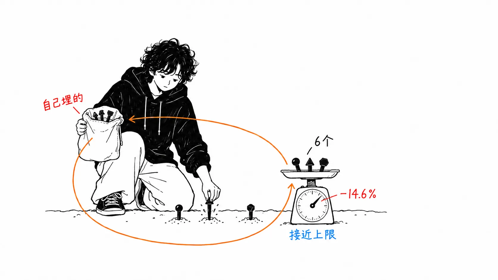
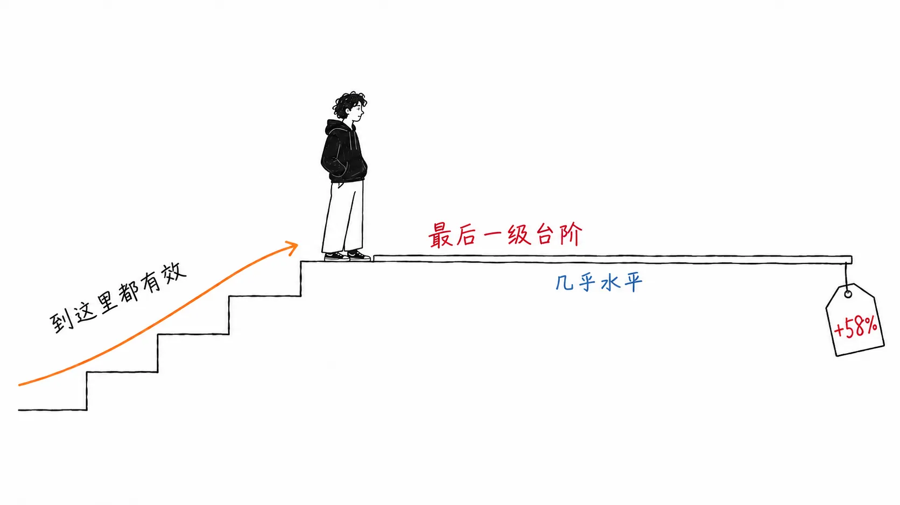
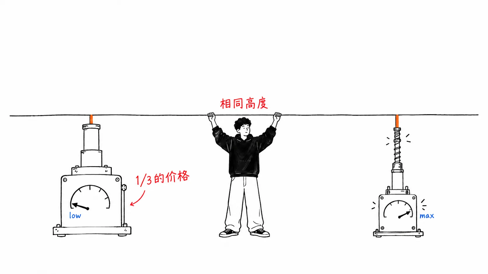

先把结论写在前面。

> 这篇文章里最有意思的，不是便宜了 14.6%。而是**同样的操作，正确率提高了 5.3%**。而且提高的原因，三个全都是“指令导致处理坏掉了”。当成成本优化砍掉的东西，在砍之前就已经是 bug 了。

## 关于这篇文章

这是我阅读 [@claudedevs 在 2026 年 9 月 8 日发布的 X Article](https://x.com/claudedevs/status/2097369738968195513)《Reducing cost and improving performance with Claude Platform》的记录。作者是 Lance Martin、Brad Abrams、Isabella He、Ben Lehrburger 四人。文中介绍了提示词缓存、指令（instructions）、effort 这三个杠杆，以及 `/claude-api prompt-audit`、`cost-optimize`、`hillclimb` 三个斜杠命令。

先坦白一件事。正文文字我全部读过了，但**文中的 Figure 是图片块，最初写这篇文章的时候我没能读到里面的内容**。

发布之后，有读者给我看了其中四张（缓存层级、Fable 5 的 effort 曲线、CursorBench 的两条曲线、`cost-optimize` 的结果），所以我在 **2026 年 9 月 10 日对正文做了修订**。从图里看出来的东西，有一条**推翻了**我最初写的解读。我没有删掉它，而是在对应的小节里留作订正。其余的 Figure 仍未确认。

另外，写到中途我会对原文提出相当严苛的要求。先说一句，我认为原文的主张本身是正确的。

## 比起“便宜了”，更该说的是“更准了”

`prompt-audit` 是一个读取现有提示词、找出反模式并重写的命令。作者们拿一个客服工单分类提示词，做了六个旧版本，每个版本各埋入一种反模式，然后在从 Opus 4.8 迁移到 Opus 5 的同时跑了 audit。

结果是**成本 −14.6%，正确率 +5.3%**。

成本下降是理所当然的。删掉了无用的指令，输入 token 和思考 token 自然都会减少。不好解释的是正确率，原文给出了三项明细。

> - 已经废弃的 thinking 设置还留着，**API 拒绝了所有路由请求**
> - 退款规则自相矛盾，**本该退的 4 笔退款没有退**
> - 手写的 scratchpad 指令和内置的 thinking 冲突，**有 3 张工单的工具调用被写进了 reasoning 里，没有被执行**

三项都不是性能问题。是坏掉了。

我觉得最可怕的是第三项。“先把想法写到 scratchpad 里，再行动”这种在五年前堪称标准答案的指令，在带有内置 thinking 的模型上，却朝着**让模型把工具调用写成 reasoning 文本**的方向起了作用。模型自以为“调用过了”，日志里思考看起来很认真，实际上什么都没发生。测试也不一定会挂，因为分类结果照样会返回。

原文列出的反模式清单是：验证仪式（verification rituals）、彻底性与强调的加强词、必须执行的步骤和 scratchpad 脚手架、过时的示例、相互矛盾的规则、日期陈旧的设置。排在一起看，**每一个都是“以前管用”的东西。** 不是失效了，而是开始朝反方向起作用了。

## 但是，那六个是作者们自己埋进去的

这里必须原样引用原文的话。

> We started from a clean prompt and **planted** one anti-pattern at a time (a retired thinking setting, a pair of contradictory refund rules, a manual scratchpad, "verify twice", "be maximally thorough", and a mandatory six-step procedure), giving six legacy prompts.

从干净的提示词出发，一次埋入一种反模式，用的词是 **planted（埋下的）**。也就是说，−14.6% / +5.3% 是**自己埋的雷自己拆掉的效果**。这不是对真实世界里的提示词做 audit 会得到的数字。我认为应该把它看作接近效果量上限一侧的测量。

把埋入的六个和上面的分类表对一下，会发现缺了一个。**“过时的示例（stale examples）”没有被测量。** 分类里有，但六个旧版提示词里没有一个放了 few-shot 示例。这不是故意刁难，大概是因为它最难测。改写了一个示例，那还是同一个提示词吗，还是另一个提示词？我自己清理 CLAUDE.md 时最犹豫的也是这里，而只有这里没有数字。

`hillclimb` 我也是同样的读法。从 Opus 4.8 high 开始：Opus 5 low + audit 在训练集上 98.9%、每张工单 2.6 美分；降到 Sonnet 5 low，1 美分但只有 88.9%；再加上路由规则和退款上限的交叉引用，仍然是 1 美分，回到 98.9%。到这里都是训练集。在留出集上是 **90.5% 对 78.6%，成本约为 1/5**。

数字很漂亮。但留出集只有 **14 件**。我在这里停住了。78.6% 恰好是 14 件中的 11 件。可 90.5% 是除不尽 14 的（12 件是 85.7%，13 件是 92.9%）。看起来像是**同样这 14 件，一边按件数打分，另一边用了不同的粒度**。也许是我读错了，但既然读不到 Figure 7，这一点我没能弄清。

不管怎样，用 14 这个母数在谈 12 个百分点的差距。只要有 1 到 2 件变动，看上去就不一样了。

我要说的不是“厂商拿自家产品在自家基准上测”这种理所当然的事。我的读法是：**方法是对的，只是效果量偏向乐观一侧。** 这个区别很重要，所以我认为这篇文章里的步骤值得照做。只是数字没法照搬而已。

## 无论哪条曲线，最后一档都最不划算

:::message
**2026-09-10 订正。** 这一节起初写的是“曲线的形状因任务而异。一边是投资，一边是浪费”。看了图之后，**这个对比并不成立**。以下是重写后的内容。我错在哪里、怎么错的，写在这一节的最后。
:::

原文用四条曲线给出了各个 effort 下的成本和分数。带数值标签的只有两端，所以中间点是我根据刻度读出来的。

| 曲线 | low | max | 最后一档（xhigh→max） |
| --- | --- | --- | --- |
| Fable 5 / FrontierCode Diamond | 11.5%・$5.35 | 30.9%・$19.00 | +1.6pt・+58% |
| Fable 5 / CursorBench 3.2 | 约 62.1%・约 $4.3 | 约 70.5%・约 $18.5 | +2.1pt・+64% |
| Fable 5.1 / HLE（无工具） | 约 53%・约 $0.30 | 约 61%・约 $2.23 | +0.5pt・+46% |
| Fable 5.1 / CursorBench 3.2 | 约 66.1%・约 $2.9 | 约 73.5%・约 $9.7 | +0.8pt・+33% |

**四条曲线全都是最后一档最贵。** 从 low 到 xhigh，每条曲线都漂亮地往上走。趴下的，总是最后一档。原文自己也写过关于 HLE 的话：“+0.5 个百分点，换来 +46% 的成本。落在每次运行的波动范围内。” 那不是 HLE 的特性，而是 **max 的特性**。

所以 effort 的判断不是“这个任务在哪条曲线上”。**要不要升到 xhigh，和要不要再买它之上的那一档，是两个不同的问题。** 前者通常值得买。后者在四条曲线上都不划算。

我起初出错的原因很明确。**我只靠两端这两个点就断定了曲线的形状。** 把 11.5%→30.9% 和 53%→61% 摆在一起，前者看起来是“有效”，后者看起来是“趴下”。加上中间点，两者其实是同一个形状。从摘抄的数值里能看出斜率，却看不出弯曲的方式。

看图时我还注意到另一点：**横轴是对数刻度。** 成本增加 3.5 倍，在横轴上只挪了一点点，所以在图上一路开到 max 看起来很便宜。只读数字时我的印象，和看图时的印象，方向是相反的。

## 在 CursorBench 上，两条曲线一次都没有交叉

CursorBench 3.2 的图里把 Fable 5 和 Fable 5.1 叠在了一起，**没有交点**。Fable 5.1 的 max（约 $9.7）比 Fable 5 的 xhigh（约 $11.3）**更便宜，还高 5 个百分点**。Fable 5 这边，没有任何一个 effort 在价格上能赢过 5.1。

原文写的“Fable 5.1 的 low 与 Fable 5 的 high 持平，成本为 1/3”，说的就是这张图的左下角。缓存读取是 $0.25/M 对 $1.00/M，便宜得多，这起了作用，但按原文所说，即使和 Fable 5 同价，也大约便宜 40%。

把强模型开得轻一点，比把弱模型开得猛一点更便宜，效果还一样。看图的话还要更进一步：**弱模型开到再猛，也根本到不了那个位置。**

## 缓存这一节里新鲜的有两点

缓存的机制（prefill / KV、与模型绑定、按字节的前缀匹配、TTL）是已知的。

**第一点。5 分钟的 TTL，是从请求的“开始”算起的。** 所以如果跑一个要 10 分钟的子智能体，父级的缓存在子级返回之前就已经过期了。原文的建议是 1 小时 TTL。另外，如果要切换模型或 effort，就趁压缩（compaction）的时候做，因为反正那是缓存要失效的时刻。

**第二点（订正与补充）。** 我起初写的是“新鲜的只有一点”，并把 `defer_loading`、把系统提示词的更新挪到消息一侧、用 `max_tokens: 0` 预热这三样，当作“已知的套路”并排列出。看了图才发现，这三样不是各自独立的套路，而是**同一条规则的不同说法**。前缀是按被共享范围从宽到窄的顺序堆叠的。

| 层 | 被缓存的范围 |
| --- | --- |
| System instructions | 全局 |
| Tools | 全局 |
| CLAUDE.md, memory | 按项目 |
| Session state | 按会话 |
| Messages | 每一轮都在增长 |

因为只有前缀匹配才会命中，**一旦把按项目变化的东西放到“全局”那几层的上面，所有人的前缀就全坏了。** `defer_loading` 是为了不污染上层而把加载挪到下面的操作，把系统提示词的更新挪到消息一侧也是同一回事。我以为是三个小技巧的东西，其实是为了守住这个堆叠顺序的同一个动作。

## `cost-optimize` 的四条置信区间，全都跨过了零

写正文的时候，我只能把 `cost-optimize` 的结果当作一串数字来处理。图里**带有 95% 置信区间**。

| 基准 | 成本 | 金额 | 分数变化 | 95% CI |
| --- | --- | --- | --- | --- |
| tau2-bench (retail) | −72.7% | $25.88 → $7.05 | +1.3pp | −4.6 〜 +7.2 |
| LegalBench | −57.6% | $13.67 → $5.79 | −0.3pp | −0.8 〜 +0.3 |
| OfficeQA Pro | −52.4% | $136.20 → $64.87 | +4.5pp | −2.1 〜 +11.1 |
| SWE-bench Verified | −55.1% | $39.74 → $17.86 | −3.3pp | −9.6 〜 +3.1 |

**四条全都跨过了零。** 我认为这是 Anthropic 一方诚实的证据。没有把 OfficeQA Pro 的 +4.5pp 写成“性能提高了”，这是对的。CI 一直延伸到 −2.1，所以不能说提高了。不给 CI、只登一个 +4.5pp 的公司要多少有多少。

同时，这边也要写下来。**SWE-bench Verified 的 CI 一直延伸到 −9.6。** 在智能体式编程，也就是读这篇文章的人最关心的用途上，近 10 个百分点的劣化没能被否定。“保持了性能”指的是“没有检测到劣化”，而不是“没有劣化”。向生产环境提议把成本减半的时候，这个差别是有分量的。

另外，这篇文章起初写过“tau2-bench retail 的削减率，原文里有约 73% 和 72% 两种写法，无法判断哪个是最终值”。图里的值是 **−72.7%**，差别只是标题的四舍五入和正文的舍去。我撤销这个保留。

## 4 天前有人观察到的东西，在这里变成了测量值

这篇文章，和我这几周读过的三样东西正好咬合。

**第一样。** 9 月 4 日，pvncher 写道“指令是会折旧的负债，升级模型之后就该清理旧指令”（[我的文章](https://meikocho1.github.io/blog/adding-a-skill-taxes-the-others)）。那是个人的观察。4 天后，官方给同一个主张配上了 −14.6% / +5.3% 这样的数字，以及三种损坏方式这样的机理。社区的体感在前，厂商的测量在后，就是这个顺序。

**第二样。** Uber 把缓存 TTL 从 5 分钟提高到 1 小时，作为内部默认值（[我的文章](https://meikocho1.github.io/blog/mcp-out-of-the-context-window)）。这次它以官方推荐的形式出现了。而且还带着 Uber 没写过的理由：“TTL 是从请求开始算起的”。

不过 Uber **只有子智能体仍保持 5 分钟**。判断是：子智能体寿命短，没有理由去付 2 倍的写入溢价。这次官方是从相反的一侧看同一个地方，说的是长时间运行的子智能体会杀掉**父级**的缓存。是看子级的成本，还是看父级的成本？同一个旋钮，站的位置不同，得出相反的答案。

**第三样最有意思。** momo5502 的审计讲的是“模型不听软性指令”的问题。这次正相反，是**模型听得太多**的问题。写上“验证两遍”，它就真的验证两遍，把 token 烧掉。写上“写到 scratchpad 里”，它就真的写，然后不调用工具。

把这两件事并排放，就是这样：**模型不听指令是个问题，听得太多也是个问题，而写指令的时候，自己并不知道自己站在哪一边。** “软性指令会被无视所以没用”的直觉，和“软性指令会被字面执行所以会出事”的事实，同时成立。

## 我的看法

如果把这篇文章当作“降本文章”来读，大概只会拿到它最弱的部分。−14.6% 说的不过是“打扫一下提示词，成本就会降”，仅此而已。

值得读的是 **+5.3% 那一边**，那并不是“便宜了顺便变好了”。而是**以成本优化为名跑起来的检查，起到了 bug 探测器的作用**。有 4 笔退款卡住了。有 3 次工具调用没有被执行。API 把路由全部拒绝了。这些是作为成本问题被发现的，但它们不是成本问题。

我从中得出的运营规则只有一条：**提示词的盘点，要用质量保证的预算来做，而不是用降本的预算。** 当成降本举措提出，会以一句“这个月还有别的优先级更高的事”被搁置。当成质量保证提出，就变成了“退款可能一直卡着”这种风险的话题。同样的工作，通过的方式不一样了。

还有一点。这篇文章里介绍的三个命令是 Anthropic 的产品。很多人所处的环境多半用不了。但内核是可以移植的。`prompt-audit` 做的只是“按六类反模式扫描提示词，删掉与模型代际相矛盾的描述”。分类清单就写在原文里，可以手工做。手工做的话，因为能记住删了什么，说不定反而更好。

## 只带走一件事的话

**今天就用 grep 搜一下你的提示词里有没有“先把想法写出来再行动”这句话。** 如果你把它发给带有内置 thinking 的模型，这条指令可能正把工具调用关在 reasoning 里面。它不会报错。结果会返回。只是没有被执行而已。

## 出处

- [@claudedevs, "Reducing cost and improving performance with Claude Platform"（2026 年 9 月 8 日）](https://x.com/claudedevs/status/2097369738968195513) — 作者：Lance Martin, Brad Abrams, Isabella He, Ben Lehrburger

这篇文章于 2026 年 9 月 9 日发布，次日 9 月 10 日做了修订。修订的原因，是读者给我看了原文 Figure 中的四张（缓存层级、Fable 5 的 effort 曲线、CursorBench 的两条曲线、`cost-optimize` 的结果）。图上带数值标签的只有端点，所以中间点的值是根据刻度读出来的，存在误差。其余的 Figure 我还没能读到。
