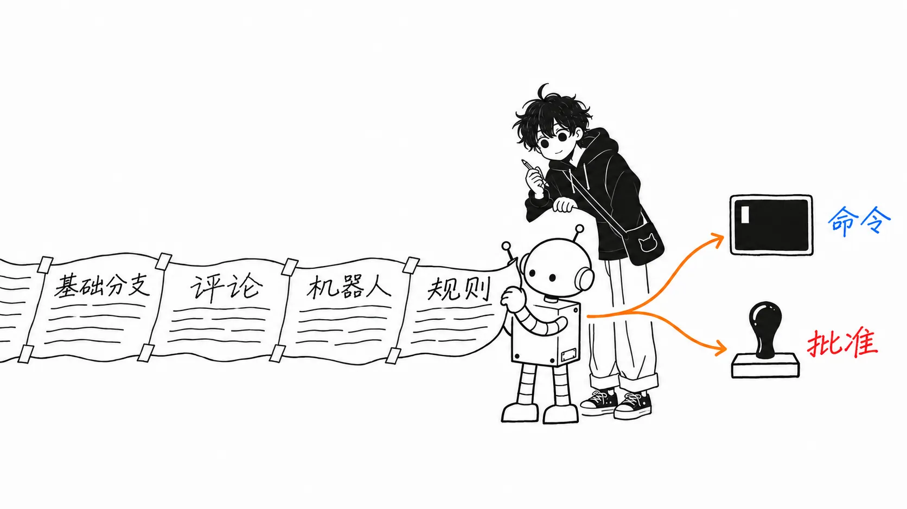
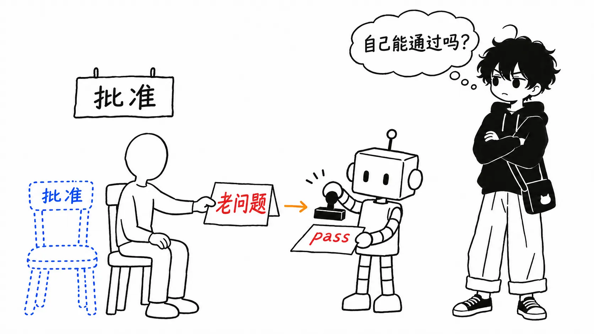
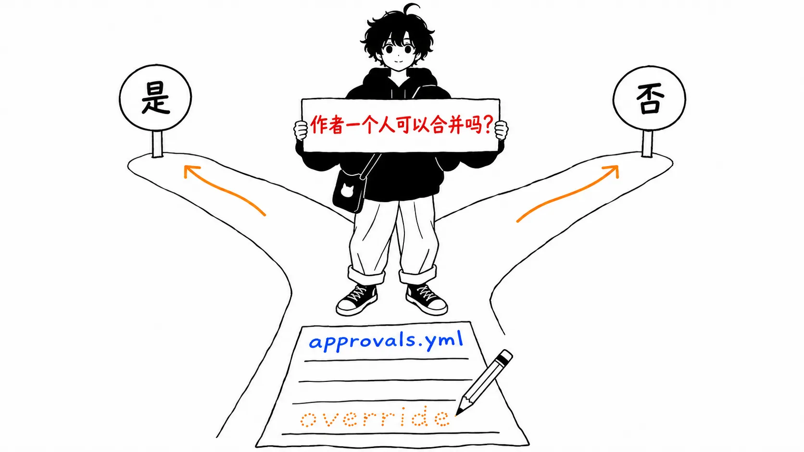

2026 年 11 月 25 日（UTC），Claude Code 团队的 Addy Osmani 在 X 上发布了一篇文章，标题是"A practical guide to shipping with Claude Code"。这是刚刚发布的 Claude Ship 的使用指南。开头是这样的。

> We just launched Claude Ship which can review your pull requests, work on fixes and approve the ones your team's policy allows.
>
> （我们刚刚发布了 Claude Ship。它可以审查拉取请求、着手修复，并批准团队策略允许的那些。）

Claude Ship 由 3 个智能体组成。Code Review 审查拉取请求；PR Steward 应对 CI 失败、冲突和审查意见，让 PR 保持在可以通过的状态；Claude Approvals 按照放在仓库里的策略文件进行批准。正式开放的只有 Code Review，另外 2 个是 beta。在本地可以用 `/code-review`、`/ship`、`/steward` 这几个命令来试。

先说结论。

> 指南里的注意事项中，我觉得分量重的，是关系到"智能体读了谁写的文字，又因此启动了什么"的那些。其中最重的，是 Code Review 通过后就减少所需批准人数的 override 设置。指南自己承认 PR 里的文字可能动摇审查，而且剩下的那 1 个席位可以由作者来填。PR 里的文字大多是作者写的，所以我把 override 当作"LLM 读了作者的文字并放行，作者就可以自己合并"的设置，认为它只应该放在允许作者自行合并的路径上。

---

## 用大白话说

改程序时，要先提一个"这个改动可以放进去吗"的申请（拉取请求，简称 PR），由别人看过内容、批准之后才能并入主代码。Claude Ship 就是让 AI 来检查这些申请、修改它们，满足设定的条件时连批准都由 AI 给出。

在指南的例子里，批准需要两个人。加上一行"覆盖（override）"，就能变成"AI 检查通过的话，批准一个人就够"。可是这一个人也可以是写申请的本人。而且指南自己也写了，AI 的检查可能会被申请里的文字左右。申请里的文字大多是本人写的。

也就是说，正式启用这个设置后，AI 读了本人写的申请就放行，本人再自己批准，改动就可能在没有其他人看过的情况下并进去（如果设置了自动合并，更是如此）。所以我认为，"覆盖"这一行只该放在允许本人独自放进改动的地方。

## 关于这篇文章

我读的是 X 文章正文的文本。正文里嵌入的图片（表格和图）我没有看。涉及表格内容的地方，只写了能从正文叙述推断出来的部分。链接指向的 Claude Ship 发布文章、各命令的文档、Claude Code 团队关于审查和验证的博客文章，我都没有读。

我自己的立场也写在这里。这个博客是个人仓库，我不创建 PR，直接 push 到 main。我在这个博客上没有用过 `/ship` 和 `/steward`，Claude Approvals 也没有试过。

## 自己的 PR、仓库、团队这 3 级

指南的脉络是 3 级：从自己的 PR 开始，然后写仓库的规则，最后推广到整个团队。

第一步是在 push 之前，用 `/code-review` 看一遍自己的分支。effort 可以从 low 选到 max，low 只给把握高的意见，越往上抓得越广。`/ship` 会像 `git add -A` 那样提交未提交的改动，创建 PR，做审查，然后最多 7 天里一直看着这个 PR。它会应对失败的检查、冲突和审查评论，PR 被合并或关闭就结束。同一个问题最多 push 3 次，还不行的话，就把试过的内容报告给作者。

下一级是把反复出现的东西写进文件。同样的审查意见写进 CLAUDE.md 或 REVIEW.md，每次都要教的应用启动步骤写进 verify 技能，照看 PR 的约定写进 steward 技能。作为团队原则，指南说只有在至少 2 个 PR 里反复出现的内容才定为规则，而且新增规则的 PR 要由人来批准。

最后一级是 Claude Approvals。在 `.claude/approvals.yml` 里写策略，先用 observe 模式，只留下"如果批准的话会这样判断"的记录，和真实审查者的判断比较 1 到 2 周，然后再转为强制执行。

## 分量重的注意事项，说的是"读谁的文字"

指南里有很多注意事项。有费用方面的（ultra 审查可能另外收费、看护会消耗用量、observe 模式下也有会计费的审查），也有环境方面的（合上笔记本电脑看护就会停、Windows 上看护不会启动、要分开 worktree）。其中我觉得分量重的，是关系到智能体读谁写的文字的那些。比如看护（watch）这一条。

> In other words, anyone who has the ability to land changes on the base branch has the ability to run commands on your machine during the watch.
>
> （换句话说，能把改动合入基础分支的任何人，都能在看护期间在你的机器上执行命令。）

看护会按需合并基础分支，并运行测试。所以，能写基础分支的人写的测试代码，会在我自己的凭据下运行。指南写了：已经指示 Claude 不要合并，无人值守的轮次里 gh 和 git 命令也会受限；然后在此之上，列出了仍然防不住的东西。测试脚本用我自己的凭据运行；如果在一个轮次中途我自己发了消息，仅那一个轮次的限制会被解除；如果 auto-merge 已启用，看护的修复可能成为合并的最后一推；看护的提交不会经过仓库的 git hooks。

评论也一样。`/ship` 默认读我自己、有写权限的人、Claude 的 GitHub App 的评论，用 `+name` 指定的机器人的评论，也当作要对照代码核实的主张来处理。关于面向团队的 PR Steward，指南是这么说的。

> Like any text-parsing agent, it can be fooled by what people say.
>
> （和任何解析文本的智能体一样，它可能被人说的话骗到。）

steward 的技能文件，能合并的人谁都可以改写，所以指南写道，要像审查 CI 的改动一样慎重地审查它。

把这些放在一起，说的是同一件事。智能体读的是各种人写的文字：基础分支的代码、PR 的评论、机器人的输出、规则文件。而它读到的文字，会让命令运行、提交累积、批准发出。

## 我的见解

指南的防御思路是一贯的。决定规则的文件（.github/、CODEOWNERS、CLAUDE.md、.claude/ 等），`/ship` 和看护都不提交。新增规则的 PR 由人批准。示例策略里，对规则文件的改动也要求 2 个人批准。多条规则同时命中时严格的那条胜出，所以这 2 个人不会被之后放宽的规则覆盖。设置的读取来源也封住了。Code Review 不读被审查 PR 里的 REVIEW.md，approvals.yml 和 steward 技能都是从默认分支读取。规则本身已经从智能体手里拿走了。剩下的入口，是 PR 的说明文字和代码。

不过，在批准这里，这条思路有 1 处松动。就是 override。指南的示例里，可以给通常需要 2 人批准的规则加一条 override：Code Review 通过的话，"1 个人加 Claude 的批准"就可以。指南紧接着自己写道：

> But text in a pull request can sway Claude's review, and when it does, this override lowers what that pull request needs.
>
> （但是，拉取请求里的文字可能动摇 Claude 的审查，一旦如此，这条 override 就会降低该拉取请求所需要的条件。）

更进一步，示例规则里作者也能填 1 个席位。也就是说，在放了 override 的路径上，如果 Claude 读了作者写的 PR（说明文字和代码都是作者的）并放行，剩下的 1 个席位，作者自己一个人就够了。如果用了 auto-merge，没有任何人做任何事，PR 也可能被合并，指南在别处也这么写了。Claude 的批准在 GitHub 上算作真正的批准，所以实际能通到哪一步，取决于分支保护的设置。

但是，指南是在 observe 模式的策略里给出这条 override 的，目的是"看看审查通过的话，在哪里可以降低所需的批准"。observe 期间只显示结果，不发出批准。作者自行合并成立，是在取消 observe、转为强制执行之后。

这里，写出会影响审查的文字的，是批准后能得益的当事人。这一点和基础分支的写权限、评论的写权限不同。那些情况下，限定为可信的协作者这个对策是有效的。而在 override 里，被信任的对象，也就是作者本人，在写审查的输入。我认为，即使没有恶意，只要在 PR 说明里写一句"这个测试失败是已知的"，审查的判断就可能改变。

所以我认为，应该把 override 当作"以 LLM 的读取为条件的作者自行合并"，而不是"带审查的批准"。可以放的，只是本来就可以允许作者自行合并的路径，比如文档的错别字、生成文件这样的地方。其他路径，就放指南说要在强制执行之前放的、既没有 if 也没有 override 的规则（一定要求作者以外的 1 个人）。指南在转向强制执行的阶段也说，如果把 auto-merge 和只有作者才能满足的策略组合起来，就要按路径决定这样是否可以，并写下来。我的不同之处只有一点：不是"如果用 auto-merge"这个条件，而是在保留 override 的同时取消 observe 的所有路径上，都先回答这个问题。

关于我自己的环境也说一点。指南写了，如果仓库的 `.claude/settings.json` 里有 Bash 的 PreToolUse 或 PermissionRequest 的 hook，看护就不会启动。我把压缩 Bash 输出的 PreToolUse hook 放在用户设置（`~/.claude/settings.json`）里，而不是仓库里。用户设置里的 hook 是否也会让看护停下，指南里没有写，我也没有试过。

## 只带走一件事的话

在保留 override 的同时取消 observe 之前，先就那条路径回答"作者一个人可以合并吗"。如果不能回答可以，就把那条路径的 override 去掉，放上一定要求作者以外的人的规则。

出处：Addy Osmani 的"[A practical guide to shipping with Claude Code](https://x.com/i/article/2125456204969512961)"和介绍它的[帖子](https://x.com/addyosmani/status/2125492213903978917)（X，2026 年 11 月 25 日 UTC）。正文中的图片、链接指向的发布文章和文档，我都没有读。`/ship` 和 Claude Approvals 我没有试过。
