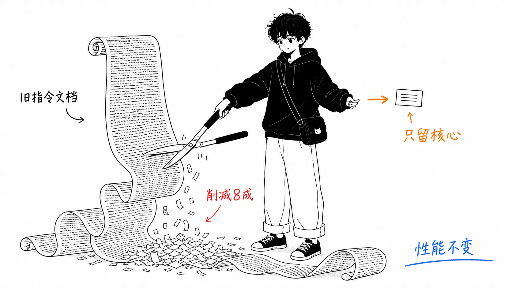
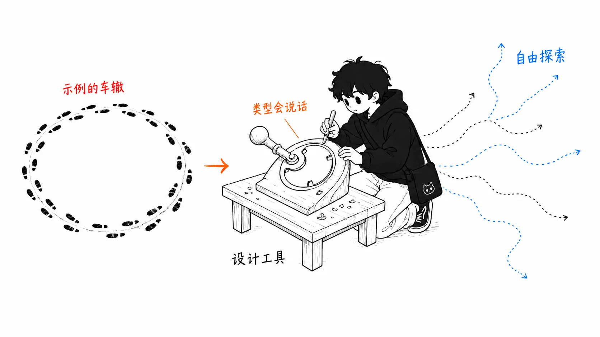
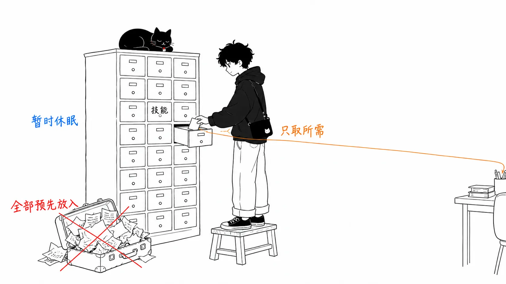

## 关于这篇文章

2026 年 7 月 24 日，Claude Code 团队的 Thariq（[@trq212](https://x.com/trq212/status/2080710971228918066)）宣布，**针对最新一代模型，他们删掉了 Claude Code 约 80% 的系统提示词**。而且编码评测的分数**没有可测量的下降**。同样的内容也以"The new rules of context engineering for Claude 5 generation models"为题，发布在 [Claude 官方博客](https://claude.com/blog)上。

在"提示词要写得长、写得细、多给例子"还是常识的年代看来，这相当反潮流。本文会梳理：

- **为什么能砍掉 8 成**（删除背后的思路）
- **"旧常识"与"现在的做法"的 6 组对比**（Then / Now）
- **怎样落实到自己的 CLAUDE.md 和技能（skill）上**（实践）

最后再写我自己的看法。

先说结论。

> 为旧模型写下的"规则"，对新模型来说会变成**束缚能力的脚镣**。在 Claude 5 世代，与其给规则，不如**给判断的依据**，效果更好。

---

## 第 1 部分：发生了什么

### 删掉 8 成系统提示词，评测分数没有下降

Claude Code 的系统提示词，是在用户的提示词送达之前每次都会加载的"地基指令书"。里面原本写着大量内容：工具的用法、编码规范、禁止事项等等。

Anthropic 针对 Claude Opus 5、Claude Fable 5 等最新一代模型，把它删掉了 80% 以上。据说内部的编码评测没有出现退化。相对于砍掉的量，结果安静得有点过分。

### 为什么能砍：事实上"过度的约束"本身就是成本

团队回看内部使用日志时发现，**同一次请求里，指令之间在互相冲突**。

比如，"要适当地留下文档"和"不要写注释"这两条指令，会同时从系统提示词、技能和用户的请求里送来。Claude 能领会用户的意图，大体上做对，但为了处理相互矛盾的指令，要多花一份思考。

这些约束曾经是为了"避免最坏情况"而必需的。擅自删文件，写满注释的代码，这些都是防止旧模型出事故的护栏。新模型能根据周围的上下文来判断，所以多数护栏删掉、交给判断，反而更好。

---

## 第 2 部分："旧常识"与"现在的做法"的 6 组对比

帖子里列出的 Then / Now 一共 6 组。我认为对实务影响最大的是前 3 组（规则、示例、渐进式披露），所以篇幅主要花在这里。第 4 到 6 组简单带过。

| | Then（旧常识） | Now（现在的做法） |
| --- | --- | --- |
| 1 | 给规则 | 交给判断 |
| 2 | 多给示例 | 设计接口 |
| 3 | 全都写在开头 | 渐进式披露（progressive disclosure） |
| 4 | 重要的事重复说 | 只在工具描述里写一次 |
| 5 | CLAUDE.md 就是记忆 | 交给自动记忆 |
| 6 | 简单的规格文档 | 丰富的参照物 |

### 1. 给规则 → 交给判断

旧系统提示词里有这样一句话。

> コードでは原則コメントを書くな。複数段落の docstring や複数行コメントブロックは絶対に書くな——最大でも短い1行。
>
> （代码里原则上不要写注释。绝对不要写多段落的 docstring 或多行注释块，最多一行简短的。）

这条指令在很多场合是对的，但**在复杂代码需要多行说明的场合就是错的**。对旧模型来说，只能接受这种取舍。新的系统提示词改成了这样。

> 周囲のコードと同じように読めるコードを書け。コメントの密度・命名・イディオムを周囲に合わせろ。
>
> （写出读起来和周围代码一样的代码。让注释的密度、命名和惯用写法与周围保持一致。）

给的不是禁令，而是**判断标准**。不是"不许做什么"，而是"要对齐什么"。

### 2. 多给示例 → 设计接口

"用示例教工具怎么用"曾是工具使用的铁律。但据说在最新模型上，人们发现**示例反而会收窄探索空间**。看过示例的模型，只会在那个示例附近尝试。

取而代之被推荐的是**设计工具本身**。比如把 Todo 工具的状态做成 `pending / in_progress / completed` 的枚举类型，光这一点就是使用上的提示。再写上"in_progress 始终只有一条"这个约束，想要的行为就定义出来了。**参数的类型和名字，比示例文字更有说服力。**

### 3. 全都写在开头 → 渐进式披露

旧的系统提示词里，始终包含着代码审查和验证的详细步骤。需要时很重要，但**不需要的场合也要每次消耗上下文**。

现在的 Claude Code 把这些切分成**独立的技能**，只在需要时加载。工具也一样：一部分工具是"延迟加载"的，在智能体用 `ToolSearch` 搜索定义之前，不会进入上下文。

这一点可以原样用在你自己的 CLAUDE.md 上。"怕 Claude 找不到，所以把知道的实践全写进 CLAUDE.md"是常见的误解，更好的做法是**建一棵文件树，让需要的时候读到需要的文件**。

### 4. 重要的事重复说 → 只在工具描述里写一次

旧世代的模型，有时不重复指令就不照做，还有"写在上下文末尾的指令更管用"的习性。所以同一个工具的说明，在系统提示词正文和工具描述里重复写了两遍。

新世代删掉了这种重复，**工具的用法只在工具的 description 里写一次**。

### 5. CLAUDE.md 就是记忆 → 交给自动记忆

以前推荐用 `#` 快捷键让 Claude 把事情记进 CLAUDE.md。现在 Claude 会**自动保存与工作和用户相关的记忆**，把 CLAUDE.md 当作记忆存放处的必要性已经变弱了。

### 6. 简单的规格文档 → 丰富的参照物

计划模式里的计划和规格，过去的惯例是存成 Markdown 文件。但新模型能处理**更复杂的参照物**。

- 不用 Markdown 规格文档，而是用 Artifacts 做出的 HTML 原型
- 不用文字规格，而是详细的测试套件，或者另一个代码库里作为移植来源的函数
- 不把偏好写成文字，而是交出一份评分细则（rubric，评价标准表），让验证智能体来打分

文中明确说"比起设计说明文字或截图，HTML 原型能产生更好的结果"。意思是：**用 Claude 最熟悉的语言，也就是代码来交付，是保真度最高的规格文档**。

---

## 第 3 部分：怎样用到自己的上下文里

帖子后半部分梳理了各层该怎么分开写。

**系统提示词**
产品上下文本身。是告诉 Claude"它在哪个产品里、在做什么"的地方。只是使用 Claude Code 的话不会去碰它，但如果自己做智能体，在这里花的时间最多。

**CLAUDE.md**
保持轻量。简短写下仓库的目的，token 的大头用在**代码库里的"绊脚处"**上（例如："类型定义统一放在这一个文件里，其他地方不要写"）。看文件系统就能明白的"显而易见的事"不要写。细节切出去放进验证技能之类的地方，CLAUDE.md 里只做引用。

**技能**
把它当作"在需要时找到信息的轻量向导"。关键领域之外不要管得太死。长的技能要拆成多个文件，做成渐进式披露。适合放**你自己或团队特有的观点、知识和最佳实践**。

**参照物**
用 `@` 提及来递交文件。规格、原型、代码库本身。原则是**尽可能以代码的形式交付**。

最后收尾的是，Claude Code 新增了自动完成这种"合身裁剪（rightsizing）"的 **`/doctor` 命令**。它会诊断你的技能和 CLAUDE.md 是过多还是不足。

---

## 我的看法："约束是与模型能力挂钩的债务"

从这里开始是我自己的解读。

### 护栏是有"保质期"的

我认为这次的事，本质不是"短提示词好"，而是**约束是以写下它时的模型能力为前提的债务**。"不要写注释"，作为旧模型的事故预防是对的。但模型一变聪明，这条约束就不再是事故预防，而是开始起到**能力上限**的作用。

这和代码里的技术债很像。写下时正确的变通办法，在环境变了之后还留在那里，悄悄地拖后腿。不同的是，提示词的债务**每次模型更新都会同时冒出来**。换模型的时候，清点 CLAUDE.md 也应该作为一套动作一起做。

### 你的 CLAUDE.md，大概比你以为的更过度

写这篇文章时，我对自己的全局 CLAUDE.md 和 rules 文件做了 grep。光是以 ALWAYS、NEVER、MANDATORY 开头的命令就有 11 处。有同感的人应该不少。每次遇到不顺就加一行规则，CLAUDE.md 就会变成**过往失败的化石层**。而且其中大多数，是当时那个模型的失败，不是现在这个模型的失败。

在"加规则"之前，先想想"能不能改写成判断标准"。不是 `DO NOT add comments`，而是 `match the surrounding comment density`。光这个改写模式就值得带走。

### 不过也有"交给判断"会带来麻烦的场合

我只想保留一点，就是**需要可复现性的团队运作**。基于规则的指令很憋屈，但输出的波动小。基于判断的指令表现得聪明，但**因成员而异、因会话而异的摇摆**会增加。像审查规范、提交规范这种"比起聪明更要一致"的领域，保留明确的规则仍然是合理的判断。帖子里也说了"关键领域可以管紧一点"，并不是让一切都交给判断。

### 渐进式披露与 MCP 的潮流是同一个方向

还有一点有意思：这种"需要时只加载需要的量"的方向，和 MCP 2026-07-28 的无状态化、延迟加载工具，是完全相同的思想。上下文窗口还在不断变大，但业界投入的不是"全都装进去"，而是**"不装进去的技术"**。上下文不是越大越好，而是**对那一刻的问题纯度越高越好**。这条原则短期内看来不会变。

---

## 总结：只带走一件事的话

如果只从这篇文章里带走一件事，那既不是 `/doctor`，也不是渐进式披露，而是**"把禁令改写成判断标准"**这个改写模式。把 `DO NOT add comments` 改成 `match the surrounding comment density`。光是这一招，就能还掉 CLAUDE.md 里堆积的大半债务。

第二是运行 `/doctor`。第三是养成习惯：每次换模型，都把清点 CLAUDE.md 作为一套动作一起做。做到这里，这篇文章的内容基本上就都收回来了。

参考：[Thariq 的 X 帖子](https://x.com/trq212/status/2080710971228918066) / Claude 官方博客"The new rules of context engineering for Claude 5 generation models"
