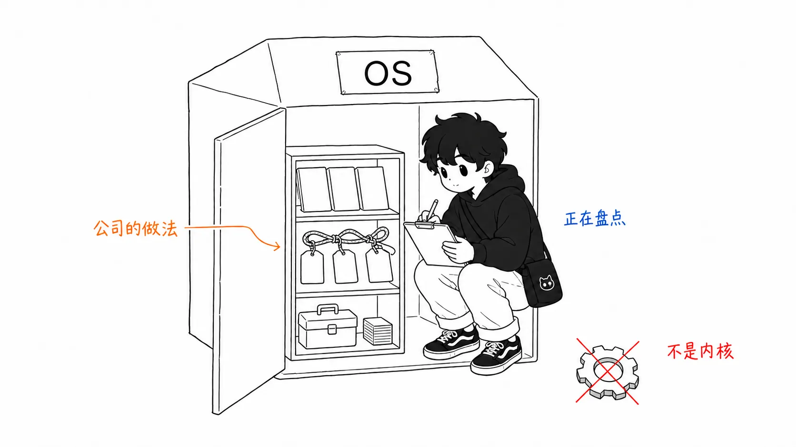
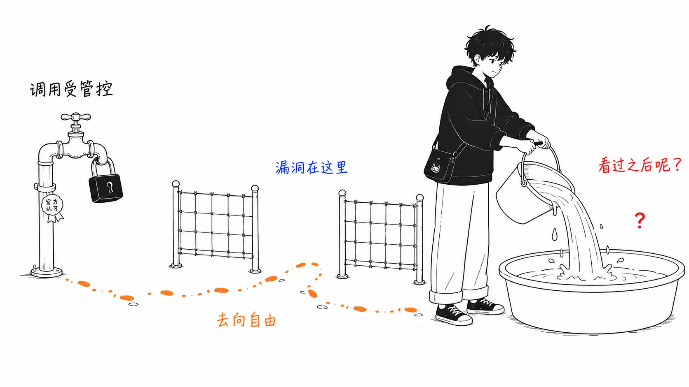
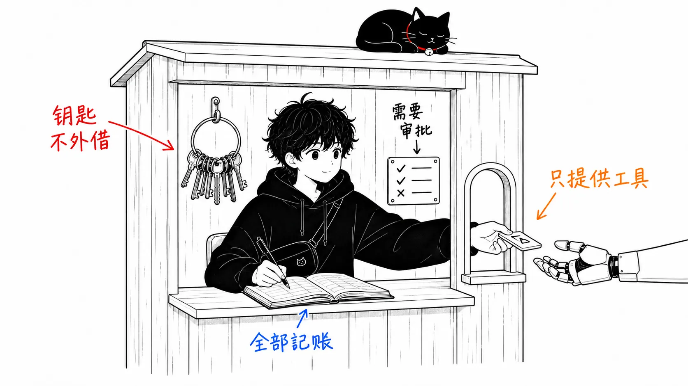
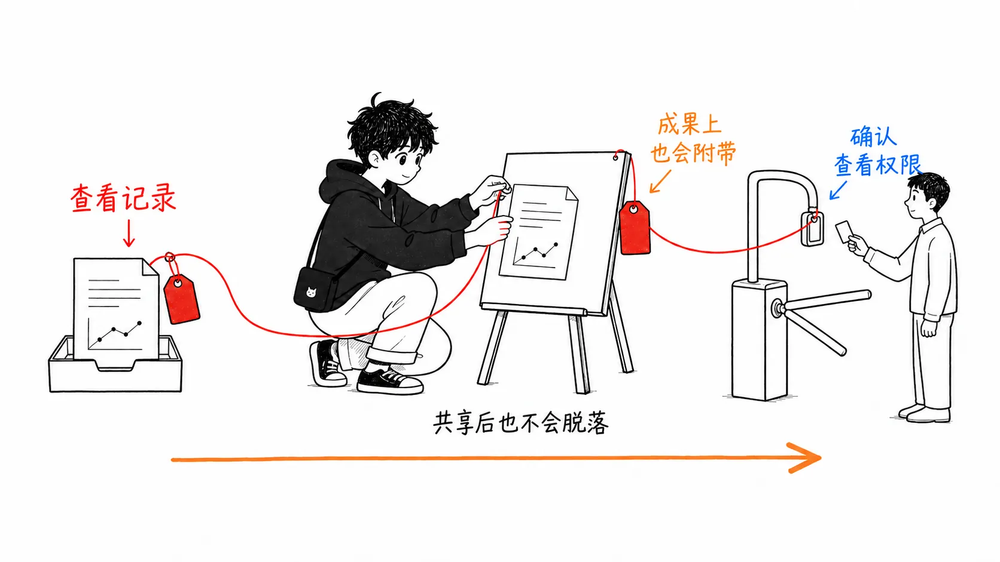
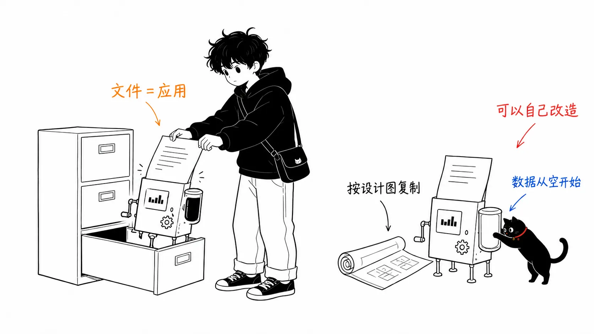

## 关于这篇文章

2026年8月5日，Cloudflare 以开源方式发布了“**Cloudflare OS**”。一手资料是[官方博客的发布文章](https://blog.cloudflare.com/cloudflare-os/)和 [GitHub 仓库](https://github.com/cloudflare/cloudflare-os)。

先交代一下，我还没有把它部署到自己的 Cloudflare 账号上实际用过（写这篇的时候是发布的第二天）。这篇文章是对博客和仓库描述的精读整理，加上我在此之上的解读。里面不包含实际运行后的体会。

先说结论。

> Cloudflare OS 有意思的地方不在聊天界面，也不在应用生成，而在于这套安全基础设施：它**把“智能体看过什么”全部记录下来，并让权限连同这份记录一起传播**。MCP 遗留下来的问题是，能控制工具的调用，却控制不了看到的数据去往哪里。平台第一次把堵上这个问题，作为标准功能提了出来。

所以这篇文章对工作区功能的介绍点到为止，把篇幅花在安全模型上。

---

## 第1部分：发布了什么（简述）

### 名字叫 OS，内核是“整个公司共享上下文的智能体基础设施”

Cloudflare OS 由三个部件构成。

- **智能体工作区**：以公司整理好的上下文和技能为基础，能在隔离的运行时里编写并运行代码
- **安全与治理基础设施**：对内部数据和服务的安全访问控制（本文的主角）
- **应用平台**：个人创建、分享，被分享的人可以持续改造的应用

体验是这样的：在浏览器里开始一段对话，它就能变成文档、应用或持续运行的工作流。在 Cloudflare 内部，今年5月起全体员工都在使用，工程师以外的职位也在日常用它做资料、自动化例行工作、制作数据可视化应用。

关于“OS”这个名字，仓库自己做了这样的声明。

> 这不是传统意义上的计算机操作系统。我们在两种意义上使用这个词：“让公司借助 AI 提高生产力的 OS”和“管理 AI 工作负载的 OS”。

许可证是 Apache 2.0。由核心本体（cloudflare-os）和模仿 Cloudflare 内部运维的示例部署（cloudflare-os-starter）两个仓库构成，设计成无需给核心打补丁就能叠加自家的定制。



功能介绍到此为止。“AI 工作区”本身在2026年已经是大路货，各家都在推类似的东西。差距出在下一部分。

---

## 第2部分：核心：把授权追踪到“数据的去向”

### MCP 只能守到“能调用什么”

公司内部刚开始用 AI 的人，最先说的是“给我 API 密钥”。但把密钥交出去，等于把过宽的权限长期撒出去，既没法限制也没法审计。到这里是已知的问题，MCP 解决的也就到这里。MCP 服务器保管凭据，只展示定义好的工具。

Cloudflare 在内部运维中撞上的，是再往后的问题。

> 对 MCP 的访问，能告诉你智能体**可以调用哪些工具**，却不能告诉你它**观测过哪些资源**。智能体可以把来自多个系统的信息组合起来，发到限制更宽松的地方，并通过应用或成果物，暴露给没有权限查看原始资源的人。授权必须连数据**接下来能去哪里**也考虑进去。

举个具体的例子：智能体读取了数据仓库里的机密表并做了一个仪表盘，这个仪表盘的分享绝不能变成“让没有权限看表的人看到表”的漏洞。光靠控制工具调用，防不住这个。



### 智能体从“什么都看不见”的状态开始

在 Cloudflare OS 里，所有智能体和应用都从**零访问权限**开始。智能体申请访问某个特定资源，人类批准之后，它会作为带类型的绑定交给生成的代码。

```ts
const issues = await env.PROJECT.listIssues({
  teamId: "ENG",
  state: "open",
});
```

`env.PROJECT` 是一种能力（capability），表示“在特定策略下使用特定资源的许可”，凭据本身对智能体和生成的代码都是完全隔离的。服务端代码跑在封死了全部对外网络的 Dynamic Worker 里，客户端代码跑在浏览器的沙箱框架里，除了明确授予的能力，都无法访问互联网。

### Gatekeeper：每个服务一道关口

在智能体和外部服务之间，会夹着一个叫 **Gatekeeper** 的 Worker。它理解目标服务的 API、资源和操作，比如对 GitHub 来说：

- 只放开对某一个仓库的访问
- 允许读 Issue，但不允许读源代码
- 对特定字段做掩码
- 合并 PR 必须经过人工批准

按这样的粒度来控制。持有 OAuth 和凭据、强制执行策略、**记录读取了什么**、居中处理会对外产生副作用的操作，全是 Gatekeeper 的工作。从智能体这边看，只是一个小小的 TypeScript API。



### 新的地方在这里：策略跟着“看过的东西”走

接下来是重头戏。Cloudflare OS 会记录智能体观测过的全部资源，这份观测记录会**一直附着**在智能体及其成果物上。

> 当另一个人想打开那个工作区、与智能体交互、或查看成果物时，Gatekeeper 会验证这个人对“已观测资源”是否拥有权限。

不仅如此，同一份观测日志还会约束对外的行为。读过一次机密数据的智能体，可以由策略拦住它向特定位置写入、邀请新的协作者、把工作移交给其他智能体、发出对外请求。

也就是说，权限不只是在“入口”处，而是**和数据一起旅行**。构建应用的人和使用智能体的人，都不需要自己去实现这套机制，平台在底层替他们扛着。文中写道，内部运维的第1版里“一开始共享就需要这个了”，正是推倒重做的直接动机。



---

## 第3部分：所有“文件”都变成应用（篇幅适中）

应用功能要抓住的只有两点。

**第一：所有应用都是 Worker。** 智能体做应用时，要写两部分：浏览器端的 UI 代码，以及持有状态和行为的服务端代码。服务端是作为专门为这个项目新建的 **Dynamic Worker**（V8 isolate，所以不需要专用容器）在需要时加载的，并作为 **Durable Object Facet**，每个应用拥有各自独立的 SQLite。与客户端的通信用 Cap'n Web（对象能力型 RPC），服务端的方法无论从人类的 UI 还是从智能体，都能以同样的方式调用。

**第二：分享有两种。** 分享应用本身，可以实时共同使用同一份状态；分享“蓝图（blueprint）”，对方会创建自己的副本。蓝图里只有代码，不包含 SQLite 的数据、对话历史、凭据和连接的资源。接收的人不必提功能需求，可以自己让 AI 去改造。



不是“文档、电子表格、幻灯片这种固定的一套应用”，而是“每一个文件都是专用的应用”，作为产品形态，我觉得确实坦率地新。

---

## 我的看法：我认可的地方，和我怀疑的地方

### 我认为信息流控制下沉成“产品标准功能”，这是第一次

“读过的数据身上带着标签，约束它的去向”这个想法本身并不是新发明。作为信息流控制（IFC），学术上已经有几十年了，在军用系统和部分研究型 OS 里实现过。但是，作为**普通公司普通使用的 SaaS 平台里、用户感知不到的标准功能**被放上去，据我所知这是第一次。

而且这也是对整个 MCP 生态的一次发问。搭起 MCP 服务器就满足了的组织应该不少，但“智能体看过的东西的去向”没有人在守。Cloudflare 给它起了名字，也给了实现。我预计会发生两件事之一：其他平台跟进，或者 MCP 规范本身引入类似的概念。

### “组织的技能库”是 Claude Code 心得的组织版

把公司的术语、步骤、例行工作的做法作为技能存进共享库，让“有人找到好办法，大家都能用”：这就是工程师一直用 Claude Code 的 CLAUDE.md 和技能在做的事，原封不动地放大到组织规模的版本。原本是个人工具的上下文整理，变成了公司的资产管理。这个趋势并不是 Cloudflare 独有，我认为到明年各家都会出现。

### 怀疑：它是“开源”，但不是“哪儿都能跑”

我最在意的是这里。Apache 2.0 让代码可读，但运行基础建立在 Dynamic Worker、Durable Object Facet、Cloudflare Access 之上，也就是**包含为这个项目专门打造的 Cloudflare 专属功能**。目前，事实上没有在自家服务器或别的云上自托管的路。

把“公司的工作方式、步骤、技能、应用”这些组织的核心资产全放到这个运行时上，意味着放上去之后的迁移成本极高。开源保证的是代码的透明，而不保证可移植。如果考虑引入，我认为现实的底线是“从那些可以和 Cloudflare 共进退的业务开始”。

### 怀疑：“OS”这个命名，说的是野心而不是实情

仓库自己两次辩解“不是传统意义上的 OS”，反过来看，是因为这个名字不是对实质的描述，而是一份**定位宣言**。作为“我们要去拿下 AI 时代业务基础设施的默认层”的宣言，这是个高明的名字，但作为读者，我认为最好别被名字牵着走，而是把它当作“带权限系统的智能体运行基础设施”来评价。

---

## 总结：只带走一件事的话

如果从这次发布里只带走一件事，不是功能清单，而是这个问题。

> **你们组织的智能体“看过的东西”，现在能走多远？**

大多数组织应该还停在控制工具调用（搭起 MCP 服务器）这一步，而再往后，也就是控制观测到的数据的去向，这次终于有了产品级的答案，这就是这次发布的意义。第二重要的是“文件 = 应用 + 蓝图分享”这种产品形态。第三是锁定在 Cloudflare 专属基础设施上的分量，这是引入决策的分水岭。

参考：[Cloudflare OS: an open platform for agents, apps, and work](https://blog.cloudflare.com/cloudflare-os/) / [GitHub: cloudflare/cloudflare-os](https://github.com/cloudflare/cloudflare-os) / [os.cloudflare.app](https://os.cloudflare.app/)
