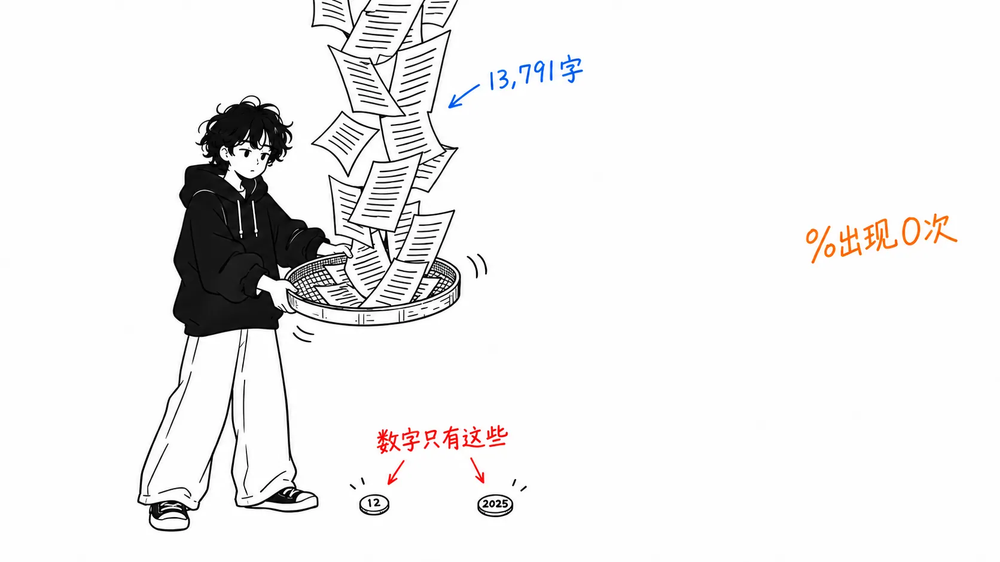
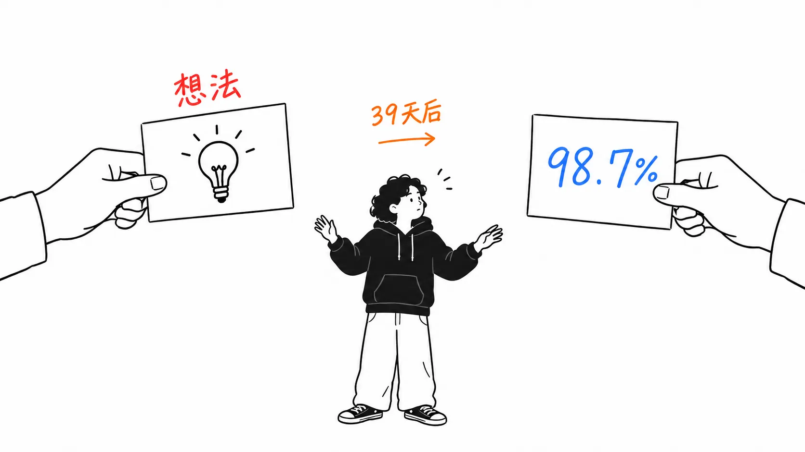
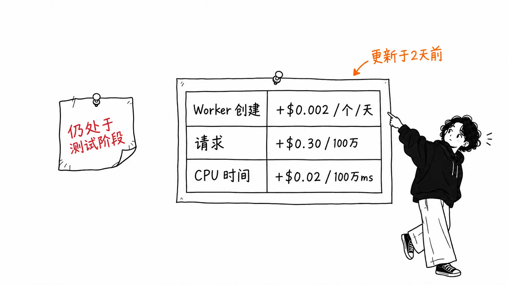
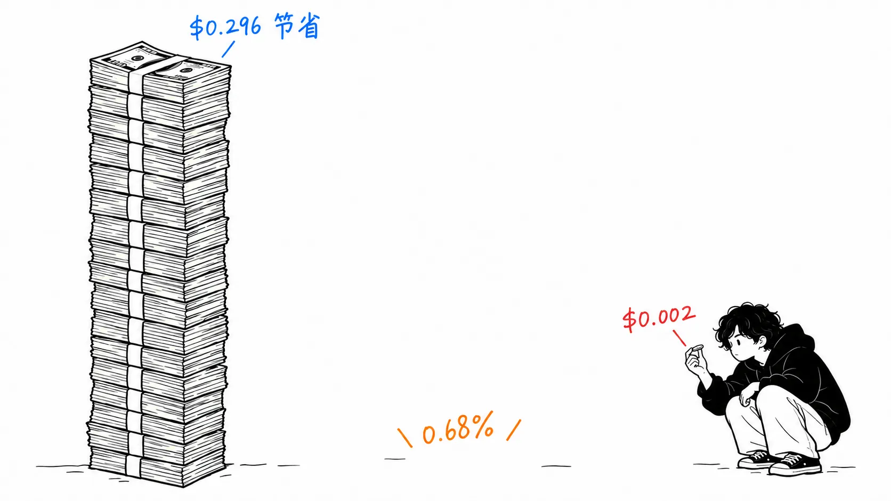

先说结论。

> 这篇以“大家一直把 MCP 用错了”开头的文章，13 个月过去了仍在被引用，我认为**它的主张是对的**。但正文散文里出现的数字，**只有两个：“12”（阅读 12 分钟）和“2025”（年份）**。百分比为零，token 数量也为零。“The results are striking”里的 striking，靠的不是测量，而是对机制的说明和一个比喻。给它配上数字的，是 **39 天后 Anthropic 的文章**，那篇文章点名引用了 Cloudflare。**想法的出处和数字的出处，是两家不同的公司。**

## 关于这篇文章

我读的是 [Cloudflare Blog 上的 "Code Mode: the better way to use MCP"](https://blog.cloudflare.com/code-mode/)（Kenton Varda / Sunil Pai，2025 年 9 月 26 日）。讲的是：不把 MCP 的工具直接展示给 LLM，而是**把它们转换成 TypeScript 的 API，让 LLM 去写调用这些 API 的代码**。

今天是 2026 年 10 月 14 日，距离发布**已经 383 天**。也就是说，我是在读一篇一年多以前的文章。

**坦率声明。**我没有亲自运行过 Code Mode。我核实过的是：文章里的数字有多少个、引用关系、发布日期，以及**现在的文档和价格表**。我还根据价格做了一次估算，所有前提都会写出来。

## 散文里只有两个数字

先说主张这一边。今天读来，它依然讲得通。

> The special tokens used in tool calls are things LLMs have never seen in the wild. They must be specially trained to use tools, based on synthetic training data.

工具调用的特殊 token，是 LLM 在自然状态下从未见过的东西，是事后用合成数据训练出来的。而代码则是从数百万个开源项目里大量学来的。所以**让它写代码会更擅长**。

比喻也很到位。

> Making an LLM perform tasks with tool calling is like putting Shakespeare through a month-long class in Mandarin and then asking him to write a play in it.

（用工具调用让 LLM 完成任务，就像让莎士比亚上一个月的中文课，然后要求他用中文写一部戏剧。）

通俗易懂。然后文章开头是这样的。

> The results are **striking**

它说结果是 striking。于是我把正文里（从 H1 到相关标签，去掉代码块后共 13,791 字）所有的数字都捡了出来。

| 查找的内容 | 数量 |
| --- | --- |
| 百分比写法 | **0** |
| “~ token”这类数量 | **0** |
| “benchmark”一词 | **0** |
| 含 “measure” 的词 | **0** |
| 散文中的数字 | **2**（“12 minute read”里的 12，和“throughout 2025”里的 2025） |

**striking 的内容，没有一处是用数字写的。**作为依据写出来的，是“We found agents are able to handle many more tools”这一观察，以及对原因的假设（"**Perhaps** this is because LLMs have an enormous amount of real-world TypeScript in their training set"）。它写的是 perhaps。

为避免误会，这并不是撒谎。“没测量”和“错了”是两回事。只是，**这篇文章没法让任何人知道它到底有多大效果。**

## 数字在 39 天后，从另一家公司那里出现

2025 年 11 月 4 日，Anthropic 发表了 ["Code execution with MCP: Building more efficient agents"](https://www.anthropic.com/engineering/code-execution-with-mcp)。这是 **Cloudflare 那篇文章的 39 天后**。

而这篇文章里提到了 Cloudflare。

> **Cloudflare published similar findings, referring to code execution with MCP as "Code Mode."** The core insight is the same: LLMs are adept at writing code and developers should take advantage of this strength to build agents that interact with MCP servers more efficiently.

明确写了是同样的发现。而且数字就在这里。

> This reduces the token usage from **150,000 tokens to 2,000 tokens—a time and cost saving of 98.7%**.

用同样的数法去数 Anthropic 这边，百分比有 1 个（98.7%），token 数量有 3 个（50,000 / 150,000 / 2,000）。Cloudflare 这边是 0 和 0。

这里需要提醒。**98.7% 也不是基准测试。**上下文是“在这个例子中”，是对一个连接 Google Drive 和 Salesforce 的虚构工作流所做的估算。测量条件、任务数、方差都没有写。

也就是说，局面是这样排列的。

| | 想法 | 数字 |
| --- | --- | --- |
| 出处 | Cloudflare（2025-09-26） | Anthropic（2025-11-04） |
| 依据的形态 | 观察与假设（perhaps） | 单个例子的估算 |

被引用时被叫出名字的是“Code Mode”，被当作数字记住的是“98.7%”。**来自两篇不同文章的两样东西，作为同一个主张在流通。**

## 13 个月里，文章被落在了后面

文章末尾是这样的。

> The Dynamic Worker Loader API is in **closed beta**. To use it in production, sign up today.
> We have **not yet finalized pricing** for the Worker Loader API

今天我去看了文档。

Worker Loader API 参考文档的 URL，会跳转到**名为 Dynamic Workers 的独立产品板块**。Overview、Getting started、Bindings、Egress control、Observability、Custom resource limits、Examples，以及 **Pricing** 和 **Platform Limits** 依次排开。最后更新是 **2026 年 10 月 12 日**，也就是 2 天前。

正文里**一个 `beta` 字样都没有**。

价格也公布了（该页最后更新于 2026 年 6 月 11 日）。

| 项目 | 包含的额度 | 超出部分 |
| --- | --- | --- |
| 每天创建的 Dynamic Worker | 每月 1,000 个 | **+$0.002 / 个 / 天** |
| 请求 | 每月 1,000 万 | +$0.30 / 百万 |
| CPU 时间 | 每月 3,000 万 CPU 毫秒 | +$0.02 / 百万 CPU 毫秒 |

计费**从 2026 年 5 月 26 日开始**，仅限 Workers Paid 套餐。

而另一边，文章至今仍写着“closed beta”和“pricing 未定”。文章的 `dateModified` 是 **2026 年 7 月 15 日**，所以在价格公布之后，肯定有什么地方被更新过。**改了什么，我没能确认**（见后文）。

另外，代码这边是活着的。文章里贴出的 `import { codemode } from "agents/codemode/ai"` 所在的 `agents` 包，目前是 **0.28.1**（发布于 2026 年 10 月 13 日，也就是昨天），`./codemode/ai` 这个导出至今仍然存在。**13 个月前示例代码里的 import 路径，原样就能用。**

## 价格出来了，所以能把两篇文章加起来算一算

这是我在本文里做的计算。**两篇文章里都没有写。**

Cloudflare 主张的核心是“用完即弃就行”。

> Isolates are so fast that we can just create a new one for every piece of code the agent runs. There's no need to reuse them.

当时价格未定，所以这个“每次重新创建”到底要多少钱，谁也算不出来。**现在能算了。**

价格页上的定义很关键。**Dynamic Worker 由“Worker ID 加代码”唯一标识，二者只要有一个变了，就算作新的 Worker。**Code Mode 每次生成的代码都不同，所以**一次执行 = 一个新的 Dynamic Worker**。

| 智能体执行次数 | 每月 | 超出部分的费用 |
| --- | --- | --- |
| 每天 100 次 | 3,000 个 | **$4 / 月** |
| 每天 1,000 次 | 30,000 个 | **$58 / 月** |
| 每天 10,000 次 | 300,000 个 | **$598 / 月** |

接着，把它和节省的部分放在一起比。Anthropic 的例子是 150,000 → 2,000 token，所以节省了 **148,000 token**。按输入 $2 / 百万 token 换算（Claude Sonnet 5，我手头的资料截至 2026 年 6 月 24 日），是 **$0.296**。

一次沙箱是 **$0.002**。

| | 每个任务 |
| --- | --- |
| 节省下来的 token 费用 | $0.296 |
| 沙箱费用 | $0.002 |
| **沙箱费用占节省额的比例** | **0.68%**（148 倍） |

即使节省的部分全部由缓存读取（约为普通输入的 0.1 倍）来承担，节省额也是 $0.0296，比例是 **6.8%**（14.8 倍）。

**无论哪种前提，都是以一个数量级胜出。**所以 Cloudflare 在公布价格之前就断言“用完即弃就行”，结果上是站得住的。不过当时并没有给出依据，**能给出依据，是从 5 个月前价格表出来的时候开始的。**

## 我的看法

这个博客里，我写过好几篇顺着数字的出处追下去，结果“追到一个个人博客”、或者“那是峰值而不是平均值”之类的文章。这次是**相反的情况**。

**一个数字都没有，主张却是对的。**

所以我没法写“没有测量的文章不行”。Cloudflare 那篇文章拥有的不是测量，而是**对机制的说明**。“特殊 token 只用合成数据训练过。代码是用真实数据大量训练的。”这是一个可以被证伪的形态，而且读的人可以拿它和自己的经验对照。属于先于数字而来的“信服”那一类依据。

在此基础上，写一下 13 个月后看到的东西。**没有人说得出它到底有多大效果，却一直在引用。**

实际在流通的，是“Code Mode（Cloudflare）”这个名字和“98.7%（Anthropic 的一个例子）”这个数字的组合。前者没有测量，后者是对一个虚构任务的估算。**两者相加，基准测试也是一个都没有。**即便如此，“别直接调用 MCP”在这一年里已经成了默认的做法。

还有一点。**文章不会更新，产品却在动。**closed beta 变成了产品，价格表出来了，计费开始了，文档在 2 天前更新过。即便如此，文章末尾仍是 beta。对读的人来说，这只是一个简单的道理：**不能用 13 个月前的文章来判断“现在是什么状况”**。只是，这篇文章现在搜索时仍排在最前面。

最后写一件会回到我自己身上的事。**这篇文章里的 0.68% 这个数字，依据的强度和 Anthropic 的估算是一样的。**148,000 token 这个节省幅度是从一个例子借来的，不是我测的。拿借来的数字去做除法，**除法的精度看起来像是超过了原数字的精度。**其实并没有超过。

## 只带走一件事的话

**读到写着“这个有效”的文章时，请数一数文章里的数字。**如果是 0 个，效果大小的依据就来自别的什么地方。这次来自 39 天后另一家公司的文章。**追溯出处，也包括确认主张的出处和数字的出处是不是同一个。**

## 出处

- Kenton Varda, Sunil Pai, ["Code Mode: the better way to use MCP"](https://blog.cloudflare.com/code-mode/)，Cloudflare Blog，2025 年 9 月 26 日发布（JSON-LD 的 `dateModified` 为 2026-07-15）
- Anthropic Engineering, ["Code execution with MCP: Building more efficient agents"](https://www.anthropic.com/engineering/code-execution-with-mcp)，2025 年 11 月 4 日
- [Cloudflare Dynamic Workers 文档](https://developers.cloudflare.com/workers/runtime-apis/bindings/worker-loader/)（最后更新 2026 年 10 月 12 日）和[价格页](https://developers.cloudflare.com/dynamic-workers/pricing/)（同为 2026 年 6 月 11 日，计费开始于 2026 年 5 月 26 日）。均于 2026 年 10 月 14 日获取
- `agents` 包的版本和导出，于 2026 年 10 月 14 日从 npm 获取（0.28.1，发布于 2026 年 10 月 13 日）

写一下数数的方法。Cloudflare 的文章，把从 H1 到 “Related tags” 视为正文，从去掉代码块后的 13,791 字里数。`%` 写法 0 处，“~tokens” 0 处，`benchmark` 0 处，`measure` 类 0 处。剩下的数字是 “12 minute read” 里的 12 和 “throughout 2025” 里的 2025。**代码块里是有数字的**（`gpt-5`、`compatibilityDate: "2025-06-01"`、`SOME_NUMBER: 123`、天气示例里的 93°F）。因为不是测量值，所以排除了。

2026 年 7 月 15 日更新了什么，我**没能确认**。Wayback Machine 里留有 2025 年 9 月 26 日起的快照，但能取到的 HTML 里不含正文（因为是用 JavaScript 渲染的），无法做差异对比。我那个“beta 的描述还是当时的样子”的推测，只是基于**现在的正文仍是 beta**这一事实，以及文档那边已经不再是 beta 这一事实而说的。

列出根据价格做估算的前提。**一次 Code Mode 执行 = 一个新的 Dynamic Worker**（依据价格页“以 Worker ID 和代码唯一标识，二者有一变化即为新建”的定义）。免费额度按每月 1,000 个计，只计入超出部分。**请求费用和 CPU 时间没有算进去**（因为会并入 Workers 现有套餐）。token 单价用的是我手头资料（截至 2026 年 6 月 24 日）里 Claude Sonnet 5 的输入价 $2 / 百万 token，**没有在官方价格页上重新核对今天的价格。**节省量 148,000 token 直接用了 Anthropic 文章里例子的数字。因此 0.68% 这个值，是**例子 × 我的单价 × 我的计费模型**的乘积。除了看数量级对不对，不能再有更多用途。

因为我没有实际运行 Code Mode，所以“工具多的时候成功率真的会提高吗”，我什么也不能说。这篇文章能说的只有两件事：**原文没有数字**，以及**数字来自另一篇文章**。
