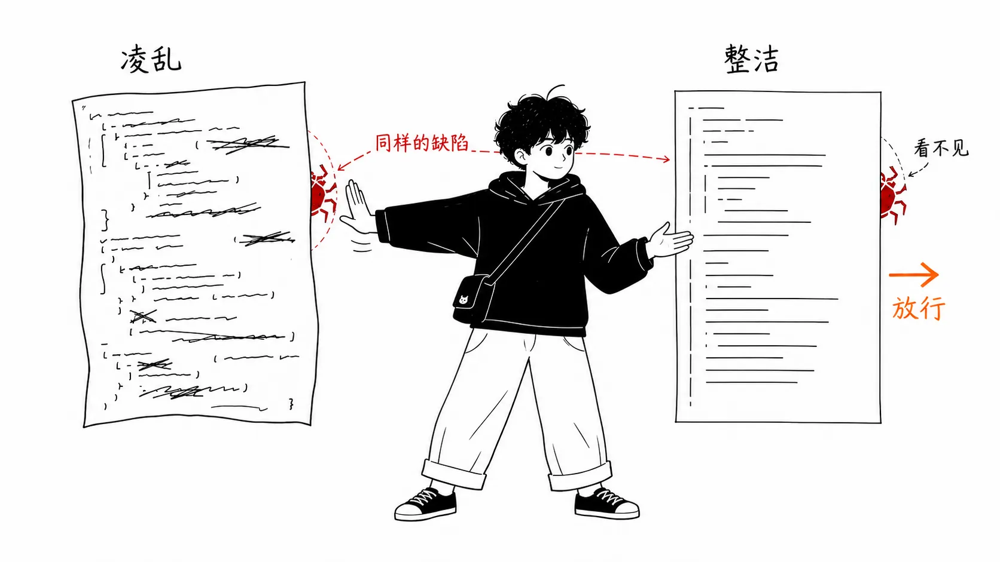
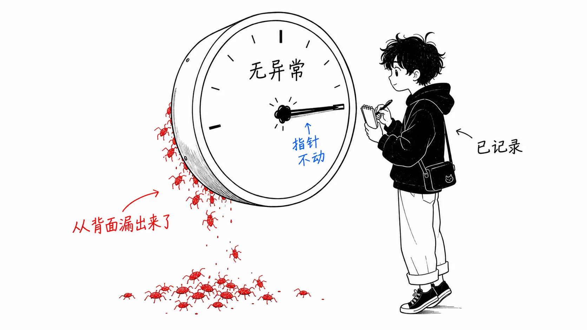
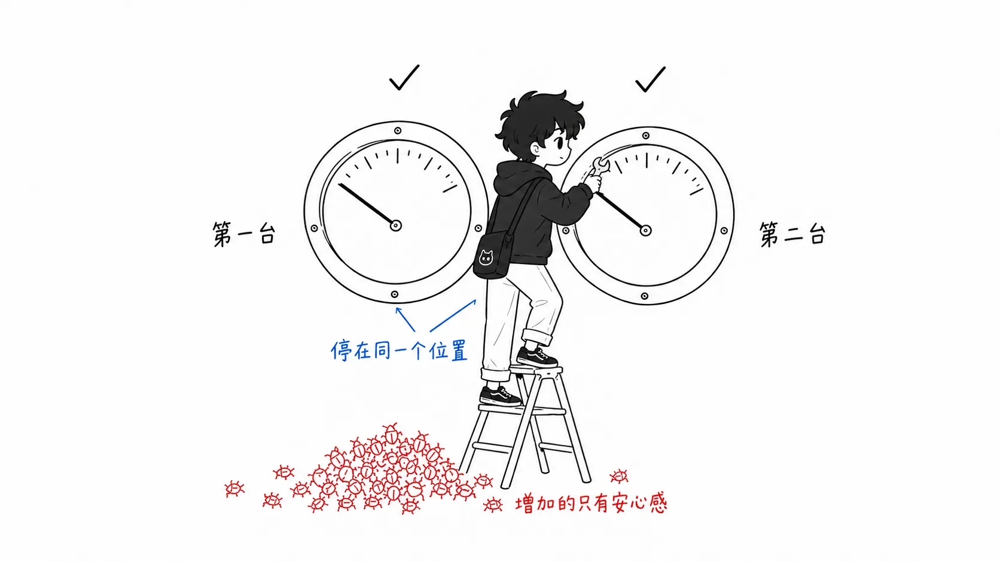
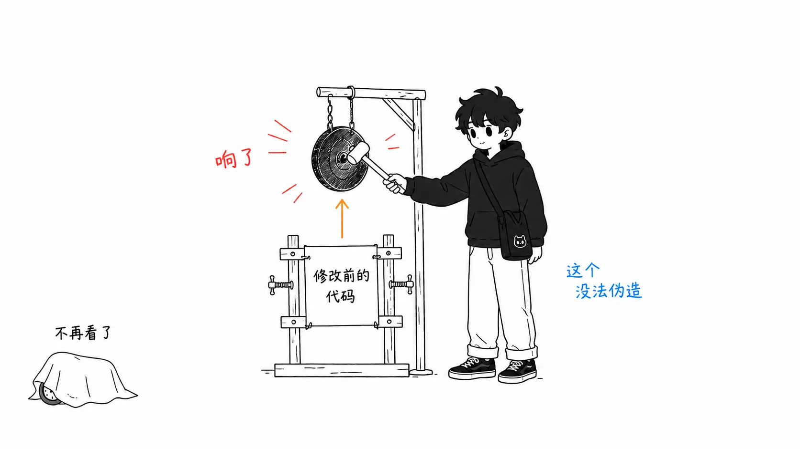

## 关于这篇文章

本文讨论的是 2026 年发布的几份代码评审相关数据。核心有四份：Faros AI 的遥测报告 "The Acceleration Whiplash"（22,000 名开发者、约 4,000 个团队）、CircleCI 的 2026 State of Software Delivery（超过 2,800 万次 CI 工作流运行、超过 22,000 个组织）、LinearB 的 2026 Software Engineering Benchmarks（810 万个 PR），以及 GitHub Blog 上 Andrea Griffiths 在 2026 年 5 月 7 日发表的文章 "Agent pull requests are everywhere. Here's how to review them."

文章分为两部分。

- **第 1 部分**：这四份数据集说了什么
- **第 2 部分**：**我对这个故障出在哪里的看法**。任何一份来源里都没有写过的读法

后半部分更长。数字的整理读原文就够了。

之前我写过一篇《AI 编程之争，吵的并不是事实》，讲的是同一批数据为什么会得出截然相反的结论，说的是解读如何分裂。这次讲的是另一件事：评审这道工序本身，到底坏在哪里。

先交代一下。我能读到正文的，只有 GitHub Blog 的那篇文章、David R. Longnecker 的博客，以及各份报告的公开摘要。arXiv 的两篇论文（"More Code, Less Reuse" 2601.21276，以及 Cotroneo 等人的 2508.21634）我只看到了摘要和二手转述，没有读论文本体。第 2 部分是把现有数字对照起来得出的解读，并不是我自己测量的结果。

---

## 第 1 部分：数字说明了什么

### 先说结论

> 如果把评审变慢的原因诊断为“量变多了”，开出的药方就是“增加评审能力”。但数据呈现的是，评审者**花了更多时间，却放行得更轻松**。这不是产能不足。这是一种故障：评审者多年来赖以判断的依据本身失灵了。

### 产出提升是真的

先看对 AI 有利的数字。Faros AI 的遥测显示，每位开发者的任务吞吐量增长约 34%。AI 生成的代码未经修改就被接受的比例，一年内从 20% 升到了 60%。CircleCI 那边，整体吞吐量同比增长 59%。

这个数据集里有 80% 的团队，已经超过了“每周活跃使用 AI 工具的人过半”的水平。这已经不是先行者的故事了。

### 同一份遥测里的另外几列

同一份 Faros 报告里，还并排列着这样几项。

- 代码评审所花时间的中位数：增加 441.5%
- 首次评审前等待时间的中位数：增加 156.6%
- 每位开发者的 bug 数：增加 54%
- 生产事故数 ÷ PR 数：增加 242.7%
- 代码 churn（写出后两周内被重写的比例）：增加 861%
- 未经评审就合并的 PR：增加约 31%

最后一项，报告还加了一条注释。没有任何团队改过评审政策。之所以出现这种情况，是因为评审者已经跟不上涌来的量。

CircleCI 的细分数据也指向同一个方向。功能分支的吞吐量中位数增长了 15%，而 main 分支的吞吐量下降约 7%，main 的成功率跌到了 70.8%。进入流水线的量变多了，平安抵达生产环境的比例却在下降。

### GitHub 给它起了名字的故障

GitHub Blog 的文章，从第一句话就是这样开头的。

> 你很可能已经批准过一个这样的 PR，只是自己没意识到。测试通过了。代码很干净。你合并了。
> 但它是智能体生成的——而**这么容易就批准，恰恰就是问题所在**。

文章引用的是 2026 年 1 月的研究 "More Code, Less Reuse"，结果是：智能体生成的代码，每次变更的冗余和技术债比人类写的更多。可人类评审者反而更容易放行它。

GitHub 团队给这种失败起了名字：幻觉式正确（hallucinated correctness）。调用不存在的 API 这类显而易见的幻觉，CI 能抓住。危险的是那种能通过编译、现有测试全部通过、却依然错误的代码。分页里的 off-by-one。测试覆盖不到的分支里缺失的权限检查。在智能体没有设想到的边界情况下被短路的校验。规模上去之后才第一次出现的竞态条件。

文章开出的药方是“别扫，要追”。在 diff 里选出最重要的一条路径，把从输入到输出的所有变换都追一遍。然后，针对这次修复声称修好的 bug，要求提供一个在修改前的代码上会失败的测试。如果智能体写不出这样的测试，要么修复不完整，要么理解错了。

### 这里有一处矛盾

以上都是各份来源里的说法。从这里开始是我自己的排列方式，不过把两个数字放在一起，就会出现奇怪的事。

在 LinearB 的基准里，智能体 AI 的 PR 被评审者接手之前的等待时间，是未使用 AI 的 PR 的 5.3 倍。AI 辅助的 PR 是 2.47 倍。可 GitHub 那边的说法却是，AI 写的 PR 更容易获得批准。

如果只是单纯的产能不足，两头都应该变慢。人手不够，就是接手慢、放行也慢。如果两头都变快，那就是评审者放弃了评审，这也说得通。但“接手极慢，接手之后却很容易过”，这两种形态都不是。

---

## 第 2 部分：我的看法，坏掉的是仪表

### 评审从来不是验证，而是抽样检查

这是我的出发点。长久以来，我们把代码评审称作“确认变更是正确的”。实际做的却不是这样。我们是把 diff 从头读到尾，寻找作者偷工减料的痕迹。

命名不统一。风格和周围不一样。错误处理偏偏漏了一处。函数长得不自然。复制粘贴的痕迹。这些东西本身并不是 bug。它们是 bug 的替代指标。而作为替代指标，它们出奇地好用。原因很简单：风格上马虎的人，逻辑上也马虎。两者之间存在相关性。

所以评审才便宜。10 分钟扫一遍 1000 行，再深挖几处引起注意的地方。不用追遍所有路径，从马虎程度的分布就能推断出“危险大概在这一带”。“批准”这一制度，就架在这个推断管用的前提之上。

### LLM 切断了这层相关性

流畅，正是模型所优化的对象本身。命名一致，风格和周围融为一体，错误处理在形式上也都在。表面变得处处均匀地干净，连逻辑出错的地方也一样均匀。

这一点是决定性的。AI 代码并不是降低了替代指标的数值，而是**切断了**替代指标与真实缺陷之间的**相关性**。并不是指针不动了，而是指针一直指着“无异常”。

作为仪表，这比坏了不动还糟。不动的仪表，至少能看出它不动。一个以很高的把握度返回错误数值的仪表，会污染所有相信它的判断。

而且这样看的话，前面的矛盾就解开了。评审者打开智能体的 PR 时心里发沉，因为他们隐约觉得哪里不对劲。所以接手慢了 5.3 倍。但一旦打开，平时用来挑毛病的材料一样也找不到。没有反对的依据。于是放行。是犹豫之后的投降。

这部分是我的推测，我要明说。Codacy 的文章把同样的 5.3 倍解读为“评审者花了更多时间来评估的证据”，和我的读法正好相反。而且 LinearB 的同一份报告里还有一个数字：AI 辅助的 PR 大约大 2.5 倍。大的 diff，不管谁写的，都更难被接手，评审也更花时间。这个混杂因素是真实存在的。后面我会回到这一点。

### 所以“多花时间”治不好

在 Faros 的数字里，我最看重的是 441.5% 和 861% 这个组合。评审时间的中位数变成了 4.4 倍，代码 churn 依然是 8.6 倍，生产事故/PR 比是 3.4 倍。

花了时间，反而更糟。

这不是产能不足的症状。如果是产能不足，多花的时间应该能挽回一些。这是仪表损坏的症状。刻度不反映实际的仪表，盯得再久也读不出正确的值。恰恰相反，盯得越久，“我认真确认过了”的把握就越是一层层堆起来。

### 业界的药方，是第二台一模一样的仪表

这是本文里最可能招来反对的主张。

根据 LeadDev 2026 年的报告，在回答 AI 影响了评审方式的受访者中，86% 在人工评审之前用 AI 做预筛。这是目前的主流药方。生成变快了，那就把检查也机械化，让它追上来。

我认为这个药方没有对准故障所在。

AI 评审者能稳稳抓住的，是可以确定性判定的东西。linter、类型、已知的漏洞模式、覆盖率阈值、复杂度。Codacy 文章列出的清单正是如此，而且这份清单没有错。只是，这些本来就不是问题。那是 CI 十年前就一直在抓的领域。

那么对于幻觉式正确，AI 评审者表现如何？读 diff 来评估合理性的模型，会偏向于把流畅、一致的代码判定为“合理”。骗过人类评审者的同一层表面，对它同样有效。也就是说，预筛就是在**对着那个已损坏的替代指标校准过的第二台仪表**。第一台漏掉的，第二台也漏掉。而且仪表盘上变成了两个绿灯，只有把握度在增加。

这么写，你也许会想：GitHub 的文章不就是推荐这么做的吗？那篇文章的三条结论是“CI 一旦被削弱就立刻停下”“先让智能体扫一遍，你来追重要路径”“复杂的 PR 用红旗清单”。

但仔细看，这其实已经先承认了我的主张。把扫描（读替代指标的工作）交给机器，把追踪（实际运行来确认的工作）留给人。这样的分配，不以“替代指标已经没法再当作人类判断的依据”为前提是出不来的。

我只在收尾上不同意。那篇文章以“Judgment is the bottleneck, and that's fine”结尾。我认为这不好。在没有一台能用的仪表的情况下做出的判断，不是判断，而是氛围。

### 能把信号找回来的，只有伪造不了的东西

那么什么能用？标准只有一个：**模型靠把表面收拾整齐无法满足的东西**。

在修改前的代码上会失败的测试。这个很强。写一个能通过的测试很容易，但“没有这次变更就会失败”的测试，是在陈述这次变更修好了什么。GitHub 要求这个，是对的。

把一条路径从头到尾追一遍。不是读，而是代入边界值（0、最大值、空），实际看会发生什么。这样得到的信息，与表面的观感无关。

还有事后指标。FlowVerify 的文章写道，要看智能体参与的 PR 的评审周期和回滚率，而不是合并的 PR 数量，这在指标选择上是正确的方向。回滚率不是替代指标。那是生产环境下的判决。流畅改变不了它。

反过来说，这不是“把评审变严”的事。所有增加阅读量的方向都是错的。这是要停止阅读，把预算转到运行上。

### 关于“批准”这个仪式

再往前走一步。

Approve 按钮从一开始就不是验证的证明。它是**摆在验证位置上的社会性仪式**。有人署上名字，承担一部分责任。这样就能过关，是因为替代指标在起作用。10 分钟扫一遍能发现的问题占比足够高，所以仪式和实质大体上是吻合的。

现在相关性断了，我想能选的路有两条。

一条，是让验证变得真实又便宜。在修改前会失败的测试、路径追踪、强力的回滚、回滚率监控。在此基础上，把批准降级。事实上，Codacy 的文章里提到的实验，“有测试和回滚保护的变更先合并、评审后补”“人工评审只限于高风险领域和架构变更”，就是这个方向。

另一条，是保留仪式，同时承认自己是在给未经验证的代码签名并发布。

很多团队在做第二条，却以为自己在做第一条。Faros 的“未经评审合并增加约 31%，但没有任何团队改变过政策”，我读到的是那个仪式在无人决定的情况下崩塌的声音。因为没有作为政策定下来，崩塌了也不会留下记录。

### 如果我错了

写一写这个解读会从哪里垮掉。

最大的是 **PR 大小**。AI 辅助的 PR 大约大 2.5 倍。diff 大 2.5 倍的话，不管谁来写，评审时间、被接手前的等待时间、检出的 issue 数量都会增加。如果按大小做归一化之后，评审时间膨胀的大部分就消失了，那我的“仪表坏了”这个说法就失去了主要支撑，剩下的是那个平淡而正确的解释：“diff 只是变大了”。就我所见，没有哪份报告做过这种归一化。

缺陷数量本身，其实也并不稳定。Longnecker 写得很细致：CodeRabbit 的“AI 共同撰写的 PR 平均 10.83 个，纯人类的是 6.45 个”（约 1.7 倍）这个数字，来自厂商报告，没有对 PR 大小、语言构成和队列的划分方式做归一化。他之所以仍然相信这个方向，是因为 Cotroneo、Improta、Liguori 等人经过同行评审的研究（超过 50 万条的匹配样本）用不同的数据和不同的检测器得出了相似的方向。不过，即便在那项研究中，AI 代码在结构上也比人类实现更简单，哪个队列的缺陷更多，也会随模型不同而反转。

我从 Longnecker 的指出中接受的是这一点。把“1.7 倍”读成“AI 有问题，要限制”的团队，会失去自己在上游实际获得的速度。比起数量多少，类别的细分（安全、null/错误处理、业务逻辑）才是能改变行动的信息。我要讲的也一样，这不是减少 AI 的论点，而是改变检查方式的论点。

还有一点。如果智能体 PR 的回滚率，在按大小对齐之后与人类的 PR 没有差别，那就说明幻觉式正确没有到达生产环境。那样的话，仪表就没有坏。我找过这个数字，没有找到公开的。如果有人能在自己团队里取到，这篇文章的主张就可以在那里得到检验。

而且这次的核心数据几乎全是出自销售 AI 评审工具的公司的遥测（Faros、LinearB、CircleCI、CodeRabbit、Codacy）。“你们的检查工序坏了”这个结论，对它有商业利害关系的一方给出了相关性数据，我却拿它们来做论点的骨架。这是弱点。

---

## 总结

如果只带走一件事，那就是这个：**花 4.4 倍的评审时间，churn 还是涨到 8.6 倍，那缺的就不是时间。** 增加阅读量的对策，比如增加评审者、让 AI 预筛、把检查清单拉长，全都是在更用心地读同一台仪表。

如果要选下一步做什么，我认为最便宜的是从要求有 AI 参与的 PR 提供“没有这次变更就会失败的测试”开始。不需要工具，也不需要改流程，而且这是唯一正面对付幻觉式正确的要求。

然后，请开始测量回滚率。我的主张对不对，也能由此知道。

---

## 出处

- Andrea Griffiths, "Agent pull requests are everywhere. Here's how to review them.", GitHub Blog, 2026 年 5 月 7 日 — https://github.blog/ai-and-ml/generative-ai/agent-pull-requests-are-everywhere-heres-how-to-review-them/
- Faros AI, "The Acceleration Whiplash"（2026 年，22,000 名开发者、约 4,000 个团队的遥测） — https://www.faros.ai/blog/ai-acceleration-whiplash-takeaways
- CircleCI, "2026 State of Software Delivery"（超过 2,800 万次 CI 运行、超过 22,000 个组织） — https://circleci.com/resources/2026-state-of-software-delivery/
- LinearB, "2026 Software Engineering Benchmarks Report"（810 万个 PR） — https://linearb.io/resources/software-engineering-benchmarks
- David R. Longnecker, "The Review Bottleneck", 2026 年 7 月 — https://drlongnecker.com/blog/2026/07/review-bottleneck-ai-code-review-trust-capacity/
- Codacy Blog, "AI Is Breaking Code Review: How Engineering Teams Fix the PR Bottleneck" — https://blog.codacy.com/ai-breaking-code-review-how-engineering-teams-survive-pr-bottleneck
- FlowVerify, "The AI Code Review Bottleneck, By the 2026 Numbers" — https://www.flowverify.co/blog/ai-code-review-bottleneck-2026-data
- "More Code, Less Reuse", arXiv:2601.21276（2026 年 1 月／经 GitHub Blog 转述提及。论文本体未读） — https://arxiv.org/abs/2601.21276
- Domenico Cotroneo, Roberta Improta, Pietro Liguori, arXiv:2508.21634（超过 50 万条匹配样本／经 Longnecker 转述提及。论文本体未读） — https://arxiv.org/abs/2508.21634
- CodeRabbit, "State of AI vs. Human Code Generation Report"（issue 数量 10.83 对 6.45／厂商报告。经 Longnecker 的文章引用。原始 URL 未确认）
- LeadDev, "The State of AI-Driven Software Releases 2026"（预筛采用率 86%／经 Longnecker 的文章引用。原始 URL 未确认）
