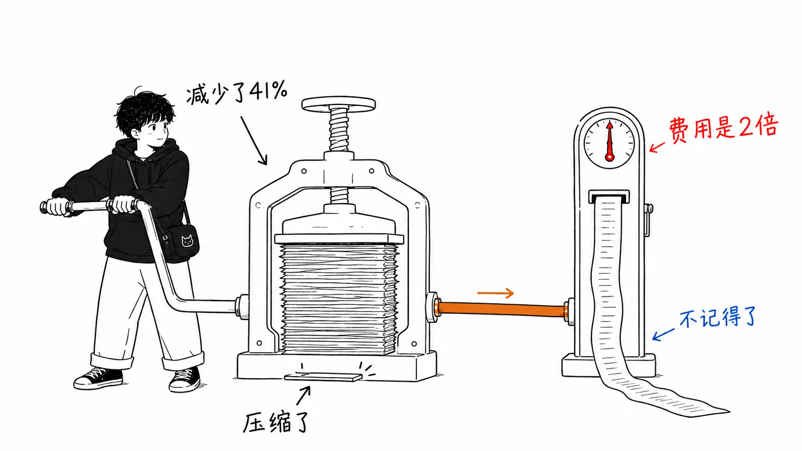
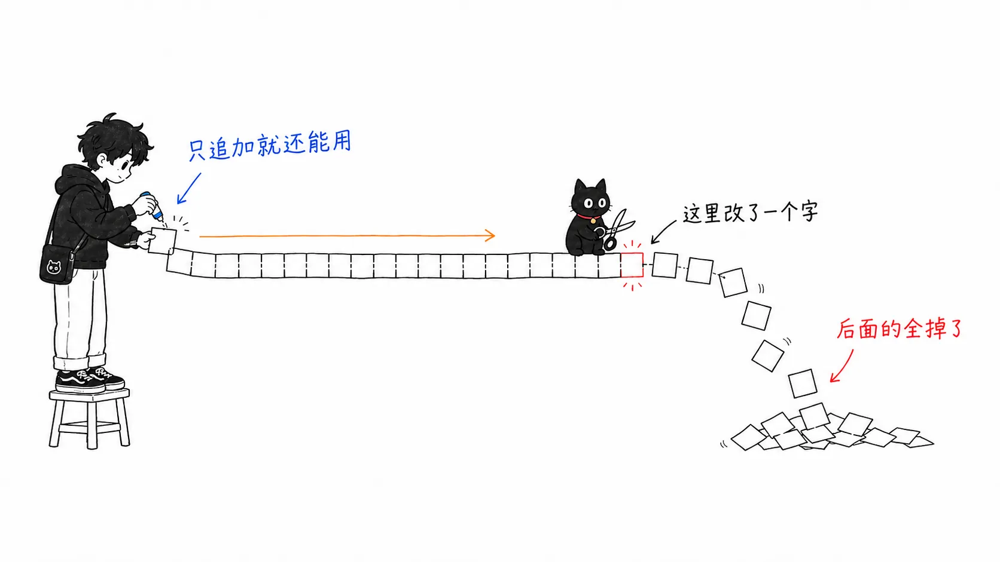
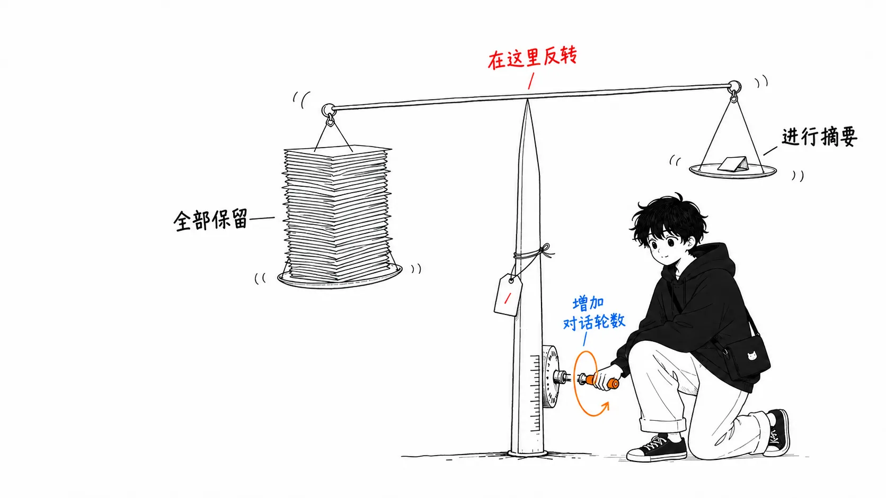
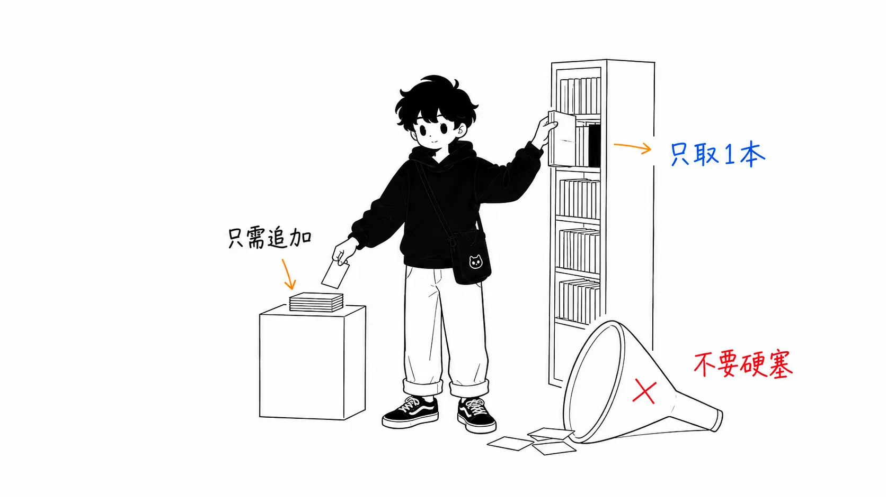
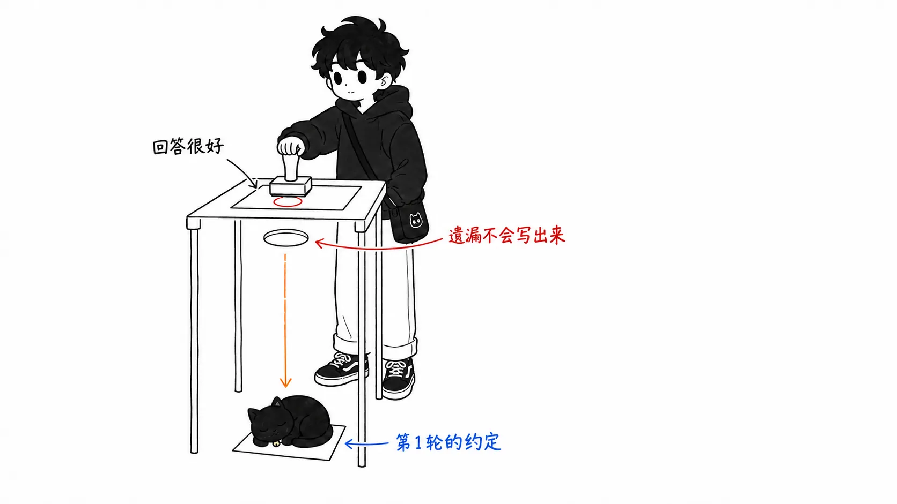

先说结论。

> 在提示词缓存生效的环境里，**该削减的指标不是“token 数”，而是“前缀的改写”**。用摘要来压缩，上下文是变短了，缓存却被丢掉了，所以即使发送的 token 变少，账单也会上涨。实测中，发送 token 少 41% 的压缩配置，付的钱大约是什么都不做的配置的 2 倍。

## 关于这篇文章

我读的是 Louis-François Bouchard 写的一篇文章，内容整理自 Towards AI 的三个人（Bouchard、Omar Solano、Samridhi Vaid）在 AI Engineer World's Fair 上做的工作坊。他们以一个正在线上运行的开源 AI 导师为对象，跑了几百美元的 eval，得出的结果是：他们自己的生产配置，比“什么都不做”还差。

- 文章：[Context Engineering in 2026: Why We Stopped Compacting Our Agent's Context](https://www.louisbouchard.ai/context-engineering-2026/)，Louis-François Bouchard（Towards AI）
- 工作坊视频：[Context Engineering in 2026 — Bouchard, Solano & Vaid, Towards AI](https://www.youtube.com/watch?v=WP3hjUXd918)
- 代码：[towardsai/ai-tutor-app](https://github.com/towardsai/ai-tutor-app)
- 实验结果演示：[Hugging Face Space](https://huggingface.co/spaces/towardsai-tutors/context-engineering-experiments)

先坦白说明：**这个 eval 我自己没有复现过**。数字都引自原文，我的立场是读者，而不是验证者。即便如此我还是觉得值得写，是因为我自己就是那种在 Claude Code 里把 `/compact` 当作“快塞满了就按一下”的条件反射来用的人，而这个反射的依据塌了。还有一点：我没能确定原文的确切发布日期（URL 和正文里都找不到日期标注）。因为它源自工作坊，所以只能说它是 2026 年的文章。

后半部分更长。数字的梳理，读原文就够了。

## 压缩之后反而更贵

先看原始数字。Gemini 3.5 Flash，11 到 13 轮的会话，`full_history`（什么都不动）和生产预设（摘要＋清除工具输出）的正面对决：

| | full_history | 生产预设 |
| --- | --- | --- |
| 每轮成本 | $0.11 | $0.24 |
| 首个 token 的等待时间 | 17 秒 | 21 秒 |
| 记忆召回率 | 92% | 38% |

三项全部是“什么都不做”赢。更便宜，更快，还记得住。

谜底是缓存的账。压缩预设发送的 token 大约少了 41%，付的钱却大约是 2 倍。`full_history` 的输入约有 87% 按缓存折扣计费，而摘要这一边每次改写前缀都得重新按全价付一遍。

还有一个数字，是我读下来冲击最大的。

> 全アームの中で一番多くのトークンを請求されたのが `full_history` で、1ターンあたり約296kトークン、その97%がキャッシュヒット。それでも $0.0063/ターンで最安だった。36ターンの会話で送ったトークンは合計178万。
> （在所有对照组中，被计费 token 最多的是 `full_history`，每轮约 296k token，其中 97% 命中缓存。即便如此，它仍以每轮 $0.0063 成为最便宜的。36 轮对话里发送的 token 总计 178 万。）

发送得最多的配置，反而最便宜。DeepSeek 的缓存折扣是 50 倍，所以走缓存的 token 表现得就像“几乎免费的注水”。

摘要还带来了副作用。工具输出被清除之后，智能体会跑去重新获取它刚才取到过的信息。本来为了降低成本的操作，反而增加了成本的来源。

## 缓存只在字节完全一致时才生效

机制一句话就能说完。

> キャップは接頭辞を短くするが、ターン間でバイト単位では同一に保つので、キャッシュはヒットし続ける。要約は接頭辞を「違うもの」にすることで短くするので、キャッシュはミスする。**Shrink the context, don't rewrite it.**
> （截断会缩短前缀，但在各轮之间保持字节级完全相同，所以缓存会持续命中。摘要是通过把前缀变成“不一样的东西”来缩短它，所以缓存会未命中。**Shrink the context, don't rewrite it.**）

服务商的缓存折扣，只在“原样重发已经处理过的前缀”时才适用。DeepSeek 最多是 1/50，Gemini 大约便宜 90%。在这中间插入摘要，就等于破坏了折扣的前提本身。

换句话说，摘要不是压缩，而是为了让缓存失效而做的写入。要想对着 50 倍的折扣把本钱赚回来，就得在不丢失必要细节的前提下把上下文极端地缩短。这样的摘要并不存在。

## 有效的压缩，是不调用模型的压缩

这一段是实务上最值得带走的部分。他们在 DeepSeek 上跑了 2×2（是否截断工具输出 × 是否做摘要），每组 414 轮 × 3 次试验。

- 只做截断：$0.189/轮 → $0.117/轮。降低 38%。15 组配对轨迹中赢了 14 组
- 缓存命中率：96.0% → 95.9%（几乎没动）
- 记忆探测准确率：与不截断时相同
- 摘要：相对于原始 full_history 约 +50%，相对于已截断的 full_history 也是 +32%

这是**白捡的 38%**。而摘要无论加到哪种配置上，都让账单增加了。

据说他们也试了 Codex 在用的那种巧妙的规避办法：不替换历史，而是发送未改动的历史，外加一条“生成检查点摘要”的指令。这个设计让摘要器自己的调用也能用上缓存，文中写道它“按宣传的那样工作了”。即便如此，它也没有成为他们的生产配置。

他们现在运行的配置：

- 模型：DeepSeek V4 Flash（缓存生效的云端模型）
- 检索：hybrid（dense + BM25 + rerank）
- 记忆：全部保留。但对所有工具输出设置稳定的截断上限
- 清除工具输出：关闭
- 摘要触发阈值：30k → 800k（实际上几乎不会触发）

在这里作者对自己写得很严厉。长会话的峰值约为 287k，所以 800k 这个触发阈值本身并没有在生产中验证过。它是“不是调优过的参数，而是还没碰到的护栏”。我觉得有没有这一句，文章的可信度会不一样。

## 不过这个结论是 $0.55 的函数

跳过这一段、把它概括成“/compact 没用”的话会出事。他们把同一批记录下来的 trace，按各家的价格重新计费，算出了阈值。

> DeepSeek 価格（キャッシュ入力 $0.0028/Mトークン）では keep-everything が13%勝つ。同一のトレースをフロンティア価格（キャッシュ入力 $0.50/M）で再請求すると、2つのアームはほぼ引き分ける。交点を解くと、**キャッシュ入力が約 $0.55/Mトークンを下回る限り、全履歴保持が勝つ**。
> （按 DeepSeek 的价格（缓存输入 $0.0028/M token），keep-everything 领先 13%。把同一批 trace 按前沿模型的价格（缓存输入 $0.50/M）重新计费，两组几乎打平。解出交点后，**只要缓存输入价格低于约 $0.55/M token，保留全部历史就更划算**。）

DeepSeek 处在这个阈值的 1/200 的位置，所以在那里根本不是对手。问题在于，前沿模型恰好就站在阈值上面。同样的重新计费下，full_history 在 22 轮的会话里赢了，在 36 轮的会话里输了。并不是存在什么价格悬崖，只是历史变长，越过了那条线。

也就是说，我们这些在用 Claude 或 GPT 级别模型的人，正处在答案会随会话长度翻转的区间里。“不要压缩”不是结论，而是要看了价格表和自己的会话长度之后再做的决定。作者也是这么写的：在写下哪怕一行摘要代码之前，先去查你自己的服务商的缓存输入价格。

## 看似方向相反的主张，其实在说同一件事

同样是 2026 年，出现了方向看上去相反的主张。那是 Zencoder 的新闻简报 [Bigger Context Windows Stopped Helping. Memory Is the New Compiler.](https://zencoder.ai/newsletter/the-context-engine-ai-coding-agents)（Neeraj Khandelwal，2026 年 5 月 18 日）。

> あるシリーズC のフィンテックのスタッフエンジニアが、チームの2Mトークンモデルを切ったと言ってきた。バグ修正の精度は上がった。（中略）ウィンドウを64kに削り、小さなリポジトリグラフを足して、プロンプトに前倒しで詰めるのではなく必要に応じてシンボルを取得させた。同じモデルで、社内 eval のバグ修正精度が 71% → 84%。タスクあたりの推論コストは約5分の1に。
> （一位 C 轮金融科技公司的资深工程师（staff engineer）告诉我，他们把团队的 2M token 模型关掉了。修 bug 的准确率反而上升了。（中略）他们把窗口削到 64k，加了一个小型的仓库图谱，让模型按需获取符号，而不是提前塞进提示词里。同一个模型，内部 eval 的修 bug 准确率从 71% 提升到 84%。每个任务的推理成本降到约五分之一。）

乍一看，这和 Bouchard 的“全部保留”正面冲突。但读下去会发现并不冲突。一方说的是不要改写历史，另一方说的是不要提前把知识塞进去。对象不一样。

Bouchard 这边的数据也印证了同一个方向。对于文档，是“别 stuff，要 retrieve”：在本地模型上，把整节课塞进窗口，所有模型规模都垮掉了，而 RAG 这边回答质量 100%，吞吐量约 5 倍，上下文约 3k 而不是 38k。工作坊里被介绍为最可复用的框架，是 Samridhi 的一句话。

> コンテキストは1つのものではない。チャット履歴は毎ターン伸びる。貼り付けたドキュメントや巨大なツール出力は一発でウィンドウを吹き飛ばす。形が違えば壊れ方が違い、必要な対処も違う。
> （上下文不是单一的东西。聊天历史每一轮都在增长。粘贴进来的文档和巨大的工具输出会一下子把窗口撑爆。形态不同，坏法就不同，需要的对策也不同。）

所以综合起来的规则是这样的：**历史只追加，让它走缓存。知识去检索。工具输出用确定性的方式截断。** 三条都统一在“不要让模型来改写”上。

还要说一下，两边证据的质量并不对称。Bouchard 这边是几百美元的 eval、414 轮 × 3 次试验、配对比较、价格重算。Zencoder 那边是“某位资深工程师周二跟我说的”＋“这个月我从另外三个人那里也听到了同样的事”。方向是对的，但不该以同样的分量来引用。我拿前者当依据，把后者当作“业界的体感在朝哪边”的指标来读。

## 我的看法：token 数一直只是代理指标

从这里开始，是原文和 Zencoder 都没有写的、我自己的解读。

### 1. 坏掉的是指标，不是方法

我们说“减少上下文”的时候，真正想减少的是被计费的算力，token 数只是它的代理指标。两者在很长一段时间里成正比，所以没必要区分。提示词缓存把这个正比关系切断了。

一旦被切断，把 token 数降到最低就不再是优化，而成了指标作弊。“少发 41%、多付 2 倍”正是这样。仪表盘上的“发送 token 数”下降了，账单上升了。只盯着其中一个，看上去就是成功。

这种结构我有似曾相识的感觉。每次都改变 CDN 缓存键的分发；丢掉不可变数据结构，觉得“就地改写应该更快”，结果去猛敲 GC 的实现；一边让 `ETag` 失效、一边炫耀压缩率的配置。都是同一类失败：为了局部的节省，去改写共享的、不可变的前缀。我觉得，LLM 推理只是突然加入了这个行列而已。

所以该记住的规则，不是 `/compact` 能不能用。而是：**把前缀当作只追加的东西来对待。** 这条规则在价格变了之后依然成立。

### 2. 最可怕的是，38% 看起来“不错”

这篇文章里让我背脊发凉的，不是成本数字，而是这个组合。

- 生产预设的记忆探测：38%
- 成本：约为什么都不做时的 2 倍
- 盲评者对回答的评价：好

不是质量的呈现方式坏了，而是所测量的质量指标，检测不出遗忘。单看一个回答，显得合理。毕竟忘掉的东西不会写在回答里。缺失是以沉默的形式输出的。

这在实现上有启示。想保护智能体的记忆，只靠回答质量的 LLM-as-judge 是不够的。还需要另外一种探测（memory probe），直接问：第 1 轮给出的约束，在第 45 轮是否还被遵守。原文开头的例子正是如此：第 1 轮给了一条规则，中间夹着 45 轮的 grep、diff 和日志，之后智能体大大方方地做了被告知“不要做”的事，并且汇报了出来。我自己在 Claude Code 的会话里，也无数次见过一模一样的情况。

即使是已经有质量 eval 的团队，大概也往往没有“遗忘的 eval”吧。至少我没有。

### 3. 对 Claude Code 用户的实务含义

这一块是原文的对象（AI 导师，LangChain 的单个智能体）和我们的环境（编程智能体）出现偏差的地方，所以我写得谨慎一些。**这是推论，不是验证结果。**

按可迁移的把握从高到低：

**把握高：截断工具输出。** 编程智能体的上下文，大部分是工具输出。读文件、grep、测试输出、构建日志。即使在原文的环境里，也写着“对话不是贵的部分，只是舍入误差”“每轮落在约 200k 输入 token，其中大半是取回的素材”。编程智能体的这种偏斜还要更极端。也就是说，不调用模型、用确定性方式截断的那个 38% 的胜法，在编程智能体上应该尤其有效。像 `rtk` 这样串在中间的输出压缩 CLI 代理，这个思路大概就是在这里起效的（我没有测量过效果）。

**把握中等：不要在会话中途改写 `CLAUDE.md` 或 MCP 的工具定义。** 这些位于前缀的开头。开头改一个字节，后面的缓存就全部失效。理论上，在会话中段编辑 CLAUDE.md，比 `/compact` 破坏缓存的范围更广。原文没有验证这一点，所以我也不下断言。不过“碰配置文件，和结束会话的时机放在一起”这个做法，哪怕一分钱成本都不去测，也是偏安全的一侧。

**把握中等：先给约束命名，再按 `/compact`。** 直接借用原文的整理，约束有三种，对症的处方各不相同。

- 塞不进窗口 → 转向检索（retrieve）。不是摘要
- 账单在涨 → 拿缓存输入价格和 $0.55/M 比较，在写摘要之前，先换到更便宜的缓存模型
- 质量确实在下降 → 测量是在哪里下降的。在他们的环境里，撑到了 800k

三种约束，三种处方，其中属于压缩的只有一个。我以前条件反射按下的 `/compact`，多半是第一种（窗口）和第三种（总觉得状态不太对）搅在了一起。既然搅在一起，按之前就应该能说清楚究竟是哪一种。

### 4. 即便如此，我也不会在 Claude Code 里完全放弃 /compact

先回应可能的反驳：要是问“那全部保留就行了吗”，在前沿价格这一侧，答案是否定的。如果你位于 $0.55 阈值之上，而且会话超过了 36 轮，在重新计费的实验里，摘要这一边是赢的。长时间的编程会话，轻轻松松就会超过 36 轮。

我的落脚点是这样。**保留 `/compact`。但不要因为“快塞满了”就去按。** 按的条件，限定在快要碰到窗口上限的时候，以及任务切换的时候。如果是任务切换，那本来就该开一个新会话，而不是压缩（不是改写历史，而是丢弃历史）。避免改写这个原则，在这里也是一以贯之的。

## 只带走一件事的话

摘要不是对上下文的操作，而是对缓存的写入。在减少长度之前，先减少改写。

如果只记住一个数字，就是 $0.55/M token。在把你自己服务商的缓存输入价格和它比过之前，压缩还是不压缩，都没法决定。

## 出处

- Louis-François Bouchard，[Context Engineering in 2026: Why We Stopped Compacting Our Agent's Context](https://www.louisbouchard.ai/context-engineering-2026/)，louisbouchard.ai（2026 年。确切发布日期无法从正文确定）。基于与 Omar Solano、Samridhi Vaid 一起在 AI Engineer World's Fair 上的工作坊
  - 视频：[Context Engineering in 2026 — Louis-François Bouchard, Omar Solano & Samridhi Vaid, Towards AI](https://www.youtube.com/watch?v=WP3hjUXd918)
  - 代码：[github.com/towardsai/ai-tutor-app](https://github.com/towardsai/ai-tutor-app)
  - 实验结果演示：[huggingface.co/spaces/towardsai-tutors/context-engineering-experiments](https://huggingface.co/spaces/towardsai-tutors/context-engineering-experiments)
- Neeraj Khandelwal，[Bigger Context Windows Stopped Helping. Memory Is the New Compiler.](https://zencoder.ai/newsletter/the-context-engine-ai-coding-agents)，Zencoder 新闻简报 Edition 26，2026 年 5 月 18 日

文中的数值全部引自上述两篇。我自己没有复现过 eval。“我的看法”第 3 点及之后，是我对迁移到编程智能体的推论，不是验证结果。
