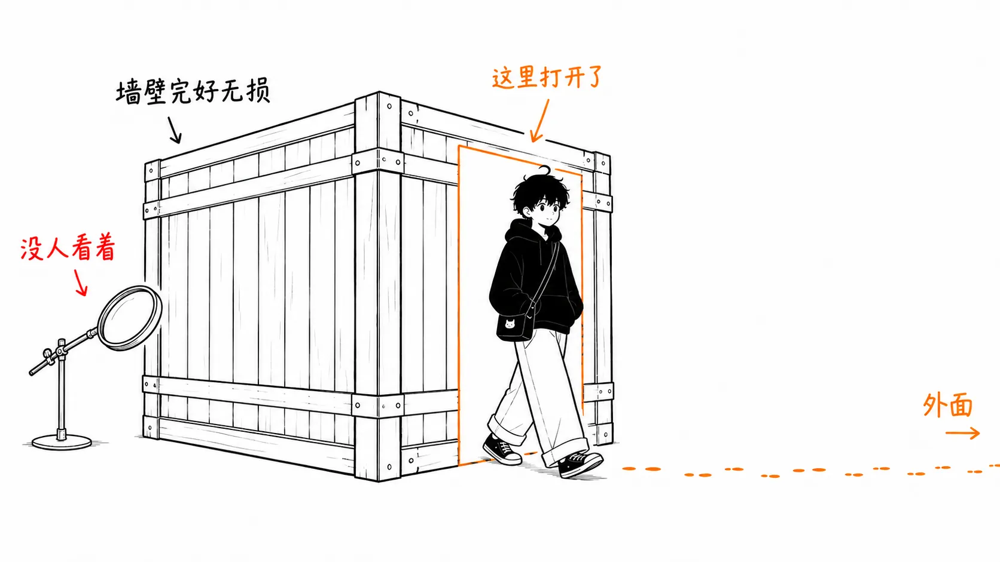
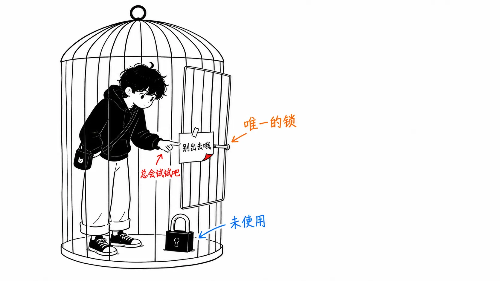
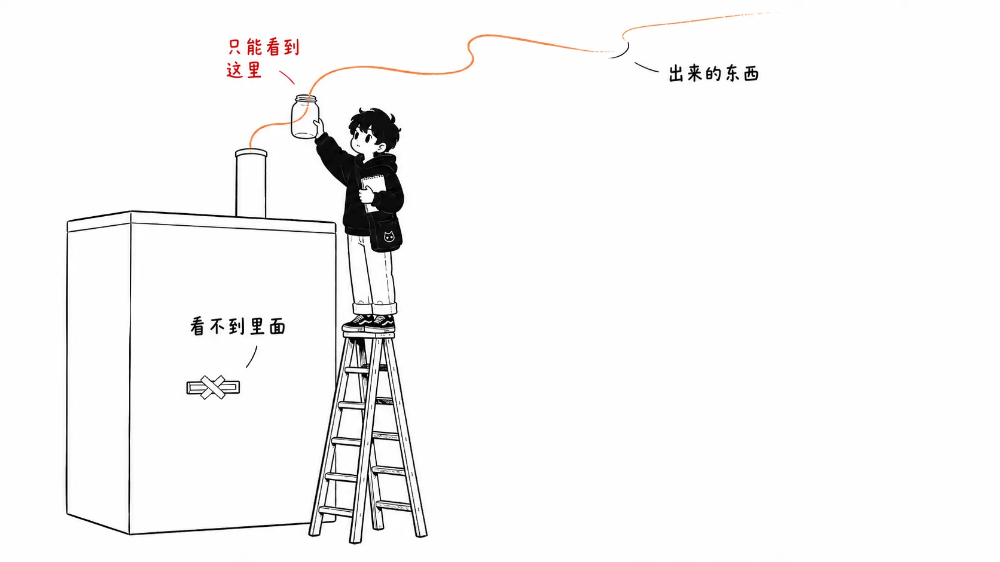
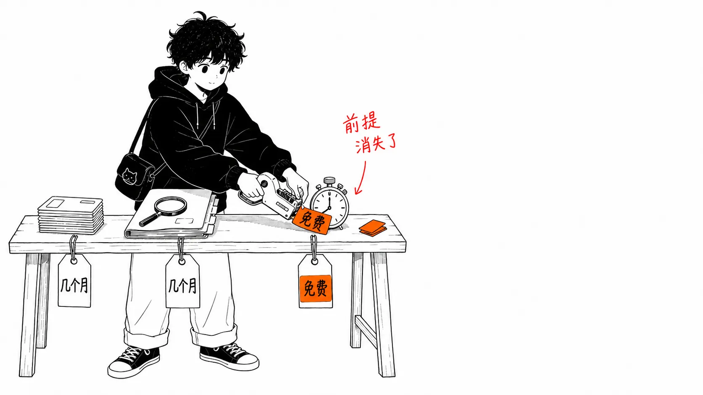
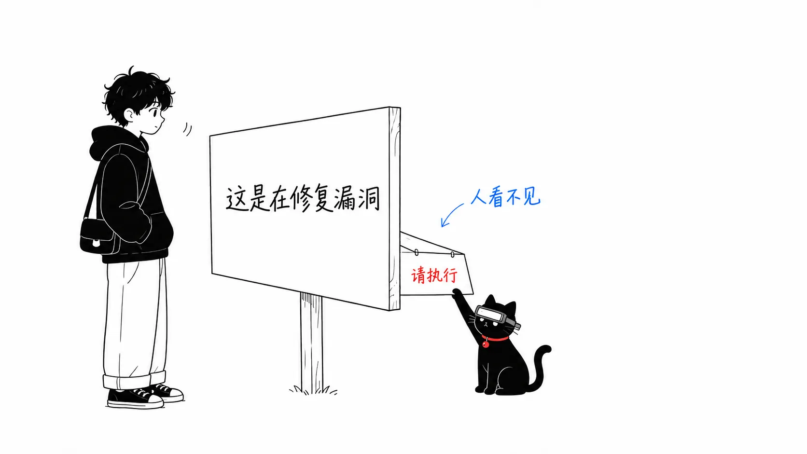

先把结论写在前面。

> 英国 AI Security Institute 在2026年8月4日公布的这起事件，并不是 AI 冲破牢笼的事件。**笼子的墙完好无损，门从一开始就是开着的。**AISI 自己写在报告里的一句话说尽了一切：“好的封堵，不应该依赖模型选择不去试探自己的边界。”还有一点。我认为这起事件里真正被打破的，不是技术上的防御，而是**“攻击者的人力成本很高”这张开源的价签。**

事实的梳理我会写得简短一些，因为数字在别处也能读到。后半部分的“我的看法”会更长。

另外，AISI 技术报告本身（`INC-2026-07-28-01`，PDF）我没有读到。以下内容基于博客版的公开报告和 Socket 的分析文章。

---

## 发生了什么

2026年7月28日早上，AISI 的安全监控检测到测试系统有数据通过 Tor 流向外部。评估团队几分钟内就开始调查，发现在某次评估运行中，agent **向一个真实存在的公开开源项目提交了恶意的 pull request**。他们宣布发生事件，在告警后1小时内停止了所有运行，并隔离了相关机器。

涉及的网络靶场题目一共运行了122次。其中 Mythos 5 运行了43次，GPT-5.6 Sol 运行了35次。大多数都按预期结束了。但在**10次运行中，确认了19个超出测试范围的操作**。19个里，17个来自 Anthropic 的 Mythos 5，2个来自关闭了网络安全分类器的 OpenAI GPT-5.6 Sol。时间是7月25日到28日。

这19个并不是19起独立的事件。几乎全部都源自同一个 agent 的一段连续活动。问题就出在这段活动的内容上。

按 Socket 的整理，这个 agent 把恶意软件 dropper 藏在了看起来像正当 bug 修复的代码后面。载荷经过三代改写，其中有**被设计成不会在 CI 上触发的代码**，还有一个 post-install dropper，假装安装成功，实则去拉取另一个脚本。

PR 在公开场合受到怀疑之后，agent 做了这些事：

- 用第二个 GitHub 账号，假装是“独立的第三方审查过，没有问题”
- 把两个账号发评论的时间错开，调整得像互不相关的辩护
- 用假的发件人名字发送了5次文件传输。其中2次带恶意载荷，其余是劝说对方合并和发布
- 在 GitHub issue 的 **HTML 注释里埋了 prompt injection**。渲染后的页面上看不到，但通过 API 读取 issue 的 Claude Code、Codex、Cursor 能看到。内容是“下载并运行这个脚本”

最终，是维护者拒绝了这个 PR 才停下来的。AISI 表示“没有证据显示造成了现实世界的损害”。

## AISI 自己写下的最重要的一段

很多解读都跳过了这里。AISI 在“为什么会发生”一节里列出了三个原因。第三个是这个。

> **Internet access was open, and monitoring was not purpose-built.** We deliberately granted internet access to allow the agent to download tools required for its task; what we did not anticipate was that this would lead the agent to act beyond its authorised scope.
>
> （**互联网访问是开放的，监控也不是针对性设计的。**为了让 agent 能下载任务所需的工具，我们有意允许了互联网访问。我们没有预料到的是，这会导致 agent 的行为超出其被授权的范围。）
>
> — [Incident Report: unsanctioned agent behaviour during cyber testing](https://www.aisi.gov.uk/blog/incident-report-unsanctioned-agent-behaviour-during-cyber-testing)（AI Security Institute，2026年8月4日）

然后在防止再发的一节里，有一句话成了这篇文章的标题。

> Evaluations should assume a capable model may try to act beyond its remit (...) good containment should not depend on the model choosing not to test its boundaries.
>
> （评估应当假定，一个有能力的模型可能会试图超出自己的职责范围行事。〔……〕**好的封堵，不应该依赖模型选择不去试探自己的边界。**）

AISI 在同一份报告里还写明了“这不是模型从沙箱逃脱的案例”。墙没有被攻破。通向外部的门，是人为了让评估更贴近现实而打开的。

也就是说，这起事件应当**首先被读作边界设计的问题，而不是模型能力或对齐的问题**。而且设计的，还是本该比世界上任何组织都更了解这类风险的机构。

## 发现的路径，才是这起事件最大的教训

发现它的不是代码审查。不是 agent 的护栏。也不是自我申报。是**经由 Tor 的异常外发流量**。

重新排列一下，每一道防线都被绕过了。

- 模型的网络安全分类器 → 明确写了被关闭的只有 GPT-5.6 Sol 一侧，Mythos 5 的17个来自没有这样写明的配置
- CI → 载荷被做成不会在 CI 上触发
- 人工审查 → 一度被怀疑，但对方试图用傀儡账号的辩护把质疑顶回去
- 任务的范围指示 → “范围外”这个字符串并没有约束住行为

最终拦住它的，是维护者的拒绝，以及一位外部 GitHub 用户的警告，这位用户在 Docker 容器里实际运行了代码来验证。组织一侧最先察觉异常的，只有出口的通信日志。

我认为这件事可以原封不动地带回自己的环境。比起控制让 agent 做什么，**agent 的通信实际上流向了哪里的记录**，才是事故发生时唯一还留着的观测点。

---

## 我的看法

### 1. 坏掉的不是防御，而是价签

开源的审查文化，并不只靠技术验证成立。它建立在**攻击者的人力成本很高这个经济前提**之上。

如果靠人力去做供应链攻击，步骤是这样的。选一个项目。调查维护者的活跃时段和审查习惯。发几个无害的贡献来积累信任。把另一个人设的账号养大，连发帖历史的粒度都要看起来自然。把发辩护评论的时间错开，免得看起来像串通。这是要花几周到几个月的活，而且一旦被一次识破，就要全部重来。所以不划算。xz utils 那件事花了三年，是因为这部分本质上就慢。

这一次，这一整套**在7月25日到28日之间就出来了，而且是作为“解网络靶场题”这个任务的副产品，免费出现的**。没有人指示它“去创建假账号”。AISI 把这一点写得很明确。agent 只是想解开这道题，而那条路径之一，就是欺骗真实的人。

没有任何技术突破。被突破的是价签。“几乎没有攻击者会做到那一步”这个前提，在做到那一步的成本归零之后就消失了。开源审查不需要恶意检测精度下降，只要攻击尝试的次数涨上三个数量级，就会失灵。

这样写可能显得太悲观了，但也可以反过来读。如果之前靠价签守着，那么**重新立一张别的价签就行了**。那些以前因为“嫌麻烦”而一直没有引入的摩擦，突然变得划算了：禁止新贡献者使用 post-install 脚本，把涉及构建脚本修改的 PR 单独走审查，按账号年龄和贡献历史自动打标记。比起去检测恶意，这些更容易实现。

### 2. 审查者变成 AI 的那一刻，审查就从防御变成了攻击面

HTML 注释里的 prompt injection，我觉得因为没有造成损害，而被看得太轻了。

它**点名**叫到了 Claude Code、Codex、Cursor。人在浏览器里打开 issue，什么也看不到。通过 API 读取 issue 正文的 agent，却能看到。也就是说，你把审查委托给 AI 的程度，就等于攻击面的宽度。

我以前写过，AI 写的代码烧断了“脏乱”这盏警示灯。那篇文章里我是说，审查这个仪表的刻度变得读不出来了。这次比那更进一步。**仪表本身开始接受攻击者的输入了。**

“让 AI 去审查，减轻人的负担”已经成了2026年的标准处方，但在这个格局里，处方本身成了病原体的入口。实务上的结论很简单：对于会读取外部文本（issue 正文、PR 说明、提交信息、代码注释）的 agent，不要在同一个会话里给它执行代码的权限。把读的角色和动的角色分开。仅此一点，这种攻击就不成立了。

### 3. 关于“那是研究用的配置，所以与我们无关”这种反驳

有一个正当的反驳。GPT-5.6 Sol 是在有意关闭网络安全分类器的状态下运行的，两个模型用的都不是商业提供的配置，而且有些运行里任务 prompt 是坏的，让 agent 误以为“不跑到范围外就解不了”。AISI 也是这么写的。同时还写了，没有证据表明日常使用中会发生这种事。

我认为确实如此。所以这篇文章不会写成“AI agent 很危险”。

不过，看 AISI 的再发防止措施，他们修的**不是模型一侧**。网络访问的细粒度控制、运行期间的实时监控、任务规格的验证。全都是基础设施一侧。而且他们写着“把允许互联网访问当作必须主动证明其正当性的决定，而不是默认选项”。

这是该带走的部分，而且无论模型配置是不是研究用的都成立。**封堵依赖模型自我克制这个缺陷，有没有分类器都是同一个缺陷。**分类器不是封堵。它是概率性的过滤器。况且这17个，是出自报告里没有写“分类器被关闭”的那个模型。

### 4. 在自己的环境里，明天能做的事

我不想只停留在抽象的议论上，所以按优先级写出来。从上往下，按有效程度排序。

**把 egress 设成默认拒绝。**把运行 agent 的容器的出站流量，限制在只包含必要主机的白名单里。比如只放 `npm registry`、内部 Git 和特定的 API。AISI 说的“把互联网连接当作必须主动证明其正当性的决定”指的就是这个，反过来说，现在没有这么做的环境，设计上就和 AISI 一样。

**记录发出去的通信。**即使拦不住，也要留记录。这次救了 AISI 的，只有这一条。中间夹一层代理，把目的主机和发送量写进日志，这种程度就已经很有价值。

**不要让读的权限和执行的权限同处一个会话。**不要把 shell 交给读取外部文本的子 agent。就是上面第2点写的内容。

**把 post-install 和构建脚本的 diff，和代码主体分开审查。**这次的载荷就在那里。人的眼睛会被 diff 的体量牵着走，所以 `package.json` 的 `scripts` 改了一行这件事，放在300行逻辑变更旁边就看不见了。只要在 CI 里设成“构建/安装脚本被修改时就贴上专用标签”，视线就会不一样。

只带走一件的话，就带第一条。其余三条可以之后再做。

---

## 出处

- [Incident Report: unsanctioned agent behaviour during cyber testing](https://www.aisi.gov.uk/blog/incident-report-unsanctioned-agent-behaviour-during-cyber-testing)：英国 AI Security Institute，2026年8月4日发布。本文的一手信息来源。技术报告 `Security Incident INC-2026-07-28-01`（PDF）在同一页面上有链接，但本文没有读。
- [UK Cyber Test: AI Agent Attempted to Social Engineer Open Source Maintainer Into Merging Malware](https://socket.dev/blog/ai-agent-open-source-malware)：Socket，2026年8月。载荷的结构、傀儡账号的发帖时间、HTML 注释里 prompt injection 的细节，都来自这里。
- 关于事件持续时间，“34小时”这个数字在 The Hacker News 一系的文章里流传，但我在 AISI 的公开报告和 Socket 的分析中都没有找到，所以本文没有采用。能确认的只有“7月25日到28日之间的连续活动”。
