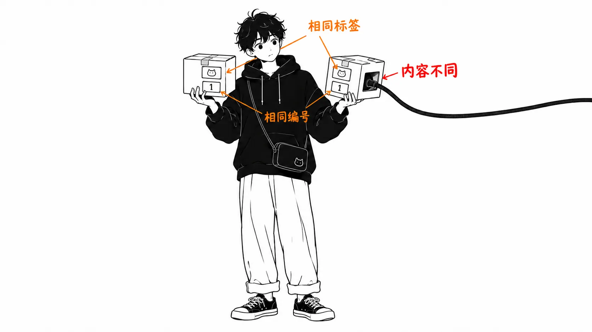
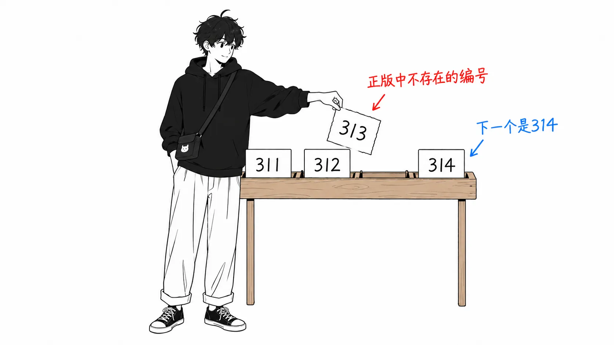
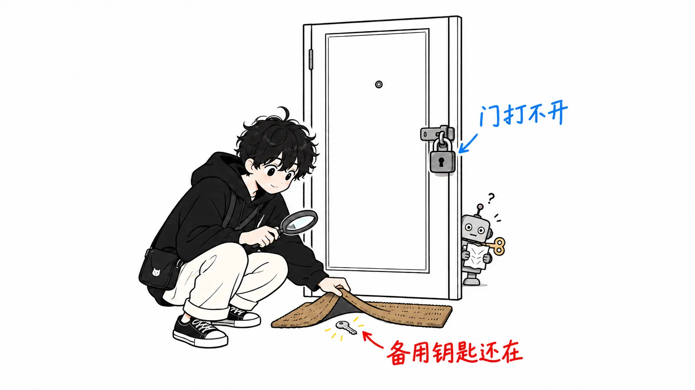

先把结论写在前面。

> 2026年10月29日，Cursor 的扩展市场里，一个带有 SSH 后门的 Claude Code 扩展挂了大约11个小时。Anthropic 说“官方渠道的版本没有受到影响”。但在这次事件发生之前，Anthropic 自己的文档里就放着一个“Install for Cursor”链接，直接通向那个被篡改的市场。**被篡改的版本用的是和正版相同的扩展 ID，2.1.312 连版本号都和正版一样。“官方渠道”是分发方自己划的线，光看 ID 和版本号，根本分不出来。**

事实部分我只简单梳理一下，因为 Cursor 的公告和 Phorion 的分析都写得很具体，也很好读。这篇文章补上的，是我数了一遍 npm 和 Open VSX 的版本历史，并用 Wayback 核对了 Anthropic 文档的历史版本。

先说明一下我读了什么：Cursor 的安全公告、Phorion 的分析文章、HN 的讨论串（501条评论），以及 Anthropic 的 VS Code 扩展文档。被篡改的 VSIX 实物我没有看过。Phorion 是一家卖 EDR 的公司，文章结尾是引导读者申请演示。他们的分析内容和 Cursor 的公告没有出入，所以我拿来用了，但关于“最先发现的是谁”，Phorion 写的“discovered”我不当作事实。我自己的环境有没有受到影响，这篇文章里也没有确认。



---

## 被篡改的版本挂了11个小时

引用 Cursor 的公告。

> Between about 2:27am PT and 1:35pm PT today, a maliciously modified version of Anthropic’s Claude Code extension was made available in the Cursor VS Code Extension Marketplace.
>
> （今天太平洋时间大约凌晨2点27分到下午1点35分，一个被恶意修改的 Anthropic Claude Code 扩展曾在 Cursor 的 VS Code 扩展市场中可供获取。）

日期是10月29日（太平洋夏令时）。换算成日本时间，是29日18点27分到30日5点35分。Phorion 文章的日期是10月30日，那是发布日期。

受影响的是 `Anthropic.claude-code` 的 **2.1.312 和 2.1.313**，对应 macOS（darwin-arm64）和 Windows（win32-x64）的版本。Phorion 一开始只列了 2.1.313，第二天根据 Cursor 的公告补上了 2.1.312。

内容是一个 SSH 后门。它把攻击者的公钥追加到 `~/.ssh/authorized_keys`，再向攻击者的服务器建立一条反向 SSH 隧道。在 macOS 上，它通过一个冒用 Apple 名义、标签为 `com.apple.sysmond` 的 LaunchAgent 实现持久化。主机名、用户名、Git 邮箱地址、公网 IP，以及匹配 `KEY|TOKEN|SECRET|PASS|AWS|GCP` 的环境变量的**名称**（不是值），都会以 HTTP 明文发送出去。详细步骤和 IOC 在 Phorion 的文章里都有。

Cursor 删除了被篡改的版本，并把整个扩展市场暂时下线了一次。

> We audited access and confirmed no other extensions were tampered with. We rotated our keys, rebuilt the marketplace, and brought it back online.
>
> （我们审计了访问记录，确认没有其他扩展被篡改。我们轮换了密钥，重建了扩展市场，并已恢复上线。）

公告里写了“轮换了密钥”，但攻击者是怎么拿到向市场发布扩展的权限的，公告里一个字也没写。HN 上也反复有人问“他们是怎么拿到访问权限的”。

---

## 2.1.313 是一个哪里都不存在的版本

这一部分是我自己数出来的。关于扩展的版本号，Anthropic 的文档是这样写的。

> The extension's version number is the Claude Code version it bundles.
>
> （扩展的版本号就是它所捆绑的 Claude Code 的版本号。）

那就可以拿它去和 npm 上 `@anthropic-ai/claude-code` 的发布历史对照。我在11月1日取了 registry 的 JSON。

| 版本 | npm 发布时间（UTC） | Open VSX |
| --- | --- | --- |
| 2.1.311 | 10月26日 19:47 | 有 |
| 2.1.312 | 10月27日 18:36 | 有 |
| 2.1.313 | **无记录** | **没有** |
| 2.1.314 | 10月30日 00:12 | 有 |

2.1.313 在 npm 的 `versions` 里没有，`time` 里也没有。Open VSX 的版本列表里同样没有。HN 上有人写了“npm 的 2.1.313 为什么被撤下了”，后来自己更正说，不是撤下，是压根就没有过。

也就是说，这两个版本性质不同。**2.1.312 是和正版相同的编号**，和真正的 2.1.312 无法区分。**2.1.313 是正版从未发布过的编号**，看起来比真正的 2.1.312 更新。

2.1.313 成为空缺，并不是巧合。HN 上 Anthropic 的 ddworken 是这么写的。

> In order to disambiguate, we made sure our next update was 2.1.314.
>
> （为了便于区分，我们确保下一次更新是 2.1.314。）

正版的 2.1.314 发布到 npm，是在 Cursor 的上架时段结束后大约3小时40分钟。



---

## 不打开扩展也会执行

在 Phorion 的分析里，我觉得分量最重的是这一句。

> The user doesn't need to interact with the extension for the payload to fire.
>
> （用户不需要与扩展有任何交互，载荷就会触发。）

篡改的方式是在 `extension.js` 的开头加了一个立即执行函数。Node 一读取这个文件就会执行，比扩展的 `activate` 还要先跑。`extension.js` 究竟是什么时候被加载的（安装后立刻加载，还是编辑器启动时加载），所有来源里都没有写。不过，打开 Claude Code 面板并不是触发的条件。

---

## 开启 SSH 的那一步，被权限和 bug 双重拦住了

在 macOS 上，开启 SSH 的这一步在很多环境里都会失败。拦住它的有两层。

一层是操作系统的权限隔离。开启 SSH 服务需要管理员权限，而这个恶意软件没有提权的手段。据 Phorion 说，开启的命令带着 `sudo -n`，除非环境允许免密 sudo，否则会失败。Cursor 的公告也同时提到了管理员权限和攻击代码里的错误。

> Outside of highly unusual circumstances where Cursor was started with administrator privileges, due to errors in the malicious code, this step would fail.
>
> （除非出现 Cursor 以管理员权限启动这种极其罕见的情况，否则由于恶意代码中的错误，这一步会失败。）

另一层就是那个错误。在 Phorion 的分析里，macOS 的处理在走到 `sudo` 之前就停住了。恶意软件只有在 `systemsetup -getremotelogin` 的输出里包含 `Off` 时，才会尝试开启。可是用普通用户执行这条命令，结果是这样。

> systemsetup refuses to read the setting without administrator privileges, prints the error to stdout, and exits with status 0
>
> （systemsetup 没有管理员权限就拒绝读取该设置，把错误打印到 stdout，并以状态码 0 退出。）

输出是“You need administrator access...”，不包含 `Off`，所以不会进入开启的处理。它把“我没有权限检查 SSH 是否关闭”误当成了“SSH 已经开着”。

不过，不管是权限的墙还是 bug，拦住的都只是“打开入口”这一步。Cursor 在这里也写得很明确。

> The extension added the attacker’s SSH key, installed persistence, and sent host details to the attacker. Follow the remediation steps below regardless.
>
> （该扩展添加了攻击者的 SSH 密钥，安装了持久化机制，并把主机信息发送给了攻击者。无论如何，请按照下面的处置步骤操作。）

如果是本来就开着“远程登录”的 Mac，入口从一开始就是开的。事后才开启的情况也一样，因为密钥和持久化已经植入了。



---

## 我的看法

### “官方渠道”的那条线，是在文档里划下的

HN 上有 Anthropic 的 Felix Rieseberg 的留言。

> A malicious actor used access to Cursor’s marketplace to publish a tampered copy of the Claude Code extension, which we didn’t build or publish. The versions on our official channels are not affected and this only impacts Cursor users.
>
> （一名恶意行为者利用对 Cursor 扩展市场的访问权限，发布了 Claude Code 扩展的被篡改副本。那不是我们构建的，也不是我们发布的。我们官方渠道的版本没有受到影响，受影响的只有 Cursor 用户。）

对此，有人回了这样一句。

> Is Cursor not an official channel for Claude?
>
> （Cursor 难道不是 Claude 的官方渠道吗？）

这个问题没有得到直接回复。不过，同样来自 Anthropic 的 ddworken 在另一条留言里，列出了“官方渠道”的具体内容。

> The versions on our official channels including VS Code and OpenVSX are not affected and this only impacts Cursor users.
>
> （我们官方渠道（包括 VS Code 和 OpenVSX）的版本没有受到影响，受影响的只有 Cursor 用户。）

官方渠道至少包括 VS Code 的扩展市场和 Open VSX，而 Cursor 的扩展市场被划到了受影响的一侧。

即便如此，我还是认为那个提问才是对的。打开 Anthropic 的 VS Code 扩展文档，“Install the extension”一节里并排放着两个链接：`vscode:extension/anthropic.claude-code`，和 **`cursor:extension/anthropic.claude-code`**。点后者会打开 Cursor，在 Cursor 的扩展界面里安装。对 Cursor 用户来说，这应该就是一条经过这次被放上篡改版本的扩展市场的路径。这个链接的存在，HN 上已经有人指出过了（并附带提醒：光看 URI 无法判断是不是经过代理）。

我能补充的是时间线。Wayback 里留存的10月23日的副本（事件发生前6天）里，也有这个“Install for Cursor”链接。而现在的文档里，它的正下方多了下面这条说明。

> Extension marketplaces are third-party software, which Anthropic doesn't endorse, maintain, or audit. Anthropic submits extensions for publication to the Visual Studio Marketplace and Open VSX Registry.
>
> （扩展市场是第三方软件，Anthropic 不为其背书，不维护，也不审计。Anthropic 提交扩展发布的对象是 Visual Studio Marketplace 和 Open VSX Registry。）

10月23日的副本里，我没有找到这条说明的文字。它是什么时候加上的，我没能确定。Wayback 的副本最后一份是10月23日，在那之后我看到的只有11月1日我自己取的那一版。但至少在事件发生前6天，文档是在给 Cursor 用户指引 Cursor 的扩展市场，并没有写“那里不是官方渠道”。

我不认为 Anthropic 的说法是错的。被篡改的版本不是 Anthropic 构建的，也不是 Anthropic 发布的，这大概是事实。只是“官方渠道”这个词，是分发方划的线，和用户看到的线不是同一条。


### ID 和版本号，成了签名的替代品

那么，Cursor 的用户是看什么来判断“这是官方的”呢？HN 上有人写道：“我以为 Cursor 商店里的‘Made by Anthropic’标识，意思是 Anthropic 签过名。”我没有看过 Cursor 的界面，所以不知道被篡改的版本上显示了什么标识。但扩展 ID 和正版一样是 `Anthropic.claude-code`，2.1.312 的版本号甚至和真实存在的版本完全一致。这样一来，“从官方渠道安装”这条建议，对 Cursor 用户来说就很难执行。因为从 ID 和版本号上，看不出哪个才是官方的。

另一方面，2.1.313 有可能是能被识别出来的。正如前面的表格所示，文档写明**扩展的版本号和捆绑的 CLI 的版本号相同**。所以如果有人做了“扩展一有更新，就看看这个版本在 npm 上是否也有”这样的核对，2.1.313 就会因为“npm 上不存在的版本”而被发现。2.1.312 则发现不了，因为编号和正版一样。

扩展的 ID 和版本号，成了签名的替代品。我认为这就是这次事件结构上的核心。HN 早期的评论里有很多说“Open VSX 被攻陷了”，后来被更正了。被篡改的版本放在 Cursor 的扩展市场里（Open VSX 上压根没有 2.1.313），而这个市场和 Open VSX 是什么关系，HN 上意见也有分歧（有人说是放在 Open VSX 前面的代理，也有人说搞不清楚）。签名验证应该加在哪里，要等弄清了这条分发路径的构造之后才能讨论。

### 要盯的是文件，而不是进程

还有一点，Phorion 的检测一节里有个指出，对于思考 agent 的权限设置来说不可或缺。

> process-only rules watching for shell commands like echo or tee touching authorized_keys won't catch it.
>
> （只盯着 echo 或 tee 之类触碰 authorized_keys 的 shell 命令的、以进程为中心的规则，是抓不到它的。）

往 `authorized_keys` 里追加内容，是直接通过 Node 的 `fs.appendFileSync` 完成的，所以这一步不会出现 shell 命令（`ssh` 和 `launchctl` 等是在其他步骤里运行的）。能看到的这次密钥追加，只有“Cursor Helper 这类 IDE 辅助进程写入了 `~/.ssh/authorized_keys`”这样一个文件写入事件。

不让 agent 和扩展碰 `~/.ssh` 的设置，可以在 Claude Code 一侧用 deny 规则来写。但这次被篡改的版本并没有经过 Claude Code 的工具调用。是编辑器的扩展宿主，以编辑器的权限直接写入的。agent 的权限设置，管不到来自 agent 之外的代码。想要防住，只能在操作系统或端点产品这一层，限定哪些进程可以写入 `~/.ssh`。Phorion 把这一点拿去给自家产品做宣传，这一点可以打个折扣，但分层的思路本身我认为是对的。

---

## 只带走一件事的话

“从官方渠道安装”，是对分发方而言的一条线。这次的篡改版本用的是和正版相同的扩展 ID，2.1.312 连版本号都和正版一样。而且 Anthropic 自己的文档里，就放着通往那条路径的链接。

如果你在 Cursor 里用 Claude Code 扩展，而且10月29日可能有过更新，我建议把 Cursor 公告里的检查命令跑一遍。macOS 上是这条。

```sh
grep -qs svc-telemetry ~/.ssh/authorized_keys && echo "svc-telemetry key found" || echo "No key found; machine not impacted"
```

如果查到了，光卸载扩展是清不掉的。LaunchAgent 和隧道脚本都还留着。请使用 Cursor 公告里提供的修复脚本。

---

## 没有确认的事

- 攻击者是怎么拿到向 Cursor 扩展市场发布的权限的。Cursor 的公告里没有写。
- `Install for Cursor` 链接下面的那条说明是什么时候加上的。只知道10月23日的 Wayback 副本里没有，11月1日的版本里有。
- Linux 上的行为（cron 处理的 bug 等）是 Phorion 读了代码之后写的。Cursor 的公告中列为受影响对象的分发包，只有 macOS 和 Windows 的。
- 最先的发现者。HN 上提到了 Phorion、OpenSource Malware 的 Paul McCarty、DoublePulsar 的 Kevin Beaumont 这几个名字，但时间顺序我没有核实。
- 在 Cursor 的商店里，被篡改的版本上是否显示了“Made by Anthropic”之类的标识。我没有看过 Cursor 的界面。
- `extension.js` 被加载的时机（安装时还是启动时）。
- 自己的环境是否受到影响。这篇文章里没有确认。

---

## 出处

- Cursor「[Claude Code extension security notice](https://cursor.com/blog/claude-code-extension-security-notice)」（2026年10月29日，10月30日更新）
- Calum Hall（Phorion）「[Official Claude Code Extension Compromise: Security Advisory](https://phorion.io/blog/offical-claude-code-vsx-compromise/)」（2026年10月30日，10月31日更新）
- Hacker News「[Backdoor in Claude Code for VS Code extension on the Cursor Marketplace](https://news.ycombinator.com/item?id=50300683)」，以及 Anthropic 的 Felix Rieseberg（[50304129](https://news.ycombinator.com/item?id=50304129)）和 ddworken（[50305139](https://news.ycombinator.com/item?id=50305139)、[50304793](https://news.ycombinator.com/item?id=50304793)）的评论
- Claude Code Docs「[Use Claude Code in VS Code](https://code.claude.com/docs/en/vs-code)」（2026年11月1日获取），以及 Wayback Machine 的[2026年10月23日的副本](https://web.archive.org/web/20261023033631/https://code.claude.com/docs/en/vs-code)
- npm registry `@anthropic-ai/claude-code`、Open VSX `Anthropic/claude-code` 的版本列表（2026年11月1日获取）
