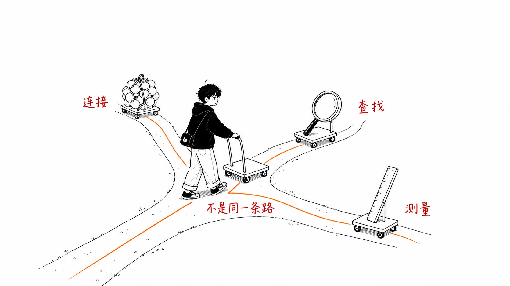
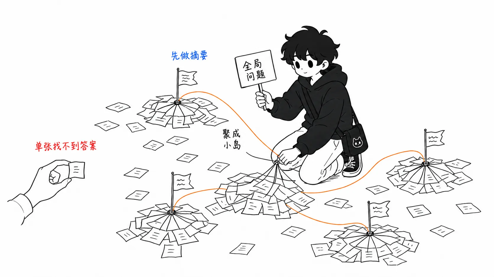
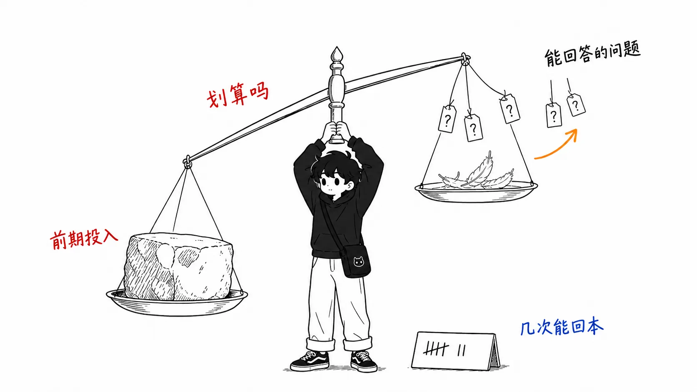
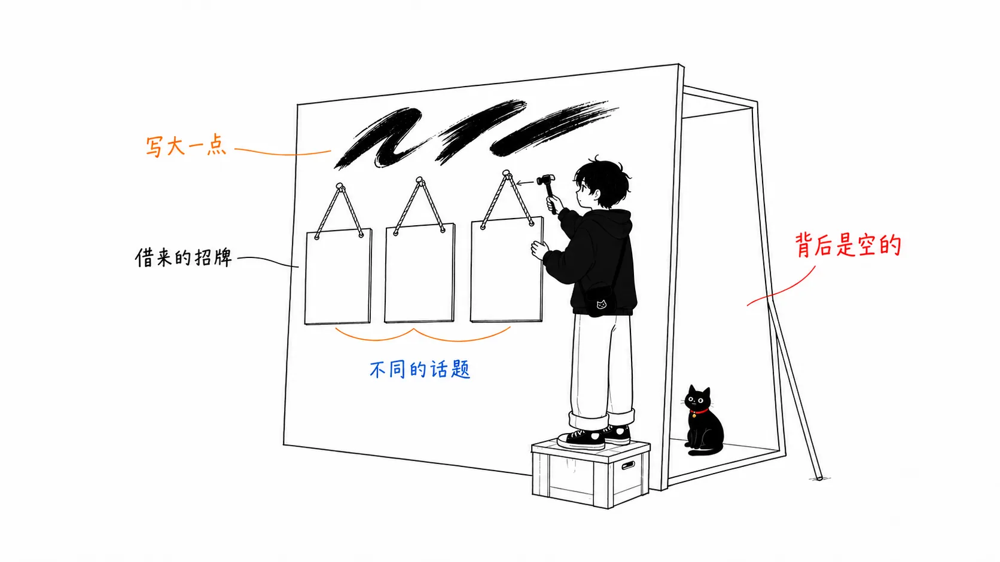

## 关于这篇文章

2026 年 7 月 19 日，X 上发了一篇标题如下的文章。

> **Graph Engineering replaced RAG at Microsoft, Stanford and Anthropic. Here's how it works.**
> （图工程在微软、斯坦福、Anthropic 取代了 RAG。下面讲它是怎么运作的）

浏览量达到 **120 万次**。封面图是一个写着“Claude Code”的终端窗口，里面画着一张知识图谱，正中央是 Anthropic 的 logo，周围排着斯坦福、Anthropic、微软三家的 logo，还写着“Why they moved beyond RAG”。

这篇文章要做的，是**用一手信息来核实这个说法是否属实。**

先说结论。

> **这三家并没有走上“图”这同一条路，而是朝着三个不同的方向。**
> 而且 Anthropic 实际选的不是图，而是 **grep**。

核实的副产品，是一套**“不同类型的问题，适合的检索架构也不同”**的梳理，可以直接用在实际工作里。这才是本文的正题。



---

## 第 1 部分 — Anthropic 选的是 grep

### 他们自己就是这么说的

下面是 Claude Code 的作者、在 Anthropic 负责 Claude Code 的 Boris Cherny 的话。多家独立媒体都引用了同一段发言。

> 早期版本的 Claude Code 用过 RAG 加本地向量数据库，但我们很快就发现 **agentic search 效果更好。** 而且它更简单，不会有安全、隐私、信息过时和可靠性方面的那些同样的问题。

在 Latent Space 播客里，他的说法更进一步：agentic search “**by a lot**（大幅度）”胜过 RAG，而且这一点“**surprising**（出乎意料）”。他列举的、试过之后败下阵来的方案，包括本地向量数据库、由模型递归建立索引等等。

### agentic search 是什么

Cherny 的解释是这样的。

> 让智能体用它需要的任意多轮检索循环去查找信息，**用的是 glob、grep 这类普通的代码检索工具。**

也就是说，实际内容如下。

```
glob（ファイル名で探す）
grep（中身の文字列で探す）
ファイルを読む
→ モデルが「次に何を見るか」を決めて、必要な回数だけ繰り返す

事前インデックス：ゼロ
埋め込み：なし
ベクトルDB：なし
グラフ：なし
```

**用写这篇文章的我自己手头的工具也能印证这一点。** 我拥有的检索类工具是 `Grep`（ripgrep 的封装）、`Glob` 和 `Read`。没有生成嵌入向量的工具，没有查询索引的工具，也没有连接图数据库的工具。

封面图把图谱画在“Claude Code”的窗口里，**这和实际实现并不一致。**

### 为什么 grep 赢了

理由已经整理得很清楚，而且不只适用于代码检索。

| 论点 | grep / agentic search 占优的原因 |
| --- | --- |
| **精度** | `createD1HttpClient` 要么出现在文件里，要么没有。对于**答案就是精确匹配的问题**，引入语义上的相近只会变成噪声 |
| **新鲜度** | 索引从建好的那一刻起就开始过时。grep 每次看的都是当时的文件 |
| **安全** | 索引总得放在某个地方。这意味着要把内部代码发给第三方的嵌入服务商。Anthropic 连自家代码都不愿意这么做 |
| **多步推理** | 可以读一个文件、学到点东西，再据此决定下一步看什么。静态检索做不到 |
| **配置成本** | 零配置，零基础设施 |
| **未来** | 智能在模型一侧，所以**模型变强，效果就免费跟着变好** |

最后这一点出奇地重要。如果把巧思都堆在索引一侧，就更难享受到模型进步带来的好处。


### 而且 Anthropic 也在改进 RAG 本身

还有一个和那个说法对不上的事实。

Anthropic 在 2024 年 9 月发布了一种叫“**Contextual Retrieval**”的方法。它**不是抛弃 RAG，而是改进 RAG**：在嵌入之前给每个分块补上上下文，据报道**检索失败减少了 49%（配合重排序则减少 67%）。**

所以 Anthropic 的立场并不是“RAG 死了”。他们只是**按用途换工具**。

- **探索代码库**（Claude Code）→ agentic search
- **检索文档知识库** → RAG。不过要补上上下文来提高精度

---

## 第 2 部分 — 微软的 GraphRAG 是“RAG 的一种”

### 名字已经说明了

微软的 GraphRAG 确实存在。它是 Microsoft Research 的成果，2024 年 7 月在 GitHub 上开源。但它官方文档的第一句话是这样写的。

> GraphRAG 是**对检索增强生成（RAG）的一种结构化、分层的做法**，与朴素的语义检索做法相对。

GitHub 仓库的描述也是“**a modular graph-based Retrieval-Augmented Generation (RAG) system**”。

**这不是取代，而是 RAG 的一种形态。** 名字里就有 RAG。

### 那它是为了什么而造的

这是技术上最有意思的部分。GraphRAG 并不是“整体上比 RAG 更强”，它是为**基线 RAG 原理上就答不了的那类问题**而造的。

Microsoft Research 的论文标题就说明了这一点 — “From Local to Global: A Graph RAG Approach to **Query-Focused Summarization**”。

```
ベースラインRAG が得意：
  「この製品の返品ポリシーは？」
  → 該当する箇所を取ってくれば答えられる（検索タスク）

ベースラインRAG が原理的に苦手：
  「このデータセットの主要なテーマは上位5つは何か？」
  → どこか1箇所を取ってきても答えにならない
    （検索タスクではなく、全体の要約タスク）
```

论文的说法是：RAG 在“面向整个数据集的**全局性问题**上会失败，因为这本质上不是检索任务，而是 query-focused summarization 任务”。

### GraphRAG 的工作方式

它做的事很清楚。

```
① 文書を分割する
② LLM で全文を処理し、エンティティと関係を抽出して
   ナレッジグラフを作る
③ グラフを密に繋がった「コミュニティ」に階層的にクラスタリングする
   （Leiden 法）
④ 各コミュニティの要約を LLM で事前生成する
⑤ 質問が来たら、各コミュニティ要約から部分回答を作り、
   それらをまとめて最終回答にする
```

关键在**第 4 步的预先生成**。先把一种结构建好，让它“即使事先不知道会来什么问题，也能提供数据集的全局概览”。



### 而且是有代价的

GraphRAG 的 GitHub 仓库里有一条明确的警告。

> ⚠️ **警告：GraphRAG 的索引构建可能是一项成本很高的操作。** 请通读全部文档以了解流程和成本，并从小规模开始。

Microsoft Research 自己的总结也很坦率。

> GraphRAG 是否适合某个用例，取决于结构化知识表示、现成的社区摘要、对全局查询的支持这些好处，**能否超过构建图索引的前期成本。**

也就是说，这是一杆**天平**，并不是无条件地好。



### 还有一点，应该写准确

GitHub 仓库里写着这样一句。

> 所提供的代码仅作演示之用，**并非微软官方支持的产品。**

“微软用它取代了 RAG”这个说法离事实有多远，从这里就能量出来。微软现在依然在 Azure AI Search 等产品里把向量检索作为主力提供。

---

## 第 3 部分 — 斯坦福做的是证明“这事还很难”

第三家。这里和那个说法偏差最大。

### STaRK — 是基准测试，不是胜利宣言

由斯坦福 CS（Jure Leskovec 教授的团队等）和 Amazon 做的 **STaRK**（NeurIPS 2024），是针对文本与关系信息混合的**半结构化知识库**的检索基准测试。覆盖产品搜索、学术论文检索、精准医疗三个领域。

而它的结论是这样的。

> 我们的实验表明，STaRK **对当前的检索系统和 LLM 系统构成了重大挑战**，说明**需要构建能力更强的检索系统。**

也就是说，斯坦福的贡献不是“用图解决了”，而是**把“这很难，还没解决”变成了可以测量的东西。**

### RAGNET — 写的是“扩展了 RAG”

斯坦福还有一项相关研究（Sinha, Halal, Pondoc, Potts, Kiela, 2025），摘要里有这么一句。

> 近年来 GraphRAG 方面的工作**扩展了 RAG（extended RAG）**，使其能从图中检索数据，从图结构所传达信息的丰富性与简洁性中获益。

**extended RAG** — 是扩展，不是 replaced（取代）。

而且这篇论文处理的问题在实务上很重要。很多图检索方法**需要监督标签**，也就是“该取哪些节点、哪些路径才算对”，但现实中的企业手里只有最终答案。所以论文提出了一种在这种弱监督设定下训练的方法。

总之，**斯坦福的论文站在处理图检索落地难题的一边。**

---

## 第 4 部分 — 把三家摆在一起

把一手信息核实出来的实际情况放进一张表。

| 机构 | 实际做了什么 | 与 RAG 的关系 | 定位 |
| --- | --- | --- | --- |
| **Anthropic** | agentic search（grep / glob，不做预先索引）。另外用 Contextual Retrieval 改进了 RAG | 在代码检索上**放弃了 RAG**。但去向是 **grep，不是图** | 已在产品中运行（Claude Code） |
| **微软** | GraphRAG（构建图 + 社区摘要） | **RAG 的一种。** 面向全局性问题这个另一类场景 | 研究成果 / 开源。**不是官方支持的产品** |
| **斯坦福** | STaRK（基准测试）、RAGNET（用弱监督训练图检索） | 图检索是 **RAG 的扩展。** 而且**仍然很难** | 研究。站在提出课题的一边 |

**三列没有一列是对得上的。**“图工程在三家取代了 RAG”这一句话，把这三件事折叠成了一件。

尤其是 Anthropic，走的是**和图相反的方向**（不持有索引，不预先构建结构）。

---

## 第 5 部分 — 实际工作中怎么选

这才是正题。核实之后得出的不是“谁赢了”，而是**问题的形状决定工具**这一套梳理。

| 你的问题的形状 | 适合的工具 | 理由 |
| --- | --- | --- |
| **找精确匹配就能找到的东西**<br/>“`createD1HttpClient` 在哪？” | grep / agentic search | 不需要语义上的相近。有还是没有，一看便知。索引只会过时 |
| **找语义上相近的文档**<br/>“写了退货政策的那一段” | 向量 RAG<br/>（用 Contextual Retrieval 改进） | 表述不同也想捞到。局部检索就能得出答案 |
| **回答纵览全局的问题**<br/>“这批数据的前 5 大主题” | GraphRAG | 局部检索原理上得不出答案。需要预先的分层摘要 |
| **跨关系去追踪**<br/>“和 A 合著过、同时又是 B 领域的研究者” | 图检索 / 半结构化检索 | 关系本身就是问题的一部分。这是 STaRK 处理的领域 |
| **对象经常变化** | 偏向 agentic search | 索引的同步成本和过时问题会变得突出 |
| **对象固定，同一个全貌被反复询问** | 偏向 GraphRAG | 前期成本可以被多次收回 |

如果非要把判断轴收成一个，那就是这个。

> **答案是在“某一处”，还是在“整体的形状”里？**

前者，检索就够了。后者，就值得事先把结构建起来。而**前期成本能被多少次提问收回**，决定了要不要碰图。

---

## 第 6 部分 — 为什么这类说法会传开

最后，也谈谈与技术无关的部分。这条帖子的传播方式里，有一个可以复现的模式。

**1. 借真实 logo 来借权威**

封面图上排着斯坦福、Anthropic、微软的真实 logo。三家确实都做了点什么（GraphRAG、STaRK、agentic search），所以并不是彻头彻尾的捏造。问题在于，**把各自不同的事情捆在一起，当作同一个说法的依据。**



**2. 同一个词指的是不同的东西**

“Graph Engineering”这个词，在 8 天后（7 月 27 日）又被另一个人用在了另一种含义上，获得了 22 万次浏览。那篇讲的是**智能体并行编排的拓扑**，节点是智能体。这条帖子里的“Graph Engineering”是**基于知识图谱的检索**，节点是知识。

**同一块招牌，里面卖的东西不一样。** 这是一个术语还没来得及定义就先被拿去博取曝光的状态，所以看到时需要确认“是哪个意思”。

**3. 读者其实挺清醒**

这条帖子的回复里，点赞最多的是“Stop writing articles with ai”。另一条回复问“这和 Karpathy 的 obsidian wiki 那套有什么区别？”，还有一条把它重新定义为“**GraphRAG without a graph database**”。

**浏览量是曝光的指标，不是正确性的指标。**

---

## 没能核实的地方

我老实写出来。

**我没能读到原文正文。** X 的长文需要登录，我尝试获取正文时无法访问。

这篇文章核实的是**标题里的说法和封面图**。这两样可以单独验证，而它们给出的“在 Anthropic，RAG 被图取代了”与事实不符。不过，**正文有可能写得更谨慎**（比如正文里写的也许不是“取代”，而是“采取了另一种做法”）。

另一方面，这篇文章里给出的三家的实际情况，全部都已经用一手信息和本人发言核实过。

---

## 总结

| 说法 | 实际 |
| --- | --- |
| 图在 Anthropic 取代了 RAG | Anthropic 选了 **grep**。不持有预先索引，和图是相反的方向 |
| 图在微软取代了 RAG | **GraphRAG 是 RAG 的一种。** 面向全局性问题。不是官方支持的产品，而且索引构建成本很高 |
| 图在斯坦福取代了 RAG | 斯坦福做了一个表明“**仍然很难**”的基准测试，并把图检索描述为“RAG 的**扩展**” |
| 图工程是正确答案 | **问题的形状决定工具。** 答案在一处就用检索，在整体的形状里就用结构 |

要是看到“RAG 已经完了”这种说法，该反问的只有一个问题。

> **你说的这件事，是为了回答什么问题？**

---

### 参考

- Sprytix [@Sprytixl](https://x.com/Sprytixl) — "Graph Engineering replaced RAG at Microsoft, Stanford and Anthropic. Here's how it works."（2026 年 7 月 19 日，未读正文）
- Anthropic — [Contextual Retrieval in AI Systems](https://www.anthropic.com/engineering/contextual-retrieval)（2024 年 9 月 19 日）
- Microsoft Research — [GraphRAG 官方文档](https://microsoft.github.io/graphrag/) / [GitHub](https://github.com/microsoft/GraphRAG)
- Microsoft Research — [From Local to Global: A Graph RAG Approach to Query-Focused Summarization](https://www.microsoft.com/en-us/research/publication/from-local-to-global-a-graph-rag-approach-to-query-focused-summarization/)（2024 年 4 月）
- Microsoft Research — [GraphRAG: New tool for complex data discovery now on GitHub](https://www.microsoft.com/en-us/research/blog/graphrag-new-tool-for-complex-data-discovery-now-on-github/)（2024 年 7 月 2 日）
- Stanford — [STaRK: Benchmarking LLM Retrieval on Textual and Relational Knowledge Bases](https://stark.stanford.edu/)（NeurIPS 2024，[arXiv](https://arxiv.org/html/2404.13207v2)）
- Stanford — [RAGNET: End-to-end Training for Neural Graph Retrieval](https://purl.stanford.edu/wc013kk1260)（2025）
- 关于 Boris Cherny 的发言 — Latent Space 播客及多家媒体的引用
