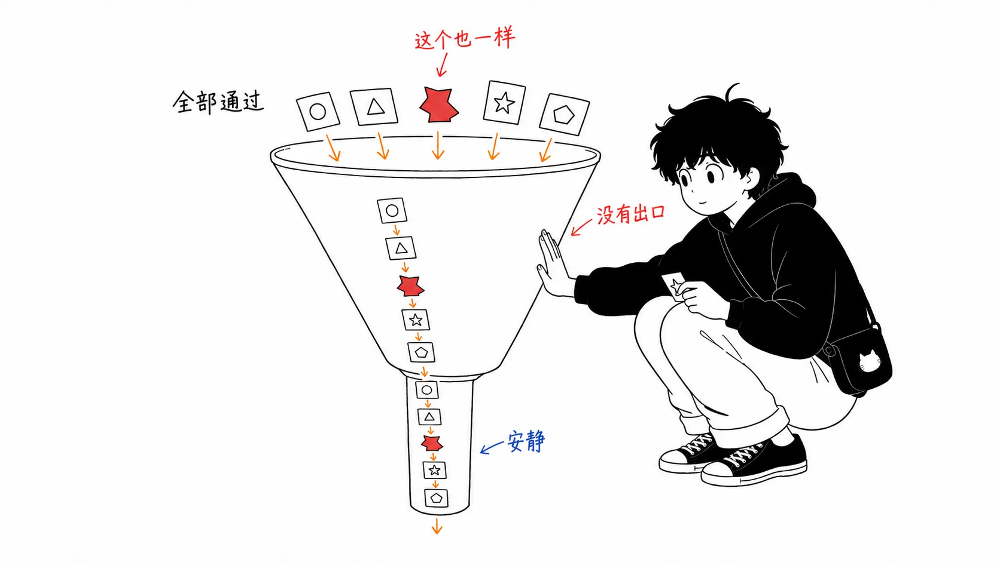

## 关于这篇文章

搜索工程师 Doug Turnbull 在 2026 年 8 月 10 日，在自己的博客上发了一篇很短的文章《[Don't classify. Hallucinate!](https://softwaredoug.com/blog/2026/08/10/hypothetical-classifications)》。我是因为 Simon Willison 在 8 月 14 日把它作为[链接文章](https://simonwillison.net/2026/Aug/14/dont-classify-hallucinate/)介绍出来，才知道的。我读它是在 2026 年 8 月 18 日。

先坦白一件事。Turnbull 公开的 [Colab 笔记本](https://colab.research.google.com/drive/1ljk72SBRuqWIijuEusCnDbhG1WAfZFcC)和 [cheat-at-search 仓库](https://github.com/softwaredoug/cheat-at-search/blob/main/cheat_at_search/enrich/vocabulary.py)，我都没有亲手跑过。这篇文章是基于原文，以及我另外核对过的 OpenAI 官方规范所写的思考。

先说结论。

> 这个技巧本身三行就能讲完。有意思的不在这里。**把词表整个塞进 enum 的设计，在比想象中早得多的阶段就已经在物理上坏掉了。** 而作为替代引入这个方法之后，失败的性质会变：从“会报错的失败”，变成“看上去合理、却悄悄出错的失败”。省下来的钱，要用评估成本来付。

前半部分我会写得很短。方法本身，读原文就够了。字数我留给后半部分的“我的看法”。


---

## 第 1 部分 — 把词表塞进 enum 的设计，到几百条就撞墙

想做的事很平常。把“wood coffee table”这样的搜索查询，分配给 Wayfair 商品类目中的某一个。类目长这样。

```
Furniture / Living Room Furniture / Coffee Tables & End Tables / Coffee Tables
Décor & Pillows / Decorative Pillows & Blankets / Throw Pillows
Furniture / Bedroom Furniture / Dressers & Chests
```

定式做法是 Structured Outputs。用 Pydantic 建一个只列出正确取值的巨大 `Literal`，把 LLM 的输出约束在里面。

```python
FullyQualifiedClassifications = Literal[
 'Furniture / Bedroom Furniture / Beds & Headboards / Beds',
 'Furniture / Living Room Furniture / Chairs & Seating / Accent Chairs',
 'Rugs / Area Rugs',
  ...
  # times 500
]
```

Turnbull 对此的评价是“这能用。但有更便宜的做法”。原文提到了上限的存在，但具体数字交给了官方文档的链接。这一点让我在意，所以我自己去读了。[OpenAI 的 Structured Outputs 指南](https://developers.openai.com/api/docs/guides/structured-outputs)里是这么写的。

> 整个 schema 中，enum 值最多 1000 个。
>
> 当单个 enum 属性取字符串值时，如果 enum 值超过 250 个，则所有 enum 值的字符串总长度不得超过 15,000 个字符。
>
> （拙译）

第二个条件很坏。字符数限制只有在超过 250 条时才会触发。所以到 250 条为止，不管路径多长（只要在整个 schema 的 12 万字符以内）都能通过。

问题出在第 251 条。上面举的 `Furniture / Living Room Furniture / Coffee Tables & End Tables / Coffee Tables` 是 78 个字符。Wayfair 的全路径型类目大致就是这么长。一旦列出 251 条，字符数限制就触发了，要求总长在 15,000 字符以内。可是 15,000 ÷ 78 ≈ 192，只放得下 192 条。“251 条以上”和“192 条以内”这两个条件，没有办法同时满足。

也就是说，对全路径型的分类，**第 251 条不可能存在。** 上限不是含糊的“大概几百”，而是恰好 250。1000 条的 enum 个数上限一次都没起作用。在它的四分之一处就到了悬崖。Turnbull 写的“hundreds（几百）”这个类目数，不是巧合，正好就是悬崖的位置。

放到 Simon Willison 的用途上就更直白了。他的博客有 1,856 个标签。即使是 `generative-ai` 这种 13 个字符上下的标签，1,856 × 13 ≈ 24,000 字符。个数和字符数双重出局，这种设计从一开始就不在选项之内。

“把选项交给 LLM 让它选”，在实际运营的词表规模下，往往根本就不成立。这一点不是凭手感，而是由规范决定的。

---

## 第 2 部分 — 步骤三行就讲完

Turnbull 的提案是这样的。

1. 让便宜的模型随意编造**并不存在**的分类
2. 事先在本地为所有真实类目生成嵌入向量
3. 拿编造出来的分类的嵌入向量，在真实类目集合里用内积做最近邻检索，让它落地

提示词完全不给词表。给的只有“形状”。

> 你的任务是，针对这条搜索查询，创造一个最贴合它的、**全新的、此前不存在的**家具、生活用品、五金的分类。
>
> 商品分类长这样：
>
> `Furniture / Living Room Furniture / Coffee Tables & End Tables / Coffee Tables`
> `Décor & Pillows / Decorative Pillows & Blankets / Throw Pillows`
> `Furniture / Bedroom Furniture / Dressers & Chests`
> （以下略）
>
> 要为其生成分类的查询：
>
> `brown coffee table`
>
> （摘自原文提示词，拙译）

出来的是并不存在的胡编乱造。比如 `Furniture / Living Room / Tables / Coffee`。原文有一行起了作用。

> 这完全没用。
>
> 其实，它非常有用。
>
> （拙译）

用 MiniLM 事先把所有真实类目都嵌入好，再拿这个胡编乱造的东西的嵌入向量去做内积，就会落在 `Furniture / Living Room Furniture / Coffee Tables & End Tables / Coffee Tables` 上。真实类目的嵌入向量可以放在内存里，所以便宜。而且不用每次都把 schema 发给 LLM。

说明到此为止。


---

## 我的看法

从这里开始才是正题。

### 意识到这只是把 HyDE 翻了个面，应用范围就看得见了

Gao 等人的 HyDE（Hypothetical Document Embeddings，2022）是这样的方法：不再直接用查询去找文档，而是先让 LLM 写出“大概能回答这个问题的假想文档”，再用这份假想文档的嵌入向量去检索真实文档。查询和文档在文体和长度上都不同，所以在嵌入空间里并不靠近。因此要绕道经过一个假货，把形状对齐。

这次的做法，方向相反。HyDE 是**造一份假想文档，去对上真实文档**。Turnbull 的方法是**造一个假想标签，去对上真实标签**。两者走的是同一步棋。

> 不再把输出约束在词表里。让它自由生成，扔进嵌入空间，用最近邻让它落到真实的值上。

用这个抽象重新看，对象并不一定非得是标签或类目。内部 API 名、Jira 组件、错误码体系、会计科目、零件编号——凡是“想把自然语言对应到有限但太大的词表”的场景，形状都是一样的。我觉得有意思的，不是作为分类的小技巧，而是这里：**对应到封闭词表这件事，原来不是 schema 的问题，而是检索的问题。** 是这种重新理解。

塞进 enum 的想法，是把词表当作“约束”。这个方法则把词表当作“索引”。约束必须交给模型才起作用，所以无法扩展；索引可以放在手边，所以能扩展。胜负就在这一点上。


### 叫它“幻觉”，让真正发生的那场交换更难看清了

标题很抓人，但我觉得并不准确。这里 LLM 并没有产生幻觉。它只是按指示，生成了语义被规范化的表达。胡编乱造的是字符串，不是语义。倒不如说，这个提示词把 LLM 用作的不是分类器，而是**语义的规范化器**。

这也许看起来像文字游戏，但名字叫错了，就会做错设计判断。一旦认为这是“利用幻觉的奇招”，就会觉得把模型变聪明、精度就会上去。实际上决定精度的是后一段：嵌入模型，以及真实词表一侧的表述。

而且，这是我最在意的地方。**这个设计改变了失败的呈现方式。**

Structured Outputs 在出现词表外的值时会坏掉。变成校验错误。吵，但能发现。最近邻检索不同。无论什么输入，它一定会返回点什么。相似度是 0.9 还是 0.2，最接近的那个都会返回。默认情况下，不存在返回“无匹配”的出口。

查询是 `wood coffee table` 的话没问题。有问题的是业务数据角落里的那些，像 `hvac damper actuator 24v` 这种，在那个分类体系里压根没有位置的东西。用 enum 的话，要么落到“无匹配”，要么被硬选出一个明显不对的值、显眼地露出来。用这个方法，它会悄悄被吸到 `Home Improvement / HVAC / Vents & Registers` 一带，没人发觉地混进统计里。

所以我认为，真要投入实战，在最近邻的相似度上设阈值、建一条拒绝通道，不是可选项，而是必须。原文里没有提到这件事。



### 最该说的是“没有评估”

原文没有精度数字。用了 WANDS 数据集，甚至公开了 Colab 笔记本，但正文里没有“与 Structured Outputs 版相比，精度是百分之几”这样的比较。除非是我读漏了，否则这里仍是空白。

这不是在责怪 Turnbull。那是一篇短小的点子文章，它也是这么自称的。如果非要有人被责怪，那是把这类方法概括成“便宜且等效”并加以传播的那一方（包括这篇文章）。

文章主张的是“便宜”“不用每次都发 schema”这两点，这从结构上就是不言自明的。没有主张的是“命中率差不多”。而在实务中要不要采用它，恰恰就取决于这个没被测量的部分。

而且评估的形状还很麻烦。分类的命中与否，是 LLM 一侧的生成质量与嵌入模型的近邻质量相乘的结果，一旦没命中，很难分清是哪边的责任。把全路径字符串（`A / B / C / D`）原样喂给 MiniLM 级别的模型，这一点我也在意。嵌入模型是用自然语句训练的，斜杠分隔的层级路径落在训练分布之外。层级深处的差别——`Coffee Tables` 和 `End & Side Tables`——因为上层层级相同，在嵌入上有可能几乎被压扁。这里不实际测一下是不知道的。所以才需要谈怎么测。

### 那么，什么时候用

我的划线是这样的。

词表超过几百条、错误不致命、而且是像统计或检索筛选这样**错误之后能被查出来**的用途，就毫不犹豫地用。Simon 的“给 1,856 个标签的往期文章打标签”正好合适。enum 版按规范根本做不出来，而且标签偏一个也不会有人因此丧命。

反过来，如果词表在 200 条以内、enum 能正常通过，就没有理由特意再加一条嵌入流水线。坏了会告诉你“坏了”的机制，价值更大。像计费的会计科目这种、错误会悄悄生效的领域，出于同样的理由我也会避开。

也就是说，这不是“Structured Outputs 的超集”，而是**为 enum 在物理上装不下的词表规模准备的工具**。这样定位的话，我觉得是相当不错的工具。

---

## 总结

如果只带走一件事，别带走技巧本身，而是带走它之前的那个事实。

**把选项列表交给 LLM 让它选的设计，有一个具体的天花板。** 对 OpenAI 来说，超过 250 条的那一刻，“所有 enum 值总计 15,000 个字符”的条件就会触发，所以长层级路径实际上恰好在 250 条就到顶了。数一数自己的分类体系现在处在相对于它的哪个位置，是值得的。250 并不是多遥远的数字。

在此之上，如果已经超过天花板，选项有两个。把层级拆开做多级分类，或者像 Turnbull 那样切换到“生成、嵌入、用最近邻落地”。如果选后者，要从一开始就把相似度阈值和拒绝通道放进设计里。不再报错，并不是因为错误变少了。

---

## 出处

- Doug Turnbull「[Don't classify. Hallucinate!](https://softwaredoug.com/blog/2026/08/10/hypothetical-classifications)」softwaredoug.com，2026 年 8 月 10 日
- Simon Willison「[Don't classify. Hallucinate!](https://simonwillison.net/2026/Aug/14/dont-classify-hallucinate/)」simonwillison.net，2026 年 8 月 14 日（链接文章）
- [Colab 笔记本](https://colab.research.google.com/drive/1ljk72SBRuqWIijuEusCnDbhG1WAfZFcC) / [cheat-at-search](https://github.com/softwaredoug/cheat-at-search/blob/main/cheat_at_search/enrich/vocabulary.py)（Turnbull 的实现）
- OpenAI「[Structured model outputs](https://developers.openai.com/api/docs/guides/structured-outputs)」（enum 上限的说明，2026 年 8 月 18 日确认）
- Luyu Gao et al.「[Precise Zero-Shot Dense Retrieval without Relevance Labels](https://arxiv.org/abs/2212.10496)」2022 年（HyDE）
