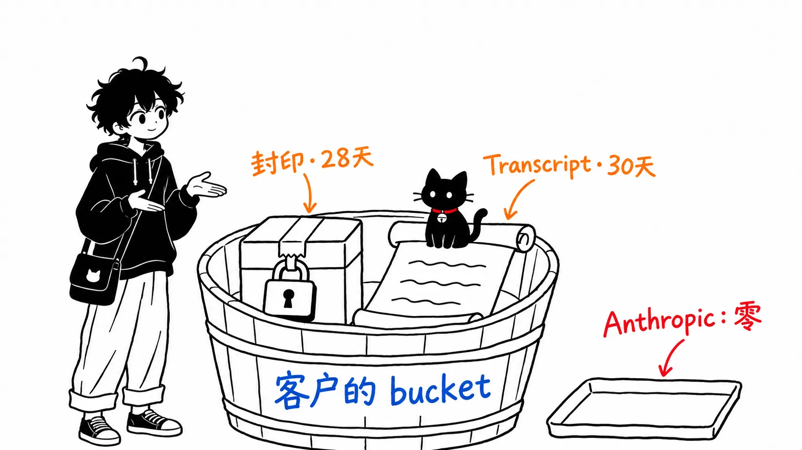
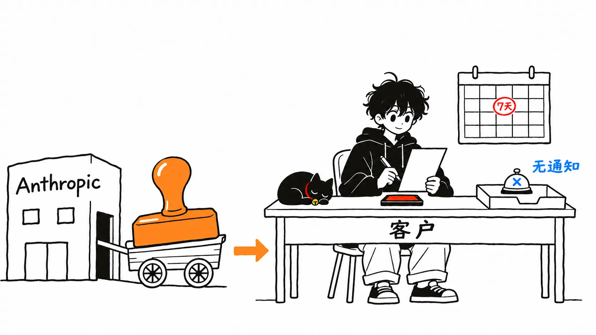
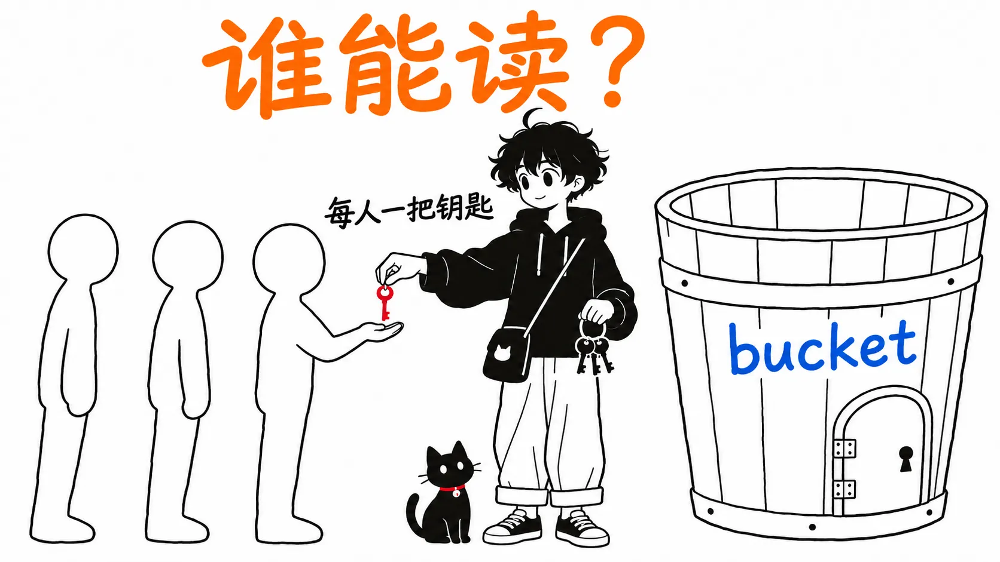

2026 年 11 月 23 日，Anthropic 宣布了 Enterprise Frontier Safeguards（EFS）的公开测试版。发布文章的标题是"Zero data retention with Enterprise Frontier Safeguards is now in beta"。开头的说明是这样的。

> EFS provides state-of-the-art detection of sophisticated misuse, while remaining compatible with zero data retention (ZDR): neither Anthropic nor any cloud providers retain enterprises' data.
>
> （EFS 在以最先进的精度检测复杂的滥用行为的同时，仍能保持数据零保留（ZDR）。Anthropic 和云服务商都不保留企业的数据。）

发布文章里写到，自动监控分析的是客户管理的基础设施上的数据。但那里到底留下了什么、谁能读到，文章没有写，所以我一直读到了它链接的开发者文档。

先说结论。

> EFS 的“零”，指的是 Messages API 的提示词和响应不会留在 Anthropic 和云服务商手里。数据会留在客户的 bucket 里。客户读不了的封存形式（最长 28 天）一定会有，客户团队能读的 Transcript（最长 30 天）则取决于设置。人工审核也从 Anthropic 的工作人员转移到了客户自己的团队。我的理解是，这是一种机制：客户在 ZDR 下使用最高档模型，代价是承担可读副本的管理和审核的责任。

---

## 关于这篇文章

我读的是发布文章（英文版。日文版 URL 的正文也是英文），以及开发者文档中的 EFS 概述、客户自有存储、Safety Case 的审核、Safety Case 的文件格式、FAQ，还有数据保留的页面。安全白皮书、9 月的威胁情报报告、Safety Cases API 的页面，我没有读。

我没有试用过 EFS。以下只是我读文档所及范围内的内容。

## 为什么需要 EFS

发布文章写道，现有的 ZDR 客户靠分类器（逐条即时审查每个请求的机制）来保护。但高级攻击横跨许多请求，逐条看都显得无害。作为例子，文章举了 9 月威胁情报报告中那起针对约 50 个组织的行动。AI agent 把攻击工作拆分给并行的许多 agent，并把收集到的凭据保存在会话之间。逐条来看，这些本来会像是各自独立的、更无害的工作，文章是这么说的。

抓住这类行为的，是观察横跨许多请求的模式的“自动安全监控”。要观察，就得把请求留在某个地方。这就和 ZDR 冲突了。

数据保留的页面里写了一个更直接的理由。

> These models require 30-day data retention and are not available under ZDR unless expressly authorized by Anthropic.
>
> （这些模型需要 30 天的数据保留，除非 Anthropic 明确许可，否则无法在 ZDR 下使用。）

“这些模型”是 Claude Fable 和 Mythos 的 5、5.1、5.2 这 6 个。签了 ZDR 合同的企业，没有 Anthropic 的个别许可，就不能直接使用最高档模型。此前的路径，是只对特定的 workspace 设置 30 天保留，或者使用 Anthropic 管理的存储。EFS 是把数据留在客户一侧使用的第三条路。

## 数据留在客户的 bucket 里

用 EFS 时，客户在自己的云上准备一个 bucket，并把访问它的权限（角色）交给 Anthropic。根据文档里“What's stored, and where”的表格，那里可能被写入的有 3 种：封存的数据、Transcript，以及 Safety Case 等往来记录。这里看前两种。

第一种是 Sealed Safety Data。它是把提示词、响应和模型的推理，用 Anthropic 的格式加密后的数据。

> Your team can't read it, even in storage you own.
>
> （你的团队即使在自己拥有的存储里，也读不了它。）

它是用于自动安全监控的数据，保留期最长 28 天。在 Claude Platform 的 S3 上由 Anthropic 删除，在 Google Cloud Storage 上则按 bucket 的生命周期规则删除。

第二种是 Transcript，是提示词和响应的可读副本。客户的团队为了调查 Safety Case 而阅读它。这一项的存放位置设置，在 Claude Platform 上是可选的。如果选择“Not copied to your storage”，就不会复制到客户的 bucket 里（在 Claude Platform on AWS 和 Google Cloud 的 Anthropic 管理版上是必选的）。对于设置了存放位置的情况，文档附了一条提醒。

> The Transcripts might include requests that never lead to a Safety Case, so plan who can read your bucket.
>
> （Transcript 里可能包含根本不会引出 Safety Case 的请求。所以要事先规划好谁能读你的 bucket。）

Transcript 最长 30 天后被删除。这个期限客户无法延长，直接改动 bucket 的生命周期规则，会通不过设置时的检查。文件格式的页面里写着，想保留更久的内容，要自己复制到别的存储里。

发布文章里的“Neither Anthropic nor your cloud provider retains your data”，在这个结构之上是准确的说法。Anthropic 和云服务商都没有留给自己用的副本。不过 bucket 本身位于客户的云上。读取其中内容的，是 Anthropic 的自动监控（封存的那一侧），以及在设置为保存 Transcript 的情况下，客户自己的团队。

范围也需要注意。EFS 覆盖的是 Messages API 的请求，code execution 的容器、Files API、Batch API 的结果、Managed Agents 的会话都不在范围内。另外，Anthropic 保留着不含提示词和响应的 Safety Case 往来记录。

## 审核的负责方转移到客户

在现有机制下，自动监控标记出的内容，有时会由 Anthropic 的少数专业团队查看。在 EFS 里，这个 Anthropic Human Review 始终关闭，改由客户的团队审核 Safety Case。

Safety Case 里既没有提示词也没有响应。里面有的是状态、时间、策略分类、相关 Transcript 的标识符等。客户的团队通过 bucket 里的 Transcript 或 Safety Cases API 读取内容，与自己的日志比对来调查原因，然后返回 `violation` 或 `no_violation`。期限是 7 个日历日，文档写道，若在没有有效响应的情况下超过期限，Safety Case 会被关闭，如果持续没有响应，访问还可能被停止。而且，Anthropic 在新的 Safety Case 产生时不会自动通知，所以需要盯着 bucket，或者轮询 API。

夸大负担是不公平的，所以我把文档里的但书也一并列出来。Safety Case 预计在大多数组织里都很少见，也不要求 24 小时值守。响应“以天为单位，而不是以小时为单位”即可，把通知发到一个每个工作日有人查看的队列里就行。自动监控发现明确且有意的危害时采取的停用措施，范围也可以缩小到单个用户，文档里是这么写的。

## 我的见解

发布文章的 3 项保证中，第 2 项是这样的。

> No operator human review. Neither Anthropic nor your cloud provider personnel access your inputs and outputs. Only automated safety monitoring can access this data.
>
> （没有运营方的人工审核。Anthropic 的工作人员和云服务商的工作人员都不会访问你的输入和输出。能访问这些数据的只有自动安全监控。）

这项保证说的是 Anthropic 和云服务商的人，不包括客户公司内部。所以这不是漏洞。只是，人工审核并没有消失，而是从 Anthropic 的工作人员，转移到了客户公司内部的负责人身上。

我认为这种转移本身是说得通的。对医疗、金融或法律行业的公司来说，外部公司的人读自家的数据，和自家的安全团队读，完全是两回事。发布文章里 Wells Fargo 的 CISO 说的话（日志放在 Wells 管理的环境里，用 Wells 管理的密钥）所要求的，正是这一点。

不过，公司内部的负责人能读，也就意味着员工发给 Claude 的提示词，公司内部的某个人也能读到。如果把 Transcript 保存到 bucket 里，那么包括没有变成 Safety Case 的普通请求在内，最长保留 30 天。Transcript 的保存在 Claude Platform 上是可选的，但我估计很多公司会打开它。因为 Safety Case 里没有内容，如果 bucket 里没有副本，7 天以内的调查就只能靠通过 API 去读取（这里是我的推测，文档里并没有这么写）。

比较的对象也确认一下。使用最高档模型的另一条路，是让 Anthropic 持有 30 天的副本。EFS 把它换成了客户 bucket 里的副本。副本并没有消失，只是持有者变了。持有者一变，就产生了一项新工作：代替 Anthropic 的审核员，决定自家公司里谁能读。文档特意写“要事先规划好谁能读 bucket”，我想是因为这会成为导入时的新议题。

另一点是运维。通知不会来，要自己盯着；即便很少，一旦来了，就得在 7 天内调查原因并回复。每个工作日都要确认的负责人，必须有人来担任。

我认为，决定是否导入的人该读的，与其说是发布文章，不如说是文档里“What's stored, and where”的那张表。

## 只带走一件事的话

导入 EFS 之前要决定的有两件事。是否把 Transcript 保存到 bucket 里，如果保存，自家公司里谁能读那个 prefix。以及每个工作日由谁来查看 Safety Case。

出处：Anthropic「[Zero data retention with Enterprise Frontier Safeguards is now in beta](https://claude.com/resources/articles/zero-data-retention-with-enterprise-frontier-safeguards)」（claude.com，2026 年 11 月 23 日）。Claude Platform Docs 的「[Enterprise Frontier Safeguards](https://platform.claude.com/docs/en/manage-claude/enterprise-frontier-safeguards/overview)」「[Customer-owned storage](https://platform.claude.com/docs/en/manage-claude/enterprise-frontier-safeguards/customer-owned-storage)」「[Review Safety Cases](https://platform.claude.com/docs/en/manage-claude/enterprise-frontier-safeguards/flagged-cases)」「[Safety Case files](https://platform.claude.com/docs/en/manage-claude/enterprise-frontier-safeguards/safety-case-files)」「[FAQ](https://platform.claude.com/docs/en/manage-claude/enterprise-frontier-safeguards/faq)」「[API and data retention](https://platform.claude.com/docs/en/manage-claude/api-and-data-retention)」。
