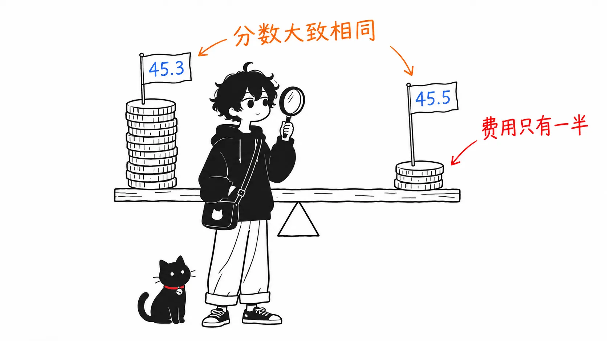
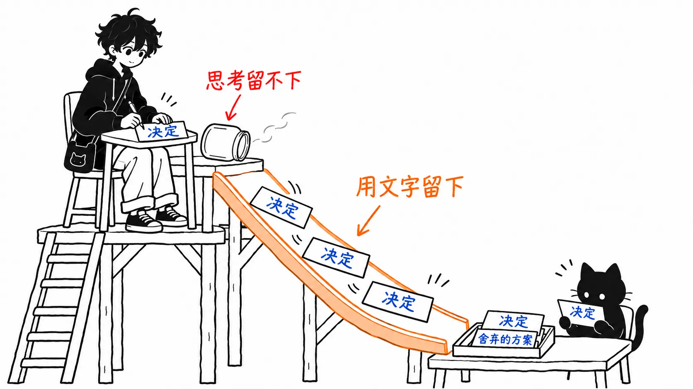

我平时用 Opus，只有需要深度推理时才用 `/model` 切到 Fable。我使用模型的方式就是这样，自己的规则文件里也是这么写的。这个"切换"其实有方向，把 Addy Osmani 的文章"Which Claude model should you build with?"（claude.dev，2026 年 11 月 9 日）里的两个章节连起来看，就能看出来。

文章的建议是，先用 effort 为 `medium` 的 Opus 5.5。升到 Fable 5.2 的情形有三种：最难的技术工作、Opus 5.5 开到 `high` 也不够的时候、长时间无人值守运行的时候。文章里列出的 Fable 与 Opus 的对比中，得分几乎持平，不同的是费用。再把文章后半部分关于模型切换的规则叠上去，还能看出另一件事。

先说结论。

> 在同一个对话里从 Opus 升到 Fable，Opus 的思考会被 Fable 继承。从 Fable 回到 Opus，Fable 的思考会被丢弃。如果只把难的部分交给 Fable、做完再回来，就需要在回去之前，让 Fable 把它得出的判断写成看得见的文字。

思考块（thinking block）的处理，是文章所写的 Claude API 和 Google Cloud（Google 托管）的情况。下面的费用也只是把文章里的数字排在一起，不是用我自己的用量测出来的。

---

## 得分持平，费用不同

文章里 Fable 与 Opus 单独对比的有两处。第一处是 Terminal-Bench 3.0。

> on Anthropic's runs of Terminal-Bench 3.0, the previous Fable, 5.1, at `max` scored 58.0%, while Opus 5.5 at `high` scored 58.9% with half the tokens.
>
> （在 Anthropic 跑的 Terminal-Bench 3.0 上，上一代 Fable 5.1 开到 `max` 得 58.0%，Opus 5.5 开到 `high` 得 58.9%，token 只用了一半。）

第二处是 FrontierCode 2.0，这次方向相反。

> On FrontierCode 2.0, Fable 5.2 at `high` scored about level with Opus 5.5 at `max` (45.3% vs. 45.5%) for roughly half the cost per task.
>
> （在 FrontierCode 2.0 上，Fable 5.2 开 `high` 与 Opus 5.5 开 `max` 得分大致持平（45.3% 对 45.5%），每个任务的费用大约只有一半。）

两处的分差都不到 1 分，FrontierCode 那一处文章自己也写了"about level"。文章主张的是费用。在 Terminal-Bench 上，Opus 开 `high` 只用了上一代 Fable 5.1 开 `max` 一半的 token；在 FrontierCode 上，Fable 开 `high` 比把 Opus 提到 `max` 每个任务的费用少一半。

文章的结论也在这里。

> So before you raise Opus 5.5 past `high` on a hard task, test Fable 5.2.
>
> （所以在难任务上把 Opus 5.5 提到 `high` 以上之前，先试试 Fable 5.2。）

这篇文章里没有出现"同一 effort 下 Fable 比 Opus 高几分"的数字。文章说各模型的得分在 Fable 5.2 的介绍页上，但我没有读那一页。所以仅凭这篇文章，只能说到"effort 到了上限时，换模型有时更便宜，所以值得试一试"。依据是 FrontierCode 的这一例。

## 长时间运行时，差距小于单价的 2 倍

按标价，Fable 5.2 的输入和输出都是 Opus 5.5 的 2 倍（每百万 token 输入 8 美元、输出 40 美元，对 4 美元、20 美元）。但缓存读取的单价是一样的。

> Fable 5.2 charges the same $0.20, so on a long, cache-heavy run the gap between Fable and Opus comes down to uncached input and output, where Fable costs twice as much per token.
>
> （Fable 5.2 的缓存读取同样是 0.20 美元，所以在缓存占比高的长时间运行里，Fable 与 Opus 的差距只剩下未缓存的输入和输出。在这部分，Fable 每个 token 贵 2 倍。）

文章的解释是，会话越长，输入的大部分就越是缓存读取。所以"Fable 贵 2 倍"这个说法，放到长时间运行里就说过头了。同一个任务，如果不是让 Opus 开 `max` 想很久，而是 Fable 开 `high` 就能短时间完成，那么输出 token 的差距足以让结果反过来，也不奇怪。FrontierCode 里的"一半"，大概就是这样出来的。

## 切换是有方向的

从这里开始，是我把文章里不同章节连起来后的解读。

文章在"Mixing models"一节里写了中途换模型会失去的两样东西。第一样是缓存。

> The prompt cache belongs to the model that wrote it. Your first turn on a new model pays the cache-write price on the whole conversation.
>
> （提示缓存属于写下它的那个模型。在新模型上的第一个回合，要为整个对话支付缓存写入的价格。）

无论是往上切还是往下切，这一点都一样。文章建议在切换之前，先在 Claude Code 里执行 `/compact`，或者写一份简短的计划，再开一个新会话。

第二样是思考块，这一样有方向。

> A move down a tier loses the earlier reasoning, because a model never reads the blocks of a model above it.
>
> （往下移一档，之前的推理就丢了，因为模型从不读比自己更高一档的模型的思考块。）

Fable 5.2 能读 Opus 5.5、Sonnet 5.5、Haiku 5.5 的思考块。反过来，从 Fable 5.2 换到其他正式发布的模型时，Fable 的推理会被丢掉。据说请求不会报错，会照常通过。

也就是说，如果留在同一个对话里"Opus 卡住了就升到 Fable"，只要付了缓存写入的钱，Opus 到那时为止想过的东西就会传给 Fable。危险的是 Fable 越过难关之后再回到 Opus。如果 Fable 为什么选了那个设计、舍弃了哪些方案，只存在于思考块里，Opus 就会在不知道这些的情况下接着往下写。因为请求不会报错，应该很难察觉思考已经被丢掉了。

另外，这种不对称应该是在原样沿用同一个对话的历史时才起作用。`/compact` 或新会话里思考块如何处理，文章没有写，但既然历史被重新概括了，往上切的时候也不会被带过去，这样想比较自然。还有，文章的这段说明针对的是 Claude API 和 Google Cloud（Google 托管），Claude Code 的 `/model` 是否会发生同样的事，我没有确认过。

## 回去之前先让它写下来

我想到的对策很简单：从 Fable 下来之前，让它把做出的决定和舍弃的方案写进对话正文或计划文件里。思考块会消失，但普通的消息和文件会留下来。这个对策，我还没有有意识地试过。

这与文章的建议也不矛盾。文章在切换之前推荐的"写一份简短的计划，再开新会话"，本是为了减少缓存费用，但同时也是把思考变成看得见的文字的办法。无论哪个方向，先写计划再切换，缓存费用就小，推理也以文字留存。上面说的"往上切时会被继承"，也就不必依赖了。

还有一点，我的规则文件现在仍然写着"深い推論が必要なときは、ユーザーが `/model` で Fable 5.1 に切り替える"（需要深度推理时，由用户用 `/model` 切到 Fable 5.1）。版本已经旧了，而且"深度推理"的界线也很含糊。按文章的思路，信号可以分成两个。一个是像大规模重构、迁移、设计规划那样，一开始就从 Fable 起步的工作；另一个是想把 Opus 提到 `high` 以上的时候。后者不是凭心情，而是由 effort 的上限决定的，所以对我来说是个好用的信号。

## 只带走一件事的话

从 Fable 下来的时候，把它想过什么用文字留下来。思考块不会传给下一档的模型。

出处：Addy Osmani《[Which Claude model should you build with? Fable, Opus, Sonnet, or Haiku](https://claude.dev/blog/which-claude-model-should-you-build-with/)》（claude.dev，2026 年 11 月 9 日）。Fable 5.2 的介绍页、发布文章、Preserved thinking 的文档，我都没有读。思考块的处理，是文章所写范围内的 Claude API 和 Google Cloud（Google 托管）的情况。
