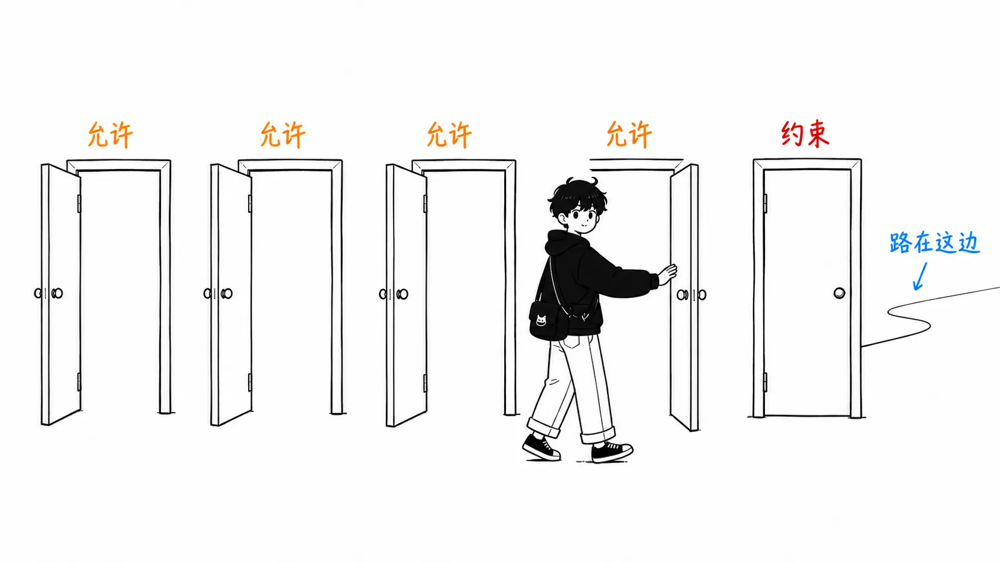
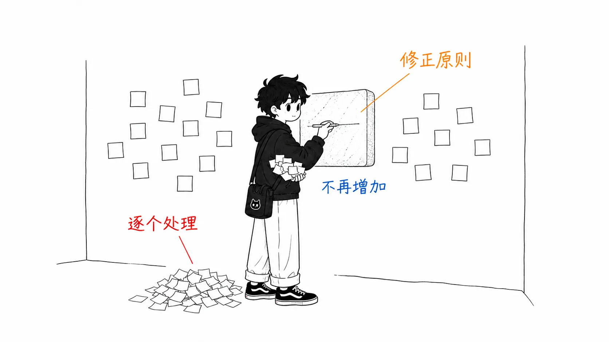

先把结论写在前面。

> 这份指南的五条规则里，**四条是“多做点”，约束只有一条**。而出事故的，总是在后者那一边。供应商的指南，从结构上就会在许可那一侧写得很厚。所以读法上，只把约束这一章（Rule 3）读两遍才是对的。而正文里我认为最实用的一句话，不是标题，而是埋在中段的 Cainex 的 **"fix the principle, not the example"**。

## 关于这篇文章

- 原文：[The Claude Code guide for startups](https://claude.com/blog/claude-code-guide-for-startups) — Michael Segner，2026 年 8 月 20 日（claude.com）

Anthropic 采访了十几家快速成长的创业公司，把 Claude Code 的使用方式总结成了五条规则。ClickHouse、Clay、Omni、Crosby、Heidi、Emergent、Commure、Artemis Security、Cainex、Zingage、Translucent、Higgsfield 等公司创始人的话在里面一一列出。

先交代我的立场。**这是供应商写的关于自家产品的指南。**这本身不是坏事，案例只有供应商才收集得到，所以这样的文档有它固有的价值。只是读法要变。比起“写了什么”，我更看“是以什么形状写的”。

坦白说明：我没有下载 PDF 版。文中引用的 Code with Claude（2026 年 5 月）上 Harvey 和 Cognition 的会议我也没看。我读的只是 Web 版的正文。

五条规则是这些。

1. Everyone ships（人人都发布）
2. Automate the tedium（把枯燥的工作自动化）
3. Trust, but verify（信任，但要验证）
4. Build for rebuilding（以推倒重来为前提来构建）
5. Prototype, dogfood, productionize（做原型，自己先用，再产品化）

## 四条是许可，一条是约束

重新排一下，结构就看出来了。

Rule 1 是“不是工程师的人也可以发布”。Rule 2 是“机械性的那 8 成可以交给智能体”。Rule 4 是“做出来的东西可以扔掉”。Rule 5 是“内部工具可以升级成产品”。**全都是“可以去做以前没做过的事”的许可。**

只有 Rule 3 朝着相反的方向。“没有验证手段，就不要自动化。”原文里的一句话本身就是条件句。

> You can't automate a process, unless you have a reliable means of monitoring and verifying the outcome.

而且 Rule 3 这一章最长。测试基础设施、在 `CLAUDE.md` 里写不变条件、维护 golden set、用 hooks 做硬性关卡、Cainex 的自我改进循环。其他四章是案例介绍，只有这一章在讲步骤。

我认为这不是编辑上的巧合。**许可卖得出去，约束卖不出去。**供应商的指南最终变成许可 4：约束 1 的比例，不是恶意，而是结构。所以需要读者这一侧去做平衡。我的读法是“先读 Rule 3，再回到 Rule 1”。

还有一个佐证这种不对称的观察。**这份指南里登的失败故事，全都发生在 Rule 3 这一侧。**

Zingage 的 Victor Hunt：

> “早期我们给了 Claude 完全的自主权，做了很‘AI’的事：我们很快地发布了看似合理的代码。问题是，它漂移的方式看起来是对的，却偏离了我们的架构。所以……我们把所有不变条件都写了下来。如何界定问题。什么必须永远为真。如何证明行为，而不是相信一个自信满满的答案。**这个团队的思维方式，567 行。**”

Cainex 的 Uriah Israel：

> “一开始并没有这么干净。第一个版本过拟合了。它靠把个别案例编码进去来‘修正’，不是变聪明，而是在堆积补丁。”

两者都是在“能快速发布了”之后出现的问题，是执行 Rule 1、2、4 之后等在前头的东西。从顺序上讲，先读许可、把约束往后放，你就会自己把这两个问题重新发现一遍。

## 最实用的一句话，没有成为标题

Cainex 是一家做医疗编码的公司（读病历，生成决定医院计费的编码）。这一节是正文里密度最高的。

> “在医疗编码里，错误的编码不是笔误。它是一起计费与合规事件。这一点决定了我们所有的构建方式。”

他们的循环是这样的。智能体处理一批数据 → 审核员在内部应用里评审输出（不只看编码，还看**模型的推理，并对两者都留下评论**）→ Claude Code 直接从数据库读取原始预测以及所有的订正和评论 → 订正的每种类型都打了标签，所以直奔相应的指导 → **找出产生错误的指令位置并修订** → 针对有版本管理的指令集做出修改，并用失败的记录重新测试。

然后是 back-test。一条记录可能有多种合理的编码，所以不能用字符串匹配来判定。他们把针对可接受集合的语义匹配，与追问“这真的是错误吗，还是另一条合理的路径”的 judge 组合起来。把候选的修改在 golden set 和随机样本上跑一遍，在发布前把回归找出来。

以上是机制，而原则只有一行。

> **The rule we enforce: fix the principle, not the example.**

我认为这是整份指南里最值得带走的一句话。理由有两个。

**第一，这是一条做减法的原则。**指南的其余部分几乎都是做加法。增加智能体、增加 skill、提高并行度、增加原型。只有这一句在说“别加”。不要去添加对个别案例的处理，而是去修原则。Cainex 自己写了“对一次修改中可以放入的个别事项数量设了上限”，也就是**对可以添加的量明确设了上限**。

**第二，它可以直接变成 `CLAUDE.md` 的运维规则。**智能体搞错了什么。常见的处理是在 `CLAUDE.md` 里加一行。“不要做 XX”。反复这么做，就如原文所说，“不是变聪明，而是在堆积补丁”。我的 `CLAUDE.md` 正是这样，过去事故的化石一层一层地堆着。

而且具有讽刺意味的是，这条原则的对象也包括 `CLAUDE.md` 本身。指南 Rule 3 的 Tip 说“把不能变的东西放在 `CLAUDE.md` 的根部”，但如果适用 Cainex 的原则，该放的是**原则，而不是案例**。这两条 Tip 明明在同一章里，只执行其中一条，文件就会变胖。

## 同一周，出现了反方向的信号

从这里起是原文里没有的内容。

这份指南发布的两天后（2026 年 8 月 22 日），Maurice Heumann 发布了[一篇审计自己约 2GB 会话日志的文章](https://momo5502.com/posts/2026-08-22-mw2-decompilation-audit/)。这是对一个实验的审计：让一群 AI 智能体不间断地花 4 周做游戏反编译。这篇文章我另外写过，细节就略过了，这里只拿两点和这份指南对照。

**1. 子智能体。**指南是这么说的。

> Dynamic workflows can be used to fan multiple subagents to analyze large amounts of data in parallel or to conduct an adversarial review of another agent's work.

Commure 的案例也是“一名工程师用 Claude subagents 并行推进了约 13 个工单的项目”。方向是增加。

而 Heumann 测出，在 47 次子智能体运行中读到的大文件里，**有 54.7% 是纯粹的重复**，于是把子智能体停用了。重复读取的间隔中位数是 35 分钟，他的道理是，如果父智能体自己读了，这些内容本来会留在上下文里。

看起来矛盾，但条件不同。在 Heumann 的设置里，子智能体**没法做实际的工作**（因为没法并行地安全修改工作区）。所以成了专门做调查，而调查很容易重复。Commure 的 13 个工单并行，每个工单都有独立的工作单元。

也就是说，分岔点是“并行化的单元是否真的独立”，而指南这一侧没有写这个条件。**“说一句 fan out multiple subagents 就行”这种粒度的 Tip，没法判断你处在哪种情况里。**这一点需要读者自己补上。

**2. 生产力指标。**指南开头摆着四个数字。

| | |
| --- | --- |
| ClickHouse | 30% more features shipped |
| Omni | 2–3x engineering productivity |
| Clay | 100% of bug triage automated |
| Artemis Security | 6,000+ PRs a week |

方法论没写。30% 是和什么比，2 到 3 倍是用什么量的，每周 6,000+ 的 PR 是以什么为单位的 PR。全都是采访中的自我申报。

把这个和 Heumann 的文章放在一起看很有意思。他写到在关掉子智能体之后，每天的提交数从 243.9 增加到 311.1，然后**自己加了一条注记**：“把提交数当作生产力指标，并不一定准确。”

出了对自己有利的数字时，自己把这个数字的薄弱之处写出来。指南的四个数字没有这样的注记。指望供应商的营销材料这么做是不对路的，所以这与其说是批评，不如说是读法的问题。把这类数字理解为**“方向的主张”，而不是“效果量的主张”**。6,000+ PR/week 说的是“快到 PR 这个单位都要失效了”，而 6,000 这个数本身没有意义。

## 我觉得自己真会用的三条

从指南的清单里，只挑能当作步骤、而不是案例来用的。

**1. 用 git worktree 把“做四遍”变便宜。**这是 Rule 4 的 Tip。让 v2 在 v1 旁边跑，两边都做 eval，只合并赢的那个。Clay 的 Kareem 说“做出来，再做，再做。第四遍时什么都懂了，能做对了”，给这番话提供实现层面支撑的，就是这条 Tip。我一直以为 worktree 只是“切换分支嫌麻烦时用的”。**降低重做成本的工具**这种定位，我从没想过。

**2. 把 hooks 当作硬性关卡来用。**Rule 3 的 Tip。“不管模型怎么决定，每次都会执行。”阻止通不过 lint 的写入、提交前要求测试通过、在离开沙箱前清除 secret。这和我之前读的 Heumann 那篇文章的结论（“软性的指示没用。要强制执行规则，机械性的阻断器更有效”）完全一致。**不同的出处得出了同样的结论，所以我认为这属于可以信任的一类。**

**3. 持有多个 golden set，并定期更新。**Rule 3。关于崩溃点的描述很具体，我很喜欢：“用户反馈‘改完之后感觉智能体变差了’，而你只能靠猜测去确认。”我就处在这个状态。

反过来，我觉得不会马上用的是 Rule 1（everyone ships）。我不觉得它不好。只是它说的是组织的事，不是工具的事。一两个人在做的话，“人人都发布”本来就是真的。这份指南的读者里，Rule 1 能真正改变些什么的，我认为只有非工程师职能已经分开的那种规模的组织。

## 如果只带走一件事

不是指南的内容，而是指南的读法。

**读之前先数一数许可和约束。**如果是 4 比 1，就把那个 1 读两遍。不限于供应商的文档，公司内部的设计文档也一样，“可以做”摆了一排，而“没有这个就不要做”只有一条，那事故就会出在这一条那一边。

要从内容里选一条的话，就是 **fix the principle, not the example.**它有一个效果，就是能拦住你正打算往 `CLAUDE.md` 里添的那一行。拦住之后，它还会指出你应该改什么来代替。

## 出处

- Michael Segner，[The Claude Code guide for startups](https://claude.com/blog/claude-code-guide-for-startups)，claude.com，2026 年 8 月 20 日
- Maurice Heumann，[235 Billion Tokens Later: Auditing What The AI Agents Really Did](https://momo5502.com/posts/2026-08-22-mw2-decompilation-audit/)，momo5502.com，2026 年 8 月 22 日（在“同一周，出现了反方向的信号”一节中引用）

引用全部来自上述两处。PDF 版和所引用的 Code with Claude 的会议（Harvey、Cognition）我没有确认。从“四条是许可，一条是约束”一节往后的分析是我的读法，不是原文的主张。开头的四个数字是原文里原样的自我申报值，我没有验证。
