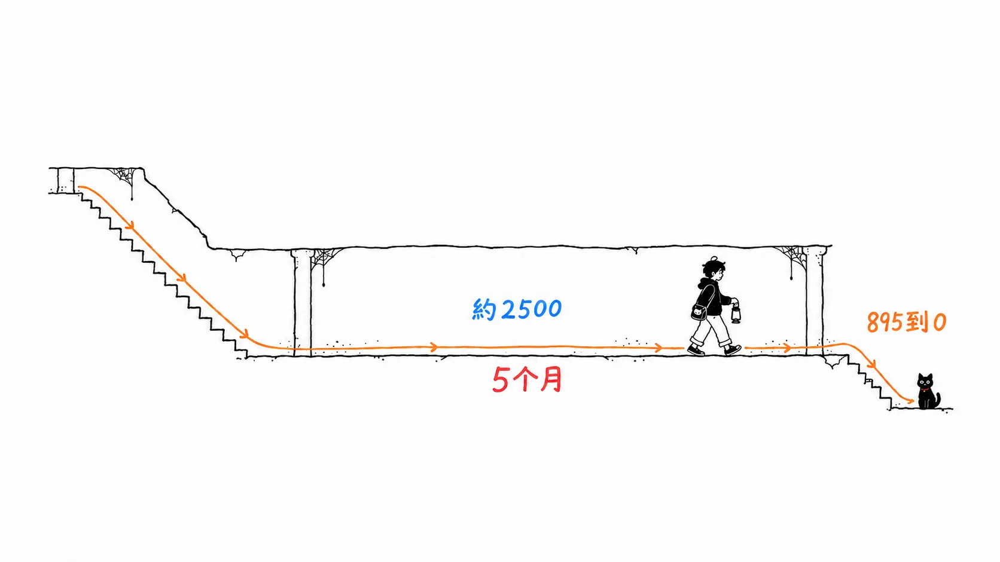

`@primer/react` 这个 npm 包，在 2023 年 10 月发布的 v36.0.0 里一个 CSS 文件都没有。到 2026 年 9 月 18 日的 v38.40.0，`dist/` 下面有 104 个 CSS 文件，合计 337KB。这是 GitHub 的设计系统 Primer 从基于 styled-components 的 CSS-in-JS 迁移到 CSS Modules 留下的痕迹。

GitHub Blog 那篇文章的标题是 "Improving site performance by shipping more CSS"（多发 CSS，让网站更快）。读完之后再去打开发布包，就会发现这个标题不是比喻，几乎就是字面意思。

先把我的看法放在前面。

> “多发 CSS 反而更快”，说的是把每次渲染页面都要付出的计算，换成了可以被缓存的字节来付。文章写了收益的一方（SSR 快了 55%），却一行也没写付出的一方（CSS 到底多了多少）。而且我认为，把这场耗时数年的迁移一路推到终点的不是 Copilot，而是那块持续统计 `sx` 剩余数量的仪表盘，以及在这个数字归零那天被废弃的兼容包。

出处是 GitHub Blog 的 [Improving site performance by shipping more CSS](https://github.blog/engineering/architecture-optimization/improving-site-performance-by-shipping-more-css/)，作者是 Josh Black 和 Marie Lucca，发布于 2026 年 9 月 25 日。

先声明一下。文章里的性能数字（SSR −55% 等）是 GitHub 的自我陈述，我没有办法验证。我自己核实过的，只有 npm 仓库里留存的各个包的版本、日期和文件大小。github.com 实际发给浏览器的 CSS 有多少，我没有测。

---

## 文章写了什么

简单概括一下。2023 年前后，部分页面上的组件数量暴涨，CSS-in-JS 的运行时成本变得肉眼可见。客户端的样式初始化拖慢了首次渲染，SSR 时收集样式变得很重，组件越多样式更新就越膨胀。

迁移的目标是 CSS Modules。样式写在组件旁边的 `.css` 文件里，类名默认是局部的。客户端和服务端都不再残留运行时处理，样式作为静态样式表与 HTML 一起送达。

推进方式是一个组件一个组件地来，步骤有四个。

- 新增一个把现有样式翻译成 CSS Modules 的新文件
- 把该组件挂到一个能在新旧样式之间切换的功能开关（feature flag）上
- 用现有的视觉回归测试，确认新旧快照完全一致
- 把开关按团队 → GitHub 员工 → 全体用户的顺序逐步放开

2024 年 12 月，Primer 的全部组件迁移完毕，文章是这样写的：

> 55% less time to server-side render a page
> 25% less time for components on a page to initialize
>
> （页面的 SSR 时间减少了 55%，页面上组件的初始化时间减少了 25%。）

文章没有写这是哪个页面的数字。

难的部分是从这里开始的。Primer 的组件有一个叫 `sx` 的 prop，可以用内联对象随意覆盖样式。在 GitHub 自己的代码里，这么多年来它几乎是事实标准，高峰时大约有 7,760 个。不把这些全部改写成 CSS Modules，就没法移除 styled-components。

于是他们做了一个叫 [`@primer/styled-react`](https://github.com/primer/react/blob/main/packages/styled-react/README.md) 的过渡包。它是一个包装层，让已迁移的组件也能接收 `sx`：用到 `sx` 的地方从这里 import，没用到的地方直接从 `@primer/react` import 来获得速度。之后以包为单位把 `sx` 翻译成 CSS Modules，替换 import，在预发布环境试过再上线。

工作从 2025 年 4 月开始，靠内部自制的 VS Code 扩展和 codemod 几乎自动化，由 8 个人轮流，用 6 个月迁移了 6,419 个。SSR 时间按页面不同改善了 1% 到 22%。2026 年 4 月重新开工时还剩 895 个，两名工程师加上“大量的 Copilot coding agent”，用 3 周把它清零。之后，又花了 2 个月，把 7 套主题（每套都有高对比度版本）的 JavaScript 部分从 styled-components 上剥离。文章最后说，到 2026 年 6 月，GitHub 已经 100% 跑在 CSS Modules 上。

---

## npm 里留下的迁移痕迹

文章里几乎没有提到包的事，所以我从 npm 仓库下载了 `@primer/react` 的 tarball，把里面的东西数了一遍。比较的只有 `dist/` 下面的部分（到 v37 为止，`lib/` 和 `lib-esm/` 里还各有两份相同内容，整包比较的话看起来会被撑大）。

| 版本 | 发布日期 | 对 styled-components 的依赖 | `dist/` 的 CSS | `dist/` 的 JS |
| --- | --- | --- | --- | --- |
| 36.0.0 | 2023-10-31 | 有 | 0 | 836KB |
| 37.0.0 | 2024-10-21 | 有 | 26KB | 1,315KB |
| 37.31.0（v37 的最终版） | 2025-08-12 | 有 | 173KB | 1,198KB |
| 38.0.0 | 2025-10-27 | **无** | 268KB | 1,251KB |
| 38.40.0（最新） | 2026-09-18 | 无 | 337KB | 1,346KB |

能读出三点。

第一，CSS 从 0 增长到 337KB。标题里的 “more CSS” 就是字面意思。

第二，`dist/` 的 JS 并没有减少。它从 836KB 增加到了 1,346KB。这期间组件本身也增加了，所以不能简单比较，但至少这不是“削掉 JS、换成 CSS”的形态。减少的是 Primer 之外的东西，也就是 styled-components 这个另一个包的运行时代码，以及它每次渲染时所做的处理（styled-components 本身的体积我没有测）。

第三，即便“2024 年 12 月全部组件已经迁移完毕”，v37 系列直到 2025 年 8 月都还依赖 styled-components。依赖是在 2025 年 10 月 27 日的 v38.0.0 才被摘掉的，这和文章里“2025 年下半年迁移 `@primer/react` 时”吻合。组件的外观已经迁到了 CSS Modules，但为了接收 `sx`，依赖还留着。

过渡包 `@primer/styled-react` 也可以在 npm 上核实。

- 首次发布是 2025 年 7 月 30 日（`0.0.0-20250730150946`）
- 最终版 1.0.8 是 2026 年 5 月 12 日。此后没有再发新版，目前这个版本被标上了弃用标记，文案是 “The styled version of @primer/react is no longer maintained. Use @primer/react instead.”

最后一个版本发布的日期，和文章里“`sx` 在 2026 年 5 月归零”吻合。不过 npm 的弃用标记不会留下日期，所以不知道标记是什么时候打上的。包信息的最后更新是 2026 年 9 月 25 日，和博客文章的发布日期相同。styled-components 一方宣布进入维护模式，是在 [Open Collective 的帖子](https://opencollective.com/styled-components/updates/thank-you)里，日期为 2025 年 3 月 17 日。这也与文章里“在我们开工之前不久，官方发布了声明”相符。

---

## 数字对不上的地方

文章里有一张名为 “Total SX props” 的面积图，读这张图，会发现和正文里的数字有一点出入。

- 正文把峰值写成“约 7,760 个”，但图的最左端在 7,300 上下，只有 5 月初的一个瞬间的尖峰才碰到 7,760
- 7,760 减去 6,419 是 1,341。重新开工时剩余 895，所以有 446 个的差额
- 图在 2025 年 10 月到 2026 年 3 月之间，约 2,500 个处几乎是平的。大约 5 个月，剩余数量几乎没动
- 8 月到 11 月之间，有好几个几天里跳涨几千个又马上退回来的尖峰

平坦的区间，和正文里“重新开工（picked this work back up）”的说法是吻合的。也就是说中途停过。停下的原因没有写。那 446 个的差额，是停工期间有人用别的方式消掉了，还是新的 `sx` 被加上又被删掉了（跳涨的尖峰暗示有这种可能，但也可能是统计的 bug），我从图上判断不出来。

SSR 改善的表里还有一处让我在意。13 行里，4.54% 出现了 4 次，6.01% 出现 3 次，3.05% 和 7.46% 各出现 2 次，而且是在互不相关的 controller 上出现了相同的值。看上去不像原始测量值，更像是被归并到某种区间里的值。正文写的是“1% 到 22%”，但表里的最小值是 3.05%，并没有 1% 的行。

还有一个，是时间线。`sx` 归零是 2026 年 5 月，之后主题剥离花了“2 个月”，然后是“到 2026 年 6 月 100% CSS Modules”。按顺序加起来是 7 月。也许主题的工作和 `sx` 是并行的，但文章里没写。

---

## 我的看法

### 1. “多发 CSS”，就是把计算换成字节来付

标题有意思的地方在于，在一篇讲前端性能的文章里，它说的是“增加”而不是“减少”。我觉得这不是文字游戏，而是诚实地写出了这笔交易的方向。

CSS-in-JS 的成本，是每次渲染页面都要付的。每个请求在 SSR 时收集样式，在客户端初始化，组件多了就跟着涨。CSS Modules 的成本，是作为样式表的字节数一次性付清，之后就被缓存。把每次的计算，换成了可以反复使用的字节。对 GitHub 这种同一个人会反复打开同样页面的服务来说，这笔交换几乎肯定是赚的。

但是，文章只写了收益的一方。SSR 快了 55%，初始化快了 25%。付出的一方，也就是送到用户那里的 CSS 增加了多少，首次访问（缓存为空时）的显示变成了什么样，都没有出现。在 npm 里看，`dist/` 的 CSS 是从 0 到 337KB。GitHub 实际发送的量和这个是两回事（应该只会打包用到的组件），所以把这个数字当成 github.com 的数值来读是错的，但可以确定它不是零。

既然标题说“多发反而更快”，我希望也能看到多发了什么、多发了多少的数字。如果写了，正在考虑同样迁移的读者就能在自己的服务上估算得失。

### 2. Copilot 清掉的，是用 6 个月搭起来的脚手架上的最后 895 个

文章里最可能被引用的，我想是 2026 年 4 月用 3 周把 895 个清零的故事。换成数字是这样：

| 时间 | 人数 | 个数 | 每人每周 |
| --- | --- | --- | --- |
| 6 个月（约 26 周） | 8 人 | 6,419 | 约 31 个 |
| 3 周 | 2 人 + Copilot coding agent | 895 | 约 149 个 |

约 4.8 倍。不过，把这个对比直接读成“用了智能体快了 5 倍”，大概是不对的。

后半段这 3 周开始的时候，已经备齐了一些东西。把 `sx` 一个个翻译成 CSS 的 VS Code 扩展，按文件翻译的 codemod，把 `sx` 的值对应到 CSS 变量的迁移指南，确认新旧外观一致的视觉回归测试，出了问题能回滚的功能开关，还有每天统计剩余数量的仪表盘。智能体应该是在这套脚手架上重复着“翻译下一个，确认测试通过”。搭脚手架的，是前半段那 6 个月里的人类。

还有一点。看图里的平坦区间，剩下的约 2,500 个有大约 5 个月几乎没动。智能体在那期间也是存在的（文章自己写了，Copilot coding agent 是“在工作进行到一半时”推出的）。数字重新动起来，是在人类重新开工的时候。智能体确实快，但让停滞的工作重新转起来的，不是智能体，而是“重新开工”这个决定。

另外，最后这 895 个是容易的剩余，还是难的剩余，我也不知道。如果是从 codemod 里漏出来的，应该很难；如果是没人负责的杂项，应该很简单。文章里没写。

### 3. 要放兼容层，就别设“拆除日期”，要给它一个朝零递减的数字

这篇文章里我觉得做得最好的，是对 `@primer/styled-react` 的处理。

兼容层一旦放上去，就很难消失。就算写了“迁移结束后就删掉”，也没有人去判定到底结没结束。在 Primer 的情况里，这个过渡包从一开始就附带着一个朝零递减的数字：“GitHub 代码里还剩多少个 `sx`”。再看 npm 上的日期，在这个数字归零的 5 月之后，这个包就不再更新了。距离首次发布大约 9 个半月。

因为把判断交给了一个数字，而不是人的感觉，兼容层才有了寿命。出于同样的道理，他们连摘除对 styled-components 依赖的这项工作也挂了功能开关（"we even feature flagged that"）。连删除依赖，也是以可以撤回的方式做的。

反过来说，我觉得从这篇文章能带走的是：没有朝零递减的数字的兼容层，最好别放。“总有一天删掉”没法计数，但“还剩 895 个”可以。

---

## 如果只带走一件事

如果你在考虑从 CSS-in-JS 迁移，开始之前，先做一块每天统计“待迁移对象还剩几个”的仪表盘。在 GitHub 这篇文章里，把功能开关、视觉回归测试和兼容包一路串成一条线直到最后的，就是那张 “Total SX props” 的图。而且这张图，还老老实实地把它停滞了 5 个月这件事也展示了出来。

---

## 出处，以及我核实的方法

- Josh Black, Marie Lucca, ["Improving site performance by shipping more CSS"](https://github.blog/engineering/architecture-optimization/improving-site-performance-by-shipping-more-css/), The GitHub Blog, 2026 年 9 月 25 日
- styled-components, ["Thank you"](https://opencollective.com/styled-components/updates/thank-you), Open Collective, 2025 年 3 月 17 日（维护模式声明）
- npm 仓库：[`@primer/react`](https://www.npmjs.com/package/@primer/react)、[`@primer/styled-react`](https://www.npmjs.com/package/@primer/styled-react)（2026 年 9 月 28 日获取）

把 npm 的统计方法写在这里。我从 `registry.npmjs.org` 获取各版本的 tarball，从 tar 头读取文件名和大小，按顶层目录分别汇总扩展名为 `.css` 与 `.js`/`.mjs` 的文件大小（类型定义 `.d.ts` 不计入）。对 styled-components 的依赖，是根据各版本的 `dependencies` 和 `peerDependencies` 中是否有 `styled-components` 来判定的。数字是未压缩的大小，不是 gzip 之后的传输量。

图和表的读数，是我用眼睛从文章里的图片上读出来的。原始数据没有公开。

### 没能验证的地方

- SSR −55%、初始化 −25%、SSR 1% 到 22% 这些性能数字。文章里也没有说是哪个页面、比较的是哪段时间
- github.com 实际发给浏览器的 CSS 量，以及迁移前后首次渲染的变化
- 峰值 7,760 个与“迁移 6,419 个、剩余 895 个”之间 446 个的差额，图上约 5 个月横盘的原因，以及跳涨几千个的尖峰到底是什么
- 文章把 `@primer/styled-react` 写成第一次 CSS 迁移（2024 年 12 月完成）的一部分，但它在 npm 上的首次发布是 2025 年 7 月 30 日。在那之前有可能只在内部使用
- “`sx` 归零是 5 月，之后主题花 2 个月，100% CSS Modules 是 6 月”这条时间线的错位
- `@primer/styled-react` 被打上弃用标记的日期。npm 上没有记录，包信息的最后更新（2026 年 9 月 25 日）是不是它，我也判断不了
- Copilot coding agent 具体负责了什么，人类在哪些地方做了评审
