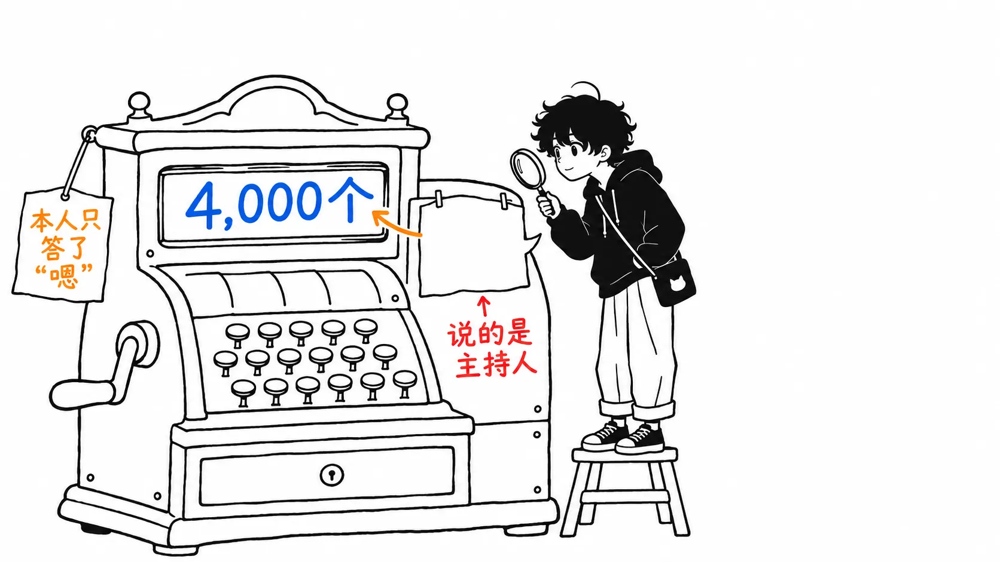
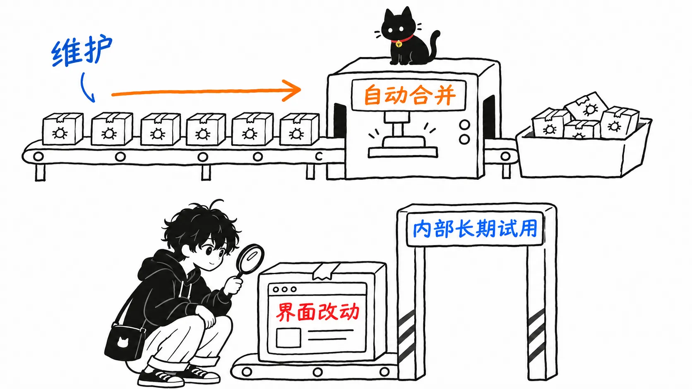
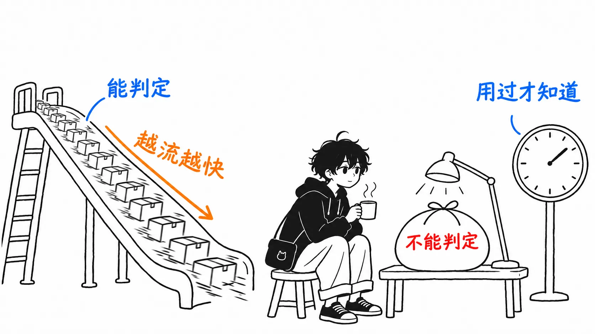

我看到过这样一个日文标题：「Grok Bot のローレン・タン氏、月間4000件のプルリクエストを処理——ボトルネックは『何を作るか』の決定に移行」（Grok Bot 的 Lauren Tan，每月处理 4000 个 Pull Request——瓶颈转移到“做什么”的决定上）。英文原文是 BigGo Finance 的"Grok Bot's Lauren Tan Runs 4,000 Pull Requests a Month — and Says the Bottleneck Is Now Deciding What to Build"，再往上追，出自 Y Combinator 的播客 Lightcone 的一期节目"[The Rise Of AI Coworkers](https://www.youtube.com/watch?v=y1-9yeYLJUo)"（2026 年 11 月 14 日，约 60 分钟）。我取了视频的英文字幕，把标题里的两个说法与原话做了对照。

先说结论。

> “每月 4,000 个”是主持人说“现在是不是超过 4,000 个了”、Lauren Tan 回答“Yeah”的数字。说“瓶颈是做什么的决定”的，是同台的 Roman Ugarte。而节目里讲的，是把工作分成两种。Lauren Tan 的 agent 被用在修 bug、改善性能这类维护上，改动会自动合并。用户每天都会碰到的界面改动，只有在内部长期使用并获得认可之后才会发布。“做什么”卡住的是后一边，而标题把这两件事合成了一件。

---

## 关于这篇文章

我对照的是 YouTube 自动生成的英文字幕。字幕没有标注说话人，所以谁说的话是根据上下文（比如说了"Lauren and I"）来判断的。以下引用来自字幕，自动字幕听错的地方（产品名的拼写等）已经改正。音频我没有全部听完。

我的立场也写一下。为了这篇文章，我没有运行 Grok Bot，也没有运行 Lauren Tan 公开的 skill 集 pstack。我只读了字幕和文章。PR 的数量是当事人自己的说法，我没有办法确认。

## “4,000 个”是主持人的话

节目 22 分钟左右，主持人这样问 Lauren Tan。

> I think when you did that presentation that had over four million views on your dev process, you were pushing about 2,000 plus PRs per month and now you're like over 4,000.
>
> （我记得你做那场播放量超过 400 万的开发流程演讲时，每月提交 2,000 多个 PR。现在是不是超过 4,000 个了？）

回答只有一句"Yeah"，随后马上转入对自己工作流的演示。后半段 Roman Ugarte 也说了"Lauren is putting up 4,000 PRs a month"。本人没有否认，所以我觉得可以当作她自己的说法来看，但这并不是她数过之后拿出来的数字。

数量以前也被提起过。2026 年 9 月 1 日，中文媒体新智元的文章写的是"上个月 1,000 多个，8 月目标翻倍"。播放量 400 万的那场演讲是什么时候，从字幕上看不出来。每个数字都没有附带 PR 的大小，也没有被打回的比例。

## “做什么是瓶颈”是 Ugarte 的话

标题后半的这句话，是 52 分钟左右 Roman Ugarte 说的。

> And I think what we've started to see be the bottleneck is less the time or engineering resourcing going into developing these ideas and features. And actually it's more alignment among us as a team of like what do we want the product roadmap to be?
>
> （我觉得开始成为瓶颈的，不是开发这些想法和功能所花的时间或工程人手。倒不如说，是我们作为团队，在产品路线图想做成什么样这件事上要不要达成一致。）

接着他说，讨论到一半，常常有人冒出一句"那我周末做过一个 PR"。

> So, the stuff is built, but we don't want to merge all of that because it's going to lead to a bit of a Frankensteiny product with like random side projects.
>
> （所以东西是做出来了。但我们不想全部合并，因为那样会变成一堆心血来潮的小项目拼凑起来、有点弗兰肯斯坦式的产品。）

BigGo 的文章，在标题和导语里把这个说法归到了 Lauren Tan 名下（导语写的是"according to Lauren Tan"）。正文的另一段里，它把这件事写成 Ugarte 的论述，还写到团队为了守住产品的整体性而收紧发布的东西。出入在标题和导语。

Lauren Tan 本人也说过意思相近的话。55 分钟左右，她说即使做得快，也不该把想到的功能全都发出去，这里需要人的判断和品味。不过，她没有用"瓶颈"这个说法。

## 两种工作

标题漏掉的，是这之间讲到的具体例子。

主持人问"发什么、不发什么是怎么决定的"，Ugarte 先举出了 Lauren Tan 搭的那套机制。它每天从产品内、客服渠道、X 上收进几千条用户的声音。其中很多是小 bug，她的 agent 机制会复现、修复、合并。

> And so in a lot of cases, Lauren's factory just fixes it like repros, fixes, merges. No one thinks about it.
>
> （所以在很多情况下，Lauren 的工厂就直接修掉了。复现、修复、合并。没有人会去操心。）

然后他接着说，也有不能那样处理的改动。就是改变用户每天看到的界面的时候。如果每次一发生什么按钮的位置就变，用户会烦。所以要在内部用上较长时间，在内部得不到支持的就不发。支持意见有分歧，也不发。

Lauren Tan 也说，她没有把自己的 agent 机制用在新功能的开发上，而是用在修性能、修 bug、修用户的小不满这类维护一侧。

也就是说，自动运转、一直做到合并的，是该修什么已经很明确的维护工作。“做什么”成为瓶颈的，是新功能和界面改动这一边。标题把这两件事做成了一个故事：“处理 4,000 个的人，卡在做什么上”。

## Lauren Tan 花时间讲的内容

节目里 Lauren Tan 花时间最多的，是让 agent 自己合并 PR 之前要做的准备。

> I've gotten to a point where I essentially have my agents merge their own pull requests
>
> （我已经到了基本上让 agent 自己合并自己 PR 的地步。）

在此之前，她说要一夜之间做到这一步相当难，需要准备合适的 skill，往代码库里放进好的护栏和约束，把本来要花在人工代码审查上的时间，嵌进代码库、静态分析和工具里。

她放在屏幕上的是一个倒三角形的图。投入最多的是代码库和静态分析，上面是规则和 skill，最顶上才是一点点人工审查。例子是 Grok Bot 的桌面应用（Electron）。在渲染线程里做重活，画面会卡，所以不再靠审查去发现，而是做成一条禁止主线程和渲染线程之间互相 import 的 lint 规则。

> We don't want to have to catch it in code review. We'll actually build it as like a lint rule.
>
> （我们不想靠代码审查去抓它。干脆把它做成一条 lint 规则。）

她还说，对于让不同模型互相审查的做法，她拉开了一点距离。理由是，审查的 agent 不了解产品的目标和今后的方向，分不太清哪些是好的意见、哪些不是，有过度迎合的风险。

## 我的见解

第一点，数量必须和分母放在一起才能读。4,000 个里，有多少被合并，有多少被打回？节目里没有这个数字。同一周 Anthropic 的 Claude Code 团队发布的关于验证的文章里写道，他们在追踪合并之后被 revert 的改动数，以及合并之前被维护者驳回的改动数。要谈产出的话，我认为至少需要这两个数。

第二点，是自动化的线划在了哪里。这个团队的线是按工作种类划的。修 bug、改性能这类能判定“修好了”的事，从复现到修复再到合并都交给 agent。像界面改动这种，好坏要在内部用过才能判定的事，由人花时间去做。Lauren Tan 讲的 lint 规则，我觉得也在同一条线上。能写成可以判定的形式的东西，就先放手。

顺着这条线看，“做什么”成为瓶颈是自然的结果。能判定的工作越流越快，只有不能判定的工作留在人的面前。团队有“在内部得不到支持的就不发”这条标准，但会不会得到支持，不用用看是不知道的。这部分时间，数量再怎么增加也缩不下来。

## 如果只带走一件事

看到“每月 ○ 个 PR”这样的数字，就去找它统计的是哪一种工作。就这个团队而言，撑起数量的是可以判定的维护工作，卡住的是不能判定的新功能一边。

出处：Y Combinator"[The Rise Of AI Coworkers](https://www.youtube.com/watch?v=y1-9yeYLJUo)"（Lightcone，2026 年 11 月 14 日，对照 YouTube 自动生成的英文字幕确认）。BigGo Finance"[Grok Bot's Lauren Tan Runs 4,000 Pull Requests a Month — and Says the Bottleneck Is Now Deciding What to Build](https://finance.biggo.com/news/e075716ae1e521f9)"。数量的变化来自新智元的文章（[智源社区的转载](https://hub.baai.ac.cn/view/57615)，2026 年 9 月 1 日）。Claude Code 团队的文章是 Addy Osmani"[How the Claude Code team thinks about verification](https://claude.dev/blog/how-the-claude-code-team-thinks-about-verification/)"（claude.dev，2026 年 11 月 16 日）。开头的日文标题，我没有确认它出自哪家媒体。节目的音频我没有全部听完，Lauren Tan 以前的演讲视频我也没有看过。
