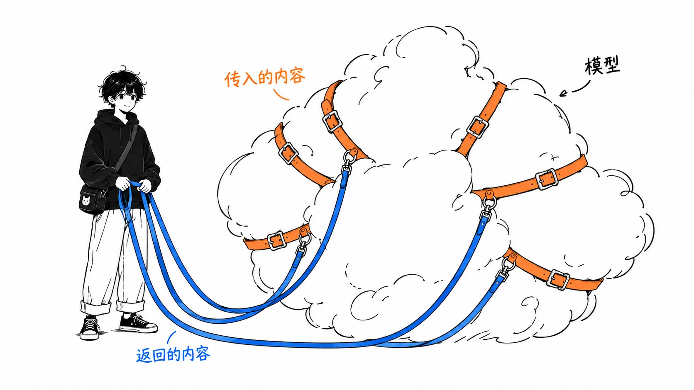
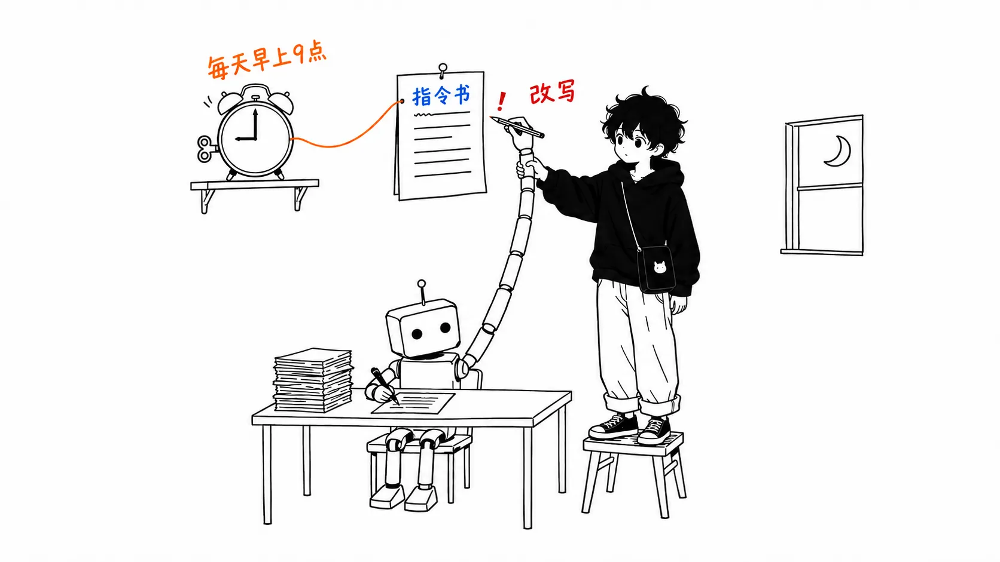

这个博客的仓库里有一个 shell 脚本 `automation/daily-article.sh`，每天早上9点由 launchd 启动。它做的事很简单：调用一次 `claude -p`，让它生成文章草稿和插图。全程无人值守。

读 santi（[@santtiagom_](https://x.com/santtiagom_)）的《Harness Engineering: explicado desde cero》时，我把文中的九个部件逐个拿来对照这个脚本。

先说我的结论。

> 交给模型的那一侧，六个部件基本都齐了，其中还有借来的。缺的是回到我自己手上的那一侧的三个部件（权限、观测、eval）。而且最重的一个漏洞，恰好出在 santi 写的“最重要的想法”那个地方。四条禁止事项里，完全由权限拦住的只有 git。其余的要么只拦住一半，要么根本没拦，其中一条甚至是指令本身在放行更危险的操作。公开之前我去堵漏洞，发现我在交互会话里一路攒下来的授权，会并入无人值守的运行，而 Bash 的白名单从头到尾都没有生效。

出处是 santi 的 X Article《[Harness Engineering: explicado desde cero](https://x.com/santtiagom_/status/2098782814837543075)》（西班牙语，2026年9月12日）。作者是 Mercado Libre 的工程师，我抓取时它大约有77万次浏览、3,430个收藏。引文的翻译均出自我手。

先说明一点。正文是通过 fxtwitter 的 API 取得的全文，两张图和六个代码块我也看过了。原文引用的三份一手资料里，OpenAI 和 LangChain 的我自己打开核对过，Anthropic 的没有打开。关于我自己脚本的所有描述，都来自仓库里的实物，以及我在本机跑过一次的 `claude -p` 的输出。

---

## 文章写了什么

santi 的文章是一篇入门讲解。它从这里讲起：模型只接收文字、返回文字，打开文件、跑测试都是周围的系统在做。这个周围的系统就叫 harness（线束、挽具）。

> Un harness es el sistema de software que rodea al modelo y convierte lo que escribe en trabajo terminado
>
> （harness 是包围着模型的软件系统，它把模型写出的东西变成完成的工作。）

接着以“给帖子加一个点赞按钮”这一个需求为例，给什么都做不了的模型一件一件地加部件。部件共九个，分成两组。

| 交给模型的 | 回到自己手上的 |
| --- | --- |
| 1. 工具（让它能动） | 7. 权限与上限（不让它做不该做的事） |
| 2. 循环（把步骤串起来） | 8. 观测（看清发生了什么） |
| 3. 记忆（记住做过的事） | 9. eval（衡量有没有变好） |
| 4. 上下文（每一轮给它看什么） | |
| 5. 工作场所（和自己的环境隔开） | |
| 6. 明确的目标与验证（知道是否做完） | |

文章的归纳是：有了前六个，智能体就能自己干活；有了后三个，人类才能约束它、理解它、衡量它。

权限那一节里，有全文最有力的一句话。

> los límites importantes tienen que vivir en el sistema de permisos, no en las instrucciones. Una instrucción como "no borres nada importante" depende de que el modelo la interprete bien en cada momento.
>
> （重要的限制必须放在权限系统里，而不是放在指令里。像“不要删除重要的东西”这样的指令，要靠模型每一次都理解正确。）

eval 那一节是这样收尾的。

> Lo ves cuando corrés las mismas veinte tareas antes y después del cambio, y comparás los resultados.
>
> （只有在改动前后把同样的20个任务各跑一遍并比较结果时，你才看得到。）

全文最后给出的定义是：harness engineering 就是“设计、衡量并改进那个让模型能把真实工作做完的系统”的工作。

---

## 回到原始出处确认的事

文章开头列举了三家公司的案例。我打开了其中两个。

**OpenAI 的“一百万行”。** OpenAI 的 [Harness engineering: leveraging Codex in an agent-first world](https://openai.com/index/harness-engineering/)（Ryan Lopopolo，2026年2月11日）写的是：5个月约100万行代码、约1,500个 pull request、手写代码0行。和 santi 的概括一致。不过同一段还写着“3名工程师驱动 Codex，后来增加到7人”“平均每位工程师每天3.5个 PR”，标题口号是“Humans steer. Agents execute.”（人类掌舵，智能体执行）。santi 说的“人类一行都没写”不算错，但漏掉了人类到底在做什么。

**LangChain 的“从第30名到第5名”。** LangChain 的 [The Anatomy of an Agent Harness](https://www.langchain.com/blog/the-anatomy-of-an-agent-harness)（Vivek Trivedy，2026年3月10日）里有一句“Top 30 to Top 5 on Terminal Bench 2.0 by only changing the harness”。这个也对。

只有一处对不上。santi 在后半部分写道：“LangChain 分别在 Claude Code 内部和其他 harness 里测了 Opus 4.6，Claude Code 里的分数低得多。”LangChain 的原文是“Opus 4.6 in Claude Code scores far below Opus 4.6 in other harnesses”，它举的依据是 Terminal Bench 2.0 的公开排行榜。并不是 LangChain 自己测的。

**Codex 的沙箱。** 对于“Codex 有三个级别”，我在本机用 `codex exec --help` 确认了确实是 `read-only`、`workspace-write`、`danger-full-access` 三个。“默认是中间那个，网络是断开的”这一点我没有确认。在我本机，在没有设为信任的仓库里运行 `codex exec`，显示的是 `sandbox: read-only`。

---

## 把九个部件对到我的脚本上

接下来是正题。我把 `automation/daily-article.sh`、它读取的 `automation/daily-article-prompt.md`，以及 Claude Code 的项目记忆，对到了 santi 的九个部件上。

| 部件 | 在每天早上的自动草稿里 | 状态 |
| --- | --- | --- |
| 1. 工具 | 用 `--allowedTools` 允许 WebSearch、WebFetch、Read、Write、Edit、Glob、Grep、Skill，以及7个 Bash 模式（`codex exec`、`ls` 等） | 有 |
| 2. 循环 | 就是 `claude -p` 内部自带的 | 有（借来的） |
| 3. 记忆 | 任务内靠 Claude Code 的会话；跨天的部分是项目记忆里的3条笔记 | 有，但旧步骤越积越多 |
| 4. 上下文 | 一份指令文件，加上需要时才读的2个技能。开工之前的底子就有 39,179 个 token | 有，但无关的东西也混进来 |
| 5. 工作场所 | 我自己 Mac 上的真实仓库 | 没有 |
| 6. 目标与验证 | 目标写在指令文件里。做完之后没有验证 | 只有指令 |
| 7. 权限与上限 | Bash 是白名单，`git`、`curl`、`rm` 被拒绝。文件写入靠 `acceptEdits` 对整个仓库放行。每天最多重试3次 | 一半 |
| 8. 观测 | 按天的日志文件。内容只有最后一条回复和退出码 | 几乎没有 |
| 9. eval | 无 | 没有 |

第4行的 39,179 个 token，是我在这个仓库里让 `claude -p` “只回答 YES 或 NO”时返回的 `usage`。还没开始写文章，就已经装进去这么多了。其中包括 SessionStart 钩子每次都会塞进来的编码指令：“做一个懒惰的资深开发者，写最短的代码”。（确认方法是问模型“上下文里有没有 ponytail 这个词”，它回答 YES，所以这是模型的自述。）写文章的活儿，每天早上都跟着一个“代码要写短”的人设。这算是 santi 那句“上下文不是越多越好”的一个小小的实例。

左边的六个，大多是从 Claude Code 借来的。循环、上下文管理、技能的分阶段加载，没有一样是我做的。我自己写的，是右边的三个，加上相当于第5项的那部分。而漏洞恰恰集中在这里。

---

## 我的看法

### 1. 最重的漏洞，出在指令在放行的地方

指令文件的“禁止事项”里是这样写的。

> - **git 操作（add / commit / push / branch 等）は一切行わない**。下書きファイルを置くだけで終了する
> - `articles/` `images/` `automation/` 以外のリポジトリ内ファイルを変更しない
> - 既存記事の編集・削除をしない
>
> （- **完全不进行 git 操作（add / commit / push / branch 等）**。只放置草稿文件就结束。
> - 不修改 `articles/`、`images/`、`automation/` 以外的仓库内文件。
> - 不编辑、不删除已有文章。）

再加上“必须同时写上 `published: false` 和 `draft: true`”，就是这套机制的四条禁止事项。完全由权限拦住的，只有第一条 git（`--disallowedTools "Bash(git:*)"`）。第三条“不编辑、不删除已有文章”，靠拒绝 `rm` 只拦住了删除，编辑没有拦。第二条和第四条，只是写在指令里而已。

仔细读第二行，`automation/` 属于“可以修改的地方”。而脚本用 `--permission-mode acceptEdits` 自动批准了文件编辑。launchd 的配置文件（plist）里有一条注释：“小程序只是调用 daily-article.sh，所以编辑脚本时无需重新编译。”

把这些连起来，结果是这样的。一个无人值守的智能体读取网页上的文字，就能改写 `automation/daily-article.sh`。第二天早上9点，launchd 把这个被改写的脚本原样执行，而且是在 Claude Code 的权限之外。脚本里甚至有一条以“无人执行 + 读取来自 Web 的文本的结构，所以 Bash 会成为提示词注入的路径。”开头的注释，接着说正因为如此，才用白名单而不是黑名单。Bash 我是照着 santi 说的做的，文件写入却没有用同样的眼光去看。

还有一个漏洞。`articles/` 下现在有27篇还没提交的草稿。`rm` 被拒绝了，但可以用 Write 覆盖。它们没进 git，一旦被覆盖就回不来了。守着它们的，只有“不编辑、不删除已有文章”这一行指令。

这也是第5项（工作场所）缺失造成的后果。santi 写过，沙箱是“一层，而不是保证”。在我的脚本里，文件写入连这一层都没有，唯一的墙是第7项的权限。而那个权限，也只设在了 Bash 上。

我在公开之前把它堵上了。起初我打算加一行，拒绝向 `automation/` 写入。在一个用完即弃的仓库里试了一下，拒绝是生效的。但这样仍然留着往 `.claude/settings.json` 里写钩子的路径。我沿用 Bash 的思路，把写入也改成白名单。去掉 `--permission-mode acceptEdits`，写入权限只给 `Edit(/articles/**)` 和 `Edit(/images/**)` 两个。按 Claude Code 的文档，`Edit(...)` 形式的路径规则对 Write 也有效，而写成 `Write(...)` 的规则不会被参考。

试的过程中，又发现了另一个漏洞。这个更大。

项目的 `.claude/settings.local.json` 里，有95条在交互会话里按“以后都允许”攒下来的授权。其中有 `Bash(python3 *)` 和 `Bash(rtk git *)`。`claude -p` 也会读这个文件，所以这95条被原样加到了我在命令行传入的白名单上。我用和脚本相同的权限参数让它执行 `python3 -c "print(7*6)"`，返回了 42。`rtk git status` 也通过了。只要 python3 能用，什么文件都能写。`rtk git` 也绕过了对 `Bash(git:*)` 的拒绝。也就是说，Bash 的白名单从一开始就没有生效。

我用 `--setting-sources user` 堵上了这个洞，让它不再读取项目和本地的设置。顺手还撤掉了 `Bash(codex exec:*)` 的授权，因为这种写法下，`-s danger-full-access` 之类的参数也能通过。取而代之的是，只允许一个小脚本 `automation/codex-image.sh`，它把参数限定为一个提示词，并把沙箱固定为 `read-only`。

修好之后，我用同样的参数让它做了8种改写和执行的操作。写入 `.claude/settings.json`、python3、直接调用 `codex exec`、用 `..` 跳到许可之外路径的 `cp`、`rtk git`，全都出现在了 `permission_denials` 里。通过的只有 `codex-image.sh`。对 `automation/` 的写入，我是在那个用完即弃的仓库里确认的拒绝。

只确认该拦的拦住了还不够。我用同样的参数试了应该通过的操作，结果 `ls`、`cp`、`mkdir` 被拒绝了。`ls` 在权限判定之前，会被另一个钩子改写成 `rtk ls`，所以匹配不上 `Bash(ls:*)`。`cp` 和 `mkdir` 以前能通过，只是靠 acceptEdits 的自动批准。如果就这样迎来第二天早上，做出来的草稿里一张插图都不会有。我把 `rtk ls` 的形式也加进许可，把 `cp` 改写成目标限定在 `images/` 的模式，并用 `--add-dir` 加上了源文件夹。

剩下的是 `articles/` 里的草稿。写这篇文章的时候，还有27篇没提交的草稿。因为我对整个 `articles/` 开了写入权限，覆盖已有草稿现在仍然只靠一行指令拦着。我打算草稿一写完就立刻提交。

### 2. 没有观测，就没办法知道什么被拒绝了

日志里只留下 `claude -p` 的最后一条回复和退出码。调用了哪些工具、哪些被权限拒绝了，都没有记录。

事实上，这个项目的记忆笔记里，带着日期排着“非交互运行时 Playwright 无法申请权限，立刻失败”“从 Bash 重定向到 `/tmp` 会被拒绝”之类的发现。它们没有一条是从每天早上的日志里看出来的，都是我在交互会话里试同样的事才发现的。

我在本机跑 `claude -p --output-format json`，输出里有一个叫 `permission_denials` 的字段。只要把日志改成这种格式，“什么被拦住了”每天早上都会留下记录。这不是 santi 在第8项里列的“哪个工具、带什么参数被调用、返回了什么”的全部，但仅就权限方面的事故而言，这就够了。

### 3. 长期记忆会变成步骤的地层

santi 把长期记忆的难点写成“不让旧信息污染新的运行”。我这边的记忆笔记正是这个样子。

记录插图生成步骤的那条笔记有 7,661 字节，9月7日到9月29日的追加带着日期层层叠叠。9月13日记下的“这样调用能跑通”的写法，9月15日被覆盖成“已经不通了”，下面又加了另一种写法。越新的条目越靠下，所以从上往下读，先遇到的是旧步骤。

每天早上的智能体读这条笔记，然后调用 codex。笔记确实在起记忆的作用，但如果不整理就一直堆下去，也会成为 santi 所说“污染”的源头。我觉得到了该重写而不是追加的时候了。

### 4. eval，20个任务往往不够

第9项，我完全没有。改了指令文件之后文章是变好了还是变差了，我一直只凭感觉判断。

santi 说的“前后各跑同样的20个任务”是个正确的起点。但要知道这个数字有多粗。Anthropic 的 claude-api 技能里的 eval 指南，把改动前后差值的误差估算为 `1/sqrt(条数×次数)`。20条各跑1次，约为 ±22 个百分点。像 santi 的例子（扩大上下文后，难的任务变好了，简单的任务变差了）这样，效果随任务类型而分化的改动，把20条再拆开，就会更粗。这部分我在[之前写的 hillclimb 那篇文章](/articles/claude-api-hillclimb-held-out)里数得更详细。

其实，我已经做了一半一个只衡量标题拟定的小 eval。用已有的75篇文章各跑2次，误差约为 ±8 个百分点。停在了确定输入集这一步。

---

## 只带走一件事的话

把你的智能体指令文件里写着“不做……”“禁止……”的行全部摘出来，在每一行旁边写上“拦住它的是哪一项权限设置”。我的情况是，四行里只写得出一行。写不出来的那些行，就是 santi 说的“靠模型每一次都理解正确”的行。而且其中可能混着指令本身在放行的行。

---

## 出处，以及确认的方法

- santi (@santtiagom_)，《[Harness Engineering: explicado desde cero](https://x.com/santtiagom_/status/2098782814837543075)》，X Article，2026年9月12日（西班牙语）
- Ryan Lopopolo，《[Harness engineering: leveraging Codex in an agent-first world](https://openai.com/index/harness-engineering/)》，OpenAI，2026年2月11日
- Vivek Trivedy，《[The Anatomy of an Agent Harness](https://www.langchain.com/blog/the-anatomy-of-an-agent-harness)》，LangChain，2026年3月10日

santi 的文章，我是从 `api.fxtwitter.com` 取得 X Article 的正文块、代码块和两张图后阅读的。浏览次数等数字是当时的值。

关于我自己的脚本，我直接读了 `automation/daily-article.sh`、`automation/daily-article-prompt.md`、launchd 的 plist，以及项目记忆的笔记。39,179 个 token 和 `permission_denials` 字段，来自我在这个仓库里运行一次 `claude -p "…" --no-session-persistence --output-format json` 的输出（模型是 Opus 5.5）。未提交的27篇草稿是用 `git status` 数的。修改权限之后的确认，是让带着和脚本相同的 `--allowedTools`、`--disallowedTools`、`--setting-sources user` 的 `claude -p`（模型是 Haiku 4.5）执行8个操作，再查看 `permission_denials` 和实际的文件。

### 未能验证的地方

- Anthropic 的 [harness-design-long-running-apps](https://www.anthropic.com/engineering/harness-design-long-running-apps) 和 [effective-harnesses-for-long-running-agents](https://www.anthropic.com/engineering/effective-harnesses-for-long-running-agents) 的内容（santi 引用的 generator 与 evaluator 的分工、进度文件的部分）
- Codex 沙箱的默认值（在受信任目录里的取值），以及网络默认是否断开
- santi 写作 Codex 模型名的“Sol”
- SessionStart 钩子的指令是否进入了每天早上的运行，只靠模型的自述确认过。系统提示词本身我没有看到
- 换了个目录，加上 `--tools ""` 问同样的问题，底子是 76,852 个 token。为什么去掉工具反而翻了一倍，我不知道
- 每天早上的运行中，实际上哪些工具被拒绝了多少次。日志里没有留下，所以过去的部分无从得知
