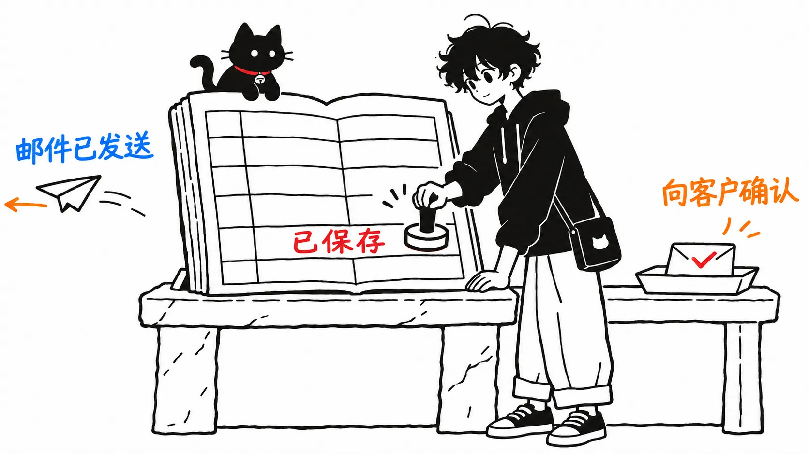
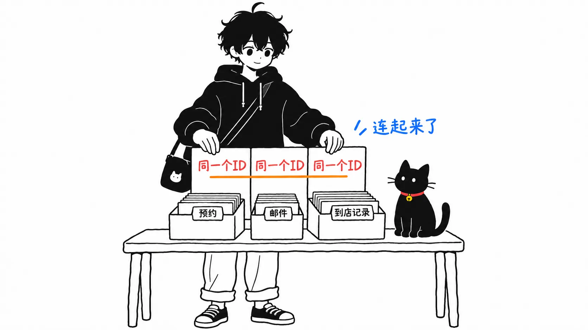
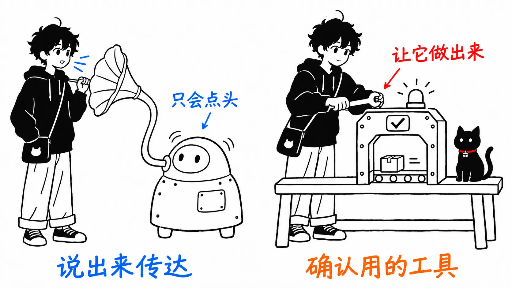

先说结论。

> 文章的骨架是：把目标和步骤分开，把步骤对 bot 说出来，再告诉它怎么确认、信息从哪里来，并在固定的触发时机运行。我觉得最有效的是两处不显眼的地方。一处是“发了邮件并不等于预约完成”这个完成的定义，另一处是“跨应用使用同一个 ID 会有帮助”的那一段。两者讲的都是让“工作有没有做完”更接近能从外部判定的形式，与 Lauren Tan 在自己的开发中投资 lint 规则是同一个方向。另一方面，“怎么确认”这一项是以“说出来告诉它”的形式给出的，文章里没有出现构建判定完成与否的机制这件事。如果由我来补，就补这里。

---

## 关于这篇文章

我读的是做 Grok Bot 的 Lauren Tan（@poteto）在 2026 年 11 月 18 日（UTC）发在 X 上的文章“Automate Anything with Grok Bot”，以及介绍它的那条推文。

> I think a lot of people aren't using Grok Bot to its full potential, because knowing how to automate things is actually quite a difficult skill to learn.
>
> （我觉得很多人没有把 Grok Bot 的能力发挥出来。因为知道怎么把事情自动化，本身就是一项相当难掌握的技能。）

读者对象是不写代码的人。不久前，我刚写过一篇文章，讲同一位 Lauren Tan 在播客里谈到的她自己的开发方式，所以把这两篇放在一起读了。

我的立场也写一下。我没有用过 Grok Bot。文章最后推荐的 Dr Eggbot（设计 bot 的 bot）我也没有装。我自动化的对象是 Claude Code，用的是规则文件和 hook。Lauren Tan 是 Grok Bot 团队的人，所以这篇文章同时也是产品的使用手册。

## 文章的脉络

按顺序排下来是这样的。

1. 自动化是一种思考方式，由目标和步骤两部分构成（烤苹果派、换爆胎的轮胎）
2. 先从目标开始。不要把步骤误当成目标。填表、发邮件不是目标，只不过是步骤中的一环
3. 步骤用语音输入，想到什么说什么地交给它。平时的步骤、需要注意的事、用到的应用、怎么确认、信息从哪里来、在哪里得到反馈
4. 把自己不假思索就做出的判断也教给它
5. 让 bot 自己收集反馈，并能够改进
6. 定好触发时机（邮件、消息、定时运行），让它自动运行。在 Grok Bot 里把这叫作 routine

在教目标、步骤、判断的几段里，附有可以原样对 bot 说的示例句。比如交出步骤之后，不是马上让它执行，而是先让它复述一遍。

> I want you to think about how you can take this over completely from me. Before you begin, restate what you think my goal and process is in simple English so I can give you feedback and confirm it.
>
> （我希望你想想怎样才能从我手里完全接过这件事。开始之前，用简单的话复述一下你理解的我的目标和步骤，我来确认并纠正。）

前半部分与把工作交接给人时的流程几乎一样。不同的是，它写了“不要太拘泥于步骤，bot 也许会找到更高效的做法”，这等于以把步骤本身的修订也交给 bot 为前提。

## “发了邮件并不等于完成”

读的时候让我停下来的，是“教它思考方式”一节里的预约例子。

> A booking also isn't finished just because an email was sent. The appointment needs to be saved correctly and the customer needs a confirmation.
>
> （预约并不是发了邮件就结束了。预约要被正确保存，还要有给客户的确认。）

接着写了：邮件和预约系统的时间对不上时相信哪一边；等待详情的期间要把这一点记录下来，以便稍后恢复时不会重复创建预约。

这里简短地包含了完成的定义、以哪一边为准，以及同一个处理运行两次也不会出错。文章用一段就带过了，但我觉得这一段是整篇文章里分量最重的。“发了邮件”是 bot 自己就能说的，而“预约已保存、已向客户确认”是可以用外部的记录来核实的。文章本身并没有写到“用外部的记录来核实”这一步。这样读是我的读法。

## ID 的那一段

另一处是“让 bot 自己改进”一节的最后一段。

> If you use multiple apps and services, having unique and consistent IDs across all these tools will help you bring that data together so bot can fully understand what's going on.
>
> （如果你用多个应用和服务，那么在所有这些工具里都有唯一且一致的 ID，就能把数据连起来，bot 也就能充分掌握发生了什么。）

它前面一段写的是，数据越多，bot 越能帮上忙。例子是汽车修理店。如果记录下客户到店的时间、跟前台说上话的时间、交出钥匙的时间、作业的开始和结束，就能计算等待时间并找出原因。在 Yelp 上有人写“等了很久”时，可以拿当天的记录去对照。

文章的说法是“数据和联系越多越有帮助”，但我认为再往前一步才重要。有了用同一个 ID 连起来的数据，前面那个“预约已保存、已向客户确认”，就可以不靠 bot 自己的汇报，而是通过比对预约系统和邮件的记录来判定。ID 是从外部确认完成的基础。

## 我的见解

在之前的文章里，我写过 Lauren Tan 在播客里谈到的她自己的开发方式。要点是：为了让 agent 合并自己的 PR，她把原来靠人工评审抓出来的问题，转移到 lint 规则和静态分析里去。

> We don't want to have to catch it in code review. We'll actually build it as like a lint rule.
>
> （我们不想靠代码评审去抓它。干脆把它做成 lint 规则。）

这篇文章读起来，像是同一个人对不写代码的人说同样的话。不同的是工具。开发中，她把“怎么确认”写成了 lint 规则这种机器能判定的形式。而在这篇文章里，“怎么确认”是步骤六项中的一项（How you check that the work was done right），要靠语音说出来传达。

说出来传达的确认方式，是 bot 记住并遵守的东西。文章也给出了让 bot 去看邮件、社交媒体、Yelp 的评价和当天的记录，并以此促成改进的路径，但那是事后才察觉的手段。预约的例子和 ID 的那一段，是让确认方式变成可以从外部判定的线索，而文章没有说到那一步。

另一件在意的事，是让 bot 自己改进的那一节。标题是“Let your bots improve themselves”，读起来像是 bot 自己改进自己。但正文的具体例子里，bot 是收集反馈并“提出改进建议”，并没有写到它自己改写步骤。文章指的是哪一条线，从文章里我无法判定。我认为应该只做到提建议为止。如果步骤和确认方式能被同一个 bot 改写，确认方式可能会随着步骤放松。要不要采纳，由人来决定。

我能想到这样的反驳：对不写代码的人说“把确认方式做成机器能判定的形式”，是传达不到的。不过文章里已经有线索了。文章自己写了，Grok Bot 可以制作用来收集数据的工具和应用。如果能让它做一个记录到店时间的应用，那么让它做一个确认“预约是否已保存”的小机制，应该也做得到。不只是把确认方式说出来，而是让它做出用来确认的工具。如果由我来补，就补这里。

## 如果只带走一件事

把工作交给 bot 的时候，先写“完成”的定义，再写步骤。而且要写成能用外部的记录核实的形式，而不是靠 bot 的汇报。文章里的预约例子，可以用作这个定义的写法。

出处：Lauren Tan（@poteto）"[Automate Anything with Grok Bot](https://x.com/i/article/2122921713864171520)"以及介绍它的[推文](https://x.com/poteto/status/2123159537016533493)（X，2026 年 11 月 18 日 UTC）。lint 规则的发言出自 Y Combinator"[The Rise Of AI Coworkers](https://www.youtube.com/watch?v=y1-9yeYLJUo)"（Lightcone，2026 年 11 月 14 日，对照 YouTube 自动生成的英文字幕确认）。Grok Bot 和 Dr Eggbot 我都没有用过。
