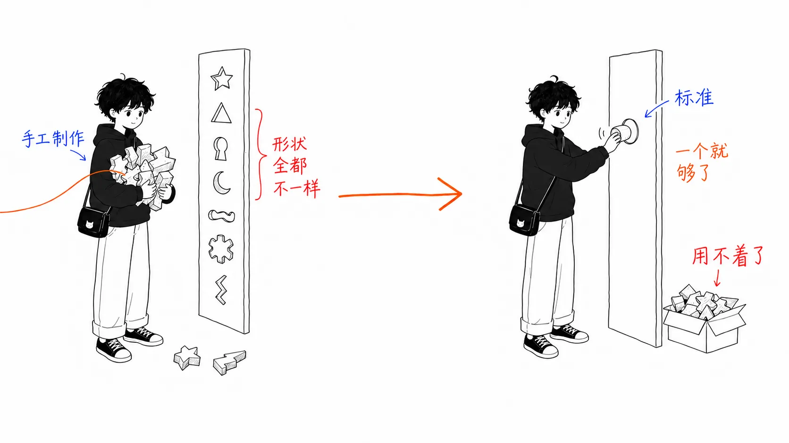
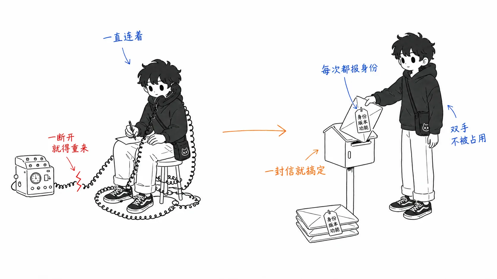
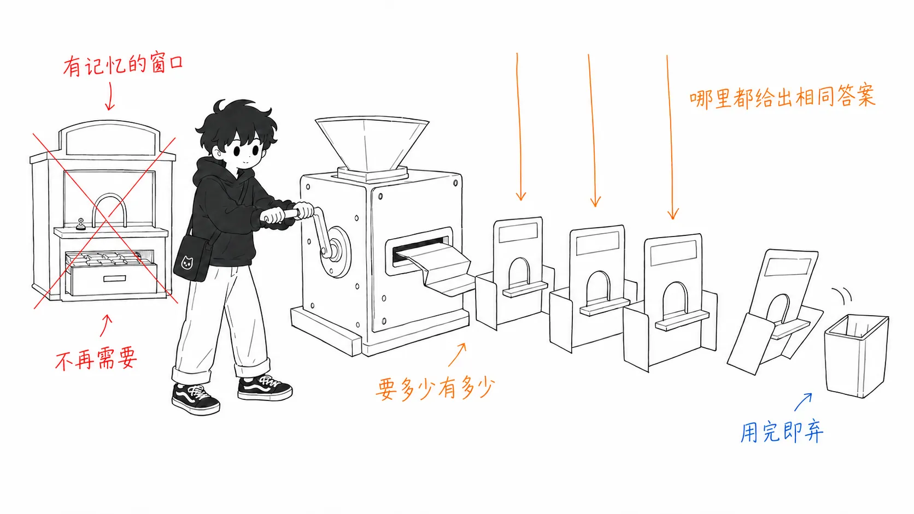
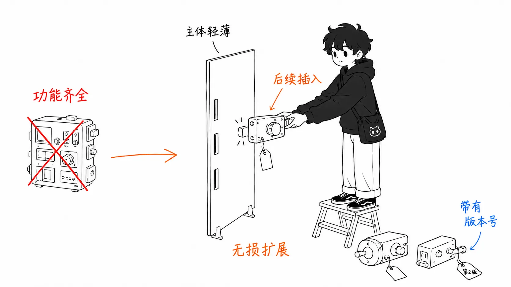
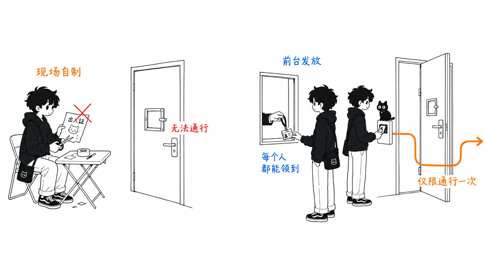
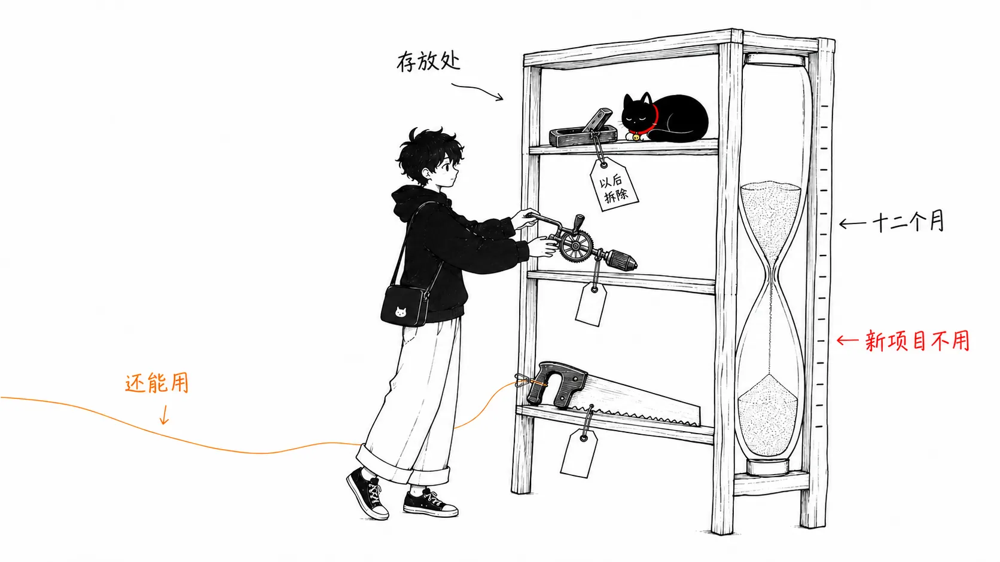

## 关于这篇文章

2026 年 7 月 28 日，Model Context Protocol（MCP）发布了第 5 次规范修订 **MCP 2026-07-28**。本文依据 Anthropic 的发布文章 [Bringing MCP 2026-07-28 to Claude](https://claude.com/blog/bringing-mcp-2026-07-28-to-claude) 和[规范本身的变更记录](https://modelcontextprotocol.io/specification/2026-07-28/changelog)，梳理以下内容：

- **MCP 当初是为了解决什么问题而诞生的**（它过去的意义）
- **这次修订从根本上改变了什么**（无状态化、扩展机制、认证）
- **不同立场的人，明天起该做什么**（未来）

专业术语我会尽量讲得通俗一些。

先说结论。

> MCP 已经从“连接 AI 与工具的标准”，变成了**“可以放在生产基础设施里一直开着的管道”**。为此，它连过去一直默认的“保持连接”这个前提本身都抛弃了。

---

## 第 1 部分：MCP 到底是什么

### 真正的难题从来不是“AI 不会用工具”

2024 年 11 月 MCP 出现之前，让 AI 使用工具这件事本身就已经能做到：定义一个函数，让模型去调用就行。问题不在这里，而在**组合的数量**。

如果有 N 个 AI 应用、M 个想接入的工具或数据源，需要的对接代码就是 **N × M 份**。给 Claude 写一份 Slack 对接，给另一个应用再写一遍同样的东西，GitHub 也照样来一遍……就是这样的世界。

MCP 做的事，是在中间放上**一个通用插口**。工具那边只需写一个“MCP 服务器”，AI 这边只需实现一个“MCP 客户端”。组合数从 **N × M 变成 N + M**。

常被说成“AI 与工具之间的 USB-C”，指的就是这种结构。

### MCP 的基本部件只有三个

规范的细节逐年增多，但从最初就有的核心概念，至今仍是这三个。

| 部件 | 作用 | 简单来说 |
| --- | --- | --- |
| **Tools** | AI 可以调用并执行的操作 | 让 AI 去做的“动词” |
| **Resources** | 可以让 AI 读取的数据 | 展示给 AI 看的“名词” |
| **Prompts** | 由服务器端准备好的固定指令 | 常用的“模板” |

其中实际使用最多的是 Tools。说到“写一个 MCP 服务器”，多数情况下指的就是加上几个 Tool。

### 规模

据 Anthropic 发布的信息，MCP 的 SDK 下载量已突破**每月 4 亿次**，今年增长了 **4 倍**。它早已不是 Anthropic 专用的机制，而是被当作连接 AI 智能体与应用的行业标准。

“它已经成了标准”这个事实，正是这次修订的背景本身。

---

## 第 2 部分：经过 5 次修订，MCP 走向了哪里

MCP 的版本号采用 `YYYY-MM-DD` 格式，**取的是引入了向后不兼容变更的那一天**。保持兼容的改进不会更新版本号。也就是说，版本每多一个，就意味着每次都有人判断过：“哪怕打破兼容，这个问题也值得修。”

| 版本 | 主要内容 | 方向 |
| --- | --- | --- |
| **2024-11-05** | 初版。Tools / Resources / Prompts，stdio 与 HTTP+SSE | 先做出能跑的东西 |
| **2025-03-26** | 引入 Streamable HTTP 传输（HTTP+SSE 被弃用），基于 OAuth 的授权框架 | 让它能跨网络使用 |
| **2025-06-18** | 向用户追问（elicitation）、工具输出结构化、把授权整理为 OAuth 资源服务器的形态 | 整理交互与数据类型 |
| **2025-11-25** | 支持 OIDC Discovery、图标等元数据、分步的权限范围同意、URL 方式的 elicitation、Client ID Metadata Documents、**以实验性方式加入 tasks** | 补齐实际运维中的细节 |
| **2026-07-28** | **无状态化**、扩展机制正式化、授权达到生产级规范、制定功能废弃规则 | 让它作为生产基础设施站得住 |

排在一起，方向就很清楚了。这是**五年时间里，从“演示能跑”走向“生产可运维”的移动**。而 2026-07-28 这一版，动的正是这段移动末尾剩下的最大障碍：**“保持连接”这个前提。**

---

## 第 3 部分：2026-07-28 的本质有三点

### (1) 无状态化：不再打电话，改为寄信

这是这次最大的变化。

此前的 MCP 是一个**先建立连接、再开口说话**的协议。

1. 客户端发送 `initialize`
2. 服务器回复“我是这个版本，具备这些功能”
3. 客户端回送 `notifications/initialized`
4. 到这时才终于可以用 `tools/list` 和 `tools/call`
5. 如果是 HTTP，则用 `Mcp-Session-Id` 请求头把这一连串交互绑定为同一个会话

也就是说，这是**打电话**。先和对方接通线路，互通姓名，再谈正事。方便是方便，但线路一断就得从头再来，而且这段时间里，服务器一直得记住“我在和谁通话”。

2026-07-28 把这些全部取消了。

- `initialize` / `notifications/initialized` 握手被**删除**
- Streamable HTTP 中的 `Mcp-Session-Id` 请求头被**删除**
- 取而代之的是，**每个请求自己携带全部信息**。每次都要在 `_meta` 字段里放入协议版本（`io.modelcontextprotocol/protocolVersion`）和客户端能力（`io.modelcontextprotocol/clientCapabilities`）。客户端每次也应该带上自己的名字（`clientInfo`），服务器也应该在每个响应的 `_meta` 里自报家门（`serverInfo`）
- 如果版本不匹配，就按单个请求返回 `UnsupportedProtocolVersionError`

变成了**信**。一个信封上从寄件人、所用版本到自己的能力全都写好了，收件方不需要记住前后的上下文。

取而代之新增的是 `server/discover`。服务器**必须实现**它，它用一个请求返回所支持的版本、功能和自身信息。客户端只在“想先确认版本”时调用即可；不调用，直接 `tools/call`，出错了再处理，也行。更贴切的说法是：**必须的握手，变成了可选的预览。**

### (2) 无状态化好在哪里

这是务实层面的正题。

不保存会话，意味着**服务器在两次请求之间什么都不用记**。这样，同一个服务器不管并排放多少台，请求落到哪一台，得到的答案都一样。一台挂了，下一个请求由另一台接手。

这直接意味着**可以跑在无服务器（serverless）和边缘环境上**。像 AWS Lambda、Cloudflare Workers 这类“被调用时才启动、结束就消失”的环境，最大的限制就是无法保存状态。MCP 无状态化之后，就不再与这个限制相冲突了。

在 Anthropic 的发布文章中，Figma 的工程副总裁是这样说的。

> 利用が増えていくなかで、我々のステートレスなアーキテクチャは一緒にスケールできる。
> （随着使用量增长，我们的无状态架构可以随之一起扩展。）

从使用者角度看，效果是 MCP 服务器的运维成本下降。因为不再需要准备并维护一台常驻服务器，个人和小团队持续公开 MCP 服务器的门槛就降低了。

当然，“想跨调用保存状态”的情形依然存在。答案是**不作为协议的功能，而是做成普通的工具参数**。服务器返回自己发放的句柄（标识符），下一次调用时让调用方把它当作普通参数传回来。协议不再操这份心，把它下放给了应用设计。

通知机制也一并整理了。

| 此前 | 今后 |
| --- | --- |
| HTTP GET 端点 + `resources/subscribe` / `unsubscribe` | 统一为一个 `subscriptions/listen`。通过长寿命的 POST 响应流，只订阅需要的种类 |
| 用 `ping` 检测存活 | 删除。已经无状态，没有需要保持的线路 |
| 用 `logging/setLevel` 设置日志级别 | 删除。在 `_meta` 的 `logLevel` 中按请求指定。禁止服务器向未指定的请求推送日志 |

格局就是：依赖“保持连接这一前提”的功能，在这里被一并整理掉了。

### (3) 扩展机制：让主体变薄，功能按需插入

另一项大变化是 **core 与扩展的分离**。

此前，新功能都是加到规范本体里。方便归方便，但本体一胖，就会变成“不全部实现就不能声称合规”，写服务器也就变重了。

2026-07-28 在 `ClientCapabilities` / `ServerCapabilities` 中加入了 `extensions` 字段，**官方扩展可以带着版本号独立分发**了。而两个有代表性的功能就移到了那里。

| 扩展 | 作用 | 状态的变化 |
| --- | --- | --- |
| **MCP Tasks**（`io.modelcontextprotocol/tasks`） | 把要花几分钟到几小时的长时间任务丢出去，之后再来取结果 | 从 2025-11-25 的“实验性地放在 core 内”，**移到官方扩展并重新设计** |
| **MCP Apps** | 服务器在对话中绘制可操作的 UI | 在扩展框架之下正式化 |

Tasks 的重新设计走的也是务实路线。不再用一直等到结果返回的 `tasks/result`，改成用 `tasks/get` **轮询**。在无状态的世界里，“一直等待”本身就是成本，所以这样说得通。此外，`tasks/update` 让客户端可以中途传入输入，`tasks/list` 被删除，服务器即使没被要求也可以返回任务句柄。

**core 要薄，功能带着版本号事后再插入。** 这是长寿协议必经的整理，MCP 已经进入了这个阶段。

### (4) 认证：不再自己做工牌，改用公司前台发的

第三点是授权的生产级规范化。目的很明确：**让它无需任何变通办法，就能接入 Entra、Okta 这样的企业既有身份基础设施。**

最具象征性的，是**弃用 Dynamic Client Registration（DCR，RFC 7591）**。DCR 是“客户端当场注册自己”的机制，在 MCP 早期很方便。但企业的授权服务器通常不允许来历不明的客户端自行注册。取而代之被推荐的是 **Client ID Metadata Documents**，也就是“把自己的信息放在一个公开的 URL 上，由授权服务器来查看”的方式。DCR 出于兼容性会保留，但已不是新实现应该选择的做法。

更细的部分，也朝着有利于生产运维的方向定了下来。

- 授权响应应当包含 `iss`（颁发者），客户端**必须验证**（RFC 9207）
- 客户端凭据**与颁发它的授权服务器绑定**。要以 issuer 为键来保存，不得挪用到别的授权服务器，授权服务器变了就需要重新注册

总之，是从“能跑就行”收紧到“在别人的环境里也能安全地跑”。

### (5) 消失的和被弃用的

这是这次最容易被忽略的部分。**有 3 项现有功能被弃用了。**

| 被弃用的功能 | 原本是什么 | 推荐的替代方案 |
| --- | --- | --- |
| **Roots** | 客户端告诉服务器“工作目录是哪个” | 通过工具参数、资源 URI、服务器配置来传递目录和文件 |
| **Sampling** | 服务器经由客户端让 LLM 做推理 | 直接调用 LLM 提供商的 API |
| **Logging** | 用 `notifications/message` 推送日志 | stdio 用 `stderr`，或者用 OpenTelemetry |

此外，HTTP+SSE 传输（自 2025-03-26 起已被弃用）被正式归类为 Deprecated，明确了向 Streamable HTTP 迁移。

还有一点不起眼但很重要：**功能废弃的规则本身被制定出来了。**

- 功能的状态有 **Active / Deprecated / Removed** 三种
- 从弃用到删除，**至少 12 个月**（即便是例外的快速删除也至少 90 天）
- 被弃用的功能连同迁移方法，会登记在**专门的注册表**中统一管理

所以不会“明天就消失”。被弃用的东西会继续运行。只是正确的理解方式是：**新做的东西里不要再用。**

“怎么收场”的规矩齐备起来，是规范从兴趣之作走向标准的标志。

### (6) 不显眼但很管用的变更

它们上不了标题，但在实际运维中很让人感激。

- **缓存提示成为必需**：`tools/list` 等的结果必须带上 `ttlMs`（多少毫秒内可视为新鲜）和 `cacheScope`（`public` / `private`）。客户端可以缓存结果，无谓的轮询随之减少
- **`tools/list` 应以确定的顺序返回**：顺序每次都变的话，客户端缓存和 LLM 的提示词缓存都命中不了。光是固定排序就能降低成本
- **OpenTelemetry 的追踪传播被写入规范**：`_meta` 中的 `traceparent` / `tracestate` / `baggage`。经由 MCP 的调用可以接入既有的分布式追踪
- **请求头的标准化**：Streamable HTTP 的 POST 必须带 `Mcp-Method` / `Mcp-Name`。中间的代理和网关不必打开内容就能做路由
- **放宽了 schema 的限制**：`inputSchema` / `outputSchema` 可以自由使用 JSON Schema 2020-12 的关键字，`$ref` 也会被解析

缓存、追踪、按请求头路由。**这些全都是为了“大量运行”而存在的功能。** 光看这一串，就能明白这一版是为谁写的。

---

## 第 4 部分：按立场来看，该做什么

### 正在开发 MCP 服务器的人

要做的有三件事。

1. **实现 `server/discover`。** 这次成了服务器端新增的义务
2. **盘点是否在用 Roots / Sampling / Logging。** 在用的话，确认迁移目标。不必着急，但不要再把新功能建立在它们之上
3. **找出依赖会话的设计。** 如果有“记住首次 `initialize` 时收到的信息”的实现，就要把那里改成每个请求的 `_meta`，或者通过工具参数接收服务器发放的句柄

迁移本身并不催得很急。版本是**按请求来协商**的，设计上客户端和服务器都可以同时支持多个版本。在 STDIO 下，可以把 `server/discover` 当作向后兼容的探针来用。SDK 会跟进，所以多数实现靠更新 SDK 就应该能解决大部分。

### 只是使用的人（Claude Desktop / Claude Code 的用户）

**现在没有什么需要做的。** 不过发布中写着“对 Claude 产品的支持正在陆续推出”，也就是还没有全面支持。

中期可以期待的是这两点。

- **能用的 MCP 服务器会变多。** 由于能跑在无服务器上，发布和维护的成本降低，对连接器的数量和寿命是正面推动
- **在对话中就能完成的操作会变多。** 借助 MCP Apps，连接器可以在对话里绘制 UI。体验的变化是：不用跳到别的标签页，就在当场操作

### 企业的 IT 管理员

这次授权方面的完善，实质上是面向管理员的变更。Anthropic 一侧提供了 **Enterprise-managed auth**，管理员可以通过身份提供商（IdP）把连接器分发给整个组织。管理员批准一次之后，用户通过已有的 IdP 组继承访问权限，首次登录时就已经是连接好的状态，终端用户这边的设置工作为零。

如果想在不公开的前提下连接内部网络中的服务器，有 **MCP tunnels**（研究预览）。它的定位是：不需要入站防火墙规则，不需要公开端点，也不需要源站 IP 白名单。

---

## 第 5 部分：接下来会怎样

从这里开始是我对规范和发布内容的解读。

### MCP 会成为“管道”，而不是“功能”

这次变更用一句话概括，就是**MCP 正在退出“被人意识到”的对象范围**。无状态，能跑在无服务器上，带缓存提示，能接入既有的分布式追踪，能直接连上企业的身份基础设施。这不是“热门新技术”的性质，而是**基础设施的性质**。

水管平时没人会去意识到它。MCP 要做的就是这样。

### core 今后不会怎么动了

有了 `extensions` 这个框架，新功能的去处就是扩展，而不是 core。这就意味着，**下一次破坏性变更（新的日期版本）短期内应该不太会来**。这次破坏得这么大，原因之一想必也是要“把破坏在这一次做完”。

反过来说，**2026-07-28 是很值得迁移的一版。**

### “怎么收场”齐备了意味着什么

有了功能生命周期政策和弃用注册表，也许比增加功能更重要。一个标准能否长寿，取决的不是怎么增加，而是**怎么减少**。把 12 个月的缓冲期和迁移目标的明示写成规则，几乎等于宣告：以 MCP 为前提搭建长期系统是可以放心的。

### 需要注意的地方

- **Claude 产品侧的支持仍在陆续推出。** 规范发布的那天，和你手边的工具能用上的那天，并不是同一天
- **弃用不等于“现在就不能用了”。** 不必慌忙改写。只是新实现里不要选它们
- **无状态化把设计作业转交给了你。** 协议不再保存状态，需要状态的用例就得自己来设计。句柄的发放、有效期、权限检查，今后都是服务器实现者的责任范围

---

## 总结

| 角度 | 此前 | 今后（2026-07-28 以后） |
| --- | --- | --- |
| 连接 | 先握手，再保持会话 | 没有握手。请求自己携带全部信息 |
| 部署位置 | 常驻服务器 | 无服务器、边缘也可以 |
| 增加功能 | 加到规范本体 | 插入带版本号的官方扩展 |
| 授权 | 也允许当场自行注册 | 正面接入企业身份基础设施 |
| 功能废弃 | 每次临时判断 | 带 12 个月缓冲期的官方规则 |
| 定位 | 用来连接的标准 | 可以一直开着的管道 |

MCP 的头五年，是在寻找“AI 与工具该怎么连接”的答案。2026-07-28 回答的，是下一个问题：**“连起来的东西，怎样才能在生产环境里撑得住？”**

想上手的话，看[规范](https://modelcontextprotocol.io/specification/2026-07-28/)和 [SDK](https://modelcontextprotocol.io/docs/sdk) 最快。如果你打算把自己写的 MCP 服务器发布到 Claude 的[连接器目录](https://claude.ai/directory/connectors)，也请一并确认[提交流程](https://claude.com/docs/connectors/building/submission)。

---

### 参考

- [Bringing MCP 2026-07-28 to Claude](https://claude.com/blog/bringing-mcp-2026-07-28-to-claude) — Anthropic，2026 年 7 月 28 日
- [MCP 2026-07-28 Key Changes](https://modelcontextprotocol.io/specification/2026-07-28/changelog) — 规范的变更记录
- [MCP Versioning](https://modelcontextprotocol.io/specification/versioning) — 版本协商的机制
- [MCP 2025-11-25 Key Changes](https://modelcontextprotocol.io/specification/2025-11-25/changelog) — 上一版的变更记录
- [Feature lifecycle](https://modelcontextprotocol.io/community/feature-lifecycle) — 功能的弃用与删除政策
