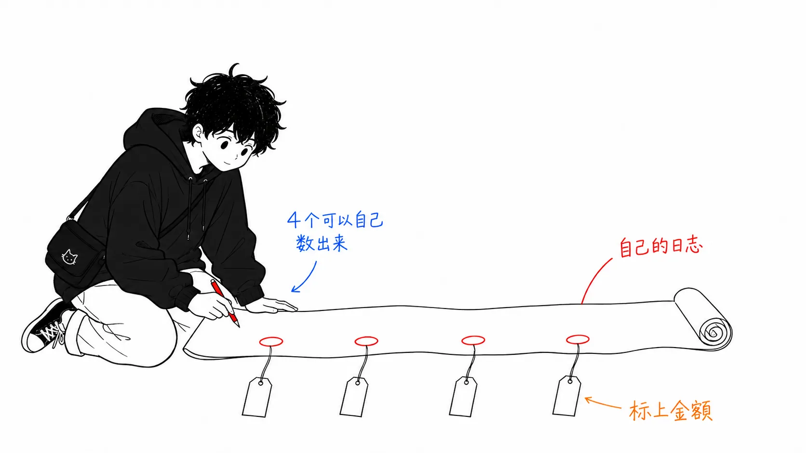

先把结论写在前面。

> 这篇文章在外面流传的版本是“Uber 有70%的 PR 来自 agent”，但它的内容并不在这儿。**它讲的不是削减总额，而是在使用量涨到7倍的同时把单价压了下去**，而其中最大的单项手段，是**把 MCP 的工具定义赶出上下文**。100个工具，每一轮都要重新发送50K～70K token 的 schema。他们用 CLI 解析和工具检索把这部分消掉，再用 code-mode 进一步削减了50%～90%。

## 关于这篇文章

- 原文：[Running a Software Factory Efficiently at Uber Scale](https://www.uber.com/us/en/blog/efficient-software-factory/)，Uber Engineering，2026年8月27日
- 在 X 上的全文转贴：[@UberEng](https://x.com/ubereng/status/2093444169037762840)（2026年8月28日，发布者 @udaykiran）
- 相关演讲：[AI Engineer 2026 上关于 Software Factory 的愿景](https://youtu.be/17-YSUHo6Lk)

先坦白交代一件事。**我没能读到原文的图表。**我是从 X 上的全文转贴读的，而正文里的主要图表（四个层级、六项成本方程、周度/月度指标一览表、uReview 的 Pareto 图、code-mode 的测量表）都在图片里，没有转成文字。演讲视频我也没看。所以图里的内容，如下文所述，要么**不引用**，要么明确标注为二手信息。

## 先把数字说完

先看开头的规模。

- **超过70%**的 PR，被**归属于**（attributed to）本地或云端的 agent
- 工程师创建的 agent skill 有**3,600多个**，**每天运行3万多次**
- 2026年2月到8月中旬，周活跃用户涨到**7倍**，每周 agent 请求数涨到**9.4倍**
- 而 AI 支出的总额，**从4月以来基本持平**
- 固定模型、只切出自家优化的那部分来看（2月→7月），**每1,000次模型请求的成本比峰值下降约34%**，**每个会话的成本比6月的峰值下降52%**

“70%”是个容易自己到处乱跑的数字，但原文用的词是 attributed。说的是**归属于 agent**，并没有说是 agent 写的，也没有说没有人参与。原文自己在后面列举了“code review、CI 自愈、E2E PR、值班分诊、bug 调试”，并写明这些**都伴有人工审查或升级处理**。

至于拿 PR 数量当生产力指标有多危险，我在另一篇文章里写过了（那个自己统计了提交数的人，自己加了一句“用提交数衡量生产力未必准确”的故事）。这里不再重复。**这篇文章的价值不在比例，而在对单价的拆解。**

## 成本方程：上面两项要增加

原文的骨架，是把 agent 会话的成本拆成六项相乘。而重要的是，**它并没有打算把所有项都减掉**。

> 前两项代表采用度和参与度，这是我们希望在整个用户群中持续增长的。（中略）中间三项提供了优化的机会：在工程师实际提出的请求之上，**agent 为自己做的工作**。我们的大部分精力都投向了这里。

这个划分就是整篇文章的设计。

- 上面两项（多少人用、用多少次）＝ **让它增长**
- 中间三项（agent 为自己额外增加的部分）＝ **削减**
- 最后一项（token 单价）＝ **靠路由来选**

所以结论也是这样。

> 我们没有依赖更低的单价，也没有降级工具，而是**消除了浪费的、零价值的 token 消耗**，由此在使用量涨到7倍的同时，让所有指标上的单价都下降，输出质量得到改善或保持。

我觉得好的是“agent 为自己做的工作”这个说法。工程师说“修一下这个 bug”时用掉的 token，和 agent 在“那个文件在哪来着”上用掉的 token，在账单上长得一模一样。因为先建好了分开计数的框架，要削减的对象才定了下来。

## 那个方程的图，已经被抄错了

这里说一件看似跑题、其实并没跑题的事。

**六项具体是什么，只存在于图（Figure 4）里。**正文只写了“可以分解为六项”。我没读到那张图，所以没法引用。

然后我看了两篇二手解读，结果是这样。

- 某篇解读：users × sessions per user × turns per session × requests per turn × tokens per request × price per token
- 另一篇解读：users × requests per user × input tokens per request × output tokens per request × price per token × turns

**它们对不上。**项数是对的，但内容不同。一个把输入/输出 token 分开了，另一个没分。一个有 sessions per user，另一个没有。

发布后的第二天或第三天，同一张图就已经传出了两个不同的方程。哪个对，只有去看原文的图才知道。我没看，所以**这篇文章不列出这六项**。

这和我之前写 TokenOps 那篇文章时的结构一样（标题在摘要里活下来，定义却丢了）。那次是一步摘要把对照组换掉了。这次是**图片里的信息在被还原成文字时分叉了**。图不好引用，写的人就按自己的理解转成文字。分叉点就在这里。

实务上的教训，我想是：**把方程、定义、schema 放进图里，它就会在摘要中被损坏。**这不是说原文不好（图确实更好读），而是引用的一方只能自己去看图。

## 正题：把 MCP 赶出上下文

这里是要带走的核心。

Uber 把 MCP 收拢到了**一个网关**后面。内部和第三方 SaaS 加起来，有**1,000多个 MCP 服务器**。这样设计，是为了在一个地方完成认证和策略执行。

问题从这里开始。

> 但标准的 MCP 会把**所有工具的 schema 加载进每一个会话**，不管工程师在该会话里是否会调用。比如装了100多个工具时，这种预加载会给初始 prompt 增加**大约50K～70K token 的 schema 开销**，而且**每一轮上下文都会重新发送**。

100个工具就是50～70K。而且每一轮都要。SaaS 一侧更糟，原文的例子里，**一套办公协作类的工具是49个工具、约22K token**，消息类是34个工具，项目管理类是46个工具。原文的措辞很到位。

> 加载两三个厂商的服务器，**在用户输入 prompt 之前，agent 背着的 schema 开销就已经比它要编辑的文件还多**。

应对分三步。

**1. CLI 工具解析。**不再直接连接 MCP，而是让模型去执行 shell 命令。CLI 在调用时针对网关动态解析工具。结果就是，**Uber 的 MCP schema 从会话上下文里消失了**。内部网关上1,000多个 MCP 工具，全部被映射成了 CLI 命令。

**2. 工具检索。**模型搜索工具目录，只按需加载需要的那些。原文还提到，工具数量增加时，选择准确率不会下降。

**3. code-mode。**这是我觉得最有意思的一个。既然可以把工具当作 shell 命令直接调用，模型就能**把多个动作打包进一个脚本**。协议越啰嗦，效果越好。

> 比如执行一条 SQL 查询，需要发送请求、轮询2～5次状态、获取输出。code-mode 把这整个流程变成一个自动化的 Python 循环，**把中间的轮询放在模型的活动上下文之外**。

然后是测量结果。

> 前三行展示了主要发现：**即使是远低于响应大小上限的最小结果集，code-mode 也能把 token 使用量削减50%以上。**这些效率提升并非来自避开大的数据载荷，而是来自**消除不必要的开销**，比如 schema 初始化、多轮轮询、冗余的逐步推理。
>
> 批量工作流会让效果叠加。原本是 N 个模型轮次的循环变成一个脚本，所以节省会叠加到**90%以上**。

（每条查询各自的削减率在原文的表里（图片）。我没能读到，所以不引用数值。）

最后一招，是**把默认设成更便宜的那一边**。他们为常用的 MCP 服务器**预先准备了25个以上的 code-mode skill**，让标准工作流自动走最便宜的路径。

### 我认为这讲的不是 MCP 怎么用，而是设计

从这里开始是我自己的解读。

MCP 的核心设计决策是“把工具定义放进上下文”。模型只能调用摆在它眼前的东西，所以这是理所当然的设计。**而且在工具只有10个的时候，这是对的。**

问题在于，这个设计的成本是按**工具数 × 轮数**来起作用的。10个工具、5轮的话是误差，但100个工具、50轮的话，**在你敲下第一个字符的 prompt 之前就已经确定的支出**，就可能占到总量的大半。Uber 的数字（50～70K × 每一轮）正是这个。

Uber 的答案并不是“不用 MCP 了”。网关还在。他们放弃的是**把 MCP 放在上下文里**。作为协议的 MCP（统一的认证、策略、发现）保留下来，**只把执行路径挪到了 shell**。

对此当然有反驳：“工具检索在 MCP 这边也有，schema 的延迟加载是已经解决的问题。”我觉得这个反驳对了一半。说一半，是因为**延迟加载出不了 code-mode 的效果**。code-mode 削掉的不是“schema 的大小”，而是“**轮数**”。把5次轮询折叠进一个脚本，消失的是这5次的全部往返（以及每次都要重新发送的整个上下文）。不管怎么在工具定义的加载方式上下功夫，这部分都不会减少。

所以这篇文章的含义，按我的理解是这样。**在 agent 和工具之间，运行脚本比函数调用在结构上更便宜。**MCP 定义的是前者，要落到后者，需要外部的机制。

## 今天就能照搬的四个默认值

这篇文章大多是 Uber 规模的故事，但有四样东西，可以直接当作配置值带走。

**1. 自动压缩设在400K。即使是1M 上下文的模型也一样。**原文给的理由是“在模型性能与缓存突增以及输入 token 的重复成本之间取得平衡”。这是1M 的40%。

我在这里停住了。这个数字，和我在另一篇文章里写过的 Maurice Heumann 的审计（原先用到1M 窗口的93～100%才压缩，后来降到60%）指向同一个方向。**一个来自数万小时的机群运行，一个来自个人四周的实验，却各自独立地得出了“比默认值早得多地压缩”。**我觉得这属于可以相信的那一类。不过一个是40%，一个是60%，所以确切的值取决于你自己的工作负载。

**2. reasoning effort 默认设为 Medium。**理由很明确：包含推理 token 在内的输出 token，在主流模型上按输入 token 数倍的费率计费。这是个**直接削减最贵那一类**的设置。

**3. prompt 缓存的 TTL 设为1小时（仅限交互式）。**缓存读取是普通输入费率的0.1倍。不过写入的溢价不同：5分钟的条目是1.25倍，1小时的条目是2倍。Anthropic 提供5分钟和1小时，OpenAI 是30分钟。

> 工程师经常让交互式会话空闲超过5分钟，所以我们从默认的5分钟 TTL 换成了1小时窗口。这种频繁出现的空闲间隙，以前会让前缀缓存失效，迫使整个上下文全额重建。

**子 agent 仍然保持5分钟**，这个细节很好。它们的运行很短命，没有理由去付2倍的写入溢价。

**4. 子 agent 的默认模型用弱一点的。**原文把这一条称为“已被证明是影响最大的杠杆，而且其重要性还在持续上升”。理由是“子 agent 执行的是输入已指定的明确任务，往往不需要前沿水平的推理”。主模型负责任务分解和评估，子 agent 负责执行。

## 不设硬性上限的选择

还有一个作为对照很有意思的部分。

Uber **没有用支出上限去拦住 agent**。原文的说法是“为了避免强加严格的上限（To avoid imposing strict caps）”，取而代之的是下面这些。

- 状态栏里的实时成本计数器（在终端里常驻显示）
- 跨 harness 共享的支出档位（不按工具各自设预算）
- **在预期支出的50/80/100%时发 Slack 通知**（给出做计划的时间）
- 提高档位需要经理批准，生效要快
- 一个展示成本明细的 dashboard skill

这和我之前写过的 Microsoft 的 TokenOps（按 run 为单位，超出预算就 HALT 的机制）是相反的选择。TokenOps 的目的是“拦住失控”，Uber 的目的是“让工程师自己判断 ROI”。用原文的话说，是“**让工程师能够独立评估任务的 ROI，同时缓解失控的支出**”。

这不是谁对谁错的问题，我认为是**要拦的对象不同**。TokenOps 想保护的是自动化的 run，那里没有做判断的人。Uber 在这里处理的是交互式会话，屏幕前有人。有人的话，给他看比拦住他好。实际上，Uber 对托管 agent（managed agents）设了**另一套档位**。

**有人的路径给可见性，没人的路径给切断。**把这两个并排放着，这就是我的整理。

## 会话分析 dashboard 的16个项目

最后，是我最想照搬的部分。状态栏只显示总额，所以在它之外补上的是“会话分析 dashboard”。它内置在运行时里，不需要设置，也不需要选择加入。执行 `cost dashboard` skill，就会跨本地和远程沙箱，分析该用户全部的会话 trace。

而且它不是给出汇总值，而是**检测16种反模式，并给每一种附上金额影响和具体的处理办法**。列出的例子有：

- **模型路由错误**：本来用 Sonnet 就够的简单多轮会话，却用 Opus 在跑
- **上下文窗口膨胀**：大的 MCP 载荷（比如40KB 的响应）一直留在上下文里，之后每一轮都被重复计费
- **缓存失效的低效**：长时间中断后恢复会话，过期的 prompt 缓存迫使整个前缀全额重建
- **prompt 初始化开销**：在用户输入之前，就预加载了10万 token 的系统指令和工具定义

这四项，全都是**能在自己的日志里数出来的**。16项的完整清单没有公开，但光这四项就能当检查清单用。准确地说，最后一项我自己很可能就中招了。

## 只带走一件事的话

**数一数在你敲 prompt 之前就已经确定的支出。**

Uber 最大的发现，我认为是可削减的空间不在 prompt 之中，而在 **prompt 之前**。工具定义50～70K，系统指令10万 token，再加上每一轮的重新发送。这部分，靠“写好 prompt”一个 token 也减不掉。

在自己的环境里数很简单。什么都不做，打开一个会话，看第一轮的输入 token。那就是接下来要被乘上几十轮的常数。

## 出处

- [Running a Software Factory Efficiently at Uber Scale](https://www.uber.com/us/en/blog/efficient-software-factory/)，Uber Engineering，2026年8月27日
- [@UberEng 的全文转贴](https://x.com/ubereng/status/2093444169037762840)（2026年8月28日）。我读的是这里的正文
- [AI Engineer 2026 上的演讲](https://youtu.be/17-YSUHo6Lk)（未观看）

引用全部来自原文正文。**原文的图表（四个层级、六项成本方程、指标一览、uReview 的 Pareto 图、code-mode 的测量表）我没能读到，所以不引用其中的数值。**“那个方程的图，已经被抄错了”一节里提到的两篇解读，我有意没有给出出处（我无法判定哪个对，只把其中一篇点名为错的一方并不公平）。“我认为这讲的不是 MCP 怎么用，而是设计”一节之后的分析，是我自己的解读，不是原文的主张。
