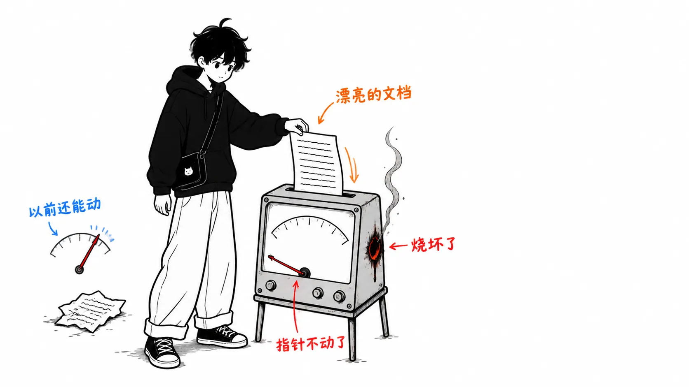
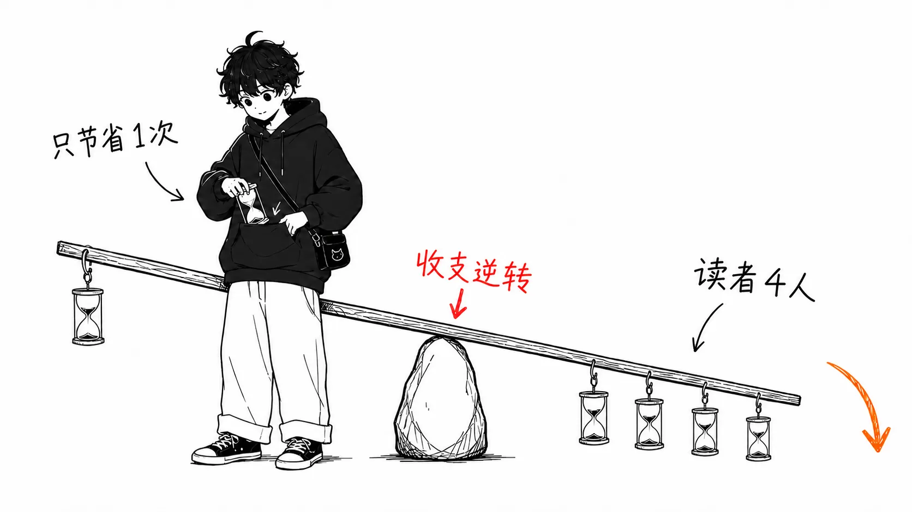
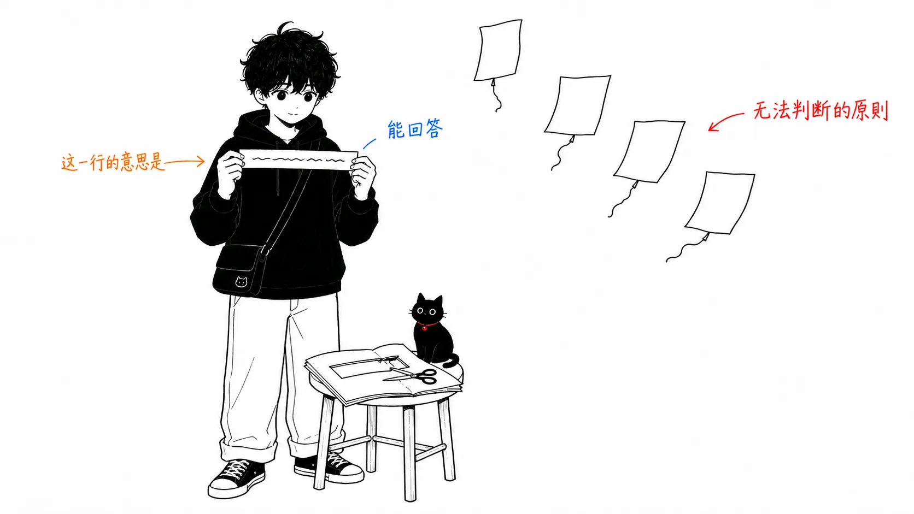
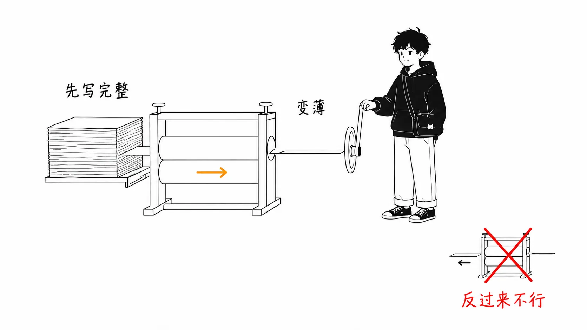

先说结论。

> 技术方案和事故复盘，起作用的不是作为交付物，而是作为**思考过的证据**。AI 可以不经思考，只生成证据。所以这类文档先失去的，不是写作者偷懒带来的质量，而是它作为测量仪器的功能。

出处是 Sophie Alpert（前 React 核心团队成员，现就职于 Clay）在 2026 年 6 月 25 日公开的内部政策 "There are no lossless transformations of natural-language text"。Simon Willison 在 2026 年 8 月 11 日的链接博客里提到了它，我就是从那里知道的。

- 原文：https://sophiebits.com/2026/06/25/there-are-no-lossless-transformations-of-natural-language-text （Sophie Alpert，2026-06-25）
- 介绍：https://simonwillison.net/2026/Aug/11/there-are-no-lossless-transformations-of-natural-language-text/ （Simon Willison，2026-08-11）

原文真的很短。它自己也遵守了自己的政策。

## 原文说了什么

作为标题的那句话是这样的。

> There are no lossless transformations of natural-language text — every rewrite and rephrase changes the meaning of your writing, and if this is done by an entity that doesn't have the most detailed mental representation of what you personally were trying to communicate, information will be lost.
>
> （自然语言文本不存在无损变换。每一次改写、每一次换种说法，都一定会改变意义。如果做这件事的主体并不具备对你想表达之事的最详细的心理表征，信息就会丢失。）

这里起作用的是后半句，不是前半句。它并没有说"AI 的文笔不够好"。它说的是那个条件从句：你脑子里的表征，只有你自己掌握得最细。所以即使文笔提高了，损失也不会归零。只有当 theory of mind 提高时才会减少，原文也是这么写的。

政策本身是四条原则。用 AI 来头脑风暴、起草、校对是允许的，在此基础上列出了必须遵守的事项。

第一条，**对每一句话由自己负责**。评审的人问"这一行是什么意思？"，不能回答"啊，那里是 AI 写的，请无视"。读者如果察觉到不对劲并指出来，还好；如果没察觉，读者就会带着对你真实想法的误解离开。

第二条才是正题。

> In many cases, written artifacts like tech specs, project status updates, and incident retrospectives serve as a "proof of thought". The artifact itself is not the only goal; instead, detailed thinking about the problem is the goal.
>
> （技术方案、进度更新、事故复盘这类书面成果，在很多情况下起着"思考的证据"的作用。成果本身并不是唯一的目标，对问题进行详细的思考才是目标。）

第三条，**写作花的时间要多于读者消耗的时间**。用很短的提示词生成很长的输出，再让读者去读，这是对读者的时间没有敬意。想读的话，读者自己去问 ChatGPT 就行。

第四条，**长不等于好**。文中引用了帕斯卡的话："我没有时间把它写短，所以这封信比平时长。"如果你是用很短的提示词生成长文章，不如直接分享提示词本身。

## 我的看法

从这里开始就长了。原则的介绍读原文就够了。

### "思考的证据"是测量仪器，而 AI 把它烧毁了

我认为这个构图，和我之前在另一篇文章（《评审没有堵塞，是仪表坏了》）里写的是同一种形态。那一篇讲的是，代码的"脏"本来是提示实现者理解程度的警示灯，但 AI 可以在不理解的情况下产出不脏的代码，于是警示灯烧坏了。

文档上发生的，是同一种故障在另一个领域的重演。

能用 3000 字写出事故复盘的人，是理解那起事故的。这与其说是相关，不如说更接近因果，因为写不出来的话结构会崩。把时间线排出来，矛盾就会冒出来。想写"为什么没有检测到这个"，就会发现自己并不知道检测机制。写作这个动作本身就是检查。所以，用文档的完成度来认定理解程度这种做法，在没有明说的情况下就已经成立了。

LLM 会在没有理解的情况下，写出没有矛盾的时间线。准确地说，是把写作者所没有的理解补全后写出来。完成的文档达到了以前可以充分证明"这个人理解了"的水准。条件满足了，它所指向的对象却不在了。

这比"AI 写的文章很单薄"更麻烦的地方在于，**单薄是可以检测到的性质，而证据的空心化无法检测**。单薄的文章一读就单薄。没有理解支撑的完美复盘，读起来也是完美的。差别要到三个月后才显现，同样的故障以另一种形式再次发生，那时已经说不清是谁的责任了。

### 来算算乘法的成本

把原文的第三条原则换成数字看看。这里是原文停在"尊重读者的时间"的地方，我觉得不该就此停住。

写技术方案的有 1 个人，读的有 N 个人。设作者靠 AI 写作节省的时间为 `a`，每位读者因"意图含糊而额外花在解读上的时间"为 `r`，那么整个团队的收支就是 `a - N × r`。

`a` 现实中有多少？一份 1500 字的方案自己写，我要花 2 到 3 小时。让 AI 起草、我自己全部改一遍，大概 1.5 小时。节省一个多小时。这里如果不做"全部改一遍"，就违反了原文的第一条原则，所以节省的上限也就到这个程度。

`r` 呢？卡在含糊的一句话上，揣测写作者的意图，在 Slack 上确认，等回复。一处花 10 分钟算轻的。1500 字的方案里如果有两处这样的地方，就是 20 分钟。

也就是说，`N = 4` 时收支就翻转了。方案有四个人读的话，AI 起草节省的时间就没了。在十个人读的团队里，是为了省 2 小时而烧掉了 2 小时 20 分钟。

当然，`a` 和 `r` 是我的体感，没有测过。所以请不要相信数字本身。希望你相信的是**正负号的结构**。节省在作者一侧发生 1 次，成本在读者一侧发生 N 次。这种不对称，换了假设也不会消失，所以读者越多的文档，越不适合让 AI 来写。反过来，读者只有自己一个人的工作笔记，想让 AI 写多少都行。我实际上就是这么做的。

### 作为政策，这条行不通

这里是对原文的反驳。

"对每一句话负责"，无法验证。没有办法从外部判断是否遵守了的规则，和我写 Claude Code 权限设置时碰到的是同一个问题（《审批按钮并不是管控》）。把意图写成文字，不是管控，只是声明。

那什么管用？其实原文里混着一个像是答案的东西。

> If a reviewer asks, "What did you mean by this line?"

它是作为条件从句写的，但**可以把它变成一种运作方式**。在方案评审中，评审人必定挑出一处，口头问："这一行是什么意思？"规则就只留这一条。写作者要么答得上来，要么答不上来，这里没有"大致遵守了"这种中间状态。

一条可以判定的规则，比四条无法判定的原则更强。如果我要把这项政策带到自己的团队，会把四条原则放在那里作为理由的说明，实际运作的则只是这一个问题。

### 对非英语母语者来说，这笔账算不通

而这里，是原文没有设想到的领域。我最想写的就是这一节，也是我选这篇文章的原因。

原文的逻辑是"最细致地掌握你的意图的是你自己，所以你来写"。这个逻辑，只有在写作者用母语写作时才闭合得起来。

用日语思考、写英文方案的时候，我脑子里的表征，和我能用英语输出的文字之间，本来就已经有很大的损失。想用英语写"这个设计感觉运维上会崩"，结果写成了 "this design might have some operational issues"，丢掉的不是文采，而是主张的强度。含糊了的英语，会被读者读成"担忧很轻微"。原文正好警告过的"读者会带着对你真实想法的误解离开"，不用 AI 也会发生。

所以对非英语母语者来说，比较的对象不是"自己写的无损文章 vs. AI 动过的有损文章"，而是**有损 vs. 另一种有损**。在这个比较里，哪边的损失更大并不是不言自明的。

我的判断是这样的。**用日语思考的内容，先用日语完整地写完，再让 AI 翻译。** 反过来不做。先让它用英语起草再用日语改的话，丢掉的强度就再也回不来了。译文和原来的日语放在一起。如果评审的人读得懂日语，那样往往更快。

只要遵守这个顺序，原文的第一条原则（对每一句话负责）就守得住。我可以对自己的日语版完全负责，对英文版的任何一句，也能立刻回答"原来我是这么写的"。theory of mind 的缺失，只要转换的源头足够详细，就会变小。原文所说的 `entity that doesn't have the most detailed mental representation` 的问题，把心理表征本身交出去就能缓解。原文没有考虑这一招，因为在英语圈的职场里用不着。

反过来，只用日语写三行，然后让它生成 1500 字的英文，是最糟的。这完全违反了原文的第四条（不要增加长度），而且被增加出来的部分，我什么都答不上来。

### 关于这篇文章

坦白说，这篇文章也是用日语定好结构写出来，再让 AI 检查文风的。所以按原文的标准，它处在边界线上。

对任何一句话，"是什么意思"我都答得上来。上面 N=4 的计算，还有非英语母语者的顺序问题，都是我自己想的。只是，有几处措辞并不是我最初写的。如果严格按原文的标准来读，这些地方我就是接受了损失。接受的理由是，这篇文章的读者并不是来读我的文风的。

在读者就是来读你的文风的媒介上，这种容许是不行的。原文针对的就是那样的文档，也就是署名有意义的文档。

## 只带走一件事的话

要不要让 AI 来写文档，不是质量的问题，而是**这份文档是对谁出示的证据**的问题。

读者只有自己的笔记，没有起到证据的作用，所以可以全部让它生成。技术方案和事故复盘，是向读者出示"我理解了这个"的证据，所以让它生成的话，就不再是证据了。分界线就在这里，和文章写得好不好无关。

判断拿不准的时候，想一想评审人的那一个问题就行。这一行是什么意思？
