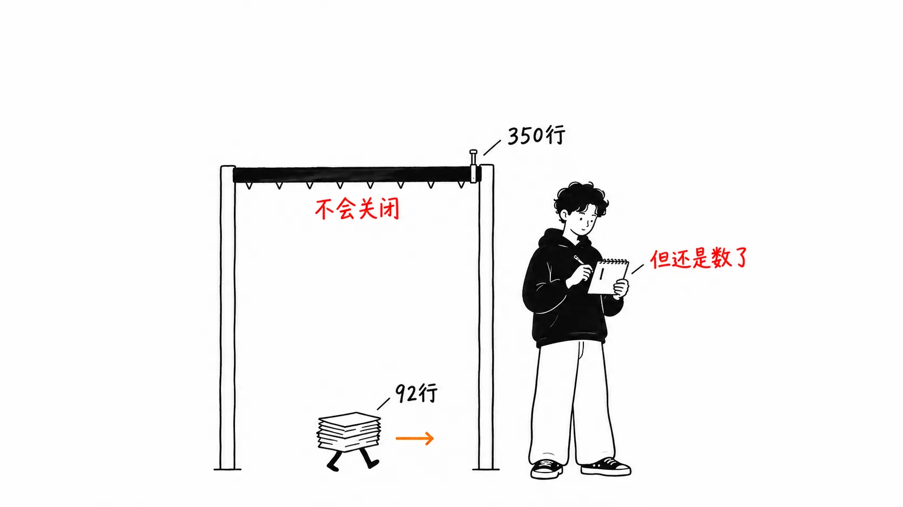
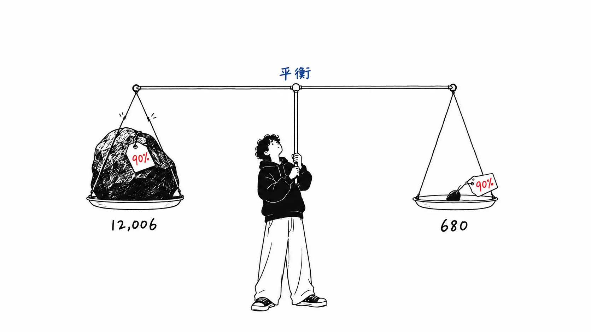
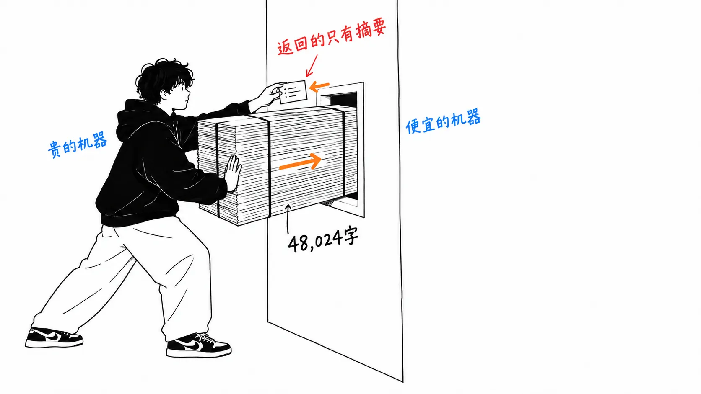

先说结论。

> 基准测试已经提交在仓库里。打开一看，四个场景中有一个，是读取两个文件、合计 **92 行** 的测试。而这个插件要到 **350 行** 才会关上闸门。也就是说，**从自己的阈值下面通过**的情形，被算进了那个 90% 的平均值里。机制本身做得很好。弱的是数字的报告方式。

## 关于这篇文章

原文是 Spotify Engineering 的 [Portal by Spotify cut my Claude Code token usage by 90%](https://engineering.atspotify.com/2026/9/portal-by-spotify-cut-my-claude-code-token-usage-by-90)（2026 年 9 月 3 日）。在 [Hacker News 上拿到 277 分、176 条评论](https://news.ycombinator.com/item?id=49571465)。

先把三处传播中走样的地方纠正一下。

**写的人不是工程师。** 作者是 Dimitri Mazmanov，头衔是 Principal Product Manager。我读过的两篇英文解读都写成了"a Spotify engineer"，但文章的署名并不是这样。原标题也是第一人称："cut **my** Claude Code token usage"。这不是公司的架构发布，而是登在工程博客上的、**一位 PM 修正自己用法的记录**。

**它也不是"Spotify 的智能体架构"。** 这讲的是搭在名为 Portal 的内部平台之上的一个 Claude Code 插件（`shunt`）。它和 Honk、Fleet Management 属于不同的文章系列。

**坦率的声明。** 我没有 Portal，所以没有运行过这个插件。以下全部是读了原文，以及公开仓库 [spotify/portal-ai-plugins](https://github.com/spotify/portal-ai-plugins) 中**已提交的文件**之后得出的内容。我没有重新运行基准测试。

## 它做什么，先看三层

结构很直白。

| 层 | 内容 | 性质 |
| --- | --- | --- |
| Hooks | 用 `PreToolUse` 监视 `Read`。默认超过 350 行就**拦截** | 强制 |
| Scripts | `bulk-read` / `code-write`。通过 Portal CLI 调用便宜的模型 | 管道 |
| Skills | 教 Claude 什么时候、怎么调用 | 建议 |

便宜模型一侧是 Gemini 2.5 Flash，temperature 0.2，分 `bulk-reader`（读）和 `code-writer`（写）两个角色。大文件由 worker 来读，返回给 Claude 的**只有摘要**。借用原文的说法，正文交给了 worker，**一次也没有进入 Claude 的上下文**。

作者自己也列出了不管用的三个地方。编辑不能委托（摘要里没有行号）、推理不能委托（worker 漏掉了一个线程安全的 bug）、延迟每次 10 到 30 秒，而 Portal 一侧的上限是 30 秒。这一点很坦诚。

## 从自己阈值下面通过的场景，被算进了平均值

原文里没有基准测试的表格。只有这一句话。

> Tested against a Java monorepo across four scenarios ... Mean bulk-read savings were around a whopping 90%.

没有表格的话，看仓库就行。`plugins/shunt/evals/benchmarks.json` 里原样放着四个场景的定义。

| # | 名称 | 类型 | 读取的文件 | 行数 |
| --- | --- | --- | --- | --- |
| 1 | single-large-file | bulk-read | websocket-handler.ts | 603 |
| 2 | multi-file-cross-read | bulk-read | 上述文件＋另外 2 个 | 695 |
| 3 | source-plus-test | bulk-read | user-service.ts + order-service.test.ts | **92** |
| 4 | code-generation | code-write | — | — |

首先，四个场景里 **bulk-read 有三个**。第四个是 code-write，原文自己也写了"很难用 token 来衡量"。所以这不是"四个场景平均 90%"，而是**三个场景的平均**。

问题出在第 3 个。36 行加 56 行，共 92 行。这个插件默认从 350 行才开始拦截 `Read`。**读一个 92 行的文件，hook 什么都不会发生。**

作者自己写明了原因。

> The line threshold exists for this reason, below it the overhead of delegation exceeds the savings.

阈值以下，委托的开销超过节省。按作者自己的规则，场景 3 是**根本不该委托的情形**。它却被算进了"委托能赚多少"的平均值里。

为保险起见，我也看了测试一侧。`hook-evals.json` 的 17 个用例里，第 1 个的名字是 `small-file`。**插件自己在测试里保证了小文件会放行。** 那个本该放行的大小，在基准测试里却被算作节省的实绩。

## 把相差 18 倍的两个东西按百分比取平均

来看看场景 1 和场景 3 的大小。仓库里的 `token_estimate` 是 `chars / 4`，所以按这个定义来对齐。

| | 字符数 | 估算 token |
| --- | --- | --- |
| 场景 1（603 行） | 48,024 | 约 12,006 |
| 场景 3（92 行） | 2,720 | 约 680 |

相差**约 18 倍**。就算两个都干净利落地削掉 90%，场景 1 省下约 11,000 个 token，场景 3 省下约 600 个。按百分比取平均，这两者就以**同样的权重**并排站着。

我认为 90% 这个数字，对于 603 行的文件是真的。那里是最见效的地方。取平均这个操作，把最见效之处的故事稀释成了"哪里都是 90%"。让我停下来的只有这一点，我并不怀疑削减本身。

## 写的是 Java，但仓库里一个 .java 都没有

原文写的是"Tested against a **Java** monorepo"。可是提交的测试数据只有 `websocket-handler.ts`、`user-service.ts`、`order-service.test.ts` 三个，全是 TypeScript。搜遍整个仓库，**一个 `.java` 也没有**。

我觉得这一点应该宽容地去读。Spotify 不可能把公司内部的 monorepo 公开，所以很自然地可以认为，这是**为公开而重新做的复现集**。并没有恶意。

不过，这样读的话结论是：**能在仓库里复现的基准测试，并不是标题数字的出处。** 而且在能复现的那一份里，就有一个情形低于它自己的阈值。

另外，复现的路径是好好准备了的。`evals/run.sh --benchmark` 可以跑 benchmarks.json（需要 portal-cli 的认证）。README 说的 51 个测试是 hook 17 个＋bash hook 17 个＋transport 17 个，基准测试在它们之外，用的是另一个标志。把测试和基准测试分开，反倒是正经的设计。

## v1 也是 router。变的是执行力

我认为这是文章里最有意思的部分。据原文，**最初的版本是写在 CLAUDE.md 里的路由规则**。

> It sort of worked: Claude would read the instructions and self-route to Portal. But it had problems. The rules were advisory, not enforced. Claude could ignore them.

"还算管用"。也就是说，v1 的时候 router 就已经存在了。v2 变的不是**路由有多聪明，而是能不能被无视**。请求变成了门闩。

这指向的，和我四天前读的 Anthropic 官方的那篇是同一个地方（[我的文章](https://meikocho1.github.io/blog/claude-official-cost-down)）。那边测出来的是"指令会贬值，长会话里效果会下降"。这边则是针对同一个问题、实现一侧的回答：**不再下指令，改用 hook**。同一周里，一边在测量，一边在修复。

## "这不就是 subagent 吗"的答案，就在 7 月的 issue 里

这是 HN 评论里最多的反应。

> This does seem to just be a subagents implementation.

> Pretty sure claude code already delegates reading a large codebase to haiku subagents.

我一开始也是这么想的。不过同一个帖子里，有可以核实的反证。`anthropics/claude-code` 的 [issue #72940](https://github.com/anthropics/claude-code/issues/72940)（2026 年 7 月 1 日，已关闭）的标题是这样的。

> [DOCS] Sub-agents page still says the built-in Explore agent uses Haiku; v2.1.198 has it inherit the main model

**内置的 Explore 子智能体已经不是 Haiku 了。** 从 v2.1.198 起，它继承父模型。报告的内容是，只有文档还停留在 Haiku。

也就是说，"Claude Code 已经在往便宜的模型委托了"这句话，**在 7 月就已经不成立了**。用 Opus 跑的话，Explore 也是用 Opus 跑。只是读个东西，却付着前沿模型的价钱。shunt 填的就是这个坑。

而且正如 HN 的另一条评论所写，这个坑只要把 Explore 智能体固定到便宜的模型上也能填上。在装一个插件之前，应该先看看这里的人想必不少。

## 我的看法

我认为这篇文章的价值不在于 90%，而在于**把"读"和"决定"放进了不同的预算**。

此前关于上下文削减的话题，大多是"减少放进去的量"。Uber 把 1,000 个 MCP 工具赶出上下文的事如此，`/compact` 也是如此。这次不同，**量并没有减少**。那 48,024 个字符，在某个地方被读了。变的只是读的地方。从贵的桌子上，挪到了便宜的桌子上。

所以我认为效果不该用"削减了多少"来衡量，而应该看**在贵的桌子上留下了什么**。原文早早就划出"编辑不能委托、推理不能委托"这条线，大概是因为作者想到了同样的事。那三条限制不是失败的故事，而是**对留在贵桌子上的东西的定义**。

还有一点。我想起了 momo5502 的审计（[我的文章](https://meikocho1.github.io/blog/subagent-isolation-costs-duplication)）。那是一份对 2GB 日志的分析，说的是因为子智能体是隔离的，它们一遍遍重读同一个文件，结果反而亏了 token。这篇原文里的"编辑不能委托。需要编辑的话，要自己重新读相关部分"，**正是那种重复读取的账单**。作者承认了这一点，并在 hook 里开了个口子，放行有针对性的读取。面对同一个问题，一个是"切掉"，一个是"开个口子"。

## 只带走一件事的话

**看到以百分比报告的节省时，请问一下分母的绝对量。** 如果 90% 是三个案例的平均，而其中一个只是 680 个 token 的事，那这一个和零没有区别。而这次之所以能看出来，是因为作者把 benchmarks.json 放在了仓库里。能够对数字产生怀疑，本身就是这篇文章诚实的证据。

## 出处

- Dimitri Mazmanov（Principal Product Manager），[Portal by Spotify cut my Claude Code token usage by 90%](https://engineering.atspotify.com/2026/9/portal-by-spotify-cut-my-claude-code-token-usage-by-90)，Spotify Engineering，2026 年 9 月 3 日
- [spotify/portal-ai-plugins](https://github.com/spotify/portal-ai-plugins)：`plugins/shunt/` 的 README、`evals/benchmarks.json`、`evals/hook-evals.json`、`evals/run.sh`、`evals/fixtures/`
- [Hacker News 的帖子](https://news.ycombinator.com/item?id=49571465)（277 分 / 176 条评论，2026 年 9 月 4 日）
- [anthropics/claude-code issue #72940](https://github.com/anthropics/claude-code/issues/72940)（2026 年 7 月 1 日）

行数和字符数，是在 2026 年 9 月 10 日获取上述仓库 `main` 分支的文件后数出来的。token 估算沿用了仓库自己的定义（`chars / 4`），不是实测的 token 数。原文提到的"每位开发者每月 200 到 500 美元"和"到 2028 年 AI 编程费用将超过平均年薪"没有给出处，所以本文没有使用。
