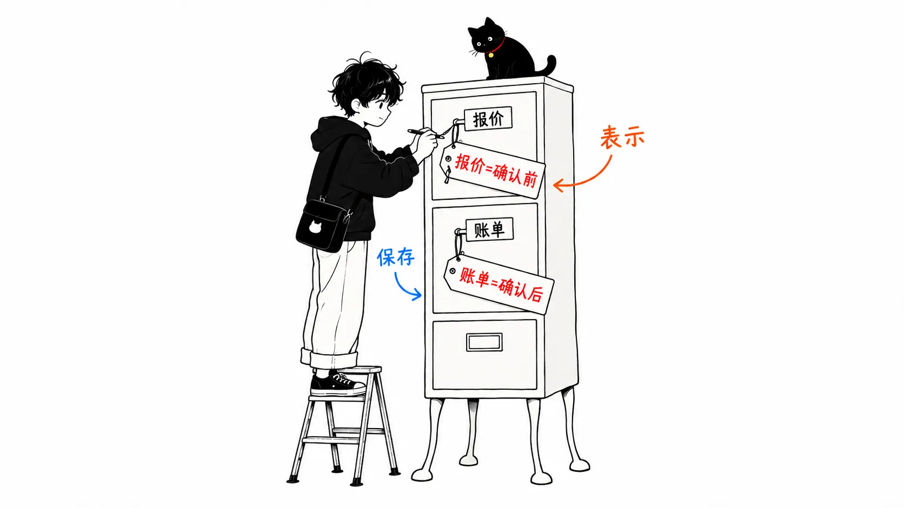
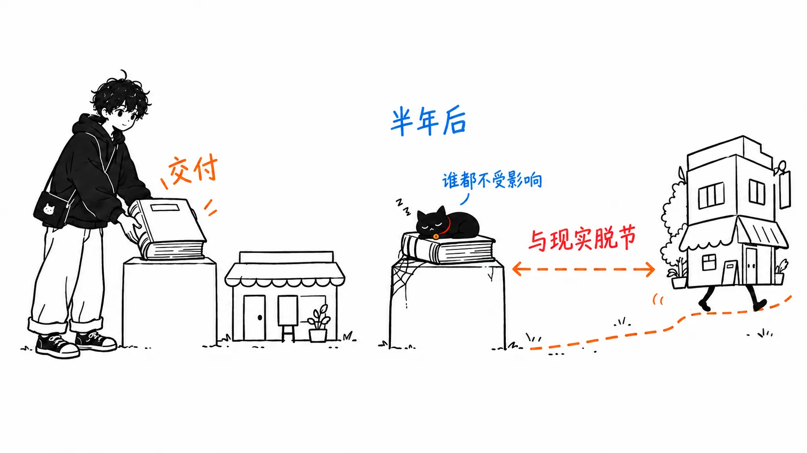
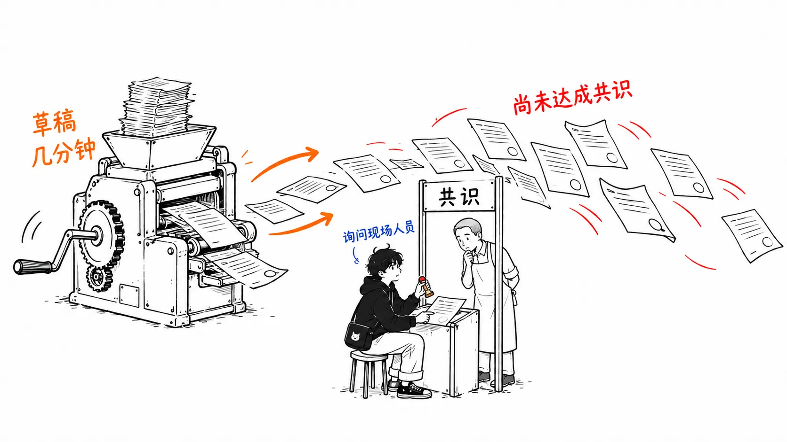

最近一年左右，我在 AI 智能体的语境里越来越常看到“本体（ontology）”这个词。Palantir 把自家产品的核心放在了 Ontology 上，所以一聊到数据平台，基本都会冒出来。

不过，这个词本身并不新。2000 年代的语义网，以及之后的 SI（系统集成）项目里，本体都正经流行过一阵。而且在很多现场，最后落得个“做是做了，但没人用”的结局。

所以这篇文章里，我想把 SI 时代和现在构建本体的步骤，以及该做的事，并排摆出来看看。先声明一下，这里写的 SI 时代的步骤，是我对当时通行做法的整理，不是某个具体项目的亲身经历。

先把结论写在前面。

> AI 让“写”这道工序变轻松了，而本体的本体——“和业务方就定义达成一致”这道工序，并没有变轻松。草稿一瞬间就能出来，正因如此，跳过达成一致的本体被批量生产出来的风险反而更大。现在该做的是，以“智能体会来读”为前提，把定义保持得少，并且保持在可以验证的形式上。

---

## 什么是本体

常被引用的定义，出自 Tom Gruber 1993 年的论文。

> An ontology is an explicit specification of a conceptualization.
>
> （本体是对概念化的显式规范。）

光这样不太好懂，换成我自己的话就是：“把某个业务世界里有什么、它们之间是什么关系，写成人和机器都能按同一种意思来读的东西。”

比如镇上的自行车修理店，有“顾客”“自行车”“维修”“零件”“报价”这些东西，也有“自行车由顾客带来”“报价引用维修和零件”这样的关系。到这里为止，ER 图也能画出来。

和 ER 图不同的地方，在于它还要赋予含义。“带来的人”是“顾客”的一种，但不一定是“自行车的主人”。“报价”和“账单”很像但不是一回事，报价是确定之前，账单是确定之后。这些区分，不是为了迁就表设计，而是用业务的语言原样写下来。把数据库负责“存什么”、本体负责“那意味着什么”这样分开来想，会比较接近。

## SI 时代的步骤

SI 时代构建本体，大致按下面的顺序进行。

1. **范围与术语表**：确定对象业务，通过访谈收集术语。同一个东西有三种叫法之类的混乱，在这里消除。
2. **概念模型**：确定类（概念）的层级和属性（关系、特性）。多数是在 Protégé 这样的编辑器里写成 OWL。
3. **与现有数据的对应**：确定 RDB 或 CSV 的列对应哪个类、哪个属性，并构建转换成 RDF 的 ETL。
4. **推理与检索**：用推理引擎推导出隐含的事实，做出用 SPARQL 查询的界面或 API。
5. **交付与维护**：连同规格说明书一起交付，变更在维护合同里受理。

其中耗掉大部分工时的是 1 和 3。要消除术语的混乱，需要把访谈做好几轮，而对应则是把现有系统的各种脾气一个一个吸收掉的工作。

而容易失败的是 5。一旦本体成了“交付物”，即使业务变了也没人去更新。不更新的本体半年就会和现实脱节，脱了节的东西就没人用了。因为没人用，所以脱了节也没人觉得困扰。我想，不少项目就是在这个循环里悄无声息地结束的。

还有一点，当时对“机器来推理”这件事期待过高了。只要用 OWL 严谨地写，推理引擎就会为你推导出新知识。但实际业务里想要的，比起推理，更是“关于这个词指什么，所有人给出同一个答案的状态”，而这并不需要推理引擎。

## 现在的步骤

有了 LLM 之后，我认为步骤变成了这样。

1. **从想让智能体做的判断倒推**：不要从“覆盖全部业务”开始。像“想让它判断报价被退回的原因”这样，先定下一个想交给 AI 的判断，只拾取其中需要的概念。
2. **让 LLM 基于现有资料给出候选**：让它读手册、DB 模式、咨询记录，给出概念和关系的候选。这一步真的变快了。
3. **人来达成一致**：把候选和业务方对照，确定定义。“能不能受理非车主的维修”，能回答的不是 LLM，而是现场的人。
4. **以对象和动作来持有**：不只定义概念，连能对它做什么（确定报价、调货）也一并定义。我认为 Palantir 的 Ontology 把动作当作一等公民，就是这个缘故。
5. **作为智能体的工具公开**：把本体直接变成智能体能调用的函数，以及对其参数的说明。
6. **用评估来运转**：每次都用测试用例确认智能体是否按定义做出了判断。偏了就改定义。

和 SI 时代的差异整理成表，是这样的。

| | SI 时代 | 现在 |
| --- | --- | --- |
| 谁来读 | 推理引擎和开发者 | LLM 智能体和业务负责人 |
| 范围 | 覆盖整个业务 | 只涵盖想交出去的判断所需的部分 |
| 最重的工序 | 术语收集与 ETL | 定义的一致认可 |
| 写法 | 用 OWL / RDF 严谨地写 | 带类型的模式加自然语言说明 |
| 如何收尾 | 交付 | 只要评估持续通过就持续运营 |

## 变轻松的只有“写”这道工序

这是我最想说的地方。

现在步骤里的第 2 步，放在 SI 时代要花几周的工作，现在几分钟就完成了。LLM 会给出像模像样的类层级，还附带像模像样的说明。

但是，只是像模像样而已。LLM 给出的“报价”的定义，是一般意义上的报价定义，不是那家公司的报价。那家公司也许把“暂定报价”和“正式报价”分开，也许把口头告知的金额叫作报价。知道这些的只有现场的人，不问就不会知道。

SI 时代，因为写得慢，写的过程中就不得不去问人。也可以说，慢强制了一致认可。现在不用问也能成形。成形了的东西，评审的一方也容易觉得“嗯，应该没错”就放行了。

所以我认为，如今构建本体的风险，不是“做不出来”，而是“能做出没有达成一致的东西”。而且这次是智能体读了它之后会真的行动，所以不会像 SI 时代那样以“没人用”收场。定义错着，确定报价的动作照样会被调用。

## 现在该做的事

站在这个看法上，该做的事可以收敛为三件。

**定义要少。**压住想要覆盖全部的心情，只保留交给智能体的判断所需的东西。定义越多，达成一致的成本越高，混入没有达成一致的定义的概率也越高。

**每条定义都留下“谁认可的”。**要能区分这是 LLM 给出的候选，还是现场的某个人确认过的。这是 SI 时代的规格说明书里写了、而现在的模式里容易漏掉的信息。

**先做评估。**和业务方一起做出“这个输入就这样判断”的用例，每次改动本体都跑一遍。放弃 SI 时代的“交付了就结束”，把评估持续通过作为完成的条件。这样，业务变化时就能检测出定义的偏离。

如果只带走一件事，那就是：不要把让 LLM 给出的草稿当作一致认可的替代品。本体无论过去还是现在，首先都是“统一语言的工作”，然后才是技术。AI 让这项工作变快了，但不会替你承担它。
