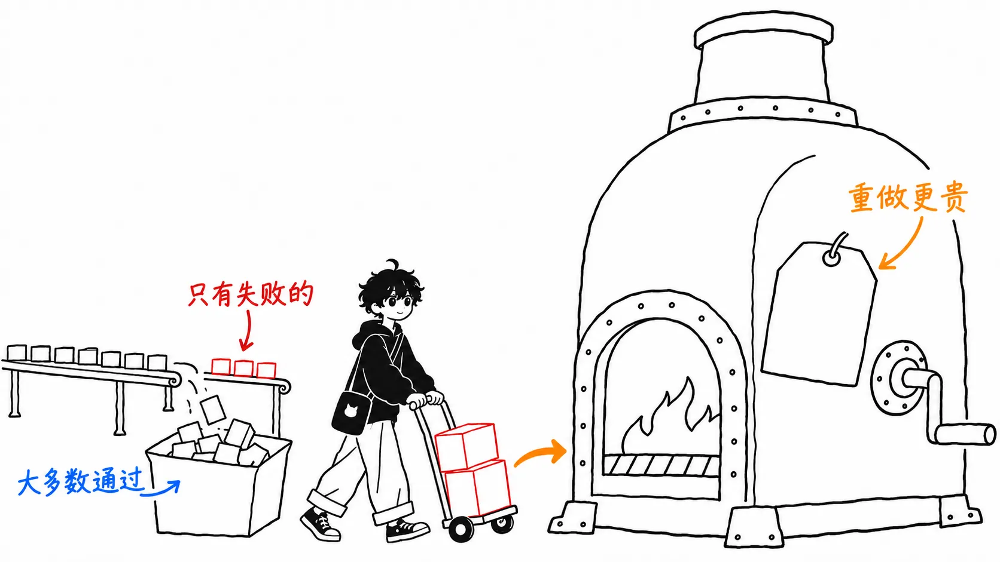
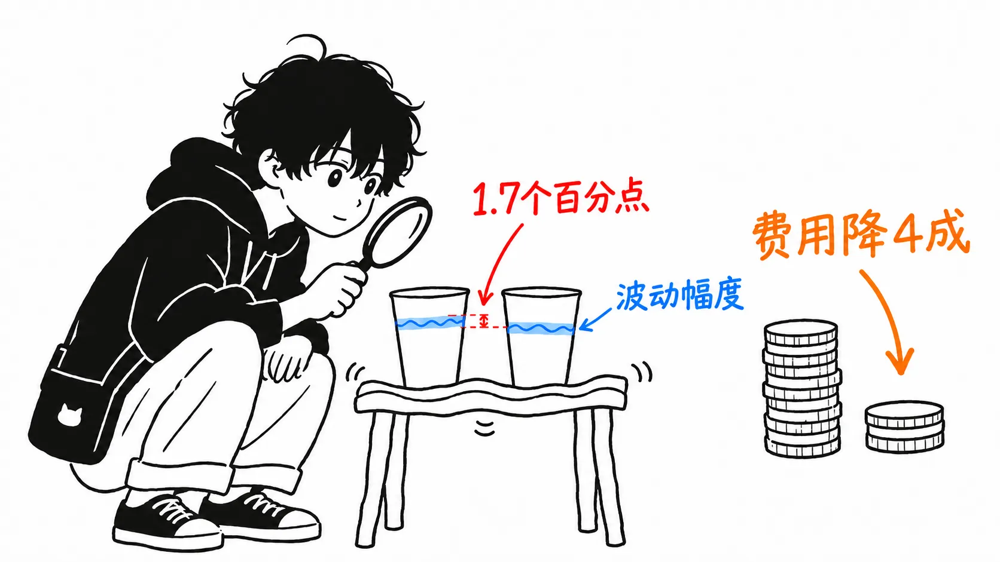
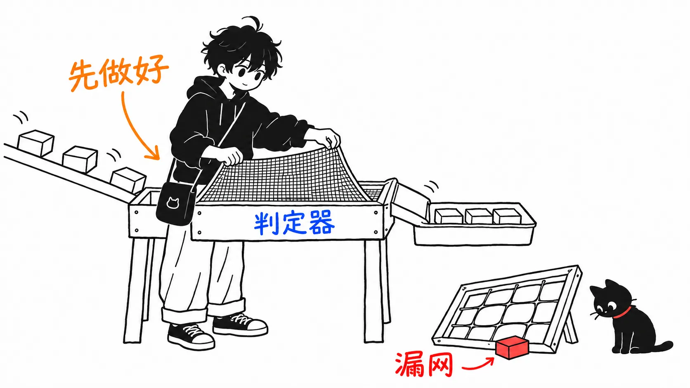

Addy Osmani 在 claude.dev 上写了《Which Claude model should you build with?》（2026 年 11 月 9 日）。这篇文章讲的是在 Haiku、Sonnet、Opus、Fable 里该用哪个，但最让我在意的不是选模型的那张表，而是 effort 一节里只出现了一行的数字。

> On the same SWE-bench Pro subset, Opus 5.5 at `low` with failures re-run at `high` passed about 97% of tasks for about $0.17 each, against 95.3% for $0.29 with every task at `high`.
>
> （在同一个 SWE-bench Pro 子集上，Opus 5.5 先用 `low` 跑，失败的再用 `high` 重跑，约 97% 的任务通过，每个任务约 0.17 美元。全部任务都用 `high` 跑，是 95.3%，0.29 美元。）

先说结论。

> 从这组数字能说的，只有"分数没有下降，费用少了约 4 成"。97% 对 95.3% 的差距 1.7 个百分点，和同一篇文章在谈另一个基准时称为"误差的边缘"的幅度一样大。而且倒推一下，把在 low 上失败的任务用 high 重做，似乎要比用 high 解一个平均任务贵出大约 2 倍。两段式运行之所以便宜，是因为失败的任务少。

这个实验我没有复现。子集的任务数文章里也没写，所以下面是根据文章里出现的四舍五入后的数字做的倒推。

---

## 文章推荐的顺序

文章写了模型性能不够时该依次尝试什么。

> 1. Check that the model can verify its own work, with a test, a build or a script that calls the endpoint.
> 2. Raise effort one level.
> 3. Move to the next model up, starting at a lower effort level than you used on the smaller one.
>
> （1. 确认模型能否通过测试、构建、或调用端点的脚本等方式，验证自己的工作。2. 把 effort 提高一档。3. 换到上一档的模型，并从比小模型时更低的 effort 开始。）

换模型是最后一步。前两步都是不换模型就能做的事。两段式运行是第 1 步的延伸。如果结果能自动判定，就可以全部用便宜的设置跑，只对失败的使用贵的设置。

在同一节稍早的地方，还给出了各 effort 之间的差距。这是在 SWE-bench Pro 上、以 Opus 5.5 的 `high` 为基准的数字。

> At `low` it scored about 8 points lower for about a third of the cost.
>
> （`low` 的得分低约 8 个百分点，费用约为三分之一。）

接着是 `medium` 低约 2.5 个百分点、费用约 70%，`xhigh` 高约 1.4 个百分点、费用 2.5 倍。

## 重做失败的任务很贵

把这两组数字组合起来，可以做一个粗略的倒推。从这里开始是我自己的计算。前提有两个：0.17 美元是包含 `low` 第一次运行在内的每个任务的总额，以及各 effort 的数字来自同一个子集（后者文章里写了"same"）。带"about"的数字我是直接按四舍五入后的值在用，所以只看数量级。

全部用 `high` 是 95.3%、0.29 美元。`low` 比它低约 8 个百分点，所以是 87% 左右。费用约为三分之一，每个任务不到 0.10 美元。失败的约占 13%。

两段式的总额是 0.17 美元，所以花在重做上的，平均每个任务约 0.07 美元。用失败的 13% 去除，**重做一个任务约 0.55 美元**。差不多是全部用 `high` 时平均 0.29 美元的 2 倍。

这并不奇怪。在 `low` 上失败的是难的任务，而难的任务在 `high` 上也会想得更久、调用更多工具。文章的另一节里也提到过费用集中在少数问题上。

> On one 20-problem search benchmark, two problems carried 43% of the spend.
>
> （在某个 20 题的搜索基准里，有 2 题占了 43% 的开销。）

两段式运行之所以省钱，不是因为重做的单价低，而是因为需要重做的数量少。如果把同样的做法用到 `low` 通过率会下降的任务群上，比如一开始就全是难题的积压任务，我认为这个 0.17 美元不会复现。假设在 `low` 上有三成失败，按同样的单价，光是重做就超过 0.16 美元，总额会逼近全部用 `high` 的 0.29 美元。

## 不要把 1.7 个百分点读成分数的提升

把 97% 和 95.3% 摆在一起，两段式运行看起来既便宜，分数也更高。不过，文章在 advisor 工具那一节是这样写的。说的是给 Opus 5.5 配上 Fable 5.1 作 advisor 的组合，比单独的 Opus 5.5 高 1.7 个百分点。

> A gain that size is at the edge of run-to-run noise, and about what raising effort would have bought.
>
> （那种程度的提升处在每次运行之间波动的边缘，大致相当于提高 effort 就能买到的幅度。）

97 − 95.3 也是 1.7。advisor 那边说的是内部的编程基准，任务数也不同，所以不能把那把尺子直接搬过来。即便如此，既然同一篇文章把 1.7 个百分点称为"误差的边缘"，我就不太愿意把两段式运行的 1.7 个百分点读成分数的提升。

我在自己的评估笔记里用的参考值是 `1/sqrt(任务数×运行次数)`，差距比它小就不写"提升"。因为不知道子集的任务数，所以算不出来。这个参考值是通过率在 5 成左右时的粗略上限，在 95% 以上这种接近天花板的地方，波动还要小得多。所以我不能说到"这就是误差"，准确的说法是"文章里没有足以把它和误差区分开的材料"。

分数看起来反而上升的原因，我也想到了一个。在两段式运行里，失败的任务会多得到第二次尝试。`low` 一次、`high` 一次，合计两次里通过一次就行。文章没有写尝试次数，但如果全部用 `high` 的做法是每个任务一次，那么 effort 的效果和尝试次数的效果就混在了一起。

所以我把这个结果读作"质量没有下降，费用减少了约 4 成"。费用这边是 0.29 和 0.17 之间的差，比分数的差稳固得多。

## 没有判定器就用不了

文章还写了另一个条件。

> If you can check outcomes automatically, run everything at a low level and re-run only the failures at a high one.
>
> （如果能自动检查结果，就全部用低档设置跑，只把失败的用高档设置重跑。）

在基准里，是否通过由测试机械地决定。在边对话边修改的用法里，就不是这样了。判定"失败"的是人，而且是在读过产出的 diff 之后。

这种情况下，"先用 `low` 跑一次，不行再用 `high`"的做法，和文章里的两段式运行是两回事。对于在 `low` 上失败的任务，要读 diff、判断"不行"、等 `high` 的结果，再读一遍。两段式能省下的，是每个任务约 0.12 美元（0.29 − 0.17）。和失败的一成多任务上增加的人工重读和等待时间相比，在我看来不划算。

在对话中能用的，是文章顺序里的第 1 步。先准备好测试和构建，让模型自己来判定。这样即使用 `low` 跑，也有望让模型发现自己失败了并重做。不过，97% 这个数字是建立在基准测试这种很强的判定器之上的。如果自己的测试很松，失败了却被当作通过的任务不会被重跑，数字会相应地下降。两段式的数字，我觉得最有用的读法，是把它当作先搭好判定器的价目表。只有当判定器和实验中的一样准确时，价格才会如表所示。

## 如果只带走一件事

两段式运行变便宜，是在 `low` 上失败的任务少的情况下。引入之前，先测一下自己的任务用 `low` 跑时的通过率。按上面倒推出的单价，在 `low` 上失败 35% 左右时，费用就和全部用 `high` 持平了。实际上，失败的数量越多，重做的内容也越简单，所以单价应该会变。即便如此，这也不是不测通过率就引入的理由。

出处：Addy Osmani，"[Which Claude model should you build with? Fable, Opus, Sonnet, or Haiku](https://claude.dev/blog/which-claude-model-should-you-build-with/)"（claude.dev，2026 年 11 月 9 日）。文章中引用的"Spending your effort"和平台的成本指南，我没有读。
