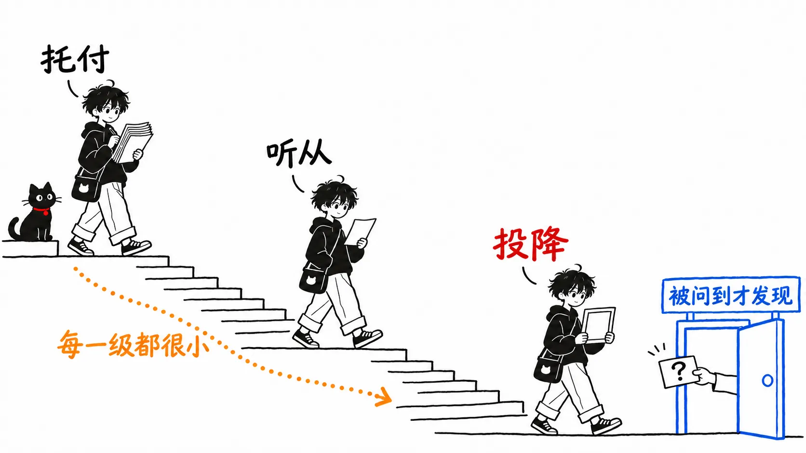
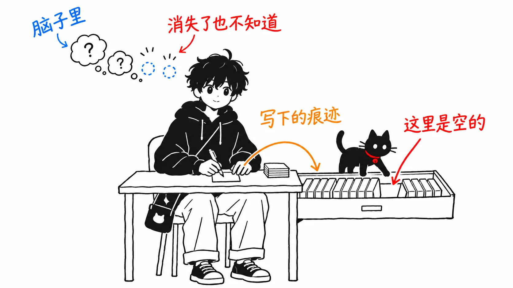

Addy Osmani 的新文章里有这样一句话。

> Before I run an agent on any non-trivial task, I write down, even just in my head, what I think the answer might be.
>
> （在把任何不简单的任务交给智能体之前，我会先把自己猜的答案写下来，哪怕只是在脑子里。）

让我在意的是“哪怕只是在脑子里”这半句。先把结论写在前面。

> 这篇文章描述的“投降”，是在本人察觉不到的情况下一点点发生的。既然如此，处方里那些只在脑子里完成的部分（问自己的问题），也会跟着投降一起，在没人发现被跳过的情况下逐渐消失。真正管用的，是像文件、日志、测试那样**事后能被别人查看的、会留下痕迹的习惯**。我认为“哪怕只是在脑子里”这半句应该删掉。

原文是 Addy Osmani 在2026年11月3日以 [X Article](https://x.com/addyosmani/status/2117512471930167377) 形式发布的《Critical thinking when agents do the work》。

先说明一下。正文我是通过 fxtwitter 的 API 以文本形式读的。文末嵌了一张图，我没有看到。正文链接的论文和博客（“认知投降”的论文、Margaret-Anne Storey 的文章等）我也没有打开。文中的方法我自己没有试过，也没有测过效果。

---

## 三级的下坡

文章的骨架，是把交给智能体的方式分成了三级。

> At the top: cognitive offloading, the act of delegating tasks to the AI, but maintaining ownership of the result. I do this all day. You should, too. In the middle: deferral, where the output of the tool becomes your new input; the result has ceased to be a hypothesis. At the bottom: cognitive surrender - the AI's output quietly becomes your own, you feel no need to check it.
>
> （最上面是认知托付：把工作交给 AI，但结果仍归自己负责。我整天都在这么做，你也应该这么做。中间是听从（deferral）：工具的输出直接成了你的下一个输入，结果已经不再是一个假设。最下面是认知投降：AI 的输出悄悄变成了你自己的，你甚至不觉得需要去检查。）

“认知投降（cognitive surrender）”据说是沃顿商学院的 Steven Shaw 和 Gideon Nave 提出的说法。

对这三级我没有异议。重要的是它对人如何走下这个坡的描述。

> The transition is rarely observed, because the steps are each gradual and seem reasonable. You read the last answer well, so you skim the next one. You just scan the skeleton of the one after that. Then you get asked about a line and can't explain it, even with your agent's help.
>
> （这个转变很少被察觉，因为每一步都很平缓，看起来也都合情合理。上一个回答你认真读了，所以下一个就扫一眼。再下一个只看个骨架。然后有人问你某一行，你就算借助智能体也解释不出来。）

关于投降在哪里被发现，文章还写了另一处。

> It's usually discovered when you try to apply a mental model of the system and it doesn't exist.
>
> （通常是在你想套用对系统的心智模型、却发现它根本不存在的时候才暴露出来。）

也就是说，从本人内部是看不见的。被发现的时候，要么是被别人问到，要么是想改东西时手停住了。两种情况都要从外面戳一下才知道。这两段引用，是我后面读法的前提。

## 按“有没有留下痕迹”给处方分类

文章后半部分是处方：六个问自己的问题、验证的习惯、评审的方法、写提示词的方法、每周和每月的练习。数量很多，所以我按一根轴重新排了一下：**事后，除了本人之外，别人能不能确认你到底做没做**。

| 处方 | 痕迹 |
| --- | --- |
| 提问前先猜一个答案（“哪怕只是在脑子里”） | 不留 |
| 问自己“我是让它帮我思考，还是让它替我思考” | 不留 |
| 想想“如果这是错的，什么必须成立”，然后去确认 | 确认的结果会留下 |
| 让多个模型去论证反方 | 输出会留下 |
| 问自己“我敢不敢在要维护它的人面前为它打赌” | 不留 |
| 问自己“我已经不再练习的是什么” | 不留（每月写下来的习惯会留下） |
| 事先定义什么叫“已验证” | 写下来就会留下 |
| 把完成条件定为测试、截图或日志 | 会留下 |
| 让新上下文里的子智能体自我批评，并嵌入循环 | 会留下 |
| 让智能体列出它做的决定和前提假设 | 会留下 |
| 在变更报告末尾附一份小测验，不拿满分不合并 | 题目会留下，成绩是自报的 |
| 把没达标的原因写进配置、钩子或测试 | 会留下 |

六个问题里有四个完全在脑子里完成。而这正是我论点的核心。

正如上一节引用的那样，投降是在“每一步都合情合理”的状态下推进的，本人察觉不到。那么，越是滑下去的人，越会跳过脑子里的问题，而且不会记得自己跳过了。上次认真问过了，这次就轻一点，下次干脆省掉。问题本身应该也会走下文章描述“扫一眼”时的同一个坡。

反过来，表里标为“会留下”的那些，一旦跳过，痕迹就会缺一块。没有写着猜测的笔记，没有决定清单，没有测验记录。就算本人心不在焉，看一眼文件就知道缺了什么。不过这只限于事先约定好“这里应该有”的痕迹。像有没有读过反方论证这种，缺了也没人在意的痕迹，即使缺了也不会被注意到。

先把一个反驳挡在前面：这根轴衡量的是“做没做”，而不是“有没有认真想”。一张敷衍的猜测笔记也算痕迹。正如原文自己写的 "You can also surrender verification."，留痕迹这件事本身也可能投降。但即便如此，空的笔记事后一读就知道是空的。在脑子里省掉的问题，连这一点都看不出来。

我觉得 Osmani 自己也有一半意识到了这个区别。关于子智能体的自我批评，他这样写：

> it's worth baking that into the loop so it runs every time, not just when you remember.
>
> （值得把它嵌进循环里，让它每次都运行，而不是只在你想起来的时候。）

“而不是只在你想起来的时候”。这个道理应该同样适用于那六个问题。可是问题那边却仍然停留在“问自己”，第一个问题还附上了“哪怕只是在脑子里”。

有意思的是文章的结尾。

> Before you ask, write down what you think will happen, and after the agent is done, write down one thing it didn't check.
>
> （在提问之前，写下你认为会发生什么；智能体做完之后，写下一件它没有检查的事。）

最后这条建议没有附上“哪怕只是在脑子里”。这并不是 Osmani 撤回了开头那句，这里的 "write down" 也可能包括在脑子里写。但我仍然认为，照字面理解为写在纸上或文件里才是对的。如果要改写开头那句，就删掉“哪怕只是在脑子里”。仅此一处，问题就移到了表里“会留下”的那一边。

## “Did I miss anything?”命中了几个，文中没写

文章里还有一处，是我最怀疑的。

> I still ask at the end "Did I miss anything?" That sounds silly, but so often, when I finish some complex feature work using a frontier model, look at it, review it, and then ask, "Did I miss anything?" It will then come back with two or three more things. That's why I always ask.
>
> （最后我还是会问一句“我漏掉什么了吗？”。听起来很傻，但很多时候，我用前沿模型做完一个复杂功能、看过、评审过之后再这么问，它会再给出两三条。所以我总是会问。）

很多时候会给出两三条。但这两三条里真正是遗漏的有几条，文中没有写。

下面是我的推测。被问“有遗漏吗？”的模型，我想很少会回答“没有”。因为列出点什么，才是对这个问题最顺从的回应方式。如果是这样，返回两三条并不能证明真的有遗漏。在一个遗漏为零的日子里，也许同样会返回两三条。

文章在同一篇里，这样写测试：

> When a check goes green, ask what it proved. Then ask what it didn't.
>
> （检查变绿的时候，要问它证明了什么，再问它没证明什么。）

我认为同样的问题也应该拿来问“Did I miss anything?”。这个问题不管哪天都会返回点什么，所以“返回了东西”这个事实本身什么也证明不了。要确认的话，就得把返回的条目逐条按“是不是真的需要改”来分类，数一数命中的比例是多少。我还没有数过，但我认为不数就一直“总是问”，本身就是文章所说的投降的入口。

## 如果只带走一件事

问自己的问题，写在纸上或文件里。

文章说，投降是在本人看不见的情况下推进的。用本人的记忆和自制力去拦一个看不见的东西，这条路不太靠谱。Osmani 放在结尾的“提问前写下猜测，结束后写下一件没检查的事”，两行文字就够了，而且写没写，事后自己和别人都能确认。比起把六个问题都记在心里，我觉得把这两行留在文件里更能坚持下去。

不需要每个请求都这么做。原文也写了 "Where the stakes are low, feel free to delegate entirely."，并没有要求连错了也无所谓的请求都写下来。开头那句本来就限定在 "any non-trivial task"，在这个范围内，不要写在脑子里，写进文件。我想改的只有这一点。

## 出处

- Addy Osmani《Critical thinking when agents do the work》X Article，2026年11月3日 https://x.com/addyosmani/status/2117512471930167377
