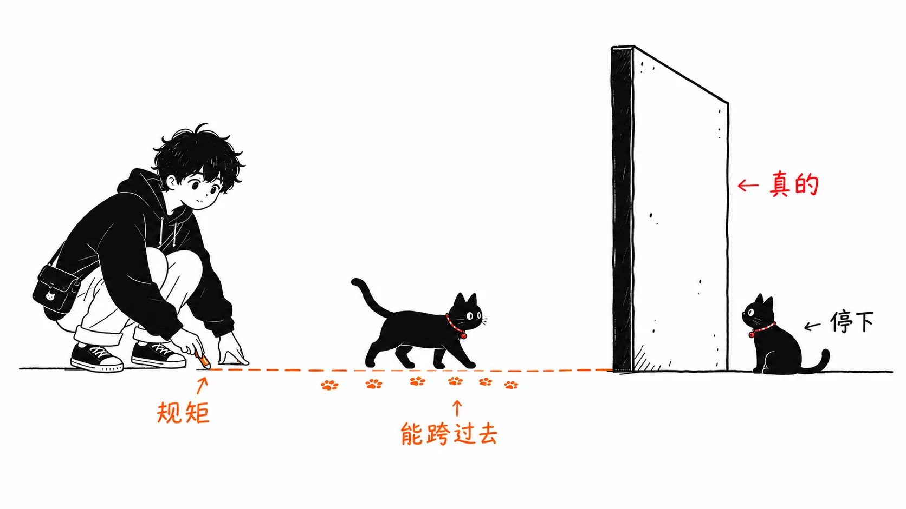

先把结论写在前面。

> 逻辑上细分，物理上在有必要之前不拆。

当我试图把自己为什么被 Phoenix 吸引说清楚时，最后落到的就是这一句。不是因为我喜欢实时（Channels 或 LiveView）。顺序是反的，实时只是入口。

先说明一下，这篇文章不是运维报告。它不是基于在大规模生产环境里跑 BEAM 的经验，而是把我一边学习一边搭建的设计判断用语言整理出来。

:::message
**本文预设的术语**

- **BEAM**：Erlang / Elixir 运行所在的虚拟机。可以理解成 Erlang 版的 JVM，不同之处在于它的设计重心放在了并发和故障恢复上。
- **OTP**：架在 BEAM 之上的一整套标准库和设计规范。GenServer 和 supervisor 都包含在内。
- **进程**：和操作系统的进程是两回事。是在 BEAM 内部运行的轻量级执行单元，一个只要几 KB 就能创建。可以同时跑几十万个。
- **deployment unit**：“一次部署中被整体替换的单位”。微服务是增加这种单位的设计，单体是把它保持为一个的设计。这是本文的核心词。
:::

## 我们不知不觉不再追问“为什么要拆”

这几年，微服务一直被当作后端的一种理想形态。用 Go 或 Node.js 写小服务，用 Docker 打包，放到 Kubernetes 上。服务之间用 REST 或 gRPC，异步用 Kafka 或 SQS，共享状态用 Redis，监控用 Datadog。

这是合理的配置。不过最近，我心里“真的有必要拆得这么细吗”这个疑问变得更强了。越想，就越被 BEAM 和 OTP 的设计思想吸引过去。

## 在大多数运行时里，“逻辑隔离”只是一种约定

拆模块，分层，定依赖方向。那是编码规范。只要有人多加一行 `import`，它就破了。共享的可变状态，不管在设计图上隔离得多干净，在内存里都在同一个地方。

于是就变成了“如果真想隔离，就把进程拆开，也就是隔着网络”。微服务买到的，是**强制实行隔离的物理之墙**。

BEAM 把这堵墙放在了另一个地方。



BEAM 的每个进程都有各自独立的堆、邮箱和状态，不直接碰共享内存，只通过消息传递来通信。它是抢占式调度的，所以一个失控了，其他的也不会停。然后 supervisor 会按既定策略重启崩溃的进程。

```text
BEAM

Supervisor
├ UserProcess #1
├ OrderProcess #100
├ AudioJobProcess #200
└ NotificationProcess
```

:::message
**会出现的 OTP 组件**

- **GenServer**：持有状态、接收消息并作出响应的进程模板。感觉就像立起一个“小服务器”。
- **supervisor**：监视子进程，一旦崩溃就按既定策略重启的父进程。把它想成 Kubernetes 的重启策略在 VM 内部运行，会比较好理解。
- **消息传递**：进程之间不碰共享内存，而是互相发送消息来通信的方式。好处是不会变成争抢锁的设计。
:::

也就是说，隔离、重启、消息通信，这些微服务靠 Kubernetes 和网络才拿到的东西，**由运行时在一个 deployment unit 之内保证**。不是靠约定，而是靠运行时。

这是魅力的核心所在。“不拆”这个选择，不再是放弃，而成了一个设计决策。

## 这不是在说 Go 不行

如果只是简单的 API 服务器，Go 非常强。启动快，内存小，单个二进制就能分发，容器密度也能提上去。如果目的是低成本地处理大量 HTTP 请求，它就是一个当之无愧的优秀选择。我不是在说 Phoenix 更快。

而且，关于规模的争论，通常换回数字就平息了。每天 1000 万次请求，平均下来约是 116 req/s。就算峰值是 10 倍，也就是 1000 到 2000 req/s。这点量两边都能扛。

真正起作用的不是请求数，而是并发连接数 × 持有的状态 × 通信频率。聊天、配送位置、厨房显示屏、POS、协同编辑、音频处理的进度。在需要大量维持这类“活着的连接和状态”的应用里，一个连接一个进程的模型就变得自然了。

## 复杂性是在拆分之后到来的

一开始只是一个 Go 的 API，随着长大，需要 worker，需要调度器，需要 WebSocket 服务器，Redis 和队列也越来越多。从这里开始拆成服务，每一个都要考虑 Docker、Deployment、健康检查、日志、指标、CI/CD、API schema、服务发现、重试、超时、熔断器、分布式追踪。

单个服务变简单了。整个系统变复杂了。

当一个 10 到 20 人的团队把系统拆成 User / Email / Profile / Preference / Notification 这样几十个时，每加一个简单的功能，网络故障、超时、最终一致性、分布式事务、schema 兼容性都会露头。

:::message
**拆分之后增加的功课**

- **最终一致性**：以分散在多个服务中的数据会有一瞬间不一致为前提的设计。“订单进来了，但库存还没有反映”这样的状态，需要在应用这一侧处理。
- **熔断器**：被调用方挂掉时，停止调用并立即失败的机制。不加的话，一处故障会连锁蔓延到调用方。
- **分布式追踪**：追踪一个请求横跨多个服务的路径的机制。在单个进程里一条堆栈跟踪就能解决的事，变成了需要专门基础设施的工作。

每一个单独看都是正确的对策。问题在于，如果不拆，**本来就不需要**。
:::

也就是说，**为了整理代码，我们制造了“网络故障”这个新问题。** 这个代价相当大。

Redis 也是同样的结构。Go 服务器一旦有了多台，A 内存里持有的状态，B 就看不到。所以要把它挪到共享存储里去。Redis 很优秀，但不是魔法。它的实体是**另一台服务器上的 RAM**。从应用看来，就是隔着 TCP 和序列化的另一头的 RAM。

用 Phoenix 的话，一部分状态可以用进程或 ETS 放在 VM 内部，所以在某些场景下，这一来一回就消失了。这不是说 Redis 变得不需要，而是**可以把引入的时间往后推**。

:::message
**ETS / PubSub / Presence / Oban**

- **ETS**（Erlang Term Storage）：BEAM 内置的内存表。可以跨进程读写，速度非常快。但它在 RAM 里，VM 一挂就没了。
- **PubSub**：在同一个应用内（组成集群的话也可以跨节点）分发事件的机制。可以不用在外面再放一个 Redis Pub/Sub。
- **Presence**：跨节点共享“现在谁在线”的机制。用于在线状态显示和协同编辑。
- **Oban**：Elixir 的任务队列。实体是 PostgreSQL 的表，所以和 Sidekiq 不同，不需要多加一个 Redis。
:::

## 以上是主张，接下来是对自己的反驳

上面这些话，是那种连我自己写着写着都会觉得舒服的类型。所以我自己来戳一下。

**BEAM 集群不是共享内存。** Node A 和 Node B 的 RAM 并不会合成一个。如果 User #123 的进程在 A 上，那么 B 要通过发消息去取。它是 distributed processes，不是分布式共享内存。把这两者混为一谈，设计就会出错。

**进程不是数据库。** 在线用户、运行中的任务、进度 42% 这类“现在是什么状态”，适合放在进程或 ETS 里。订单、支付、库存、积分余额这类“发生了什么”，要放进 PostgreSQL。不能消失的事实，不能放在 BEAM 里。ETS 很快，但它在 RAM 上，不能成为 source of truth。

**除了进程崩溃，其他都隔离不了。**


supervisor 守护的，是进程崩溃的时候。物理隔离买到的，是与此不同的爆炸半径：部署事故、内存泄漏、VM 本身停止。NIF 一崩，整个 VM 都会死。发出一次糟糕的部署，30 个逻辑上隔离的组件会同时死掉。这一块 BEAM 是隔离不了的。

:::message alert
**NIF**（Native Implemented Function）是从 Elixir 调用 C 或 Rust 原生代码的机制。在把图像转换或加密处理这类繁重计算分流出去时会用到，但**NIF 内部一旦崩溃，整个 VM 都会挂掉**。supervisor 帮不上忙。BEAM 的故障隔离，只对在 BEAM 内部写的代码有效。
:::

**独立部署不是技术需求，而是组织需求。** 许多团队选择微服务的真正理由，既不是性能也不是故障隔离，而是“不想等其他团队的发布”。支付团队能够自己管部署和回滚，这有明确的价值。BEAM 解决不了这一点。只要是一个 deployment unit，发布就只有一条。

所以准确地说，主张要限定成这样。**在团队还小的时候，仅靠逻辑隔离就已经足够真实了。** 需要物理隔离的时候，人数先于负载。

## 整合什么，放到外面什么

即使设想一个巨大的电商，把所有东西合成一个也太极端了。换作我，会把 Accounts / Cart / Orders / Checkout / Inventory / Promotion / Point / Notification 放进一个 Phoenix，内部用 PubSub、Oban 和 supervisor 来搭。

放到外面的，只是没有理由整合的东西。搜索引擎、支付、欺诈检测、AI 和推荐、对象存储、分析基础设施。AI/ML 用 Python，吃 CPU 的音频处理用 Rust 或 C++，全文检索用专用引擎。运行时不同的东西，硬往 Elixir 上靠没有意义。

不把 Phoenix 当作万能语言来用，而是**把它当作应用的编排者来用**。这是我现在最信服的形态。

## AI 时代：顺风和逆风放在同一杆秤上

单体被嫌弃的原因之一，是代码库太大，人没法理解。能够跨越代码搜索、AST、Git 历史、依赖、测试、类型来阅读的智能体越是实用，**仅仅为了降低认知负荷而拆分的理由就越弱**。如果能说出“这个修改会影响 Orders、Inventory 和 Promotion”，那么巨大代码库的一部分劣势就消失了。

智能体最容易出错的地方，是上下文断开的地方。跨仓库，跨服务边界，契约在另一个文件里，实际行为在另一个 deployment unit 里。在那里它们会若无其事地做出“改了调用方，却没看被调用方”的事。deployment unit 少，就意味着智能体需要读的边界少。

以上是顺风。逆风这一面，很少有人谈。


**智能体的实力，赤裸裸地与训练数据的量成正比。** 和 TypeScript 或 Python 相比，Elixir 写出来的代码绝对量要少几个数量级。让同一个模型来写，产出的质量就是不一样。OTP 的模式、supervision 策略的选择、`handle_info` 漏掉的消息。在这些地方，智能体会悄悄地出错。

而且越是站在“AI 提升生产力”这个前提上，这个差距作为选择的理由就越重。上下文在单一代码库里闭合所带来的收益，与模型写不好这门语言所带来的损失，放在同一杆秤上。只算一边，结论就会错。

我的判断是这样。**对于限制因素是编写量的团队，逆风占上风；对于限制因素是阅读量和故障处理的团队，顺风占上风。** BEAM 的收益不是在写的时候，而是在挂了的时候和追查的时候体现出来的。在批量生产新功能的阶段，Phoenix 并没有那么快。是一种进入运维之后，才能说“选对了”的设计。

另外，安全边界、独立伸缩、团队归属、运行时差异、故障域的隔离，这些微服务本来的优点，不会随着 AI 的进步而消失。会消失的，只有“为了整理代码而做的拆分”。

## 如果只带走一件事

要不要选 Phoenix，不取决于是否需要实时功能。取决于的是，**隔离是用网络买，还是用进程买**。


用网络买，能得到独立部署和缩小的爆炸半径，付出的是运维成本和上下文的断裂。用进程买，能在 deployment unit 之内得到隔离和重启，放弃的是独立部署。

需要前者的时候，通常是人数先于负载到来的时候。在那之前，后者就足够了，而且如果你已经在用 BEAM，那就不是妥协。先在 BEAM 内部按进程做隔离，只把真正需要的边界升格为外部服务。目前对我来说，这是最贴切的做法。
