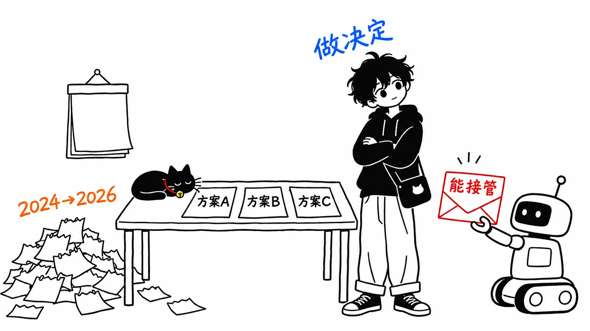
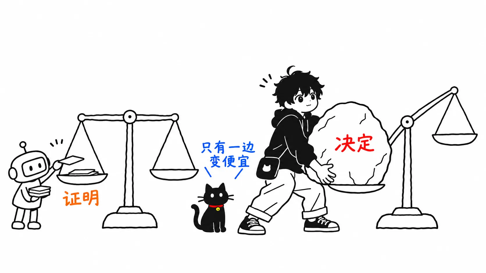
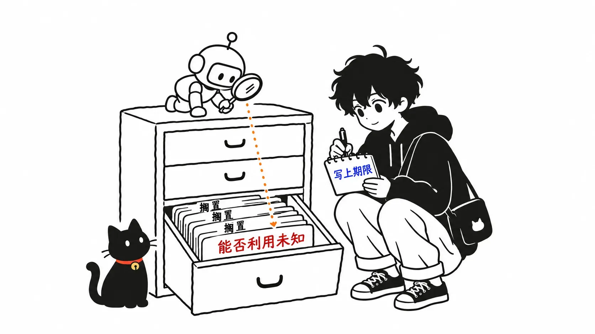

IEEE Spectrum 发了一篇讲 PHP2Shell 的文章。副标题是这样的。

> AI is forcing us to pay off 40 years of technical debt
>
> （AI 正在逼我们偿还40年的技术债。）

在 Hacker News 上，它拿到了超过1,000分，评论超过600条。回复最多的几条评论里，有“我们一直在流沙上盖房子”“开源软件‘总有人会去审计’的承诺，靠 AI 才真正兑现”这样的话。

把这个副标题和 PHP Foundation 发布的经过报告放在一起看，有对不上的地方。先把结论写在前面。

> PHP2Shell 的根本问题，2024年就在一次由人主导的审计过程中被发现了。卡住的不是“发现”，而是**决定**：在几种修法里选哪一种。AI 带来的，是“真的能拿下服务器”的证明，让这个决定再也拖不下去。被偿还的与其说是40年的代码债，不如说是两年来一直没能拍板的判断。

我不参与 PHP 的开发，是从外部把一手资料摆在一起看的。IEEE Spectrum 的文章（Dina Genkina，2026年11月2日）和 PHP Foundation 的博客（2026年10月21日）我都读了全文。CVE 的技术细节（php.net 的公告）以及 Calif、Wiz 的技术解读，我没有读。

---

## IEEE Spectrum 的文章说了什么

文章的主线有三条。

第一条：一直被当作普通崩溃放着不管的 bug，借助 AI 被升级成了可以用来攻击的东西。文章引用了哥伦比亚大学 Suman Jana 的话。

> If you look at any at any point of time, there will be a bunch of bug reports that are waiting to be fixed, which are just crashes. Most people don’t take them very seriously
>
> （任何时候去看，都会有一堆等着修的 bug 报告，而它们只是崩溃。大多数人不会太当回事。）

第二条：找 bug 和修 bug 是不对称的，修的一方更重。

> There is a fundamental asymmetry in finding bugs and fixing bugs
>
> （找 bug 和修 bug 之间存在根本性的不对称。）

第三条：所以应该把钱和最前沿的模型分给防守方，并用形式化验证让修复这一侧也接近自动化。约翰斯·霍普金斯大学的 Matthew Green 没那么乐观，说“在真正糟糕的事情发生之前，谁也不会去修”。

第二条和第三条我没有异议。让我在意的是第一条，以及把这些捆在一起的副标题。

## PHP Foundation 的报告说，2024年就发现了

PHP Foundation 的博客是在修复版发布当天发的。引用讲经过的部分。

> While fixing one of the issues Quarkslab reported, a PHP core developer contracted by the PHP Foundation found the first signs of the OOM problem behind CVE-2026-109618. In 2024, a potential exploit for the OOM problem was theorized, but no concrete vectors were found and other concrete issues with clear impact overshadowed these concerns.
>
> （在修复 Quarkslab 报告的其中一个问题时，PHP Foundation 签约的一位核心开发者发现了 CVE-2026-109618 背后内存不足（OOM）问题的最初迹象。2024年时，理论上设想过被利用的可能，但没有找到具体的攻击路径，而其他影响明确的具体问题把这一担忧盖了过去。）

Quarkslab 的审计由德国 Sovereign Tech Agency 出资、OSTIF 组织，是 PHP 多年来第一次外部审计。发现问题的是人，不是 AI。

那为什么将近两年都没修好？报告写得很清楚。

> To fix the OOM problem, the PHP security team developed several competing approaches, but each came with its own trade-offs: backward compatibility breaks, new denial-of-service potential, or requiring changes to many third-party extensions which seemed impossible to coordinate. The PHP security team, operating on consensus, struggled to choose between these and feared the repercussions of shipping the wrong choice.
>
> （为了修复 OOM 问题，安全团队做出了几个相互竞争的方案，但每个都有代价：破坏向后兼容、带来新的拒绝服务风险，或者需要修改大量第三方扩展，而这种协调看起来不可能做到。靠共识运作的安全团队难以在其中做出选择，也害怕发布了错误方案的后果。）

他们自己这样总结：

> We won't pretend otherwise: the delay was a structural failure, caused by both the security team's decision process and its lack of resources.
>
> （我们不会粉饰：这次延误是结构性的失败，原因既在于安全团队的决策流程，也在于人手不足。）

修法的候选是有的。缺的是选定其中一个。

## AI 带来的是“证明”

转折发生在2026年夏天。

> On August 11th, researcher Ryan A at Calif reported an unconditional remote code execution with the same root cause as the OOM problem we had found in 2024.
>
> （8月11日，Calif 的研究员 Ryan A 报告了一个无条件的远程代码执行，其根本原因与我们2024年发现的 OOM 问题相同。）

Calif 的审计属于 OpenAI 的 Patch the Planet 计划，7月30日开始。OpenAI 也独立报告了同一个根本原因，Wiz 则在8月24日报告了另一条攻击路径。报告接着写道：

> The reports from Calif, OpenAI, and Wiz made the full impact of the OOM problem clear, and from August 11th onward, fixing it became the top priority for all of the PHP Foundation's team working on security.
>
> （Calif、OpenAI 和 Wiz 的报告让 OOM 问题的全部影响变得清晰。从8月11日起，修复它成了 PHP Foundation 所有从事安全工作的成员的头号优先事项。）

从8月11日到10月21日发布，是71天。和 IEEE Spectrum 文中“四名工程师花了两个月做补丁”大致吻合。从2024年就卡住的东西，在证明送到之后十周就发布了。

按时间的花法排一下：

| 时期 | 发生了什么 | 谁 |
| --- | --- | --- |
| 2024年 | 在修复审计问题时发现 OOM 问题的迹象。利用只停留在理论上 | 人（核心开发者） |
| 2024年〜2026年夏 | 有多个修复方案，靠共识选不出来，停了又重启 | 人（安全团队） |
| 2026年7月30日〜8月11日 | 审计开始12天后，报告了无条件 RCE | Calif（有 AI 辅助） |
| 2026年8月11日〜10月21日 | 作为最优先事项修复，在所有受支持分支发布 | 人（Foundation 团队） |

最长的是第二行。而那恰恰不是 AI 加速的那一段。

## “崩溃一直被轻视”很难套到这件事上

IEEE Spectrum 的文章这样描述这件事：

> The bug underlying the PHP2Shell vulnerability was reported to the PHP Foundation as far back as 2024.
>
> （PHP2Shell 漏洞背后的 bug，早在2024年就已报告给 PHP Foundation。）

2024年这个年份和 Foundation 的报告一致。但按 Foundation 的说法，并不是从外部“被报告”的，而是签约的核心开发者在修复审计问题时自己发现了迹象。文章紧接着又写道：这类错误通常只会让程序崩溃，本身并不危险，所以这个 bug 一直没人处理——然后把它汇入了 Jana 那句“崩溃不被当回事”的一般论。

Foundation 报告写的理由不一样。利用的可能“理论上设想过”。不是轻视，而是卡在了怎么修上。人手不够，影响明确的其他问题排在了前面。这和“只是崩溃所以没管”是两回事。

还有一点。二手资料（merginit 的解读）把2020年的 PHP bug 报告 #78876 列为同一行为的早期记录。我打开看了，它在2019年11月以“Sec Bug”登记，分配了 CVE-2019-11048，2020年5月关闭。至少这份报告不是被当作崩溃放着不管的。#78876 和这次的根本原因有多大程度相同，我没能确认（“Calif 后来把两者联系起来”的说法只出现在二手资料里，我没读 Calif 的原文）。

IEEE Spectrum 对 OOM 的解释（“分配给数据的内存太小、装不下数据的一类错误”）和 Foundation 的解释（请求“恰好在最糟的时刻”碰到内存上限时，初始化到一半的数据会被当作有效数据处理）内容也不一样。这是细节，我不深究。但连同副标题里的“40年”在内，我的理解是：这篇文章把 PHP2Shell 当成进入一般论的入口，对这件事本身的经过并没有怎么追。

---

## 我的看法：降下来的是“证明的成本”，决定的成本没降

下面是正题。

“40年的技术债”这个说法描绘的是这样一幅图：旧代码里埋着洞，AI 把它们挖了出来。PHP2Shell 的经过展示的是一幅稍有不同的图。洞已经被发现了，修法的候选也有。卡住的是“付出这个代价、就选这个方案”的决定，而推动它的，是“真的能拿下服务器”的证明。

我想把这里变化的东西叫作“证明的成本”。2024年，利用的可能在理论上被设想过，但没有找到具体的攻击路径。深入了解引擎的核心开发者人数很少，还身兼许多其他职责。到了2026年，审计开始12天，无条件的 RCE 就送到了。这就是 AI 接手了 Jana 所说的“大量非常具体、做起来很痛苦的推理”的那部分。

公平起见要写一句：变化的不只是证明。Foundation 在2026年5月成立了 Ecosystem Security Team，7月和9月又增加了人手。它还写道，8月以后能有多人全职投入修复，是因为 Foundation 有资金。Foundation 自己给出的延误原因，也是“决策流程和人手不足两者”。所以“证明推动了决定”，更准确的说法也许是“证明恰好在团队快要准备好的时候送到”。即便如此，切换为最优先事项的日子正是证明送达的8月11日，这一点报告里写得明明白白。

另一方面，决定的成本并没有降。Foundation 自己写道：

> What tools cannot do is decide on the right fix for a long-standing design decision in the engine, weigh the compatibility trade-offs, and review the patch.
>
> （工具做不到的，是针对引擎里长期存在的设计决定选出正确的修法、权衡兼容性的代价、审查补丁。）

证明变便宜了，决定的价格没变。那会怎样？证明今后会大量涌来。根据 Foundation 的报告，仅7月1日以来，他们就公开了15个 CVE，处理了100多份最终判定为无效、重复或无法复现的报告。每送来一份证明，一个卡着的决定就变成“马上”。在证明12天就能送到的世界里，已经没有把决定放两年的余地了。

IEEE Spectrum 写道，找和修是不对称的。我认为这个不对称还应该再拆一层。修复工作里写补丁的部分，也许会因为形式化验证和 LLM 变快。但 PHP2Shell 这两年里显眼的，与其说是写补丁的速度，不如说是在多个方案里迟迟定不下来（用 Foundation 的话说，修复工作在几个月里一再停下又重启）。形式化验证能证明“这个补丁是对的”，却不会替你决定“即使破坏向后兼容也选这个方案”。

### 重新看看自己团队“搁置”的理由

把这件事带回自己的现场，问题就变成：**手头搁置的工单里，有哪些是以“不知道能不能被利用”“复现条件很苛刻”为理由停着的？**

我认为 PHP 安全团队在2024年做的判断，就当时的信息来看是说得通的。没有具体的攻击路径，还有其他影响明确的问题，人手又有限。在这些条件下，往后放是合理的。问题在于，“没有攻击路径”这个前提的保质期，在2026年突然变短了。

“不知道能不能被利用”作为搁置的理由，已经变弱了。当然，这次的12天是精通 PHP 和安全的 Calif 研究员借助 AI 得到的结果，并不是谁去问都能这么快拿到。Jana 也特意强调：“我没说 AI 能全靠自己做到。它显然做不到。”尽管如此，Jana 的判断是，能做出这种证明的人群正在扩大。“不知道能不能被利用”正在接近“还没有人认真来做证明”。如果要搁置，就把理由写成即使证明送来也不会崩塌的形式，比如“即使被利用，影响也限于这个范围”。

另一点是决定的方式本身。PHP 安全团队写道，这件事之后他们开始改流程，“让决定可以按多数做出，并鼓励妥协”。还写道，今后如果严重漏洞的修复卡在困难的取舍上，会更早上报到 Foundation 的领导层。等到达成共识为止的机制，在证明来得慢的年代，等待的成本不容易被看见。现在看得见了。

我觉得这件事里最重的就是这里。AI 挖出来的不只是旧代码里的洞，还有组织里那些“一直没决定、就那么放着的东西”。对后者，AI 的补丁不起作用。

### 说成“40年”会看不见什么

回到副标题。说成“40年的技术债”，责任就落到了过去的作者身上：从前的人随手写的代码欠下的账，现在由 AI 来讨。

原因确实很老。Foundation 自己也写了“引擎里长期存在的设计决定”，而且据二手资料，影响可以追溯到 PHP 5.4。从这个意义上说，副标题并没有错。

但2024年发现问题迹象的人、想修法的人、拍不了板的人，都是2024年到2026年的人。Foundation 自己把这次延误称为“结构性的失败”。旧设计里有洞，和发现之后将近两年定不下来，是两笔不同的账。把它们合成一个“40年”，我觉得后者就会溶进旧代码的一般论里。

Matthew Green 在文中被介绍为“没那么乐观”的人。他说“在真正糟糕的事情发生之前，谁也不会去修”“PHP2Shell 还没糟到真正糟糕的程度”，又接着说一旦发生了糟糕的事，“我们会什么都肯出钱”。Green 讲的是资金怎么流动，但我认为决定也是一样。在糟糕的事情发生之前，“糟糕的事情可能发生”的证明已经能送到了。收到之后能不能做出决定，是组织那一边的事。

## 只带走一件事的话

把搁置工单理由栏里的“不知道能不能被利用”删掉，改写成“谁、在什么时候之前做决定”。

在 PHP2Shell 里，专家借助 AI 开始审计12天后，证明就送到了。另一方面，修法将近两年都没定下来。如果不给决定加上期限，等下一份证明送来的那天，你就得在71天里做完两年份的判断。

## 出处

- Dina Genkina《The PHP2Shell Vulnerability Heralds Cybersecurity Hell》IEEE Spectrum，2026年11月2日 https://spectrum.ieee.org/ai-in-cybersecurity-php2shell-vulnerability
- The PHP Foundation《Today's PHP Security Release, and How We're Strengthening PHP Security》2026年10月21日 https://thephp.foundation/blog/2026/10/21/todays-php-security-release-and-how-were-strengthening-php-security/
- PHP Bug #78876《Long variables in multipart/form-data cause OOM and temp files are not cleaned》2019年11月28日登记 https://bugs.php.net/bug.php?id=78876
- merginit《PHP2Shell: What Happened, Who Is at Risk, and What PHP Administrators Should Do》https://merginit.com/blog/24102026-php2shell-rce-what-happened-and-what-to-do
- Hacker News 讨论串（2026年11月4日） https://news.ycombinator.com/item?id=50364336
