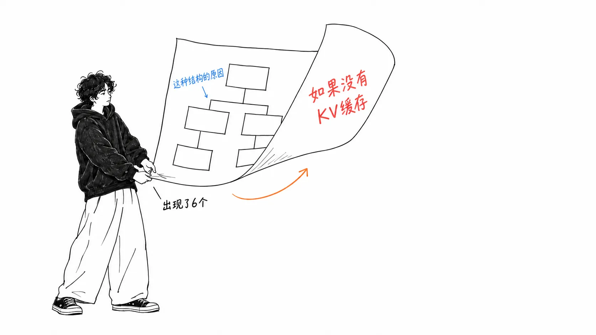
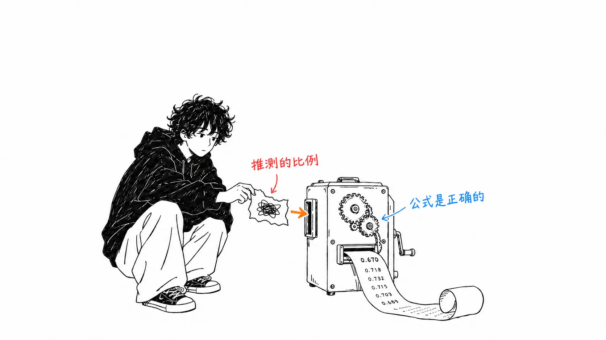
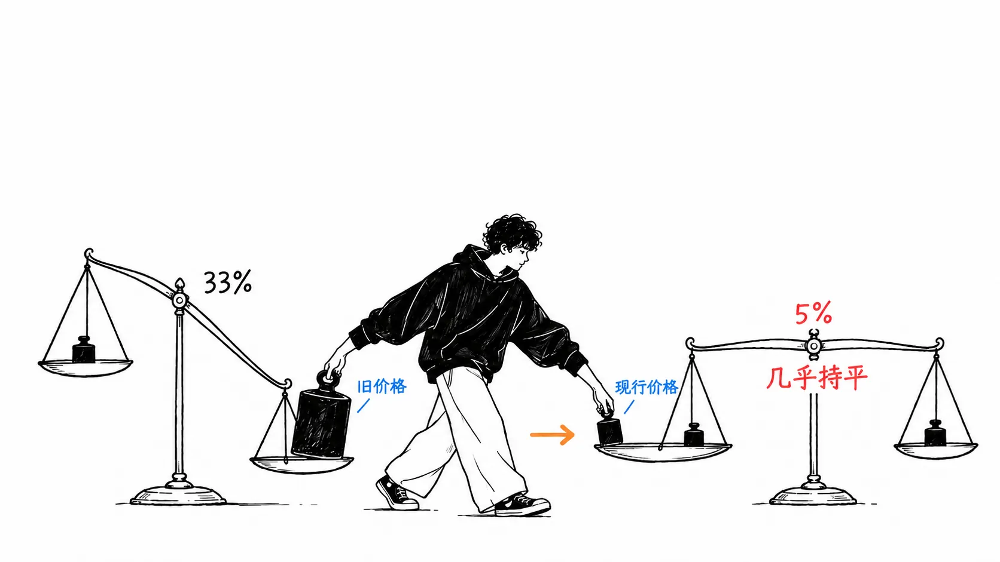
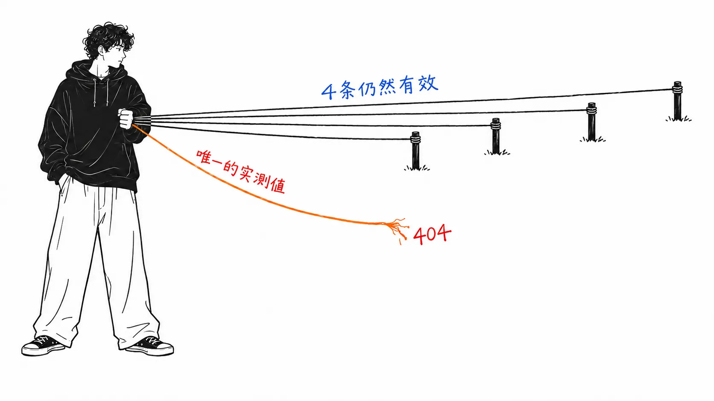

先把结论写在前面。

> 文中有一段计算，说“把活交给便宜的模型再交回来，反而更贵”。公式是对的，我复现之后，作者所说的“纯 opus 只要 2/3 的成本”分毫不差地算了出来。不过，**用到的 Sonnet 价格是上一代的。** 只要换成现行价格，优势就从 33% 缩到 **12%**，再把缓存读取也计入，只剩 **5%**，基本持平。结论不是“路由没用”，而是“**在如今的价格下，处于误差范围之内**”。

## 关于这篇文章

我读的不是 [@CompleteSkeptic 的帖子](https://x.com/CompleteSkeptic/status/2101894250401271876)（2026 年 9 月 21 日，513,493 次浏览）……而是它链接过去的那份 [Google Doc](https://docs.google.com/document/d/1G61uUB0FifUnmmrPzFQojZ3KpczYKmXGpgEXDJ2l_Zg/edit)。帖子正文只有三行，内容全都在文档那边。

作者是 Diogo Almeida。据其个人简介，他在 OpenAI 参与过 RLHF / ChatGPT 的启动，现在是 TypeSafe AI 的 CEO。也就是说，这不是一份中立的分析，而是**一份关于“为什么还要再做一个编程智能体”的自家设计备忘录**。标题本身就以 "Why yet another agent" 开头。

而作者自己是这么写的。

> we likely will never have time (ever again) to play ourselves, but hope the that the community goes WILD (**and makes me look like a naive idiot**)

他写了，希望你们让我显得像个傻瓜。所以我验算了一遍。以下就是记录。

**坦白交代。** TypeSafe 的产品我没碰过。文档我读了全文（14,661 字）。价格如后文所述，是基于我手头的资料，并且会写明日期。

## “如果没有 KV 缓存”这个问题

先写好的地方。这份文档的中心是一个问题。

> One of my favorite questions I ask people here is “**how would you design a coding agent if LLMs had no KV cache?**”

如果 LLM 没有 KV 缓存，你会怎么设计编程智能体？

我觉得这是个好问题。现在被当作理所当然的设计，很多其实是从“别弄坏缓存”这个约束倒推出来的。作者把这叫作 "the tyranny of the KV cache"（KV 缓存的专制），列出了六条。

| # | 主张 |
| --- | --- |
| 1 | **路由不划算**（唯一带计算的一条） |
| 2 | 工具定义必须在开头全部声明，占用上下文 |
| 3 | 压缩（compaction）只有在“所有轮次共享同一个状态”的前提下才能成立 |
| 4 | 子智能体不太行（因为状态交接很麻烦） |
| 5 | “重启”这个想法本身，就来自状态会坏掉的前提 |
| 6 | 要不要“电池全含”（batteries included）的拉锯 |

第 3 条我个人很有感触。它指出：压缩想要解决的是压缩的问题，但**如果知道在找什么，压缩会容易得多**，所以在不知道查询的情况下去压缩，是特意选了最难的形式。

## 我把计算重新算了一遍

六条里，带数字的只有第 1 条。

前提是：opus 输入 5 / 输出 25，sonnet 输入 3 / 输出 15（每百万 token 的美元数）。X = 上下文 token，Y = 输出 token，Z = 执行命令、读文件所产生的额外 token。

- **路径 1（opus 单独）**：25Y + 5Z
- **路径 2（opus → sonnet → opus）**：3X + 20Y + 8Z

关键在路径 2 多出来的那个 3X。sonnet 必须从零开始读入上下文。而 opus 这边已经在缓存里了，所以没有重新读取的费用。这就是“专制”的内容。

比例是作者设定的。而且设定的方式，写得再坦诚不过了。

> let's have chatgpt **vibe** some proportion of X / Y / Z
> X = 0.65, Y = 0.12, Z = 0.23

让 ChatGPT 随手给出来的。文中明确写了。

用这组值计算，得到 4.150 / 6.190 = **0.670**。作者说的“纯 opus 只要 2/3 的成本”原样算出来了。**公式和算术都是对的。**

让我在意的是价格。sonnet 的 3 / 15 是 **Claude Sonnet 4.6 的价格**，而现行的 Claude Sonnet 5 是 **2 / 10**。我换进去重新算了一遍。

| 条件 | opus 单独 | 经由路线 | 比率 |
| --- | --- | --- | --- |
| 原文原样（Sonnet 4.6 价格） | 4.150 | 6.190 | **0.670**（便宜 33%） |
| 换成 Sonnet 5 的现行价格 | 4.150 | 4.710 | **0.881**（便宜 12%） |
| 再计入 opus 的缓存读取 | 4.475 | 4.710 | **0.950**（便宜 5%） |

关于第 3 行补充一下。原来的公式里，路径 1 一个 X 项都没有。opus 的上下文被当作“在缓存里所以免费”。实际上缓存读取是按普通输入约 0.1 倍计费的，所以 opus 这边也要加上 0.5X。把它算进去，差距是 5%。

**ChatGPT 猜出来的比例只要动 5%，正负号就变了。**

也就是说，这个计算所支撑的不是“路由没用”，而是“**在现行价格下，哪个更便宜，光靠计算是定不下来的**”。结论的方向虽然相同，强度却完全不同。能不能拿来做设计判断，就变了。

另外我用的价格，来自我手头资料（截至 2026 年 6 月 24 日）里的表：Sonnet 5 是 2 / 10，Opus 5 是 5 / 25，缓存读取约 0.1 倍，缓存写入约 1.25 倍。**我没有用今天的官方价格重新核对。** 我的数字更旧的可能性依然存在。

## 引用的出处已经消失了

我还确认了另一件事。文档的附录里列了五个参考项目。其中四个健在，而且规模很大。

| 仓库 | star | 最后更新 |
| --- | --- | --- |
| `chopratejas/headroom` | 73,469 | 2026-09-22 |
| `rtk-ai/rtk` | 81,413 | 2026-09-21 |
| `ast-grep/ast-grep` | 16,001 | 2026-09-21 |
| `dmtrKovalenko/fff` | 10,840 | 2026-09-21 |
| `microsoft/fastcontext` | **404** | — |

只有最后一个消失了。而这恰恰是文档里**唯一引用外部实测值的地方**。

> Interesting claim: In our analysis of GPT-5.4 trajectories, reading and searching account for **56.2%** of all tool-use turns and **46.5%** of the main agent's total tokens

读取和搜索，占了工具调用的 56.2%、token 的 46.5%。如果是真的，这是比文档里其他主张重得多的数字。

我顺着查了一下。GitHub 搜索里还留着好几个“被微软删除的 FastContext 的镜像”，从那里能找到论文。[arXiv 2606.14066](https://arxiv.org/abs/2606.14066)《FastContext》是真实存在的，2026 年 6 月 12 日公开，**今天 9 月 22 日有更新**。论文主张把仓库探索从解题本身中分离出来，并写到在 SWE-bench Multilingual / Pro / SWE-QA 上解决率最多提高 5.5%，**token 消耗最多减少 60%**。

不过，**56.2% 和 46.5% 并没有出现在论文的摘要里。** 三个镜像的 README 里也没有。那两个数字只存在于已经消失的 README 里，现在没有办法确认。论文正文里给出的 URL 也是 `github.com/microsoft/fastcontext`，那里是 404。

主张的方向，论文是支持的（把探索分开，token 就会减少）。只是数字悬在了半空。

## 我的看法

这不是一篇抨击这份文档的文章。我的立场是：**以可以验算的形式写出来的东西，仅凭这一点就有价值。**

对比一下。我之前读过的另一份指南，是以“生产环境中的工具调用有 3 到 15% 会失败”为基础的，顺着出处查下去，最终落到了一个个人博客（[我的文章](https://meikocho1.github.io/blog/three-to-fifteen-came-from-one-blog)）。那个根本没法验算。这次的不一样，公式全都写着，所以只要换个价格就能复现。而且他自己写了“让 ChatGPT vibe 出来的”。**自己把薄弱之处明示出来的文档，读者是可以修正的。**

在此基础上，我把最可怕的地方写下来。**这份文档，是为了说明作者“为什么还要再做一个智能体”而写的。** 六条“专制”全都是在说既有智能体的设计被约束所束缚，结论自然会落到“所以有重新做一个的空间”上。

正因如此，唯一的计算是用上一代的价格搭起来的，这一点才有分量。这不是恶意的问题。**价格表三个月就会变，而设计备忘录不会变。** 我用的价格也是三个月前的。这篇文章也会以同样的方式变旧。

最后一点。文档对 `rtk` 写道：“这类项目理想状态下能帮到智能体，但实际上帮不到。原因大概是 LLM 并不原生理解它。”对一个拿到 81,413 个 star、昨天还在更新的项目来说，这个评价很重。而且作者自己写的是 “My guess”，没有附带任何测量。**在同一份文档里，对自己的计算附上了公式，对别人的工具附上的却是猜测。** 我觉得这一点并不对称。

## 只带走一件事的话

**看到别人的成本计算，只需要确认价格表的日期。** 即便公式是对的，如果单价是上一代的，结论的强度也会变。这次 33% 的优势变成了 12%，计入缓存读取后变成 5%。33% 可以定设计，5% 就定不了。**比起公式里的 bug，单价过时起作用的方式要安静得多。**

## 出处

- [@CompleteSkeptic（Diogo Almeida）的帖子](https://x.com/CompleteSkeptic/status/2101894250401271876)（2026 年 9 月 21 日，513,493 次浏览 / 3,019 个赞 / 4,276 次收藏）
- 链接指向的 [Google Doc "Why yet another agent"](https://docs.google.com/document/d/1G61uUB0FifUnmmrPzFQojZ3KpczYKmXGpgEXDJ2l_Zg/edit)（共 14,661 字，2026 年 9 月 22 日获取）
- [arXiv 2606.14066 "FastContext"](https://arxiv.org/abs/2606.14066)（2026 年 6 月 12 日公开，9 月 22 日更新）
- star 数和最后更新日期，于 2026 年 9 月 22 日从 GitHub API 获取

价格基于我手头的资料（截至 2026 年 6 月 24 日）。Claude Opus 5 输入 $5 / 输出 $25，Claude Sonnet 5 输入 $2 / 输出 $10，Claude Sonnet 4.6 输入 $3 / 输出 $15，缓存读取约 0.1 倍。**我没有在官方价格页面上做今天的重新核对。** 我关于原文的 3 / 15 指的是 Sonnet 4.6 的判断，由于作者没有明说，也只是推测。如果作者是出于别的意图放了 3 / 15，那这篇文章的指摘就不成立。

把缓存读取当作 0.5X 加到路径 1 上的处理，同样是我设的假设。实际上会随上下文中有多少在缓存里而变化。公式和数值如正文表格所示，请用你自己的价格和比例重新算一遍。
