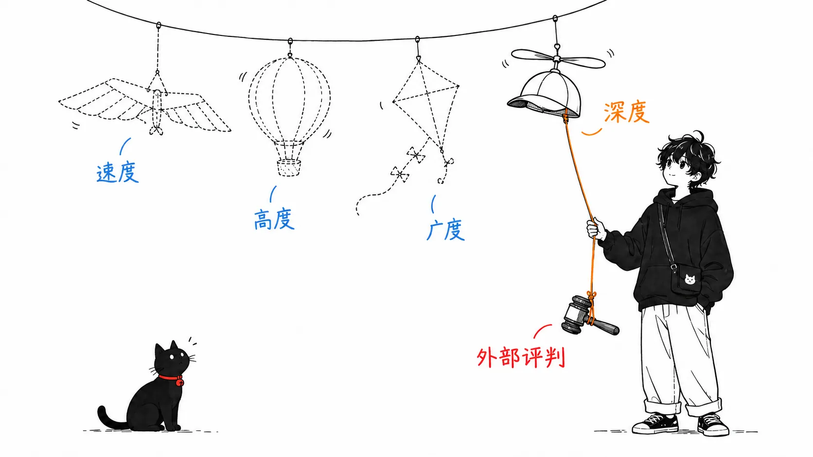
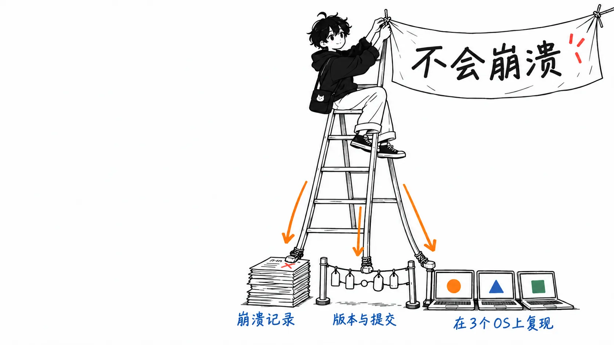
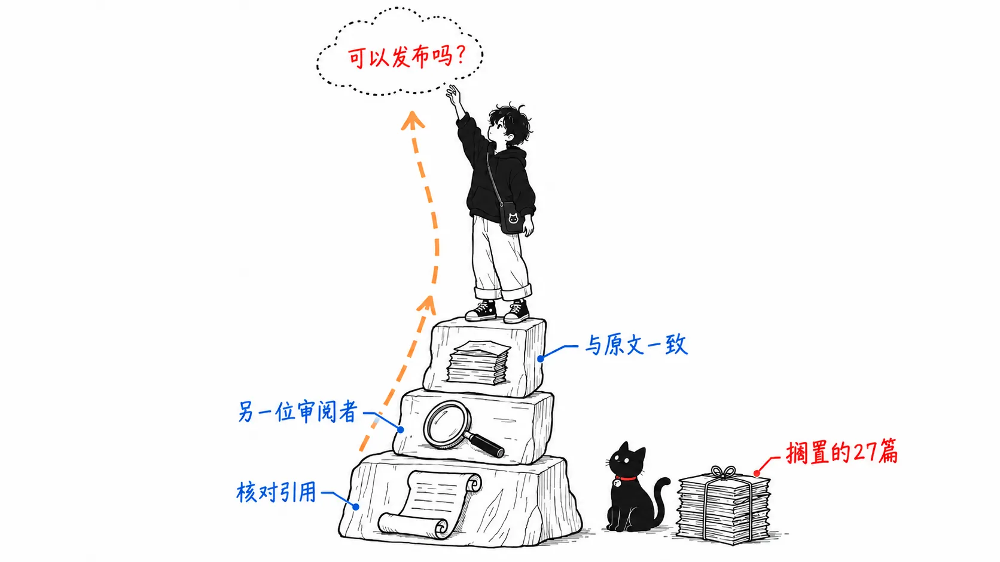

2026 年 10 月 13 日，Felix Rieseberg 在自己的博客上发了一篇文章，题为“How to be more ambitious: A tutorial for humans with models”。Rieseberg 是 Anthropic 的工程经理，带领过 Claude.ai、Cowork、Claude Code Desktop 的工程团队，同时也是 Electron 的共同维护者。

AI 圈的人每次看到惊艳的用法，都会说“大家的野心不够”。可是被这么一说，还是不知道该做什么。所以他把它写成了步骤。这就是这篇文章。

我读完之后，试着把它套用到了生成这个博客草稿的 harness 上。这个博客的草稿是让 Claude Code 来写的，每天自动产出一篇，另外我拜托的时候再出一篇。这篇是把 Rieseberg 的步骤套到它上面的记录。

先说结论。

> Rieseberg 把野心分成四种，除了被他略过的“速度”之外，其余三种都附了提示词示例。但是，“怎么知道做完了没有”这件事，只有“深度”里的“请外部裁判”这一条写到了，在我看来，其他几个维度都是搭在它上面的。把他自己“高度”的例子拆开来看，他在提高目标之前，先建好了验证的机制。没有裁判就只提高目标，模型会说“做好了”。在我的 harness 里真正起作用的，也是裁判。

---

## 写到“如何判定结束”的只有一条

Rieseberg 的划分是这样的。

> I think of ambition in four types: Speed, Altitude, Depth, and Range.
>
> （我认为野心有四种类型：速度、高度、深度、广度。）

速度是“同样的活，用更短的时间”。他自己写道，这一项已经成熟，面对 AI 的方式几乎不需要什么巧思，所以略过。剩下三个才是正题。

**高度**，是委托成果而不是作业。他自己的例子很好懂：前年年初他还是让 Claude 一个个去修崩溃，后来变成了请它“让应用保持不崩溃的状态”。

**深度**，是让它用那个领域顶尖的人的做法去做。这里排着五个小技巧：用顶级的工具、给一个看似离谱的目标并说它并不离谱、让它用原始数据去验证我们自己的想当然、让它产出新的见解、请一位外部裁判。

**广度**，是带入其他领域的视角。把名词改说成动词（季度回顾不是“材料”，而是“让忙碌的人相信一个因果的故事，并在不确定的情况下用 30 分钟做出决定”），像电影里的抢劫团队那样把各路专家聚到一起。

三个维度里，每一个都附有可以直接使用的提示词示例。高度的话，是把季度回顾分三个阶段拉高的提示词；深度的话，是“我觉得流失（churn）是入职引导（onboarding）的问题。用原始数据把它复现出来”；广度的话，是专家团队的组建方法。

不过，我读下来注意到的是，每一个写的都是“让模型做什么”，而“做没做成，由谁、怎么判定”几乎都没写。把它作为一个独立条目正面处理的，只有深度里的“外部裁判”。

> Use an outside judge: Do not ask the model to judge itself. I assume that this will eventually be solved with increasing model intelligence, but in October 2026, I implore you to insist on outside validation. Ideally that's a tool the model can run to get feedback immediately.
>
> （请用外部裁判：不要让模型给自己打分。我猜想随着模型变聪明，这个问题终究会被解决，但在 2026 年 10 月这个时间点，我恳请你坚持要求外部验证。理想情况是一个模型能自己运行、并立刻拿到反馈的工具。）



## “高度”的例子，讲的是建造裁判

崩溃的例子还有后续。我觉得这一部分才是正题。

> Doing this well often involves changing your workflow - in order to let Claude make sure our app is crash-free, I first had to make sure it can easily fetch crash reports, understand which app version maps to what git commit, and give it access to Windows, macOS, and Linux computers so it can actually independently reproduce and verify fixes.
>
> （要把这件事做好，往往得改变自己的工作流程。为了让 Claude 来保证我们的应用不崩溃，我首先得保证它能轻松获取崩溃报告，能弄清哪个应用版本对应哪个 git 提交，并且能用上 Windows、macOS 和 Linux 的机器，这样它才能自己去复现并验证修复。）

并排的这三项，全都是位于模型之外的、判断“是不是真的修好了”的依据。崩溃报告是修复之前状态的证据，版本与提交的对应是原因所在位置的证据，三个操作系统是已经修好的证据。

“让它保持不崩溃的状态”这个高目标，是有了这些之后才第一次能够委托出去。反过来，要是没有这些就提同样的要求，模型会修一点什么，然后汇报“修好了”，而确认这是否属实，又回到了人的头上。目标的高度提上去了，人的工夫并没有减少。

深度一节里的“给一个离谱的目标，并说它不离谱”也是同样的结构。

> Does something seem impossible to the model? Reiterate that it's very much solvable, it just needs to keep going.
>
> （有什么事在模型看来似乎不可能吗？反复告诉它，这完全是可以解决的，只要继续做下去就行。）

文中有这样的例子：想把耗时 10 秒的页面降到 5 秒，就去要 200 毫秒。如果有测量工具，这是好建议。如果没有工具，模型就可能写一句“已经是 200 毫秒了”然后收工。我的理解是，这两条建议只有成对才能成立。Rieseberg 把它们写成了各自独立的条目，但没有裁判的话，离谱的目标就只是一句“请你说你做到了”的请求。



## 套到我的 harness 上，能选的只有裁判

从这里开始，说的是我手头的事。

这个博客的 harness，由写着文风规则的 skill、插图的 skill、每天自动运行的提示词，再加上几份备忘构成。我套用 Rieseberg 的三个维度，让 Claude 给出了四个改造方案。

高度的方案，是把目标从“写一篇”提高到“写一篇不用修改就能发布的”。截至 2026 年 10 月 18 日，我在 Zenn 上发布的文章有 41 篇，没有进仓库、搁了一个多星期以上的草稿有 27 篇。思路是把已发布文章和停滞草稿之间的差别当作判定标准。

深度的方案，是取消文章的自我打分，改由另一个上下文里的审阅者来判定事实和文风。广度的方案，是把编辑和事实核查员的工作作为工序写进去。剩下的一个，是清理重复的设置。

我只选了深度。

事后想想，理由和 Rieseberg 的崩溃例子是一样的。高度的方案里没有裁判。那 27 篇为什么停下来，我手头找不到留下过理由的记录。判定“可以发布”的依据，只存在于我的脑子里。在这种状态下把目标提高到“可以发布的一篇”，模型也只会写出它认为可以发布的文章，而判定它的，依然是我。

## 造了裁判，拿昨天的文章试了一下

我做了两个。

一个是脚本，把文章里引用的原文，与原始来源做机械比对。核对英文引用是否一字不差地出现在原始来源里，没有就以失败告终。还会把来源里没出现的数字列成清单。拿它去跑昨天发布的“Claude Code 团队的 6 层评审”，7 行引用全部一致。在把引用里的一个词从 “indefinitely” 改成 “forever” 的版本上，它如期失败了。作为来源里没有的数字冒出来的，只有我在正文里自己估算的 0.6 和 1.2 这两个。拿原文章去跑时的输出是这样的。

```text
原文引用: 7行を照合、NG 0行
数字: 27種類、ソースに無いもの 2種類（要確認）
  0.6, 1.2
```

另一个是在另一个上下文里运行的审阅者。写文章时的备忘不交给它，只给文章的路径和来源的 URL，让它自己去把来源取回来读。它看五件事：事实、来源里没有的夸大、没有依据的写作者个人经历、有没有“见解”一节、文风。

拿同一篇文章去跑，84 秒就返回了。必须修改的意见 0 条，建议修改 8 条。

内容是这样的。我在正文里写道，原文章把评审的第二项工作“在最后三段里就交代完了”。数了一下是四段。原文的 “Noise costs more when the author is an agent”（作者是智能体时，噪音的代价更高），我翻成了“飙升”。在我写的“数字全都是他们自己测的”里面，混进了来自另一篇文章的引用，还有 Boris Cherny 个人的估算。

每一条都很小。但在写作者自己的检查里，每一条都通过了。写作者脑子里关于来源的记忆，就是写的时候所做的摘要本身，所以没法自己确认有没有偏离它。我自以为记得原文的 “costs more”，可在脑子里它早已变成了“飙升”。

写这篇文章的时候，这 8 条还没有反映到已发布的文章里。


---

## 我的看法

### 裁判要用“做什么”来写，而不是“角色”

广度一节里有一句话，我觉得最实用。

> Don't ask the model to write like a short seller, ask it to do what a short seller does to research their position.
>
> （不要让模型像做空者那样写作，而要让它去做做空者研究自己仓位时所做的事。）

深度一节里也有类似的指出：你说“要像专业人士那样行事”，模型往往只切换了词汇，而没有切换方法。

回头看自己给审阅者的委托文，第一行是“你是日语技术文章的事实核查员兼编辑”。这正是角色设定。不过我觉得，起作用的并不是它。能重新数出四段，是因为有一行写着“来源要自己取回来、读完全文之后再判定。不要相信文章的摘要”；能捡出 “costs more”，是因为我写了要把译文与原文并排对照。我觉得把角色那一行删掉，结果也不会变，但还没有试过。

### 裁判能抓住写作者注意不到的那类错误

还有一件事。这个 harness 本来就有类似的机制，写昨天那篇文章的过程中，我也让另一个模型读过。有一句话在那里被拦下了。草稿的“如果我错了”一节里，模型把我的经历写成了“我是个人开发者，没有运营过团队审批规则的经验”。这是披着谦虚外衣的披露，看上去是提高文章可信度的一句话。但它没有任何依据。我在发布前把它删了，所以含有这句话的草稿没有留下。我把这一点写出来：读者没有办法去确认。

这类错误，只要是写作者自己打分，就发现不了。因为写作者心里只有“我是在诚实地披露”。文风规则里写着“不要靠捏造事实来制造经历”，但“否定形式的经历也是捏造”这种读法，写的本人是想不到的。

Rieseberg 写道，让模型给自己打分的问题，等模型变聪明了终究会解决。我的看法略有不同。写的本人之所以会漏看，与其说是能力不足，不如说是因为他原封不动地带着写作时的上下文。我觉得裁判的作用，就是准备一个没有那份上下文的读者。要是这样的话，即使模型变聪明了，这个作用也还会留下来。

### 高度，是用裁判买来的

这里是我在这篇文章里想说的。

Rieseberg 的四个维度是横向并列的，但在我看来它们是上下叠起来的。外部裁判在最下面，搭在它上面有多少，高度就能提多少。在崩溃的例子里，报告、提交的对应、三个操作系统齐备之后，才第一次能委托“让它保持不崩溃的状态”。在我的 harness 里，有了引文核对和审阅者的现在，“写一篇与原始来源不矛盾的文章”总算成了可以确认的目标。“写一篇可以发布的文章”还提不上去。因为判定那 27 篇为何停下的依据，现在还没有。

所以我认为接下来要做的，不是去想高度的目标，而是把停滞草稿的原因一篇一篇记录下来。攒起来之后，就能做出“可以发布”的裁判了。



### 如果我错了

最大的问题是，我还没有测量裁判本身的质量。必须修改的意见为 0 条，可能是因为文章没有重大错误，也可能是因为审阅者太宽松。昨天那篇文章里写到的 Claude Code 团队，每天都用一组过去的事故来给审阅者打分。我的审阅者只对一篇文章跑过一次。

另外，每天的自动运行里还没有加入这道工序。自动运行用白名单限定了可用的工具，审阅者的启动和脚本的执行都不在里面。因为这是放宽权限的改动，所以还没有加。眼下，这个裁判只有在我拜托它来写的时候才会起作用。

还有，Rieseberg 文章后半部分关于自我效能感（相信自己能做到的程度）的话题，我在这里没有涉及。那是人这一侧的野心问题，不属于可以套到 harness 上的那类话题。

---

## 总结

只带走一件事的话，就是在提高目标之前先造裁判。无论是 Rieseberg 的崩溃例子，还是我这个博客的 harness，都是先造出了在模型之外确认“是否真的做成了”的工具，然后能委托的目标才上了一级。没有裁判就只提高目标，增加的只是“做好了”的汇报。

---

## 出处

- Felix Rieseberg “How to be more ambitious: A tutorial for humans with models”，2026 年 10 月 13 日 https://felixrieseberg.com/how-to-be-more-ambitious-a-tutorial-for-humans-with-models/
- 拙文《Claude Code 团队的 6 层评审》，2026 年 10 月 17 日
