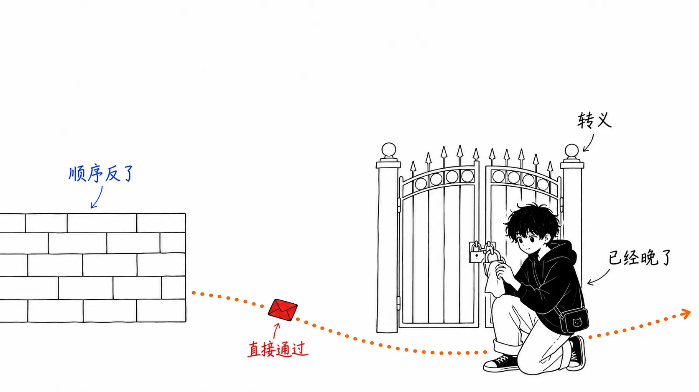
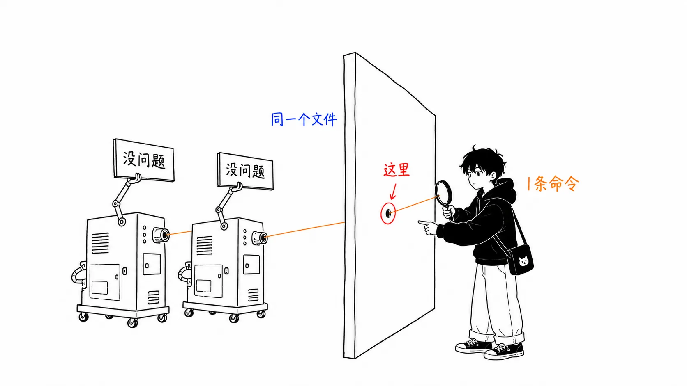
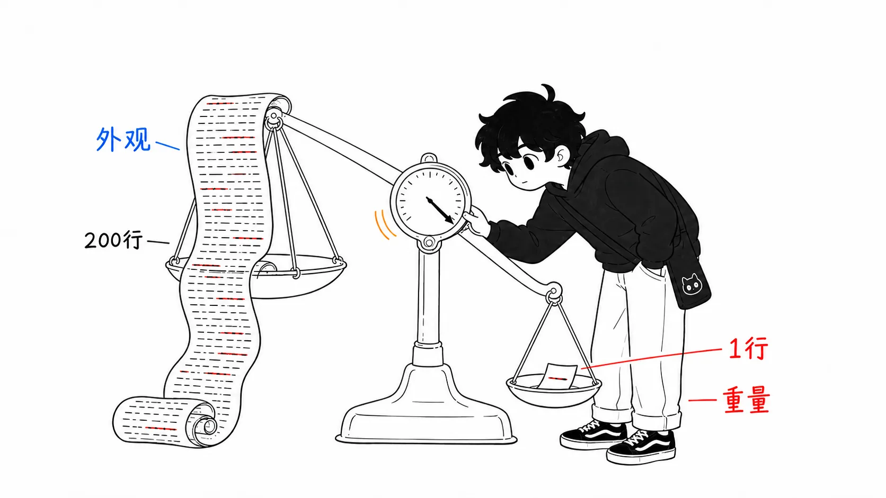

## 关于这篇文章

本文讨论的是 Wiz Research 于2026年8月17日公开的、Snowflake 公开仓库里的 GitHub Actions 脚本注入案例。作者是 Gal Nagli。

- 出处：[Wiz Red Agent Finds Its Way Into Snowflake's Internal Jira Through a Flaw in a GitHub Copilot–Assisted PR](https://www.wiz.io/blog/red-agent-snowflake-copilot-cicd-bug)（Gal Nagli，2026年8月17日）
- 相关 PR：[snowflakedb/snowflake-connector-net#1218](https://github.com/snowflakedb/snowflake-connector-net/pull/1218)（引入漏洞的一方）、[#1402](https://github.com/snowflakedb/snowflake-connector-net/pull/1402)（修复的一方）

本文分两部分。第1部分是事件经过，第2部分是**我自己读了 diff、自己跑了 linter 之后得出的东西**。后半部分更长，因为事件经过读 Wiz 的博客就够了。

先说明哪些是我自己确认过的，哪些没有。

自己确认过的：通过 GitHub API，PR #1218 和 #1402 的合并时间与提交 SHA（`4a1b8ce` / `1dc7766`）与 Wiz 的描述一致；两个 PR 的实际 diff；以及取下存在漏洞的版本 `4a1b8ce` 的 `jira_issue.yml`，用2026年8月时点的 `zizmor@latest` 跑出来的结果。

没有确认的：GitHub Advanced Security 扫描了这个文件却什么都没报告，Copilot 判定这个 PR“没有问题”，以及实际攻击成功了。这些全是 Wiz 的说法，我没法从外部验证。下文提到这三点时，都会写成“Wiz 是这样写的”。

---

## 第1部分：发生了什么

### 先说结论

> 安全的写法只是以代码的“形状”存在。没有任何机制去强制保证为什么要是那个形状。所以它在重写的过程中消失了。而它消失这件事，人工评审和 AI 评审都没有发现。另一方面，零配置的免费 linter，却把真正被攻击的那一行本身，以 High 级别指了出来。该守住这里的不是注意力，而是机器可读的规则。

### 五天

据 Wiz 所述，时间线如下。2026年6月18日 PR #1218 合并，漏洞进入生产环境。6月23日，Wiz 的自主安全智能体“Red Agent”发现了它，并实际加以利用，取得了对 Snowflake 内部 Jira 的读取权限。同一天通过 HackerOne 上报，Snowflake 当天打了补丁。第二天轮换了令牌。通过核对审计日志，确认暴露期间访问过的只有 Wiz 的测试用 IP。

这个口子开了五天。

### 怎么被攻破的

有问题的工作流由 `issues: opened` 触发。也就是说，GitHub 上任何人只要开一个 issue 就能触发它。而这个 issue 的标题，被直接展开在了 `run:` 块里。

```yaml
run: |
  # Escape special characters in title and body
  TITLE=$(echo '${{ github.event.issue.title }}' | sed 's/"/\\"/g' | sed "s/'/\\\'/g")
```

注释里写着“转义特殊字符”。而且确实用 `sed` 处理了单引号。可它还是会被攻破。

因为顺序反了。`${{ }}` 的展开，是 GitHub 在把 YAML 交给 shell 之前就完成的。`sed` 运行在这之后，也就是生成好的 shell 脚本执行的时候。标题里只要放一个 `'`，`echo '...'` 的字符串就在那里闭合，后面的内容就被当作普通命令来解释。转义处理保护不了一个在它之前就已经完成的替换。

Wiz 写道，它通过这条路径让密钥（`JIRA_API_TOKEN` 等）被发送到外部，并能以 `qa@snowflake.net` 的身份认证进 Snowflake 的 Atlassian。取得了工程、安全合规、漏洞赏金跟踪这几个项目的读取权限。

Red Agent 的行为有意思的一点是，它第一次尝试因为 bash 语法错误而失败了。载荷里用了 `#`，把 `TITLE=$(...)` 的右括号也吞掉了。智能体没有就此停下，而是读了错误信息，把载荷改成 `; echo '` 的形式，然后成功了。



### 只是摆设的关卡

这个工作流上带着一个看起来很像防御的条件。

```yaml
if: (github.event_name == 'issues' && github.event.pull_request.user.login != 'whitesource-for-github-com[bot]')
```

在 `issues` 事件里，`github.event.pull_request` 永远是 `null`。所以这个条件退化成 `null != 'whitesource-for-github-com[bot]'`，永远为真。谁都能通过。

在这里我补充一点读 diff 才发现的事。**这个坏掉的关卡，并不是 PR #1218 带进来的。** 在 #1218 的 diff 里，这行 `if:` 在删除侧（`-`）和新增侧（`+`）以相同内容同时出现。变的只有缩进。也就是说，这个永远为真的条件，在这次事件之前就已经放在那里了。Wiz 的博客解释了关卡是怎么坏的，但没有写是 PR 引入的。这次的回归，纯粹是从 `env:` + `jq --arg` 换成直接展开的那一处改动。

---

## 第2部分：我的想法

### 首先，我自己跑了一遍

到第1部分为止都是概述。从这里开始才是正题。

我取下存在漏洞的版本 `4a1b8ce` 的 `jira_issue.yml`，用 GitHub Actions 的静态分析工具 [zizmor](https://docs.zizmor.sh/) 扫了一遍。连安装都没装。就一行。

```
uvx zizmor@latest .github/workflows/jira_issue.yml
```

结果：`template-injection`，严重度 High / 置信度 High，指向第24行。第24行就是这个。

```
TITLE=$(echo '${{ github.event.issue.title }}' | sed 's/"/\\"/g' | sed "s/'/\\\'/g")
```

正是被实际利用的那一行。同一个审计还以 High 抓到了第25行（`BODY`）和第42行（`description` 里的 `html_url`），此外 `secrets-outside-env` 以 Medium 指出“密钥处在 `run:` 块能够触及的位置”。在 auditor 人设下合计16条。

为免误会，先说清楚，这并不是在主张“当时用了这个就能防住”。我跑的是2026年8月的最新版。当时的版本是否会得出同样的结果，我没有确认。即便如此，这个检测就是 zizmor 的核心审计 `template-injection` 本身，规则很简单：只要 `${{ }}` 进了 `run:`，就报。我没写配置文件，也没动排除列表。耗时不到一分钟。

而另一边，Wiz 写道，GitHub Advanced Security 扫描了包含这个有漏洞的工作流的最终版本，明确提取了这个文件，却没有报告这个注入。Copilot 作为同一个 PR 的共同作者检查了代码，判定没有问题。

同一个文件。一边是一条命令。另一边是企业级安全产品加 AI 评审员的双重检查。



### 这不是“AI 写了危险代码”的故事

这起事件是以“AI 辅助的 PR 引入了漏洞”为标题传播的。但这比已公开的事实多走了一步。Wiz 自己在公开当天的 1957 UTC 加了一条补充，明确写道：Copilot 是检查已合并 PR 的共同作者，**代码改动本身是否由 AI 辅助，并不清楚**。

所以我想把这起事件里的 AI 要素分成两份。写的一方不明。**放行的一方，已被披露是 AI。**

这个区分不是无关紧要的细枝末节。“别让 AI 写危险的代码”这个教训，和“别让 AI 来判定安全性”这个教训，对应的对策完全不同。前者指向限制代码生成。后者则是要把判定落实为机器可读的规则。这次公开的内容所支持的，是后者。

### 消失的不是一道防御，而是三道

读 diff 可以看到，改写之前的代码做了三重防护。

把 `ISSUE_TITLE` / `ISSUE_BODY` / `ISSUE_URL` 放在 `env:` 里，作为 shell 变量引用。这是第一道，也是避免经过模板展开的唯一正解。JSON 的组装交给 `jq -n --arg`。这是第二道，引号和控制字符都由 `jq` 负责。此外还有对反引号的显式转义（`${ISSUE_TITLE//\`/\\\`}`），以及把正文写进临时文件的处理。

改写之后，三道全没了。`env:` 里那三个变量被拿掉，`jq -n` 被换成裸的 `-d '{...}'`，反引号处理和临时文件也都没有了。

我认为写这段的人（或者别的什么）并没有恶意。甚至可以说它变得更好读了。比起拼装 `jq` 管道，直接写 JSON 更短，第一眼就能看懂。这三道防御，每一道的**形状都让人读不出它是防御**。用 `--arg` 的理由，代码里哪儿都没写。那一行反引号转义，不知道意图的话只是噪音。

安全的意图，只存在于代码的形状里。不在注释里，不在测试里，也不在 CI 的规则里。形状会在改写时消失。


### 想用评审去守护测试守护不了的性质

再往一般化推一步。

这一类安全性是**负向性质**。你写不出一个断言“不会发生注入”的测试。单元测试检查的是该做的事有没有做。它证明不了“不该做的事一件都没做”。所以这类不变量，会被放到测试套件之外。

放到的地方就是“惯例”。惯例存活的时间，与那个文件的变更频率成反比。而2026年发生了什么？**重写变便宜了。** 不管是生成还是辅助，把整份 YAML 重写一遍的成本都急剧下降。变更频率升高的地方，恰好是“正确性靠惯例而不是靠测试来保证的领域”。

也就是说，问题不在于 AI 不理解安全。**AI 提高了测试没有保护到的领域的重写速率。** 那些地方原本就只靠人的记忆在守着。

之前我在一篇叫“评审没有堵，是仪表坏了”的文章里写过，AI 代码烧掉了“脏”这个判断依据。这次不是它的续篇，而是另一种故障。那篇讲的是判断依据坏掉了。这次讲的是**判断依据从一开始就不存在的领域**。CI 的 YAML 上，原本就没装“脏”的警示灯。

### diff 在视觉上的大小，和语义上的危险没有相关性

还有一点，不读 diff 就看不出来。

PR #1218 把 `jira_issue.yml` 的缩进从4个空格改成了2个。结果这个块的几乎每一行都显示为变更行。块里的内容实际上也被改写了，所以它并不是“只整理缩进的 PR”。但**危险的语义变化被埋进了全行变动里**，这一点是确定的。

在评审里打开这份 diff，映入眼帘的是大片的绿和红。人的注意力在这里会落入一种快速的模式匹配：“这是格式整理”。落进去并不是毛病，人本来就是被设计成这样落进去的。

diff 在视觉上的大小，对语义上的风险什么也说明不了。一个字符的改动可能删掉权限检查，200行的改动也可能全是缩进。评审者没法从外观上区分这两种情况。所以我的结论是，不能让人来做这个区分。凡是碰了 `.github/workflows/**` 的 diff，不管行数多少，都无条件交给 linter 判定。别让判定成为人类专注力的函数。



### 别读错“五天”

最后是我最想说的部分。

Wiz 的教训部分写的是“发现的窗口在缩短，要加快补丁周期”。我同意一半。但如果把“加快补丁”当作主要对策，就是踏进了一场注定会输的比赛。

五天，是自主智能体持续扫描一个组织的 GitHub、找到漏洞、从失败中恢复、一路完成利用所花的时间。这个数字今后只会朝**变短**的方向走。牵涉人工审批和部署的补丁周期，不可能追上这条曲线。只要是在比速度，对方永远更快。

我认为结构性的答案有两个。

第一个是**让被偷走也没有价值的密钥**。这次被拿走的是一个长期有效的 Jira API 令牌。从暴露到失效，实际花了6天（6月18日暴露，6月24日轮换）。假如发现的时间不是5天而是50天，它会一直有效。在这里起作用的不是检测速度，而是压根不把长期有效的凭证放进 `secrets` 的设计。用 OIDC 获取短期令牌，把权限收窄到一个项目，把 `permissions:` 压到最小。zizmor 以 Medium 给出的 `excessive-permissions` 和 `secrets-outside-env`，指的正是这一层。

另一个是**整个类别一并禁止**。不再在评审里每次去判定“这个 `${{ }}` 安全吗”。`run:` 块里的 `${{ }}`，包括安全的在内，一律去掉。有几个安全的例子被一并卷进去也无所谓。把判定从人转移给机器，价值更高。zizmor 以低置信度报出的 `steps.create.outputs.jira_key` 那一行，实际上多半也不是攻击者能控制的值。修复 PR #1402 把那里也改了。我的理解是，这不是因为它能被利用，而是因为按类别一并去掉了。这才是正确的做法。

顺便一提，修复 PR 的标题是 `NO-SNOW adjust jira yml files`。连内部 Jira 编号都没带，看上去像是个杂活。实际上，它是把开了五天的口子关上的那个提交。这里同样出现了同一个问题。**一个改动在守护什么，从外观上看不出来。**

---

## 只带走一件事的话

不是加快补丁。也不是不再让 AI 写代码。

是给碰 `.github/workflows/**` 的 PR 加上一道 `zizmor`。今天就能做，一句 `uvx zizmor@latest` 就完事。不需要配置文件。

在这之后，不妨数一数，在你自己的仓库里，“测试守护不了、只靠惯例在守护的不变量”还有多少。在重写成本下降的世界里，惯例不再是资产，而是转到了负债那一边。没有人写下理由的正确形状，会在下一次重写里消失。这次消失的有三个。

**机器读不了的规则，已经不再是规则。**

---

## 出处

- Gal Nagli, "Wiz Red Agent Finds Its Way Into Snowflake's Internal Jira Through a Flaw in a GitHub Copilot–Assisted PR", Wiz Blog, 2026年8月17日 — https://www.wiz.io/blog/red-agent-snowflake-copilot-cicd-bug
- snowflakedb/snowflake-connector-net PR #1218（2026年6月18日合并，`4a1b8ce`） — https://github.com/snowflakedb/snowflake-connector-net/pull/1218
- snowflakedb/snowflake-connector-net PR #1402（2026年6月23日合并，`1dc7766`） — https://github.com/snowflakedb/snowflake-connector-net/pull/1402
- zizmor 文档（`template-injection` 审计） — https://docs.zizmor.sh/audits/#template-injection
- HackerOne 报告 #3819931（Wiz 博客中提到，未公开）

PR 的合并时间和提交 SHA，以及两个 PR 的 diff，我是通过 GitHub API 确认的。zizmor 的运行结果是2026年8月20日、对版本 `4a1b8ce` 运行 `zizmor@latest` 的输出。
