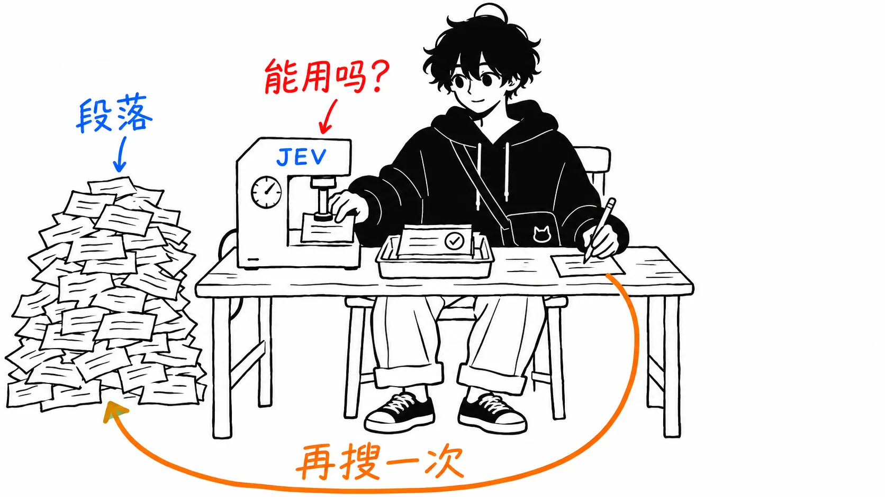
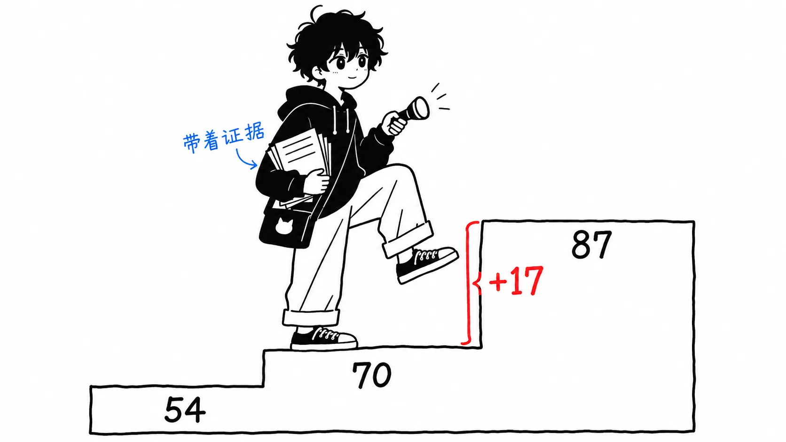
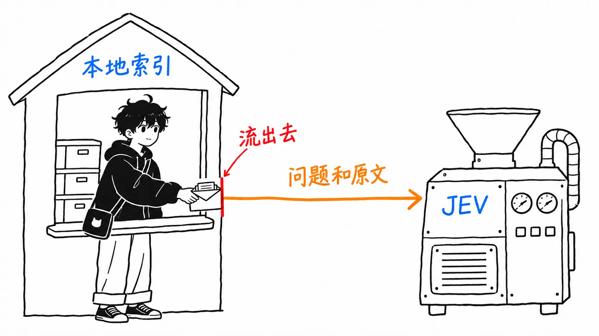

我读了 X 上的文章《RAG这次真死了！SAG2才是本地知识库的神，又快又准又便宜～》（袋鼠帝，2026年11月9日）。作者长期以搭建知识库为业，这是一篇介绍 SAG2 的文章。SAG2 为什么比 RAG 强？为了弄清这一点，我一路追到了原始论文。

先说结论。

> SAG2 并没有取代 RAG。它是把 RAG 里“检索”这一环，从事先加工改成了在提问时做判定。论文证明的是多跳问题中找回证据段落的比例（召回率），并没有测最终回答是否正确。而且用来做判定的 JEV 是外部 API，问题和候选段落的原文都会发送过去。“本地知识库”“便宜”这两个说法，都要带着这两个前提来读。

在论文的表格里，它确实比对比对象强。但“比什么强”，在传播中被说偏了。

---

## 关于这篇文章

我读的是 X 上的那篇文章，以及它所依据的论文《SAG2: Embedding-Free Multi-Hop Retrieval with BM25 and JEV》（Yuchao Wu，Zleap AI，[arXiv:2610.22588](https://arxiv.org/abs/2610.22588)，2026年10月15日）。

先交代我的位置。我没有运行过 SAG2，也没有用过桌面版 SAG Wiki。下文的数字，除了 7,000 倍和 4.57 小时（X 文章里的数字）之外，都来自论文的表格和正文；差值和每题平均值是我据此算出来的。没有任何一个数字是我自己测的。论文中作为对比来源引用的 SAG 第一版论文（Wu et al., 2026）和 EnterpriseRAG-Bench 论文（Sun et al., 2026），我都没有读。

我没有使用论文里的图。这篇论文在 arXiv 上的许可不是 CC，而是版权仍归作者的形式（arXiv.org perpetual non-exclusive license），所以我把需要的数字整理成了表格。

## SAG2 在做什么

机制可以说得很短。建库（论文里叫 index construction）时完全不调用模型，只给原始段落建一个 SQLite 全文检索（FTS5）索引。问题来了之后，重复以下步骤：

1. 用 BM25 取出候选段落
2. JEV 结合问题和此前已找到的证据，逐个判断候选“是不是有用的证据”
3. 从有用的段落里挑出词，用它们做下一轮检索

论文摘要是这样写的：

> This moves semantic evidence selection to query time, eliminating offline embedding computation, LLM-based event--entity extraction, and dedicated database servers.
>
> （这样一来，基于语义的证据筛选被移到了提问时，不再需要事先的向量计算、用 LLM 抽取事件与实体，也不需要专门的数据库服务器。）

JEV 是 TypeSafe AI 推出的专门做判定的模型，不写文章，每次判定只返回“是”的概率。论文的实现通过 OpenRouter 调用 `typesafe/jev-1.13-20260917`。

X 文章里张三的例子（A 公司收购 B 公司、张三任 A 公司 CTO、张三加入盘古项目），就是把上面的 1→2→3 原样跑了一遍。

## 论文里的数字

下面是三个多跳问答数据集（各 1,000 题）上的段落召回率，从论文表格中摘了一部分，单位是 %。

| 方法 | MuSiQue R@5 | MuSiQue R@10 | 2Wiki R@10 | HotpotQA R@10 |
| --- | --- | --- | --- | --- |
| BM25 | 47.47 | 54.41 | 71.50 | 86.90 |
| NV-Embed-v2（向量检索） | 68.84 | 77.27 | 80.75 | 97.70 |
| HippoRAG 2（图谱） | 65.13 | 73.76 | 93.40 | 97.15 |
| SAG（第一版） | 80.36 | 83.37 | 93.57 | 97.70 |
| SAG2 | 80.68 | 86.62 | 97.43 | 99.00 |

R@10 指的是前 10 个段落里包含了多少正确的证据段落。在最难的 MuSiQue 上，SAG2 比最好的向量检索高 9 个百分点，比 HippoRAG 2 高 13 个百分点。

在使用 51 万份模拟企业文档（邮件、工单、会议记录等）的 EnterpriseRAG-Bench 上，文档级 Recall@10 是 81.10%。同一张表里 BM25 是 68.4%，向量检索是 46.0%。

论文还有一张成本表：MuSiQue 的 11,656 个段落建库用时 2.36 秒，SQLite 文件 25.87 MiB，事先的模型调用为 0 次。1,000 道题的 JEV 费用是 4.33 美元。

## 真正起作用的是“带上下文的反复检索”

我认为最值得读的，是 MuSiQue 上的消融实验（拆掉部件后的对比）。

| 配置 | R@10 |
| --- | --- |
| 仅 BM25 | 54.41 |
| BM25 + JEV，不扩展 | 67.93 |
| BM25 + JEV，一次性多判定一些（判定次数与 SAG2 对齐） | 69.82 |
| SAG2，不把已找到的证据交给判定 | 76.25 |
| SAG2（扩展 2 轮，交给证据） | 86.62 |

只加上 JEV，召回率停在 68% 左右。即使判定次数和 SAG2 一样多，只要是一次性做完，也只有 69.82%。再往上的 17 个百分点，来自两件事：用找到的段落里的词重新检索，以及判定时把此前的证据一起给模型看。仅仅不给证据，就会掉 10 个百分点。

也就是说，SAG2 强的核心既不是 BM25，也不是 JEV 本身，而是“拿找到的东西当线索再去找”的反复检索。这和 RAG 并不对立。像 IRCoT（推理与检索交替进行的方法）这样的迭代式检索早就有了，论文的相关工作里也提到了。SAG2 的新意在于，用“零预处理的词汇索引 + 便宜的判定器”把这种反复跑了起来。

所以“SAG2 vs RAG”这个对比，准确地说是“一次性检索 vs 边判定边反复的检索”。SAG2 找到的段落，最终还是要交给 LLM 生成回答。这本身就是 RAG。

## X 文章和论文之间的出入

X 文章很有热情，读起来也顺，但和论文对照，有几处说过头了。

**“8 项指标全部第一”。** 论文声称的是在 R@5 和 R@10 上最好，仅此而已。看表格，MuSiQue 的 R@1、R@2 和 2Wiki 的 R@1，都是 SAG 第一版更高。论文自己也写了“SAG retains higher R@1 and R@2 on MuSiQue”。如果只取前 1～2 条，第一版仍有更合适的场景。

**“本地知识库”。** 索引是本机上的 SQLite，判定却是外部的 JEV。X 文章也写了要在设置里填 JEV 的 Key，以及可以换成别的决策模型。但“本地”这个词，很容易让人以为数据不会离开本机。论文在局限一节写道：

> Consequently, the present system cannot be independently deployed entirely on premises using publicly released model artifacts, even though its retrieval index is local.
>
> （因此，尽管检索索引在本地，目前的系统仍无法仅靠公开发布的模型完全私有化部署。）

论文接着写道，问题和候选文本也必须发送给该服务。如果你处理的是不能出公司的文档，这是第一个要确认的点。换成其他判定模型后精度如何，论文没有评估。

**“又快又准又便宜”“速度直接提升7000倍”。** 7,000 倍是 SAG 第一版建库 4.57 小时与 SAG2 的 2.36 秒之比。4.57 小时这个数字在 SAG2 论文里没有出现，X 文章说它来自第一版论文，我没有去核实。

更重要的是，计算并没有消失，而是挪了位置。第一版在建库时用 LLM 抽取事件和实体；SAG2 则在每次提问时调用 JEV。按论文的数字，MuSiQue 的 1,000 道题里 JEV 共判定了 331,325 次，平均每题约 330 次，费用约每题 0.4 美分。但论文没有把它和其他方案在提问时的费用放在一起比较，所以从表格里看不出这到底算不算便宜。响应时间也没有测。

> Online latency is not reported because service waiting time was not separated from concurrent execution.
>
> （由于无法把服务等待时间与并发执行区分开，论文不报告在线响应时间。）

**“LightRAG、MS-GraphRAG、HippoRAG 2 这些图谱方案都没跑完全量”。** SAG2 论文里 EnterpriseRAG-Bench 的表格只有 BM25、向量检索、Bash Agent 三项。图谱方案没跑完这件事，在这篇论文里核实不了。也许写在基准测试那篇论文里，但我没有读。

## 对比的前提

论文本身也写明了读这些数字时要注意的地方：

- 三个数据集表格里向量检索和图谱方案的数字，是从 SAG 第一版论文转录的。论文写的是“The SAG comparison uses different models and implementations”。
- MuSiQue 在方法开发过程中也被用过（“MuSiQue was also used during method development.”）。与 BM25 差距最大的 MuSiQue，同时也是用来调方法的数据集。
- EnterpriseRAG-Bench 是合成语料。
- 在 MuSiQue 的四跳问题（166 题）上，前 10 条里凑齐全部证据的比例只有 28.31%。
- 那 17 个百分点的对比是按判定次数对齐的，论文说明 token 数和费用并没有对齐。
- 测的只是检索召回率，回答是否正确被列为今后的课题。

> Generalization to an unused split, private organizational corpora, and downstream answer generation remains to be evaluated.
>
> （在未使用的数据划分、非公开的组织内部语料，以及下游回答生成上的泛化能力，仍有待评估。）

还有一样东西不在表里。X 文章自己写了，全文检索 + 向量检索 + 重排序的混合检索已经“成了标配”，至今仍是“最成熟的工业方案”。可这种标准配置，比如 BM25 和向量检索混合后再做重排序，并不在论文的对比表里。SAG2 赢过的对象，是单独的 BM25、单独的向量检索和图谱方案。

## 我的看法

决定要不要用 SAG2 时，我认为比召回率表更该看的是下面三点。

第一，问题和文档片段能不能发给外部 API。不能的话，现在的 SAG2 就不在选项里。论文也把可本地运行的判定模型列为今后的课题。

第二，你手头的问题，现有检索到底漏了多少。HotpotQA 上向量检索的 R@10 已经是 97.70%，和 SAG2 的 99.00% 只差 1.3 个百分点。差距大的是 MuSiQue、2Wiki 这类要顺着线索跳好几步的问题。如果你现在的混合检索漏得并不明显，换过去的理由就不强。

第三，成本的方向。SAG2 把建库成本降到 0，改成了按提问付费。和事先一次性付费的方案不同，这部分会随着提问次数线性增加。文档多、提问少的知识库，SAG2 这种形式划算；文档不多、每天却有大量提问的话，迟早会在某个点上被事先加工的方案反超。论文没有比较提问时的费用，所以这个分界点在哪里，只能用你自己的数字去算。

我之前在这个博客写过一篇 Hightouch 的文章（《关于 Hightouch 的 Jev 与 Opus 两段式判定》），里面也出现了 Jev。因为名字相同，我把它们当作同一系列的模型来读，但那篇原文没有说明 Jev 的内部情况，我没有确认它们是同一个模型。在那里，Jev 是“便宜、快、返回概率的第一级判定器”，没把握的部分交给 Opus。SAG2 则是每题调用约 330 次同类便宜判定器的设计。便宜的判定器出现之后，“事先把所有东西都加工好”以外的选项才变得现实。我把 SAG2 读作其中的一种形态。

反过来说，SAG2 的价值建立在 JEV 的价格和持续供应之上。论文也写了，所评估版本能否持续可用，取决于提供方。

## 如果只带走一点

试用 SAG2 之前，先确认问题和文档片段能不能发给外部的判定 API。如果不能，召回率表格现在还没有读的意义。

出处：袋鼠帝《[RAG这次真死了！SAG2才是本地知识库的神，又快又准又便宜～](https://x.com/aikangarooking/status/2119717912546304048)》（X，2026年11月9日）。Yuchao Wu《[SAG2: Embedding-Free Multi-Hop Retrieval with BM25 and JEV](https://arxiv.org/abs/2610.22588)》（arXiv:2610.22588，2026年10月15日）。基准测试的复现代码在 [Zleap-AI/SAG-Benchmark](https://github.com/Zleap-AI/SAG-Benchmark)。SAG 第一版论文、EnterpriseRAG-Bench 论文和 JEV 的官方文章我都没有读，也没有运行过 SAG Wiki。
