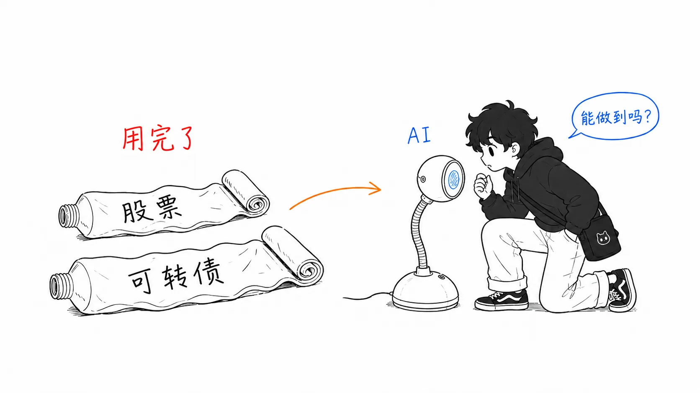
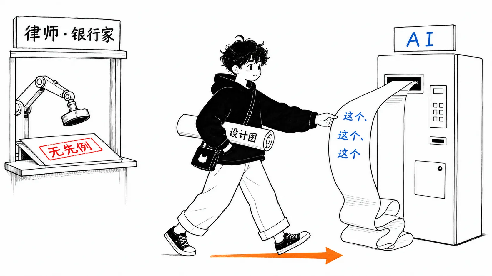
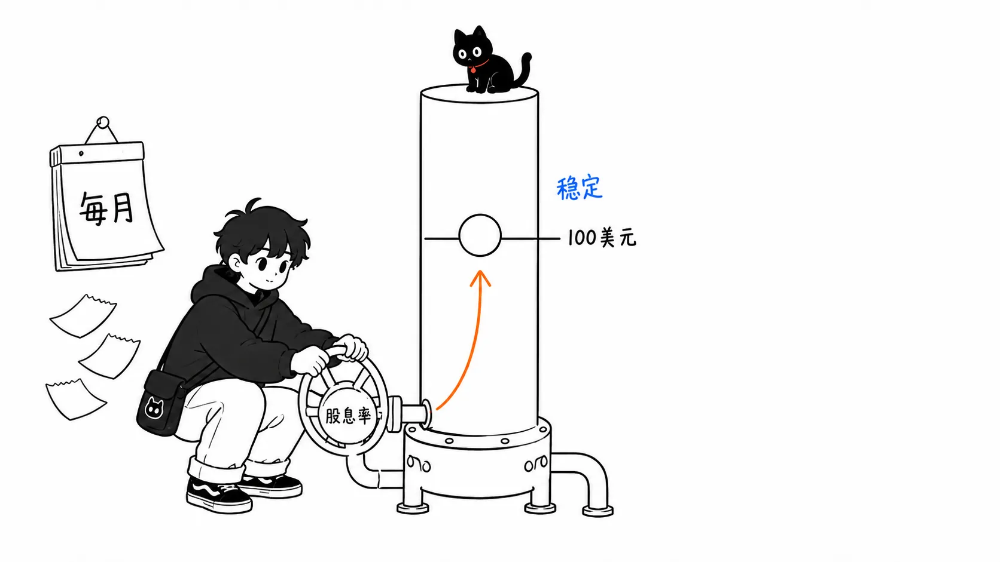
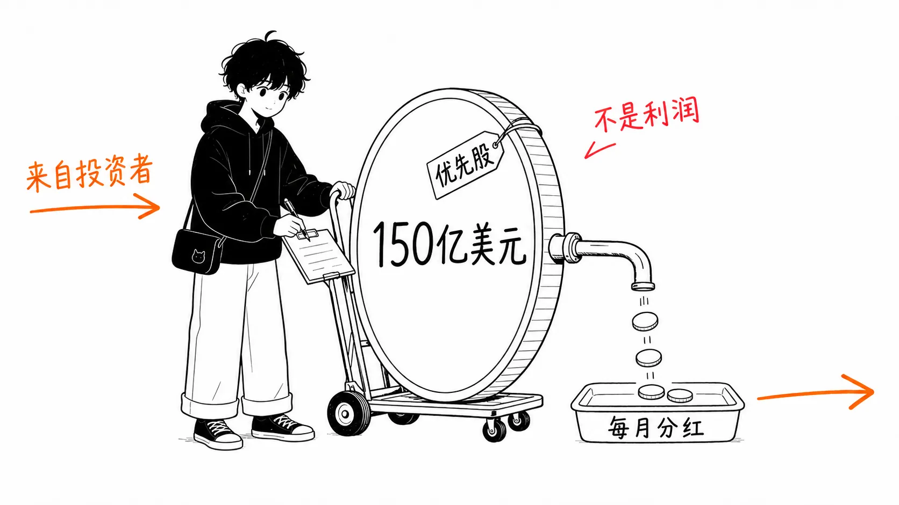
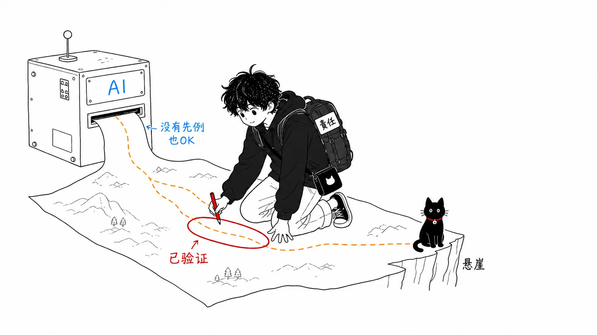

## 关于这篇文章

2026 年 8 月 6 日，Strategy（原 MicroStrategy）的执行主席迈克尔·塞勒（Michael Saylor）上了播客 “The Diary of a CEO”（主持人：史蒂文·巴特利特）。各家媒体只截取了“ChatGPT 让一位亿万富翁赚了 150 亿美元”这一点来报道，但正片大约有两个小时，AI 的部分只是其中一段。

这篇文章不是标题的摘要。我获取了访谈正片（YouTube 的自动生成字幕，约 1.9 万词），机械地抽取出相关段落，与报道对照之后，围绕他实际讲的内容做了整理。引用均为我根据字幕自行翻译的，无法保证逐字准确。

先写全貌，是这样的。

> 访谈有三根支柱。①与 ChatGPT 一起设计优先股，**筹集**了约 150 亿美元的经过（说“赚了”不准确。法律形式是股票，经济实质更接近借款）。②“别想着比机器人干得更久。要让 AI 去做没人做过的事”这种 AI 时代的工作论。③比特币下跌阶段（2026 年，BTC −26%、Strategy 股价 −38%）的防守。这三者不是各自独立的故事，而是被“用来做前所未有之事的工具”这一条世界观串在一起。

## 支柱①：150 亿美元筹资的经过，从死胡同开始

150 亿美元的故事，与其说是成功故事，不如说是从“走投无路”开始的。到 2025 年，Strategy 持有约 300 亿美元的比特币，还在寻找继续增持的资金。然而：

- 在股票市场增发已经“用到头了（maxed out）”
- 可转换债券，一直发行到成为全球最大的发行人，这也“用到头了”

也就是说，传统的筹资手段已经枯竭。

这时他转向了 AI。

> 我去找 AI，开始摸索怎么设计优先股。我想做出一种既不是普通股、也不是债券的中间混合型证券。

最先做出来的，是以比特币为后盾的可转换优先股 STRK。是“金融工程、数字资产工程、法务和证券法的结合”，没有任何先例。专家们的反应一致。

> 他们的回答是：“没人做过。人们不会做这种事。所以我认为你不该做。”

之后他更进一步，瞄准了面值 100 美元附近稳定交易的“类似货币市场产品的优先股”。要让价格稳定，股息率必须能每月变动。这是核心的一段对话。

> 人类历史上没有人做过浮动股息率的优先股。违法吗？不。那为什么没人做？因为没有理由去做。根本没人想到。律师、银行家、传统投资者都说“没见过。不知道行不行”。而我们问 AI“能做吗？”，它回答“当然能。做这个、这个、这个就行”。

被问到“哪个 AI”，答案只有一句：“ChatGPT。OpenAI。”

这样诞生的浮动股息优先股（STRC），IPO 筹得 25 亿美元（当时是当年最大规模），追加发行 80 亿美元，再加上其他优先股系列约 40 亿美元，合计约 150 亿美元，这就是 “ChatGPT made me $15 billion” 的内容。

## 支柱①的补充：“赚了”是错的，实质是“接近借款的筹资”

整理一下数字。首先是“150 亿美元”的内容。全部都是向投资者出售优先股所收到的筹资额。

| “150 亿美元”的明细 | 金额（以发言为准） |
|---|---|
| STRC IPO | 25 亿美元 |
| STRC 追加发行 | 80 亿美元 |
| 其他优先股 | 约 40 亿美元 |
| 合计 | 约 150 亿美元 |

接着是访谈时点的余额（同样以发言为准）。可转换债券约 65 亿美元，优先股约 150 亿美元，持有资产约 580 亿美元。他还主张“就算比特币跌到每枚 5,000 美元，对债务也是抵押超额的”。

容易被忽略的是他本人附加的但书。

> 我们本质上是卖出了 150 亿美元的信用（credit）。那和公司创造出 150 亿美元，差不多是一回事（kind of equates to）。

“kind of equates to”。这 150 亿美元不是利润。那么是“拿到了融资”吗？严格说也不对。优先股在法律形式上终究是股票，没有偿还本金的义务。但每月的股息是配套附带的，不付的话，作为产品的信用就会崩塌，设计就是这样的。他本人说的“卖出了信用”最接近实态，也就是**披着股票外衣、接近借款的筹资**。把它报成“赚了”的标题，在两方面都不准确。

## 支柱②：他的 AI 论，“要统御探索空间”

媒体几乎没有提到的就是这一部分。开头那句有名的话是这样的。

> 不要想着比机器人干得更久。你该做的，是让 AI 去做“没人做过的事”。

光听这句像是励志鸡汤，但在正片里更具体了一层。巴特利特展示自己的用法时（“我问 AI‘我该读什么书’，让它用 20 页写出那本书，做成 MP3，在 43 分钟的通勤路上听”），塞勒回应道：

> 你把这当作例子，但归根结底，需要**统御状态空间（state space）**。“该听什么”谁都会说。真正的问题是，输入的约束条件是什么。拉各斯的面包师和洛杉矶的消防员，条件完全不同。要探索哪个状态空间，才能产生贡献。

用“state space”这种工程术语来谈 AI 应用的企业高管很少见。150 亿美元的事，是作为这个一般论的实例被拿出来的（被探索的空间＝“合法、但没人有理由去做的证券设计”）。

他还留下了一段关于 AI 时代文字的讽刺性观察。

> 讽刺的是，现在给别人发消息时，如果想证明是自己写的，就得故意写错。有错误，别人才会相信“大概是本人敲的”。AI 写出来的文章，就像一位从事了 20 年、拥有英语学博士学位的文字编辑。你写出了不完美的东西，不是因为你不完美，而是因为你偷懒。

另外，对于巴特利特提出的“拥有 AI 订阅的家庭还只有 2%”这个数字，他回答说：“对创业者来说，熟练掌握多个 AI，和读写算一样，是基础素养。”

## 支柱③：下跌阶段的防守，为什么卖了比特币

在 2026 年访谈的时点，比特币年初至今下跌 26%，Strategy 股价下跌 38%（Cryptopolitan）。巴特利特也直率地顶了过去：“几个月前大家都说‘未来的货币’，现在大家都说‘果然是庞氏骗局’”，后半段几乎就是防守。

有意思的是，对于被批评的“为了支付股息而卖出比特币”，他把它重新讲成了一步主动出击。

> 空头基于“最大的买家不能卖比特币。一卖就崩”这个前提。要打破它，只有真的卖给他们看。我们卖出的时候，价格反而涨了。我们的盈亏平衡点是年化 3.2%，比特币只要涨这么多，光靠卖出就能永久支付股息。

也就是说，“卖不了”这个叙事本身就会损害信用产品的价格，所以特意去卖，来证明“卖得了”。这是嘴硬还是合理，我判断不了。不过，150 亿美元筹资的故事与这场防守被放在一起讲的构图（为了守住所筹集的信用产品的股息，在一点一点地变卖本体资产），是光看文章标题绝对看不到的部分。

## 我的看法

有三点。

### 1. 不是 ChatGPT 能干，而是律师的“不行”有结构性的原因

这段插曲里最有意思的，是专家和 ChatGPT 的回答为什么会分歧。我并不认为这是能力的差别。而是**激励的差别**。

律师和银行家对没有先例的方案说“还是算了”，不是因为无能，而是因为在没有先例的案子上出了事故，要承担职业生涯和赔偿责任的是他们。“没人做过”，在专家的世界里是一个合理的驳回理由。

ChatGPT 没有职业生涯。没有责任。所以可以立刻回答。塞勒得到的不是超人的金融智能，而是**没有自保偏见的探索空间**。借用他自己的话，专家出于激励上的考虑而修剪掉的 state space，AI 不会修剪。

### 2. 但是，同样的性质也在推动别处某个人走向毁灭

“不怕没有先例”和“不阻止坏主意”，是同一种性质的正反两面。ChatGPT 对塞勒说“当然能”的那个把握度，对别处某个人思路很差的方案，想必也在说“当然能”。我们之所以能听到这个故事，是因为筹资（到目前为止）成功了，是典型的幸存者偏差。而且这家当事公司的股价下跌了 38%。

在塞勒的故事里不太看得出来，但在实际操作中，AI 说完“能”之后，律师做的证券法验证、承销、向 SEC 的登记都要全部走一遍。**AI 提案，责任由人来负。** 缺了这种分工的“因为 ChatGPT 说行所以就干”，只是鲁莽。

### 3. 工程师能带走的，不是“别和机器人较劲”的那一半

把塞勒做的事一般化，就是“在专家有‘不做的理由’的领域，用一个没有不做理由的工具去探索”。放到代码的世界里，相当于这样一种用法：当有人说“这个架构没有先例”时，让 AI 来分辨这个“没有先例”到底是技术约束，还是仅仅是惯例。

反过来，一旦把 AI 的回答当成“因为它说行所以就行”的依据，这个构图就崩了。探索归 AI，验证和责任归自己。塞勒的 150 亿美元，说到底也是靠这种分工成立的。

## 总结

如果只带走一件事：**AI 不怕没有先例。但它也不负责任。** “ChatGPT 赚了 150 亿美元”这个标题，同时漏掉了金额的性质（不是利润，而是接近借款的筹资）和这种分工结构。

塞勒在 2025 年 5 月的自家开发者大会上也讲过同样的内容（说他用 ChatGPT 的 Deep Research 设计了可转换优先股。出自 Forbes JAPAN 的报道），所以这次并不是首次出现。包括在下跌阶段的现在特意把这个故事推到前面的背景在内，这是一场值得去查一手信息的访谈。

### 来源

- The Diary of a CEO（2026 年 8 月 6 日）"The Man Who Owns 4% Of All Bitcoin: 'I Made $15 Billion By Using ChatGPT!'"（YouTube: 1aGpJQ8BMLI）
- Fortune（2026 年 8 月 6 日）、Forbes / Forbes JAPAN（2026 年 8 月 9-10 日）、CryptoSlate、Benzinga、Cryptopolitan 的各篇报道
