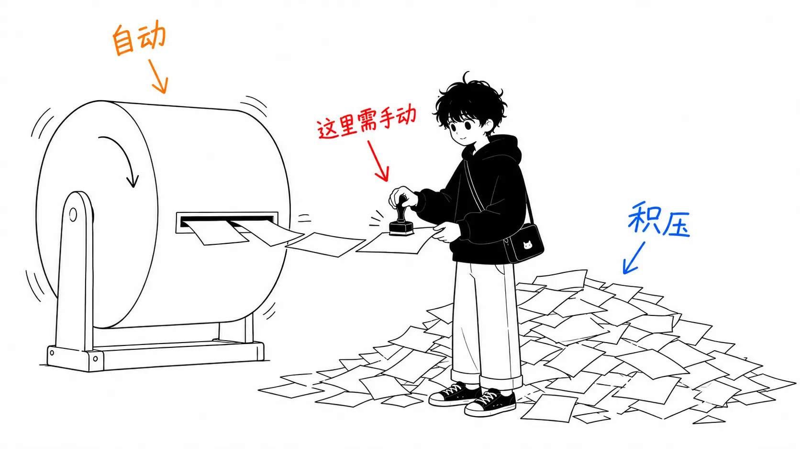
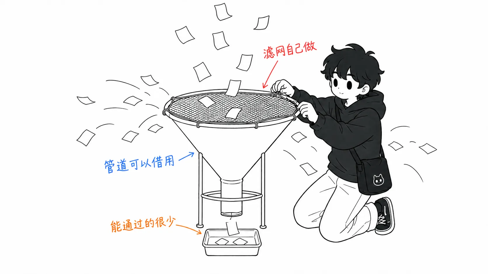

先把结论写在前面。

> Warp 的“自我改进智能体”所自动化的，只到**把反馈汇总成对 skill 的修改提案**为止。再往后，就是评审、批准、合并的普通 PR。这不是弱点，而是正确的设计。只是这样理解之后，成本里会多出一项。**需要评审的对象，除了代码，还多了“skill 的 PR”。** 而原文里分量最重的一句话，不在正文里，而在末尾 FAQ 表中的“要假定反馈是错的”。难点不在循环，而在入口。

## 关于这篇文章

- 原文：[How Warp builds self-improving agents on Claude](https://claude.com/blog/how-warp-builds-self-improving-agents-on-claude)，Michael Segner，2026 年 8 月 26 日（claude.com）

这是一篇案例文章，讲的是 AI 终端 Warp（2020 年创立，CEO 是 Zach Lloyd）从内部代码评审智能体的输出根本没法用起步，做出了基于 skill 的自我改进循环。

和上一篇一样，这是 Anthropic 自家博客的文章，把它当作厂商资料来读的方式也一样。开头罗列的数字（80 万月度开发者、财富 500 强中的 56%、在 Warp 内部累计运行了 1000 万次 Claude Code 会话、每周超过 40 万次）同样是自我陈述的数值，我没有验证。这一点上一篇已经写过，这次不再重复。**这篇文章的价值不在数字，而在机制很具体。**

坦白交代：文末链接的网络研讨会（带现场演示）我没有看。Warp 我也没用过。我读到的只有网页文章的正文。

## 机制真的很简单

先说机制。这部分很短。

- **inner / base skill**：持有领域知识和流程。PR 一打开，代码评审智能体就读取这个 skill，给出评审
- **人的反馈**：针对输出，人写下“不错”或者“这里不对，因为按我们的规范……”。写的地方是 PR 或 issue 的评论区，也就是工作本来就在发生的地方
- **outer / improver skill**：观察者智能体。它**按计划**运行，而不是每个任务运行一次。它把积累的反馈拉过来，把智能体的提案和人的反应对照起来，提出对 base skill 的**小而聚焦的修改**

skill 只是文件，所以这些修改会以 PR 的形式出现。评审、批准、合并。下次 inner skill 运行时，改进就已经生效了。

Zach Lloyd 的原话：

> “这个框架真的很简单：有一个领域专用的 base skill，还有一个负责打磨它的 improver skill。这种简单正是这个做法的美妙之处。”

确实简单。而且因为简单，所以能照着做。我老实觉得这是一篇好文章。

## 那么，“self-improving” 里自动的到底是什么

我被名字绊住了。

这个循环里机器做的，是**读反馈、写 diff、提 PR，到此为止**。什么内容会进入 base skill，是由最后批准的人来决定的。原文也是这么写的。

> A human reviews, approves, and merges, and the next run of the triage skill inherits the new knowledge. That final human step closes the loop and keeps a person in control of what actually changes.

所以准确地说，这**不是 self-improving，而是 auto-drafting**。不是自我改进，而是自动起草。

这不是批评。正因为最后站着一个人，这套机制才可用，如果 skill 自己擅自改写，没有人会把它放进生产环境。**我想说的是，名字把成本藏起来了。**

一听“自我改进”，感觉像是可以撒手不管。实际发生的恰恰相反，**评审队列会多出一条**。

- 以前：评审代码的 PR
- 引入之后：评审代码的 PR ＋ **评审 improver 提出来的 skill 的 PR**

而且后者的评审比前者更难。代码的 PR 只需要看“这个修改对不对”，而 skill 的 PR 要看的是“**这个泛化对不对**”。从一条反馈里提炼出的原则，应用到还没见过的下一百条上，会不会出问题？这是一类很难靠肉眼判断的问题。

拿原文的例子来说，流程是：triage 智能体漏打了 `ready to spec` 标签 → 维护者附上理由指了出来 → improver 提出了“只要问题确实存在，即使 UI/UX 的形态还没定，也打上 `ready to spec`”这样的修改。这个修改是否合理，**光看这一个案例是看不出来的**。合理与否，要由未来的 issue 来决定。

Warp 的规模扛得住这样的负担（开源仓库有数百名贡献者，有数千次代码评审）。**小团队引入这个循环，评审预算可能不够应付生成出来的 skill PR**，这是我的担忧。原文里没有提到这件事。

## FAQ 比正文更重

原文末尾有一张叫 “Best practices from the Warp team” 的问答表。最重的内容就在这里。

> **What happens when the feedback is wrong?**
> Assume it will be. Don't let the agent accept feedback blindly — give it context to sanity-check, filter whose input counts, and keep a human in the loop at either the filtering or final-review stage.

“要假定反馈是错的。”还有，“**要过滤谁的输入算数**”。

再来另一行：

> Where you must use human feedback, restrict it to domain experts — don't open the floodgates.

正文的主张是“让反馈容易收集，摩擦越低，信号越能流动”（Make feedback effortless to give）。FAQ 的主张是“收窄让谁的声音通过”。两者可以并存，但**方向并不相同**。一个说要把入口放宽，另一个说要在入口设置筛选。

我认为这两者之间的张力，是这套机制最难的地方。而且正文和 FAQ 对它们的着墨轻重正好相反。原因和我上一篇写的一样，**放宽的事好写，收紧的事难写**。

进一步说，这两者的可复用性不同。Zach 自己这样说：

> “除去领域专属知识的部分，这是个相当可复用的机制。代码评审智能体的 improver skill，和任何其他智能体的 improver skill 并没有太大差别。”

也就是说，**管道可以复用**。但过滤器不能复用。“谁的指正有资格进入 skill”，是因组织而异、不如说是因人而异的判断，没法复制。**简单的是管道，难的是入口。** 原文说“这种简单正是美妙之处”，指的是管道，这一点没错。只是借用管道的一方，必须自己做过滤器。

## 既不是 skill 也不是 memory 的第三种东西

FAQ 的第一行也很好，所以引一下。

> **Are you conflating skills with memory?**
> Skills are procedural and stable—"how to do X," run-agnostic, changed deliberately. Memory is auto-written by the agent at inference time and never stops changing.

skill 是流程性的、稳定的，不依赖具体的某次运行，是**有意地**被修改的。memory 是智能体在推理时自动写入的，变化永不停止。

这个区分本身以前就有人讲过，但有意思的是，**Warp 的循环造出了一种既不是这两者之一的第三种东西**。

| | 谁来写 | 何时变化 | 批准 |
| --- | --- | --- | --- |
| memory | 智能体 | 每次推理 | 无 |
| skill（传统） | 人 | 人编辑的时候 | 隐含的（写的那个人） |
| Warp 的循环 | 智能体起草 | 每次按计划运行 | **明确的 PR 评审** |

它把 memory 那种“由智能体来写”的性质，和 skill 那种“有意地变化”的性质结合了起来。会自动变化，但要变化就需要批准。

为什么这很重要？因为由此可以看出，**memory 难用的真正原因不是“自动”，而是“没有批准”**。我以前把 memory 功能当成“会擅自记住奇怪的东西，所以信不过”，但问题并不在自动写入本身，而是对写入没有否决权。Warp 的设计，在那里夹进了 PR 这个否决权。

这么一想，比起这篇文章标题里的 self-improving，我觉得 **“reviewable self-modification”（可评审的自我改写）** 更准确地指出了新在哪里。

## 把三篇摆在一起，是从三个方向到达同一个结论

这几天我碰巧读了三篇话题相近的文章。摆在一起，位置关系就清楚了，所以记下来。

**1. Warp（本文）：“写原则，而不是规则”**

> “像给聪明人下指示那样来构建 skill，而不是像给计算机编程那样。‘找出重复的代码’这样的指示，比罗列全部变量命名规则更能给出好的方向。”

接着说要附上理由（Explain the why）。有理由，智能体就能推理；只有规则的话就会僵化。

**2. Cainex（出自[面向初创公司的指南](https://claude.com/blog/claude-code-guide-for-startups)）：“要修原则，而不是修案例”**

一家医疗编码公司，通过把个别案例编码进去来“修复”，结果没有变聪明，反而攒了一堆补丁，这个原则正是从这次失败中得来的。他们**给一次修改中可以放入的个别事项的数量设了上限**。

**3. Maurice Heumann（审计 2GB 的会话日志）：“软性指示不起作用。机械式的拦截更有效”**

他反复对智能体说“不要在本地运行测试”，它不听，于是他在代码这一侧禁用了测试的运行。

1 和 2 说的是同一件事。**Warp 提供了机制，Cainex 提供了上限。** improver skill “提出最小的修改”，和 Cainex “限制可放入的具体例子的数量”，是对同一个问题的不同药方。两家独立的公司落在了同一个地方，我觉得这属于可以信任的一类。

3 乍看朝着相反的方向。skill 是软性指示，看上去和“软性指示不起作用”正面冲突。但摆在一起就能划出一条边界。

**能机械拦截的，不要写进 skill。写进 skill 的，只有无法机械化的判断。**

Heumann 消灭掉的全是可以机械化的东西（不要运行测试 → 禁用运行；不要轮询 CI → 用 webhook 通知；不要确认 issue 是否关闭 → 用 `Fix #N` 自动关闭）。而 Warp 的 skill 处理的是“这个变量名符合我们的规范吗”“这个 issue 到了可以开始写 spec 的状态吗”，这些是 hooks 判定不了的。

把这三篇压成一句话，我的理解是这样：**规则交给机器，原则交给 skill，而修改 skill 时，只从一条反馈中取最小的泛化。**

## 我实际会做的最小版

Warp 的规模没法照搬，所以能削的都削掉。

**要做的：把反馈攒在一个地方。** 这一点今天就能做到。决定好在你对智能体的输出想到“这不对，因为……”的那一刻，往哪里写。正如原文所指出的，**写的地方应该是工作正在发生的地方**，一旦让人去打开别的表单，就没人写了。

**不做的：把 improver 设成定时运行。** 那样 PR 队列会增加，我觉得一个人干的时候不划算。取而代之的是，自己决定什么时候去看攒下来的反馈，只在那时说一句“读一下这些，提出对 skill 的最小修改”。自动化的是提案的生成，不是运行的频率。就是这样切分。

**入口的规则：即使是自己写的反馈，也不要原样放行。** FAQ 里的“要假定反馈是错的”，读起来像是在说别人，但如果是一个人在干，对象就是自己。恼火时写下的“凭什么会变成这样”不是信号。我的反馈里大概有一半是这种。

## 如果只带走一件事

**要确认自动化到哪里为止，看边界，而不是看名字。**

“self-improving” 的实际边界，是“到起草 diff 为止”。确认了边界，就能看到边界之外还剩下什么（也就是自己要做的工作）。这次剩下的是**评审**，而且是“这个泛化对未来的输入是否正确”这种比代码评审更难判定的评审。

我认为值得引入。只是，增加的不只是 skill 的质量。

## 出处

- Michael Segner, [How Warp builds self-improving agents on Claude](https://claude.com/blog/how-warp-builds-self-improving-agents-on-claude), claude.com，2026 年 8 月 26 日
- Michael Segner, [The Claude Code guide for startups](https://claude.com/blog/claude-code-guide-for-startups), claude.com，2026 年 8 月 20 日（Cainex 的案例引自此处）
- Maurice Heumann, [235 Billion Tokens Later: Auditing What The AI Agents Really Did](https://momo5502.com/posts/2026-08-22-mw2-decompilation-audit/), momo5502.com，2026 年 8 月 22 日（在“把三篇摆在一起”一节中引用）

引用均出自以上来源。网络研讨会我没有看，Warp 本身我也没用过。开头的增长数值如原文所示，是自我陈述的数值，未经验证。从“那么，‘self-improving’ 里自动的到底是什么”一节开始的分析，以及对这三篇的定位，是我自己的读法，不是原文的主张。
